# Architecture Review

Status: Final package review. D-001 through D-103 are accepted, with scoped amendments noted; the consolidated architecture/delivery package is drafted and awaits Review 104.
Keep all requested services, technologies, and distributed-system patterns in scope.
Accepted scope addition: D-079 online single-use Venue Check-in within the original eight services. D-080 selects bearer credentials and D-081 selects entry/use policy; D-082 selects staff/scanner authority and conservative recovery; D-083 selects gate/enrollment capacity and operating targets; D-084 selects private artifacts and isolated rendering; D-085 selects historical notification channels and semantics; D-086 selects contact routing and Auth security-mail challenges; D-087 selects mailbox identity and retired-contact guards; D-088 selects MFA and independent recovery; D-089 selects notification delivery targets and free-mail gaps; D-090 selects Auth workload and abuse targets; D-091 selects certified Auth observations and primary grant boundaries; D-092 selects durable attempt guards and physical-resource fencing; D-093 selects deployment profiles and independent production placement; D-094 selects Patroni/etcd, independent fencing and safe write readiness; D-095 selects encrypted PITR and business-safe isolated restore; D-096 selects regional zero-loss critical history and useful recovery objectives; D-097 selects three-site remote WAL coverage and a bounded post-COMMIT capture lane; D-098 places one recovery-control voter per site and requires an independent two-of-three quorum; D-099 selects fenced new-cluster restoration after permanent quorum loss; D-100 selects prepare/commit/outcome reconciliation between the external authority journal and etcd; D-101 requires normal all-site journal durability; D-102 permits the exact fenced single-site recovery plan through both verified survivors. D-103 selects Go 1.27.2. The consolidated final package is the last interview round; implementation and capacity evidence remain unproved.
Keep the 1 million concurrent user target, zero overselling, and hold p99 below 200 ms.
The two-day implementation target is separate from later validation and deployment.
Free deployment limits must be documented against the production design.

## Review 001: Seat safety during failover
Status: Accepted as D-001. See [ADR-0001](adr/0001-seat-safety-contract.md).
Scenario: A receives a successful hold. Redis fails before replication. B sees the seat as available.
Decision: Two conflicting valid holds are forbidden, as are conflicting confirmed bookings.
Decision: Pause affected allocation writes when exclusive ownership cannot be established.
Trade-off: Safe rejection or delay can reduce availability and increase latency during failures.
Next dependency: Choose authoritative ownership and recovery guarantees after this contract is accepted.

## Accepted safety behavior
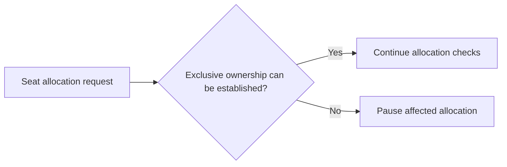

## Review 002: Authoritative seat ownership
Status: Accepted as D-002. See [ADR-0002](adr/0002-authoritative-seat-allocation.md).
Decision: Inventory/Seat Service alone writes durable allocation records in PostgreSQL.
Decision: A hold succeeds only after its authoritative transaction commits with the required durability.
Decision: Booking Service requests allocation changes through Inventory APIs.
Decision: Redis holds support atomic coordination, TTL tracking, and availability reads; they cannot override durable ownership.
Trade-off: Successful allocations require database writes. Admission control and measured capacity must bound contention.
Unresolved: Replication, safe promotion, stale-writer fencing, expiry semantics, and capacity limits.

## Accepted allocation ownership
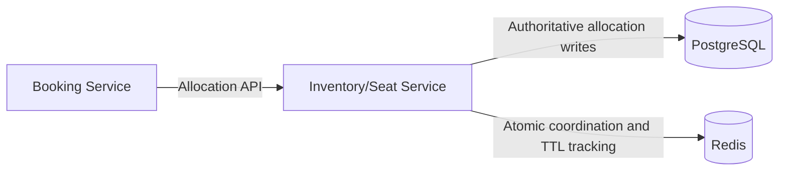

## Review 003: Durability under database host loss
Status: Accepted as D-003. See [ADR-0003](adr/0003-allocation-durability-under-host-failure.md).
Scenario: A receives hold success; the primary database host and its local storage become unavailable.
Decision: RPO zero for acknowledged allocations after loss of one database host, assuming a surviving durable synchronous copy.
Decision: Success requires durable WAL on the primary and at least one independent synchronous standby.
Decision: Promote only a safe candidate containing acknowledged writes; fence the former primary before accepting allocation writes.
Decision: Stop allocation when required durability or safe ownership cannot be established; do not silently switch to async writes.
Unresolved: Replica count, failure domains, failover mechanism, RTO, whole-region disaster recovery, and verified free deployment capacity.
Source: https://www.postgresql.org/docs/current/warm-standby.html#SYNCHRONOUS-REPLICATION

## Accepted durability requirement
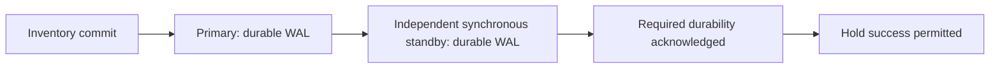

## Review 004: Payment versus reservation expiry
Status: Accepted as D-004. See [ADR-0004](adr/0004-bounded-payment-reservations.md).
Scenario: Checkout starts just before hold expiry; payment succeeds after the original hold deadline.
Decision: Before contacting the provider, atomically convert the user's unexpired hold into an exclusive payment reservation with a fixed bounded deadline.
Decision: Retries do not extend that deadline; request timeout means unknown payment outcome.
Decision: Confirmation and expiry compete through guarded authoritative allocation transitions; confirmed allocation cannot be released by stale expiry work.
Decision: At the payment deadline, end an unconfirmed reservation and make it eligible for release when safe; do not wait forever for the provider.
Decision: Late payment success cannot revive a closed allocation; void authorization or refund captured funds through durable compensation.
Unresolved: Deadline duration, provider capabilities, exact time checks, reconciliation, refund recovery, and multi-seat atomicity.

## Accepted checkout lifecycle
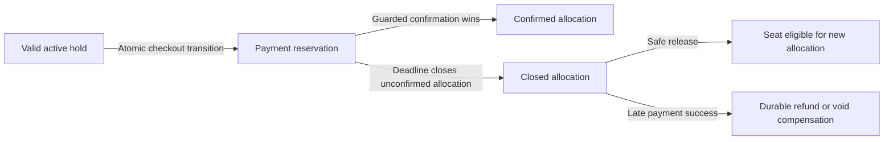

## Review 005: Payment provider eligibility and cost
Status: Accepted as D-005. See [ADR-0005](adr/0005-sslcommerz-sandbox-only.md).
Decision: Intended merchant country is Bangladesh; this delivery uses SSLCOMMERZ sandbox only.
Finding: Bangladesh is absent from Stripe's current supported merchant country list.
Finding: SSLCOMMERZ lists a BDT 25,500 setup fee and 2.5% standard successful-transaction fee; AMEX is 3.5%.
Finding: SSLCOMMERZ offers a sandbox for transactions without payment.
Historical follow-ups: D-022 selected BDT. D-069 now accepts an isolated supplemental provider test double; sandbox remains the external integration. Actual credentials and provider capabilities remain unproved.
Constraint: No live transactions in this delivery; keep future live requirements, onboarding, fees, and readiness gaps documented.
Sources: [Stripe availability](https://stripe.com/global), [SSLCOMMERZ pricing](https://sslcommerz.com/pricing/), [SSLCOMMERZ sandbox](https://developer.sslcommerz.com/registration/).

## Selected payment environment
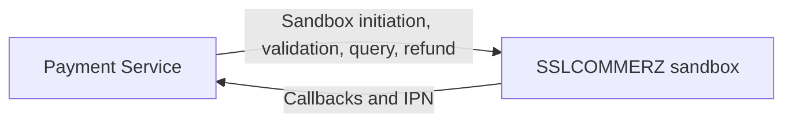

## Review 006: Payment initiation with an unknown result
Status: Accepted as D-006. See [ADR-0006](adr/0006-uncertain-payment-initiation.md).
Finding: The provider query API returns multiple attempts for one tran_id; a unique merchant transaction ID is not an exactly-once execution guarantee.
Decision: Persist one logical initiation identity before provider contact and serialize concurrent initiation requests for an order.
Decision: Replay known session results; client retries cannot create another initiation while the previous result is unknown.
Decision: After ambiguous dispatch or timeout, reconcile provider records instead of blindly replaying initiation; not-found alone is not proof of non-execution.
Decision: Reservation deadlines still close inventory independently; continue payment reconciliation and late-success compensation after closure.
Decision: Do not claim provider-side exactly-once behavior without a documented and validated contract; detect extra successful charges for compensation.
Unresolved: Safe terminal-state evidence, session recovery, refund retries, reconciliation cadence, and API idempotency retention.
Source: https://sandbox-gw.sslcommerz.com/docs

## Accepted payment initiation behavior
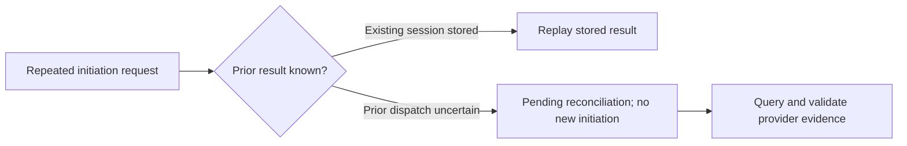

## SSLCOMMERZ validation requirement
Source contract: Browser redirects and IPN payloads alone do not prove payment success.
Source contract: Server-to-server validation must match the locally stored transaction ID, amount, and currency.
Source contract: VALIDATED can mean the transaction was already validated; it does not prove local booking completion.
Unresolved: Duplicate evidence handling, risk-level policy, receipt persistence, payment-to-booking recovery, and refund ambiguity.
Source: https://sandbox-gw.sslcommerz.com/docs

## Review 007: Saga ownership and crash recovery
Status: Accepted as D-007. See [ADR-0007](adr/0007-booking-saga-orchestration.md).
Scenario: Payment is verified, Inventory confirms seats, but Booking crashes before recording completed order state.
Decision: Booking Service owns a durable Saga; Payment owns external payment evidence and compensation execution; Inventory owns allocation transitions.
Decision: Each service persists its own state and reliable outbound work through a local transaction and Outbox; consumers deduplicate local effects.
Decision: Mark an order confirmed only after verified payment and matching authoritative inventory confirmation are durably established.
Decision: After an uncertain inventory response, reconcile the same reservation identity before retrying or compensating; confirmed allocation must not be mistaken for expiry.
Decision: Recover unfinished Sagas from durable state and reliable delivery, with no cross-service database writes or blind external payment retries.
Trade-off: Durable orchestration adds coordination state and recovery work; choreography distributes recovery reasoning across services.
Unresolved: Exact Saga states, transport per step, compensation ordering, service data isolation, and recovery-time objectives.

## Accepted Saga responsibilities
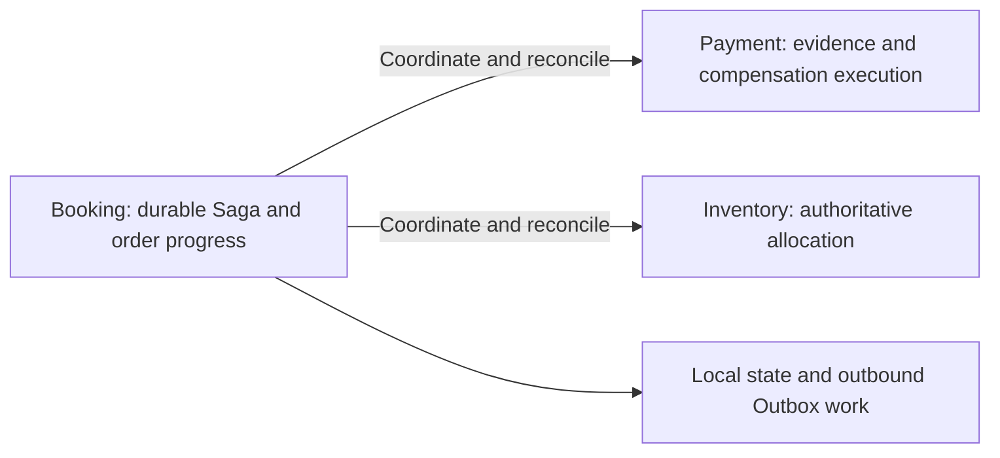

## Review 008: Atomic purchase unit
Status: Accepted as D-008. See [ADR-0008](adr/0008-atomic-seat-bundle-boundary.md).
Scenario: A requests four seats; one becomes unavailable while the group is being allocated.
Decision: One reservation and order target one event occurrence; the requested seat bundle succeeds entirely or fails entirely.
Decision: Hold acquisition, payment-reservation conversion, and allocation confirmation preserve bundle atomicity; no silent partial result or substitution.
Trade-off: A bundle conflicts if any requested seat is unavailable and can contend with other overlapping bundles.
Decision: Cross-event purchases use separate orders; cross-event all-or-nothing purchasing is outside this accepted contract.
Finding: PostgreSQL local transactions support all-or-nothing writes; Redis Cluster atomic multi-key operations require compatible hash-slot placement.
Unresolved: Bundle size limits, adjacency selection, general admission, and inventory partitioning.
Sources: [PostgreSQL transactions](https://www.postgresql.org/docs/current/tutorial-transactions.html), [Redis Cluster](https://redis.io/docs/latest/operate/oss_and_stack/reference/cluster-spec/).

## Accepted bundle boundary
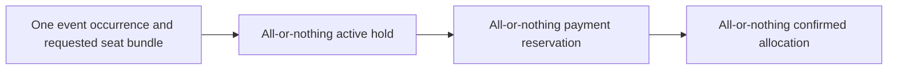

## Review 009: One million concurrent users and latency measurement
Status: Accepted as D-009. See [ADR-0009](adr/0009-million-user-workload-contract.md).
Decision: Design for one million simultaneously active client sessions aimed at the same flash sale, including waiting and admitted users.
Decision: Waiting Room bounds admitted checkout traffic by measured safe capacity; queue state alone does not prove active-user capacity.
Decision: Hold p99 below 200 ms applies after admission, from arrival at the API Gateway through the hold response, including internal queues and required durable commit.
Decision: Report successful holds, conflicts, overload rejections, timeouts, and errors separately; fast rejection cannot substitute for successful hold capacity.
Decision: Report queue wait, admission delay, external-network latency, arrival rates, throughput, active sessions, and load-generator limits separately.
Decision: Validate both concurrency and independent arrival-rate scenarios; report dropped work and measured limits alongside any extrapolation.
Unresolved: Arrival burst shape, active-session duration, request mix, polling or connection model, admission budget, numeric error objectives, and full SLO definitions.
Source: https://grafana.com/docs/k6/latest/using-k6/scenarios/concepts/open-vs-closed/

## Accepted admission boundary
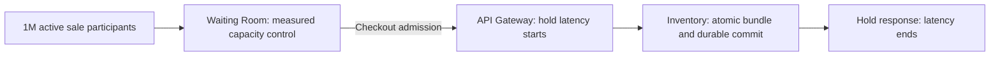

## Review 010: Waiting room activation before fairness
Status: Activation accepted as D-010. FIFO fairness accepted as D-011.
Clarification: Ordinary booking does not require scheduled sales opening. A flash sale can have a ticket-booking opening time, distinct from the event start time.
Clarification: The brief does not require a pre-sale waiting window or lottery; the user challenged this assumption.
Previous proposal: Randomize a pre-sale cohort once, then use FIFO after opening. This was not adopted; D-011 selects server-accepted FIFO.
Constraint: Waiting-room capacity control and D-009 remain accepted; they do not establish a lottery or pre-sale requirement.
Unresolved: Scheduled, manual, or load-triggered activation; admission ordering; eligible identity; reconnect behavior; recovery; and admission tokens.
Source: https://developers.cloudflare.com/waiting-room/reference/queueing-methods/

## Accepted activation contract
Decision: Enforce measured per-event and global admission budgets at all times; show waiting when new demand cannot be admitted safely.
Decision: Activate queueing automatically under excess demand or reduced safe capacity; expected scheduled sales may enable queueing in advance without a pre-sale lottery requirement.
Decision: Use resource and dependency signals with conservative hard limits; p99 alone is a lagging signal and cannot enforce a safe budget.
Decision: Stop new admission when capacity evidence is stale or ownership safety is uncertain; do not fail open.
Decision: Reserve bounded capacity for existing checkout, durable payment evidence ingestion, expiry, reconciliation, and compensation; unsafe operations still pause.
Decision: Use hysteresis and controlled recovery to prevent mode flapping or a synchronized queue release burst.
Decision: Operators may tighten queueing or pause admissions, but cannot bypass correctness or hard safety limits.
Unresolved: Numeric budgets, signal freshness, reserved-capacity sizing, fairness, sold-out handling, and admission credential lifecycle.
Source: https://sre.google/sre-book/handling-overload/

## Accepted automatic admission gate
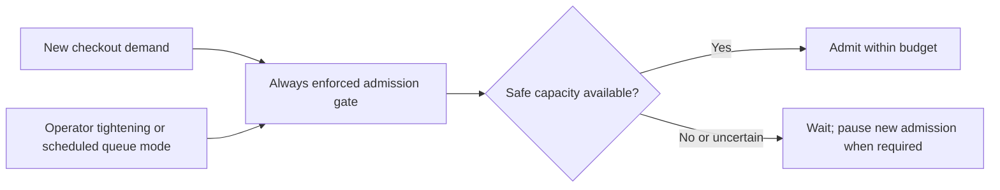

## Review 011: FIFO admission semantics
Status: Accepted as D-011. See [ADR-0011](adr/0011-server-accepted-fifo-admission.md).
Decision: For each event occurrence, admit valid eligible waiting entries by stable authoritative server acceptance order; no lottery.
Decision: Concurrent joins use an authoritative acceptance sequence, not client click time or unsynchronized per-node timestamps.
Decision: Refresh and reconnect reuse the same valid queue entry and priority; duplicate requests cannot create extra entries for the same eligible identity.
Decision: New arrivals cannot bypass earlier eligible waiting entries when capacity becomes available or queue mode changes.
Clarification: FIFO governs checkout admission, not seat selection, payment completion, or guaranteed ticket availability.
Trade-off: Precise ordering needs coordination during a single hot event; capacity must be measured rather than assumed from replica count.
Unresolved: Identity policy, ordering linearization and durability, failover, stale-entry expiry, admission lease expiry, and position display semantics.

## Accepted queue priority


## Review 012: Identity for queue and checkout
Status: Accepted as D-012. See [ADR-0012](adr/0012-account-bound-queue-and-checkout.md).
Decision: Allow anonymous event browsing and search; require an authenticated account to join the queue or allocate seats.
Decision: For each account and event occurrence, allow one active queue/admission lifecycle and one active checkout seat bundle.
Decision: Multiple tabs or devices reuse that account's valid entry and allocation; enforce the boundary server-side.
Decision: Bind admission permission to the authenticated account and event occurrence; a copied token alone cannot authorize another account.
Decision: Use IP and device signals for abuse controls, not as the sole identity or a hard IP binding for legitimate reconnects.
Clarification: This is account-level fairness, not proof of one real person per account; cumulative purchase limits and account-farming defenses need separate rules.
Trade-off: Login adds a dependency before queue entry and checkout; authentication capacity and abuse handling must be validated.
Unresolved: Account verification, authentication/session design, purchase quotas, account farming, identity changes, and exact lifecycle closure rules.

## Accepted identity boundary
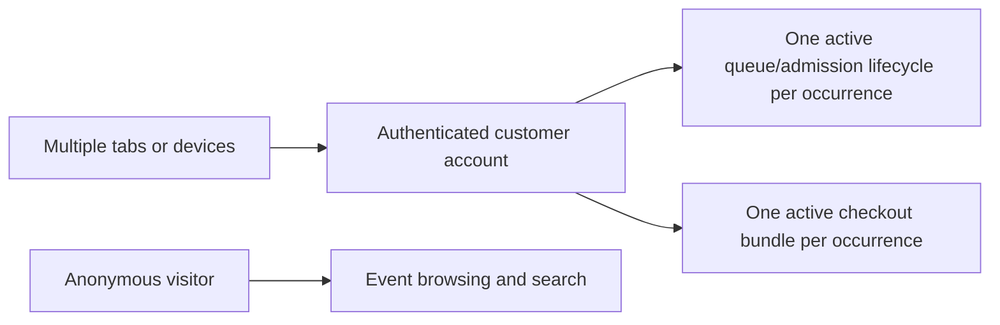

## Review 013: Admission capacity lease lifecycle
Status: Accepted as D-013. See [ADR-0013](adr/0013-admission-capacity-lease-lifecycle.md).
Decision: Bound both new-admission rate and active checkout slots with per-event and global limits.
Decision: Issue an account/event-bound admission lease with a fixed bounded window to begin checkout; retries cannot acquire another slot.
Decision: Reclaim an unused lease only when safe evidence proves no claim, in-flight allocation, or active reservation can still consume it.
Decision: Keep the slot counted during claiming, unknown allocation outcomes, active holds, and payment reservations; credential expiry alone cannot release it.
Decision: Reconcile a matching authoritative terminal allocation outcome before guarded, idempotent slot release; monetary recovery continues on its separate reserved budget.
Decision: An expired or retired lease cannot authorize new allocation; another purchase requires fresh admission subject to FIFO and future quota rules.
Trade-off: Conservative accounting can temporarily reduce admissions during uncertain outcomes, preventing unsafe capacity reuse.
Unresolved: Claim protocol across service ownership boundaries, storage, fencing, time windows, slot sizing, and hold-conflict retry behavior.

## Accepted admission capacity accounting
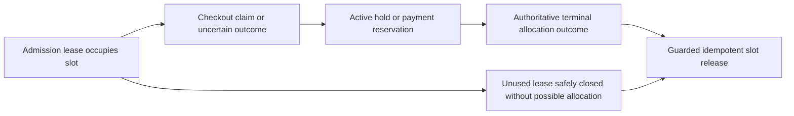

## Review 014: Queue and admission durability
Status: Accepted as D-014. See [ADR-0014](adr/0014-durable-queue-and-admission-state.md).
Decision: Waiting Room owns authoritative accepted FIFO entries and admission lease records in PostgreSQL; Redis provides fast projections and atomic coordination.
Decision: Acknowledge accepted joins and admissions only after durable commits with an independent synchronous copy, preserving acknowledged state after a covered single-host failure.
Decision: Fence stale writers and pause admissions when authority or lease accounting is uncertain; recover accepted priority and reconcile allocation claims before reusing capacity.
Decision: Never reset active capacity to zero or discard acknowledged queue priority merely because Redis lost data.
Trade-off: One million queue joins now require durable writes and authoritative ordering; ordering contention, ingress bursts, and replication latency require measured capacity and backpressure.
Clarification: Redis and PostgreSQL remain required; status polling should use projections. Physical database topology and exact ordering mechanism remain unresolved.
Unresolved: Queue ingress SLO, batching, ordering protocol, safe failover, recovery time, and achievable free-deployment failure domains; whole-region recovery is a separate decision.

## Accepted queue authority
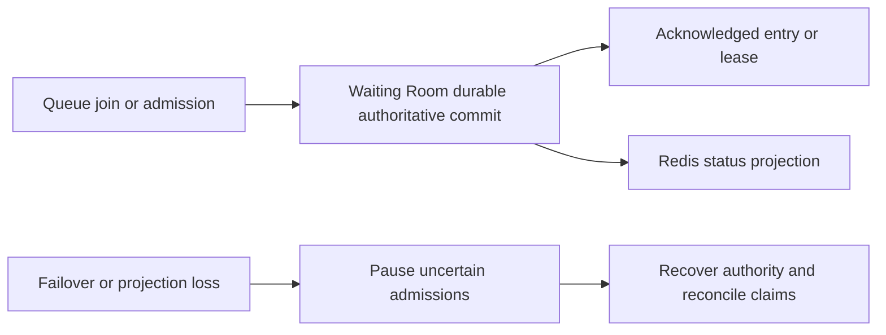

## Review 015: Checkout claim and late allocation safety
Status: Accepted as D-015. See [ADR-0015](adr/0015-durable-admission-claim-and-closure.md).
Decision: Waiting Room durably claims a lease for one stable checkout identity before allocation; claim and unused expiry are mutually exclusive local transitions.
Decision: Inventory owns a durable claim guard; allocation checks this guard and changes the complete seat bundle in one local transaction.
Decision: Closing a claimed workflow requires an Inventory barrier that rejects later allocation, including when the original command has not arrived; a not-found query alone is insufficient.
Decision: Keep the slot counted during unknown outcomes; release it only after matching durable closure and no remaining active allocation, with idempotent retries and stale-generation rejection.
Clarification: Each service writes only its own data; client credentials or a Redis TTL alone cannot prove safe closure. Closing a guard cannot prematurely free a valid hold or payment reservation.
Trade-off: Claims add coordination and durable work; the hold p99 target still applies, so critical-path placement requires measurement.
Unresolved: Transport, exact state machine, conflict retries, authority checks, generation format, record retention, and timeout values.

## Accepted claim closure boundary
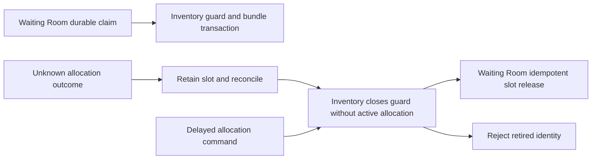

## Review 016: Authoritative expiry boundary
Status: Accepted as D-016. See [ADR-0016](adr/0016-authoritative-allocation-deadlines.md). D-017 resolves numeric durations.
Decision: Inventory owns fixed UTC allocation deadlines; use fresh primary database time after required locks, with time strictly before deadline required for hold conversion or payment confirmation.
Decision: Request arrival, client clocks, Redis TTL, transaction-start time, and provider timestamps cannot independently establish eligibility; only a successfully committed guarded transition counts.
Decision: Deadlines end eligibility even if cleanup is late; release or reclaim expired bundles through atomic Inventory closure and generation checks, preserving payment reservations and confirmed allocations.
Decision: Retries do not reset deadlines; clock health and failover safety must be established, otherwise pause affected time-sensitive transitions rather than revive closed allocations.
Clarification: A transition eligible at its guarded decision point may commit or respond after the deadline; delayed responses do not create a new reservation lifetime.
Trade-off: Lock waits or delayed payment evidence can miss the deadline; late verified success follows D-004 compensation rather than retrospective booking.
Unresolved: Clock error bounds, clock-health mechanism, cleanup SLO, and precise locking/transaction implementation. Hold and payment durations are resolved by D-017.

## Accepted deadline eligibility
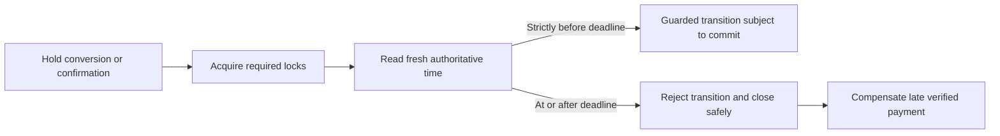

## Review 017: Initial hold and payment durations
Status: Accepted as D-017. See [ADR-0017](adr/0017-two-minute-holds-five-minute-payments.md). These are TicketForge defaults, not provider guarantees.
Decision: Set active hold duration to two minutes from its guarded Inventory creation time.
Decision: Set payment reservation duration to five minutes from its guarded conversion time, before provider initiation; initiation, user payment, validation, and Inventory confirmation eligibility consume this window.
Decision: Store fixed deadlines and the policy version; retries and refresh never extend them, and configuration changes apply to new reservations only.
Clarification: The nominal eligibility span of one hold-to-payment cycle can approach seven minutes; cleanup, blocked transactions, and unknown lease closure may retain resources longer.
Evidence: Checked SSLCOMMERZ docs describe EXPIRED sessions without establishing an exact hosted-session TTL or merchant-controlled expiry guarantee; verify actual sandbox behavior separately.
Trade-off: Longer windows retain scarce seats and capacity, while shorter windows can increase failed checkouts and late-payment compensation; these numbers require payment-duration and load measurements.
Unresolved: Admission-start window, conflict/reacquisition rules, purchase quotas, provider-session control, and evidence-driven future tuning.
History: The ten-minute hold and fifteen-minute payment recommendation was not accepted; the user chose two minutes and five minutes.

## Accepted reservation windows
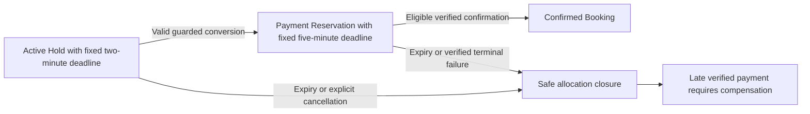

## Review 018: Conflict retries and reservation reacquisition
Status: Accepted as D-018. See [ADR-0018](adr/0018-conflict-retries-and-fresh-admission.md).
Decision: Before the first successful hold, allow rate-limited seat-choice retries only after known conflict outcomes and within the original bounded allocation-start window; do not reset that window.
Decision: During an unknown outcome, reconcile or replay the same request identity; a different request cannot bypass the unresolved allocation.
Decision: One admission permits at most one successful hold lifecycle; expiry, explicit cancellation, or verified terminal payment failure retires it after safe Inventory closure.
Decision: Subsequent seat acquisition needs fresh FIFO admission; refresh, replacement, or a new idempotency key cannot create another full hold window under the retired admission.
Clarification: Browser cancel or failure redirects alone do not prove terminal payment failure; valid reservations retain their existing protection until authorized closure.
Trade-off: Reacquisition costs queue priority, while ordinary seat conflicts before successful allocation do not force immediate requeue.
Unresolved: Allocation-start window duration, retry rate and budget, purchase quotas, and any separately approved seat-amendment workflow.

## Accepted conflict and reacquisition boundary
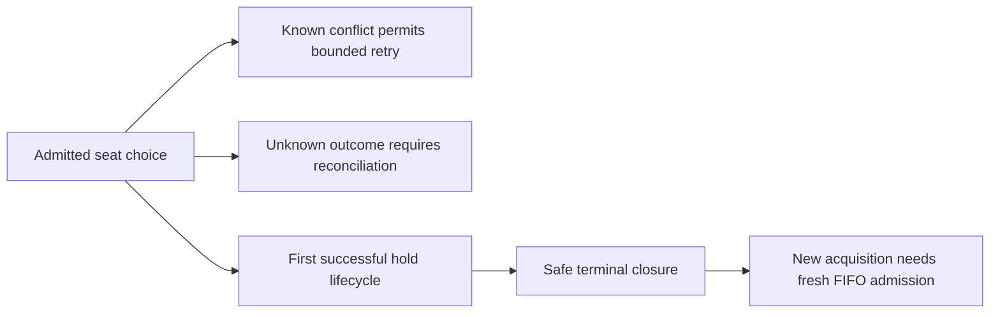

## Review 019: Selection window and attempt budget
Status: Accepted as D-019. See [ADR-0019](adr/0019-selection-window-and-attempt-budget.md).
Decision: Allow sixty seconds from durable admission issuance to obtain the first successful hold; refresh, claims, and conflicts cannot restart the selection deadline.
Decision: Permit at most five distinct logical allocation attempts, including the first, and at most one in flight per admission; allow a new choice only after a known conflict.
Decision: Limit new logical allocation attempts to one per second per account/event, without burst accumulation or reset through requeue; event/global resource budgets can tighten admission further.
Decision: Idempotent replay and reconciliation do not consume another logical attempt or extend deadlines, but have separate bounded request and recovery budgets.
Decision: Enforce deadline and attempt limits authoritatively; at exhaustion without a successful hold, close safely and require fresh FIFO admission while retaining slots during unknown outcomes.
Clarification: A successful hold obtained within the selection window starts its own two-minute deadline; payment conversion starts its five-minute deadline. These windows have different purposes.
Trade-off: A short selection window and limited conflicts can requeue customers under hot-seat contention; rejected requests and replays still cost resources and require ingress backpressure.
Unresolved: Budget implementation, clock checks across service boundaries, overload response semantics, purchase quotas, and measured tuning evidence.

## Accepted selection limits
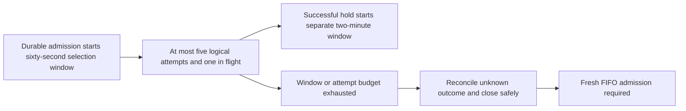

## Review 020: Seat bundle and cumulative purchase quota
Status: Accepted as D-020. See [ADR-0020](adr/0020-atomic-inventory-purchase-quota.md).
Decision: Use configurable per-occurrence defaults of four seats per bundle and four cumulative confirmed tickets per account; confirmed plus active reserved units must not exceed the account quota.
Decision: Inventory owns authoritative account/occurrence quota accounting and reserves units in the same local transaction as the all-or-nothing seat bundle allocation.
Decision: Hold-to-payment conversion keeps the same reserved units; confirmation moves them to confirmed consumption exactly once, while safe unconfirmed closure releases them exactly once.
Decision: Tabs, replicas, requeue, and new idempotency keys cannot bypass the quota; reject an oversized requested bundle without silent partial allocation.
Clarification: Booking/Redis/Kafka projections can display or precheck entitlement but cannot independently authorize quota; refund notification alone cannot restore confirmed purchase entitlement.
Trade-off: Inventory gains account-level contention and durable accounting; a four-ticket default restricts large groups, and account farming remains a separate defense problem.
Unresolved: Policy publication and update protocol, post-confirmation cancellation/restoration rules, anti-farming controls, and any distinct group-sales policy.

## Accepted purchase quota accounting
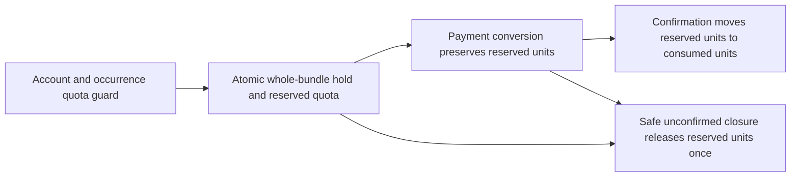

## Review 021: Price ownership and immutable checkout quote
Status: Accepted as D-021. See [ADR-0021](adr/0021-immutable-checkout-quote.md).
Decision: Event and Venue owns pricing definitions; Inventory allocates against an activated pricing version in its own durable state, without a catalog dependency on every hold.
Decision: Check the customer's expected pricing version and persist the exact bundle, currency, line items, TicketForge-defined fees/taxes, total, and pricing version atomically with a successful hold.
Decision: Reject stale accepted prices for explicit customer reconfirmation without silently allocating or charging at a different price; replays retain the original outcome, and selection deadlines do not extend.
Decision: Preserve that quote throughout the valid hold and its payment reservation; Booking stores the matching order snapshot, and Payment initiates and validates against the trusted server-side snapshot.
Decision: Require matching provider transaction identity, successful verified status, customer payment amount, and currency; merchant net settlement is not the checkout amount, and mismatches cannot confirm a booking.
Trade-off: Published price updates must coordinate with executable Inventory versions; existing valid quotes retain old prices, and payment mismatches need financial recovery.
Unresolved: Currency and money representation, fee/tax policy, publication/update protocol, reconfirmation retry classification, fraud-risk handling, and mismatch recovery details.

## Accepted quote ownership
```mermaid
flowchart LR
    E[Event and Venue pricing definition] --> I[Activated durable Inventory version]
    I --> H[Hold and immutable checkout quote]
    H --> B[Matching Booking order snapshot]
    B --> P[Payment initiation and server validation]
    P -->|Matching identity amount currency and success| S[Eligible Inventory confirmation]
```

## Review 022: Currency and exact money contract
Status: Accepted as D-022. See [ADR-0022](adr/0022-bdt-and-exact-money.md).
Decision: Use BDT for this Bangladesh sandbox delivery, retaining an explicit currency field in every quote, order, payment, event payload, and refund; reject unsupported currencies explicitly.
Decision: Represent BDT as checked signed 64-bit integer paisa internally; send and parse provider decimal strings exactly without binary floating point or approximate matching.
Decision: Compute fractional fee/tax components with exact arithmetic, round half-up once per line to paisa, and sum already-rounded lines without rounding the total again; snapshot the rounding policy.
Decision: Reject fractional-paisa monetary inputs, invalid or overflowing values, and payable bundle totals outside documented provider bounds before successful allocation; do not clamp prices or split one order into payments automatically.
Evidence: SSLCOMMERZ documents two-decimal total_amount with BDT 10.00 to BDT 500000.00 limits and converts non-BDT initiation currencies to BDT; verify actual sandbox boundaries separately.
Clarification: These are transaction-total bounds, not per-seat bounds. Refunds use the same exact representation and original currency; financial ledger and refund concurrency rules need a separate decision.
Trade-off: This delivery has no foreign-exchange checkout; any later currency requires explicit exponent, conversion, settlement, and validation rules without changing the typed-money model.
Unresolved: Fee/tax business policy, supported refund amounts, exact provider field normalization, and mismatch/recovery handling.

## Accepted exact money flow
```mermaid
flowchart LR
    Q[BDT quote in integer paisa] --> P[Exact provider decimal serialization]
    P --> V[Verified amount parsed exactly]
    V --> E[Exact identity amount and currency comparison]
    Q --> R[Refund in original currency and exact units]
```

## Review 023: Charge and compensation recovery
Status: Accepted as D-023. See [ADR-0023](adr/0023-charge-level-compensation-ledger.md).
Decision: Payment owns unique verified charge records and refund intents, durably committed with an independent synchronous copy before acknowledgment or refund dispatch under the covered single-host failure contract.
Decision: For an authenticated charge linked to a known order, target full original-charge refunds for amount mismatch, extra charges, or late success without confirmed allocation; do not fulfill partially or collect a top-up automatically.
Decision: Apply at most one eligible exact quote-matching charge to an order; reconcile unknown Inventory confirmation before treating that charge as unfulfilled, and preserve a valid booking when refunding extra charges.
Decision: Serialize each charge's refund work with stable intent identities and deduplicated local effects; completed plus pending or unknown refund amounts cannot exceed the verified original charge.
Decision: Refund initiation is not completion; query final outcome, and never blindly re-dispatch an ambiguous initiation without proven non-execution or a validated provider idempotency guarantee.
Decision: Keep unresolved obligations in durable reconciliation with alerts and evidence-based operator recovery; quarantine unmatched or untrusted transaction identities rather than refunding supplied bank IDs automatically.
Evidence: SSLCOMMERZ documents refund_trans_id and query by refund_ref_id, but the checked material does not establish safe replay or recovery of a lost reference; this is a capability dependency to resolve in sandbox.
Trade-off and unresolved: Recovery can remain pending without provider evidence; resolve replay/reference recovery, refund limits/fees, recovery SLOs, financial failover, fraud risk, and post-booking cancellation before claiming monetary recovery guarantees.

## Accepted refund recovery boundary
```mermaid
flowchart LR
    C[Distinct verified charge] --> L[Durable charge and refund ledger]
    L --> D[Guarded refund dispatch]
    D --> P[Provider processing or unknown outcome]
    P --> R[Evidence-based reconciliation]
    R --> F[Verified completed refund]
    R --> U[Unresolved obligation remains durable and alerted]
```

## Review 024: Kafka delivery and consumer correctness
Status: Accepted as D-024. See [ADR-0024](adr/0024-idempotent-kafka-consumer-effects.md). Pure presence projection delivery is specialized by [D-064](adr/0064-coalesced-presence-projection-and-immutable-lifecycle-events.md); critical event history remains unchanged.
Decision: Use at-least-once delivery with stable event identity; producer business state and Outbox work commit together, and the relay preserves each aggregate's revision order while retrying publication safely.
Decision: Consumers use a transactional Inbox: deduplication, guarded local effects, and resulting Outbox work commit together; no payment-provider call occurs inside that transaction.
Decision: Advance Kafka offsets only after the required durable local commit and only across a contiguous safely handled range; missing prerequisites may be durably parked with distinct received/applied states and reliable local recovery.
Decision: Key each topic by its owning aggregate's stable identity and carry owner revision plus workflow correlation; do not assume global or cross-topic order or that one whole event must share one partition.
Decision: Reject stale or invalid transitions, retain revision gaps and causal dependencies for bounded reconciliation, and preserve terminal allocation/financial decisions during duplicate or delayed delivery.
Clarification: Kafka producer idempotence or transactions do not alone make PostgreSQL effects or provider calls exactly once; D-006 and D-023 still govern monetary dispatch.
Trade-off: Inbox state, ordered relay, and pending-event recovery add durable writes and lag; critical events cannot disappear through an offset advance or blind skip.
Unresolved: Broker acknowledgments/replication, concrete topics/keys, retention and replay horizon, poison-event isolation, pending-event bounds, schema evolution, and transport per Saga step.

## Accepted event processing boundary
```mermaid
flowchart LR
    P[Business state plus Outbox commit] --> K[Kafka may redeliver]
    K --> C[Inbox plus guarded effects plus Outbox commit]
    C --> O[Advance contiguous safe offsets]
    C --> R[Durable pending prerequisites and recovery]
    R --> C
```

## Review 025: Kafka durability under a broker-host failure
Status: Accepted as D-025. See [ADR-0025](adr/0025-kafka-durability-and-publication-pause.md).
Decision: Critical topics use replication factor 3 across independent hosts, acks=all, minimum in-sync replicas 2, and explicitly enabled producer idempotence with compatible client settings.
Decision: Disable unclean leader election; audit and test the chosen version's Eligible Leader Replicas behavior so failover preserves acknowledged records rather than promoting a stale copy.
Decision: Production has three KRaft controllers with majority availability and separate broker/controller roles; place controller voters so one covered host failure cannot remove their majority.
Decision: Insufficient safe replication pauses publication; keep unacknowledged or ambiguous Outbox work pending with its stable identity, and never lower durability to drain the backlog.
Decision: Bound Outbox growth with lag/storage admission thresholds; preserve independently safe payment ingestion, expiry, and reconciliation within reserved capacity, without extending allocation deadlines.
Clarification: Kafka acknowledgment does not imply per-record fsync on every replica; this contract covers one host loss with surviving replicas, not simultaneous cluster power/storage loss or regional disaster.
Trade-off: RF3 consumes replicated storage and network; local containers test logical broker failures, while independent-host guarantees require actual placement and failure tests.
Unresolved: Kafka/client version and ELR settings, internal-topic durability, physical placement, free-cloud capacity, backlog thresholds, retention/rebuild policy, failover RTO, and cluster-wide disaster recovery.

## Observed Oracle Always Free limits — 2026-10-11
Status: Provider documentation checked; actual tenancy entitlement, resource availability, and full-stack capacity are not verified.
Compute: A1 monthly allowance is 1,500 OCPU-hours and 9,000 GB-hours, described as 2 OCPU and 12 GB RAM across up to two A1 instances; up to two E2.1.Micro instances each have 1 GB RAM and 1/8 OCPU baseline.
Storage: 200 GB combined boot/block volumes and five volume backups in the home region; the page gives both 47 GB and 50 GB boot guidance, so use the conservative 50 GB guidance until Console verification.
Availability: Free shapes can be out of capacity, idle instances can be reclaimed, and E2 micro placement is limited to one availability domain in multi-domain regions.
Engineering impact: Three broker copies, controller quorum, synchronous PostgreSQL copies, Kubernetes, search, and observability compete for a small shared CPU/RAM/storage budget; independent-host and zone placement cannot be assumed.
Production approach: Independently placed brokers and controller quorum, correctly fenced database replicas, resource isolation, and measured capacity with headroom remain required.
Closest free approach: Self-host the full stack locally for staged process/network failures, then assess an all-free cloud topology using actual quotas and measurements; label shared-host and insufficient-capacity validation gaps explicitly.
Preserved requirements: Keep Kafka durability, all services/technologies, and the 1M target; free deployment does not establish production throughput, 99.9% availability, or independent-host recovery by itself.
Source: https://docs.oracle.com/en-us/iaas/Content/FreeTier/freetier_topic-Always_Free_Resources.htm

## Accepted Kafka publication boundary
```mermaid
flowchart LR
    O[Durable pending Outbox] --> G{Safe replicated publication available}
    G -->|Yes| K[Replicated Kafka acknowledgment]
    K --> A[Record publication acknowledgment]
    G -->|No or uncertain| P[Retain same event identity and apply backpressure]
    P --> O
```

## Review 026: Critical-event retention and safe replay
Status: Accepted as D-026. See [ADR-0026](adr/0026-critical-retention-and-guarded-replay.md).
Decision: Target seven days of critical Kafka log retention from broker append time; preserve separate original business timestamps, and do not use broker timestamps for seat eligibility.
Decision: Each owner retains exact critical event envelopes in its durable Outbox/history for at least thirty days after acknowledged publication; preserve stable event IDs, owner revisions, and schema versions during replay.
Decision: Never age out unpublished/uncertain Outbox work, unapplied Inbox work, open Sagas, unresolved charges/refunds, or recovery gaps; alert and apply admission backpressure before storage exhaustion.
Decision: Retain processed Inbox identities for at least thirty days after their latest receipt and through any active replay; financial business identities and allocation closure/generation guards have no automatic time-based purge until safe lifecycle/restore rules are proven.
Decision: Critical consumers use auto.offset.reset=none with explicit initial checkpoints; detect missing offsets or retained-log gaps, pause affected processing, and reconcile/replay from durable owner records rather than silently starting at latest.
Decision: Recovery preserves business guards and provider dispatch fences; projection rebuilds run with external effects disabled, and older-than-archive recovery needs verified owner snapshots/history plus an explicit rebuild plan.
Trade-off: Time and byte retention limits act independently; size capacity must support the agreed horizon at measured rates with RF3 and headroom, and free deployments must disclose any inability to satisfy it without silently shrinking the contract.
Unresolved: Storage budgets and archive durability/backup, exact replay authorization/checkpoints, gap detection, schema compatibility, poison-event isolation, safe guard deletion, and disaster recovery objectives.

## Accepted recovery boundary
```mermaid
flowchart LR
    K[Kafka log gap detected] --> P[Pause affected processing]
    P --> H[Owner history or verified rebuild sources]
    H --> G[Original identity plus business guards]
    G --> R[Reconcile and resume safely]
    G --> B[Projection rebuild with external effects disabled]
```

## Review 027: Poison-event isolation without losing workflow correctness
Status: Accepted as D-027. See [ADR-0027](adr/0027-workflow-aware-quarantine.md).
Decision: Separate isolated transient failures, malformed/unsupported events, missing prerequisites, and dependency-wide outages; duplicates/stale events and expected business refusals use normal guarded outcomes, and database outages are not many poison events.
Decision: Isolated transient failures get at most five total automatic processing attempts with persisted counters and exponential jittered delays of up to 1/2/4/8 seconds; redelivery/restarts cannot reset the budget, and provider dispatch follows D-006/D-023 separately.
Decision: Deterministic malformed/unsupported events quarantine immediately; exhausted isolated failures quarantine after the retry budget; missing prerequisites remain durable pending work with reconciliation rather than being marked applied or discarded.
Decision: Atomically commit original bytes/metadata, failure state, trustworthy aggregate/dependency blocking, and Outbox work for an optional DLQ mirror in the consumer database before advancing contiguous safe offsets; quarantine is received, not applied.
Decision: Continue independent aggregates while durably parking dependent later events; if identity/order dependencies cannot be established, quarantine cannot commit, or safe storage headroom is exhausted, pause the affected partition and apply backpressure.
Decision: Dependency-wide outages pause affected processing with backoff/circuit breaking; independently safe expiry/reconciliation remains active and original seat/payment deadlines remain unchanged.
Decision: Alert on quarantine and track blocked workflow age; authorized audited recovery reprocesses unchanged original identities after a handler fix, while wrong producer facts require a new owner-issued correction event rather than rewriting history.
Trade-off and unresolved: Durable quarantine is authoritative and does not expire unresolved work; DLQ delivery alone is not recovery. Resolve numeric backlog/headroom limits, alert/escalation SLOs, dependency mappings, replay roles, schemas, and recovery commands.

## Accepted quarantine boundary
```mermaid
flowchart LR
    F[Isolated event cannot be applied] --> Q[Durable quarantine plus dependency block]
    Q --> O[Advance only contiguous safe offsets]
    O --> I[Independent orders may proceed]
    Q --> D[Dependent events remain pending]
    D --> R[Audited recovery with original identity]
```

## Review 028: Event schema evolution and rolling deployment safety
Status: Accepted as D-028. See [ADR-0028](adr/0028-versioned-event-contracts-and-compatible-rollouts.md).
Decision: Use binary Protobuf for Kafka contracts, with owner-controlled versioned schemas, generated Go/Java types, and pinned local code-generation/runtime tooling; this does not choose interservice RPC transport.
Decision: A stable validated envelope carries event identity/type, contract version, owner aggregate/revision, workflow correlation/causation, and original occurrence time; version is distinct from aggregate revision and replay keeps exact original bytes.
Decision: Within one contract major version, permit only changes safe for both deployed/rollback readers and business meaning; preserve existing field types, tags, units, enum meanings, and semantics, reserve removed tags/names, and do not silently add mandatory rules.
Decision: Required business fields use explicit presence and validation; unspecified/unknown financial enums never mean success, safely ignorable additive fields may be tolerated, and unsupported critical contracts follow D-027 quarantine.
Decision: CI uses local open-source Buf lint/breaking checks plus semantic contract fixtures and mixed-version/replay tests against supported released contracts; wire compatibility alone does not prove money or state-transition correctness.
Decision: Deploy compatible consumers first, verify readiness, then enable producer output; breaking changes need a new event contract major/type and a controlled cutover, with business identities preventing duplicate effects during any overlap.
Decision: Keep readers/descriptors for thirty-day archived versions and all unresolved older work; define a tested compatibility release as the rollback floor and refuse rollback to binaries that cannot safely handle emitted contracts or durable workflow states.
Trade-off and unresolved: Protobuf generation and multi-version readers add tooling and maintenance; Git-versioned schemas and local Buf need no paid registry, while exact envelopes, compatibility baselines, contract migration, database expand/contract, deployment gates, and rollback procedures remain unresolved.

## Accepted contract rollout boundary
```mermaid
flowchart LR
    C[Schema and semantic checks] --> R[Deploy compatible readers]
    R --> V[Verify mixed-version and replay safety]
    V --> P[Enable producer contract]
    P --> F[Retain readers and tested rollback floor]
```

## Review 029: Database migration and rollback without losing acknowledged work
Status: Accepted as D-029. See [ADR-0029](adr/0029-staged-migrations-and-safe-release-recovery.md).
Decision: Each owner has versioned checksummed migrations and one serialized migration runner using scoped credentials/locking; application replicas check supported schema ranges and do not independently run concurrent DDL or write other owners' data.
Decision: Use expand, migrate, validate/cut over, then contract; preserve old authoritative representation while old writers exist, use atomic owner-local bridge writes, and run resumable throttled backfills guarded against overwriting concurrent updates.
Decision: Cutover requires writer/reader compatibility, data parity, valid replacement safety constraints, and resource/SLO headroom; destructive cleanup waits until rollback and retained/unresolved recovery dependencies no longer need the old representation.
Decision: Preserve seat exclusivity, claim/generation fencing, account quota, financial uniqueness, Outbox/Inbox atomicity, immutable quote/history meaning, and original deadlines; validate equivalent replacement guards before retiring existing ones, and migrations never initiate provider calls.
Decision: Use bounded DDL lock/statement waits and capacity-aware scheduling, keep unvalidated heavy DDL away from active flash sales, and use applicable concurrent index/staged constraint operations with explicit partial-failure inspection and recovery.
Decision: Roll back application code only to a tested compatible release, otherwise forward-fix; do not automatically down-migrate applied schemas or restore an old live snapshot to undo a release. Uncommitted transactional DDL may still roll back normally.
Decision: Database restore is a separate disaster-recovery operation with writer/provider-dispatch fencing, isolated verification, and allocation/financial/event reconciliation before writes resume; backup existence does not establish RPO/RTO or recoverability.
Trade-off and unresolved: Bridge releases, retained structures, backfills, WAL/replication load, and migration jobs cost time/capacity; mixed-version, interrupted-migration, and restore tests are required, while tooling, numeric budgets, physical ownership, backups, RPO/RTO, and recovery commands remain unresolved.

## Accepted migration boundary
```mermaid
flowchart LR
    E[Expand compatible structures] --> M[Bridge writers and guarded backfill]
    M --> V[Validate parity guards and capacity]
    V --> S[Switch compatible writers and readers]
    S --> C[Contract after recovery dependencies end]
    S --> R[Compatible application rollback or forward repair]
```

## Review 030: Service-owned databases and physical isolation
Status: Accepted as D-030. See [ADR-0030](adr/0030-service-database-ownership-and-deployment-isolation.md).
Decision: Use one logical PostgreSQL database per state-owning service with distinct scoped runtime and migration identities; revoke unintended cross-database access, keep runtime identities non-owner/non-superuser, and audit isolation in tests.
Decision: Services own only their state and local Outbox/Inbox/recovery records; no cross-service SQL reads/writes, foreign keys, joins, or shared transactions authorize workflows, and API Gateway has no domain SQL authority.
Decision: Cross-owner references are stable identities reconciled through authorized service contracts/events; service-owned projections can copy needed facts but cannot become another owner's allocation or financial authority.
Decision: The production design provides independently scalable PostgreSQL HA deployments for critical/hot owners, especially Inventory, Waiting Room, Booking, and Payment; exact partitioning and node counts require workload and failure analysis.
Decision: A documented local/free resource profile may co-locate logical databases on shared physical PostgreSQL infrastructure, preserving all service boundaries and acknowledging shared CPU/disk/WAL/checkpoint, connection, failover, and physical-restore blast radius.
Decision: Critical acknowledged writes still need required primary/independent synchronous durability and fencing; shared-host replicas or missing safe synchronous copies cannot be presented as satisfying covered host-loss contracts or silently changed to async.
Decision: Bound connection pools per replica and total deployment, account for autoscaling/jobs, reserve recovery/operator capacity, and reject excess work before the database connection/CPU/storage budget is exhausted.
Trade-off and unresolved: Logical isolation does not prove resource isolation, continuous failover write availability, or 1M capacity; verify actual free topology and retain unmet production gaps. Resolve pool/resource numbers, failover design, physical restore/migration, replica routing, and sharding without splitting an atomic seat bundle.

## Accepted critical SQL ownership

| Service | Owns |
| --- | --- |
| Inventory | Event-seat allocations, claim guards, quota accounting, checkout quotes |
| Booking | Orders, booking workflow state, Saga progress |
| Payment | Payment attempts, verified charges, refund intents and recovery |
| Waiting Room | Accepted FIFO entries, admission leases and claims |

## Accepted supporting SQL ownership

| Service | Owns |
| --- | --- |
| User/Auth | Customer accounts and authentication state |
| Event and Venue | Event/venue definitions and pricing definitions |
| Notification | Durable notification work and delivery outcomes |

## Accepted SQL authority boundary
```mermaid
flowchart LR
    I[Inventory] --> IDB[Inventory database]
    P[Payment] --> PDB[Payment database]
    I <-->|Authorized contracts and events| P
    IDB -.-> H[Physical placement varies by documented profile]
    PDB -.-> H
```

## Review 031: Safe PostgreSQL failover and post-failure write capacity
Status: Accepted as D-031. See [ADR-0031](adr/0031-safe-postgresql-failover-and-write-capacity.md).
Decision: Production critical PostgreSQL HA groups have at least three data nodes on independent hosts, with enough surviving capacity after one host fails; a witness/controller is not an additional durable data copy.
Decision: Critical acknowledgments require primary WAL durability plus at least one independent synchronous standby, never off/local or automatic async downgrade; promote only a candidate proven to preserve acknowledged history on the correct timeline.
Decision: Use a tested majority-backed HA controller with strict synchronous behavior and verified fencing of the former writer before safe promotion; stale pooled sessions and process hangs must not preserve a second writable primary.
Decision: Resume critical success only with safe leadership and an independent synchronous follower established; invalidate stale primary routes/connections, and stop new critical success when leadership, fencing, or durability is uncertain.
Decision: Treat cancelled/timed-out COMMIT as an unknown outcome; visible SQL rows do not prove synchronous durability, so external Outbox publication and payment/refund dispatch require a verified durability barrier, whose exact protocol remains unresolved.
Decision: Use a free self-hosted implementation where feasible; fewer independent data hosts may protect acknowledged data but cannot claim the same post-failure write availability, and same-host containers do not validate host-loss guarantees.
Decision: Validate primary/standby loss, partitions, process hangs, stale sessions, and cancelled sync waits with correctness and recovery metrics; no unsafe manual promotion, silent durability downgrade, or claim that configuration alone proves RPO/SLO compliance.
Trade-off and unresolved: Extra replicas, quorum infrastructure, fencing, and sync flush add resource and latency costs. RTO, controller/tool versions, durability-barrier protocol, failure-domain placement, pool routing, and free-profile feasibility need explicit validation; original 1M, p99, and availability targets remain.

## Accepted failover success boundary
```mermaid
flowchart LR
    F[Failure or uncertain leadership] --> S[Pause new critical success]
    S --> C[Prove candidate history and fence former writer]
    C --> P[Safely promote and invalidate stale connections]
    P --> R[Establish independent synchronous follower]
    R --> W[Resume eligible critical success]
```

## Review 032: Durability barriers for replay and external dispatch
Status: Accepted as D-032. See [ADR-0032](adr/0032-verified-commits-and-logged-write-durability-barriers.md). The inferred protocol still needs implementation and fault validation.
Decision: Centralize critical write COMMIT handling with synchronous_commit=on, verified strict HA configuration and storage durability; success requires completed replication wait, not just a command tag or a driver returning no error, and cancelled wait warnings/connection failures remain unknown.
Decision: The original caller may authorize its guarded result from a verified synchronous business COMMIT; request cancellation cannot erase the work or authorize a fresh identity, deadline extension, seat release, or blind provider retry.
Decision: A replay/recovery worker reads and revalidates the relevant owner-local records on the safe primary, then performs a real logged persistent write in that same guarded transaction and physical database session, and waits for verified synchronous COMMIT before critical success or external dispatch.
Decision: Background claims store the immutable event or stable payment/refund identity and dispatch ownership before the barrier; the later acknowledged write covers the earlier visible records in the same WAL history, conditional on D-031 safe leadership, promotion, and replica membership.
Decision: An empty/read-only transaction, unlogged write, an insert doing no work, a visible ready flag, stale replica read, or an LSN from a different history is not this proof; after a lost barrier acknowledgment, revalidate and obtain new proof rather than trusting its visible marker.
Decision: Outbox publishing may retry through stable event identities and D-024 deduplication, but a durable financial dispatch claim with uncertain handoff remains possibly sent under D-006/D-023; worker crashes or lease expiry never alone grant another provider call.
Decision: Recovered success must respect current allocation state and original deadlines; preserve exact replay identities and financial obligations, do not revive terminal allocations, and apply admission/backpressure if safe barriers cannot complete.
Trade-off and unresolved: The barrier is an engineering inference from ordered WAL and synchronous flush, requiring version/driver-specific cancellation, warning, concurrent-worker, failover, and lost-ack tests; extra logged writes and waits must be measured against p99/throughput, with guarded batching only after an equivalent coverage proof.

## Accepted recovered dispatch boundary
```mermaid
flowchart LR
    R[Read and revalidate owner-local facts] --> C[Real logged guarded claim write]
    C --> V[Verify synchronous COMMIT and safe HA history]
    V --> E[Authorize eligible response or external dispatch]
    C -->|Unknown acknowledgment| U[Reconcile with original identity]
    U -->|Financial handoff uncertain| P[Possibly sent: no blind provider retry]
```

## Review 033: Measurable single-host recovery and critical-operation availability
Status: Accepted as D-033. See [ADR-0033](adr/0033-measurable-recovery-and-critical-operation-availability.md). These are acceptance targets, not measured guarantees.
Decision: Target production RTO at most thirty seconds for one covered host loss at the declared design workload with healthy surviving nodes and dependencies; start the timer at injected/known fault occurrence, including detection, fencing, replay, promotion, synchronous follower readiness, routing, and worker recovery.
Decision: End recovery only when affected paths sustain safe representative work, including admitted durable holds, durable waiting-room FIFO/admission, and eligible existing Saga/outbox progress; a green process health check, a fast rejection, or one lucky response does not prove recovery.
Decision: Recovery must preserve acknowledged single-host-loss RPO zero, allocation exclusivity, financial identity/dispatch guards, and original deadlines; never meet RTO by bypassing fencing/durability, extending reservations, or blindly retrying possibly-sent payments/refunds.
Decision: Measure at least 99.9 percent request availability over rolling thirty-day windows separately for waiting-room access, admitted allocation, checkout/payment orchestration, and financial callback/status handling; serving browse traffic cannot average away a broken checkout capability.
Decision: Count eligible operations at the public service boundary, reconcile retries to logical operation identities, and classify verified expected business conflicts separately from infrastructure rejection, timeout, or failure; valid-load capacity 429/503 and fail-closed interruption consume the affected capability's budget.
Decision: A pending/unknown response is not completed allocation or payment success; report durable asynchronous acceptance and eventual completion separately, include provider-caused user-visible failures in the journey report, and exclude only documented genuine client-invalid/abusive requests or business outcomes, not dependency outages.
Decision: Keep D-009 hold p99 below 200 ms with outcome splits, failure-inclusive and flash-sale-window reports, throughput/admission/queue progress, and representative low-traffic probes; declared maintenance/fault periods cannot silently disappear from measurements, and missing evidence cannot prove availability.
Trade-off and unresolved: Thirty seconds is a design target requiring repeated sustained-load failure tests and enough surviving capacity; free topology gaps are measured and documented. Whole-region/compound-failure DR, per-operation non-hold latency deadlines, queue wait/throughput floors, probe details, backlog drain, and financial-resolution SLOs remain separate decisions.

## Accepted recovery measurement boundary
```mermaid
flowchart LR
    F[Covered host fault at design load] --> T[Recovery timer starts]
    T --> S[Safe leadership durability routing and workers]
    S --> W[Sustained safe affected-path work]
    W --> R[Compare with 30 second RTO target]
    F --> A[Failures count in affected capability availability]
```

## Observed SSLCOMMERZ recovery capabilities
Status: Public documentation checked on 2026-10-11; sandbox behavior and merchant-specific limits are not yet tested.
Payment query: Session-key and merchant transaction-ID queries exist; the transaction-ID response can contain multiple entries, so reconciliation must examine verified distinct charge identities rather than assume one result.
Refund initiation: A unique refund_trans_id is documented, but its exact replay/idempotency guarantee still needs provider evidence and sandbox validation; initiation success is not final refund completion.
Refund query: The documented status query requires refund_ref_id returned by initiation; lost-reference recovery cannot be assumed from the public API contract.
Refund outcomes: Processing and refunded are separate; cancelled has ambiguous wording in the public table and must not be treated as refunded without verified semantics.
Unresolved: Provider query quotas, delayed-visibility bounds, lost-reference lookup, safe initiation replay, and final-settlement timing need evidence; no bounded bank-credit or human response guarantee is established.
Source: https://developer.sslcommerz.com/doc/v4/

## Review 034: Financial recovery processing and unresolved-obligation escalation
Status: Accepted as D-034. See [ADR-0034](adr/0034-durable-financial-recovery-and-escalation.md). SSLCOMMERZ sandbox remains the only authorized provider environment.
Decision: Payment owns a durable recovery queue for unresolved attempts/charges/refund intents, coordinated with Booking Saga and Inventory evidence; persist recovery work with the financial transition and retain it until evidence-backed resolution, even after the seat deadline or worker restart.
Decision: Target a first safe recovery-processing attempt within thirty seconds of detecting a timeout, unknown handoff, missing expected progress, or actionable provider signal; record due/actual attempt times and blockers, use safe documented status queries where possible, and never turn a retry timer into a second provider dispatch right.
Decision: For 99.9 percent of actionable cases over rolling thirty days, persist the correct booking outcome or compensation obligation within sixty seconds of the earliest durable verified evidence sufficient for that decision; include internal queue/dependency delays, record blocked misses, and separately measure first-signal-to-verification and provider wait to avoid hiding upstream latency.
Decision: Confirmation still requires a valid current allocation and original deadline; verified late success, mismatch, or extra charge follows D-023 compensation, and unknown Inventory outcome remains reconciliation work rather than proof that a refund is immediately safe.
Decision: Alert when an ambiguous/blocked monetary case stays unresolved for five minutes, and automatically escalate it into an auditable operator recovery case at fifteen minutes from its original unresolved start; restarts, callbacks, retries, and healthy HTTP responses cannot reset that age.
Decision: Operator cases retain identity, original amount/currency, evidence, safe next action, blockers, and ownership; authorization/audit is required for interventions, safety violations alert immediately, and escalation does not imply a human response or authorize blind retries, fake success, or deletion of obligations.
Decision: Schedule reconciliations with bounded concurrency, jitter/backoff, provider query budgets, and reserved recovery capacity; known provider-processing status remains pending with visible age and follow-up, completed refund requires verified final evidence, and blocked automation stays durable rather than disappearing after a retry cap.
Trade-off and unresolved: Extra durable scheduling, queries, and audited cases cost capacity; final provider/bank settlement, human response, pending-state aging rules, query quotas, lost-reference/replay semantics, and alert delivery/roles require separate evidence or decisions. Free self-hosted tracking preserves obligations and reports gaps without claiming provider-controlled timing.

## Accepted financial recovery boundary
```mermaid
flowchart LR
    U[Unknown or blocked monetary outcome] --> Q[Durable recovery work and original age]
    Q --> R[First safe attempt target: 30 seconds]
    R --> E[Verified evidence: durable decision target 60 seconds]
    Q --> A[Ambiguity alert at 5 minutes]
    A --> O[Audited operator case at 15 minutes]
```

## Observed provider transport and documentation limits
Status: Official developer, sandbox, and FAQ pages checked on 2026-10-11; no provider call or external message was made.
Refund transport: Initiation is documented as GET despite producing a financial side effect; replay safety cannot be inferred from the HTTP method.
Provider identities: Payment tran_id and refund refund_trans_id are documented as unique strings of length thirty; uniqueness wording does not specify concurrent replay behavior, payload-conflict handling, retention, or exactly-once effects.
Sandbox endpoints: The developer page lists sandbox.sslcommerz.com for payment initiation, while the sandbox docs list sandbox-gw.sslcommerz.com; the chosen sandbox contract/host must be verified rather than guessed or replaced with a live endpoint.
Settlement: The public FAQ states customer refunds take five to seven working days; this is provider guidance, not a verified sandbox timing guarantee or an agreed TicketForge SLA.
Limits: Status query visibility bounds and lost-refund-reference lookup are not established by the reviewed public contract; ambiguous cancelled-status wording remains unresolved.
Sources: https://developer.sslcommerz.com/doc/v4/ ; https://sandbox-gw.sslcommerz.com/docs ; https://sslcommerz.com/faq/

## Review 035: Evidence-gated provider initiation replay and lost-reference recovery
Status: Accepted as D-035. See [ADR-0035](adr/0035-evidence-gated-provider-replay-and-reference-recovery.md). Sandbox-only execution; no implementation or provider contact yet.
Decision: Persist merchant/environment-scoped immutable mappings from Payment Attempt to tran_id and Refund Intent to refund_trans_id before dispatch, using provider-compatible opaque ASCII identities at most thirty characters; preserve exact business payload meaning and identity through timeout, restart, failover, or worker handoff.
Decision: Maintain evidence per operation/environment for replay scope, concurrent duplicates, payload conflicts, key retention, status visibility/finality, and reference lookup; public documentation plus representative sandbox fault tests must support automation, and observations alone cannot prove undocumented provider guarantees.
Decision: Treat payment initiation and refund initiation as side effects regardless of HTTP method; prohibit implicit SDK/client/proxy/mesh retry, redirect replay, caching, or prefetch for these dispatches, use verified TLS and verified sandbox hosts, and redact credentials/query strings from logs/traces.
Decision: Reuse a known validated session/refund reference through local replay and safe status lookup; ambiguous initiation freezes further dispatch for that affected attempt/intent, while safe read-only reconciliation, existing monetary recovery, and unrelated eligible work continue within budgets.
Decision: Permit another side-effect call only under an authoritative validated replay contract covering the same identity/payload or conclusive non-execution evidence including exclusion of delayed/in-flight execution and stale worker dispatch; timeout, HTTP status alone, a unique field name, or one not-found response is insufficient.
Decision: If a refund response/reference is lost, require a verified lookup/replay capability or auditable provider evidence mapping merchant, charge, refund identity, amount/currency, and final outcome; retain the unresolved obligation and D-034 escalation when evidence is unavailable, without inventing an API or assuming portal/support access.
Decision: Preserve full compensation and all payment/refund features; ambiguous final statuses quarantine for investigation, and unsupported recovery paths remain explicit readiness blockers for bounded automatic-recovery claims rather than guessed success, dropped obligations, or silent provider substitution.
Trade-off and unresolved: Safety can leave affected cases awaiting provider evidence; exact sandbox capabilities, credentials/access, host selection, replay/lookup contracts, quotas, and operator roles must be verified. A provider simulator may exercise unreachable failure paths only as clearly labeled supplemental evidence, never as a replacement for SSLCOMMERZ integration or proof of its guarantees.

## Accepted provider replay boundary
```mermaid
flowchart LR
    U[Unknown provider initiation] --> Q[Safe queries and retained recovery obligation]
    Q --> E[Validated replay or conclusive non-execution evidence]
    E --> G[Recheck owner guards identity payload and dispatch authority]
    G --> D[Eligible initiation through explicit side-effect adapter]
    Q -->|Evidence unavailable| C[Operator Recovery Case without blind dispatch]
```

## Review 036: Operator authorization without correctness overrides
Status: Accepted as D-036. See [ADR-0036](adr/0036-guarded-operator-recovery-and-authorization.md). No accounts, permissions, or operator tools are configured.
Decision: Use named operator identities separate from customer accounts, self-hosted MFA/step-up authentication, deny-by-default permissions checked by each owning service, and scoped support-read, recovery-operator, financial-approver, and platform-admin responsibilities; infrastructure administration does not automatically grant domain financial authority.
Decision: Manual recovery uses typed idempotent owner-service commands with an Operator Recovery Case, reason, evidence, expected state/revision, and resource/environment scope; authorize again at execution and bind short-lived one-use approval to the exact action/identity/amount/currency/payload, invalidating it on relevant evidence/state changes.
Decision: Permit scoped evidence submission, safe re-query, guarded original-event replay, and provably safe financial recovery under D-035; prohibit force-confirm/refunded setters, revived closed allocations, rewritten provider identities, exceeded refunds/quotas, fabricated non-execution proof, or routine cross-owner/direct SQL intervention.
Decision: Production high-risk manual financial dispatch or authoritative financial correction requires a requester and independent approver who are distinct people with fresh authorization; automatic evidence-backed Saga/compensation work keeps its established service authority and does not require a human approval per normal transaction.
Decision: The local/free sandbox-only single-maintainer profile may explicitly allow one named operator with step-up and full audit; this exception is environment-bound, visibly documented, and cannot impersonate independent approval or authorize live operation, which remains out of scope.
Decision: Persist authorization/evidence/action identity and append-only audit with each owner-local financial/domain mutation and required durability before effects; missing authorization or durable audit rejects that intervention, while rejected attempts are recorded without storing secrets or unnecessary PII.
Decision: Scope emergency controls to reducing admissions/pausing dispatch and guarded recovery of readiness; they cannot bypass allocation/financial/fencing rules. Protect audit access and export tamper-evident records to separately controlled storage, documenting free-profile gaps and the limits against privileged infrastructure compromise.
Trade-off and unresolved: Step-up, transaction-bound approvals, owner-local audit, and production separation of duties add work; approval lifetimes, identity/MFA implementation, role/resource matrix, audit retention/export/failure handling, and emergency infrastructure procedures need validation. Single-maintainer sandbox testing cannot prove independent-human approval effectiveness.

## Accepted operator recovery boundary
```mermaid
flowchart LR
    O[Named operator with MFA and scoped permission] --> C[Case evidence and exact recovery command]
    C --> A[Fresh action-bound authorization and required independent approval]
    A --> G[Owner rechecks state evidence and all safety guards]
    G --> T[Owner-local mutation and durable audit before effects]
    T --> E[Separately protected tamper-evident export]
```

## Review 037: Stable customer identity and guarded account recovery
Status: Accepted as D-037. See [ADR-0037](adr/0037-stable-customer-identity-and-account-recovery.md). No authentication or email delivery is implemented.
Decision: User/Auth owns self-hosted email/password authentication using maintained security libraries; an immutable opaque Customer Account ID binds queue priority, Admission Leases, allocations, bookings, and quota, while email is a mutable login attribute. Do not auto-merge or transfer ownership based on matching email.
Decision: Preserve anonymous browsing/search; require authenticated verified email before queue admission/allocation, and have each resource owner enforce account/event/resource authorization. Verification proves mailbox access, not a unique human; multi-account fairness remains a separate unresolved limit under D-012.
Decision: Use salted Argon2id with at least nineteen MiB memory, two iterations and one lane as the initial baseline, benchmark stronger settings, and use password-manager-compatible passwords of at least fifteen characters with a supported maximum of at least sixty-four and no silent truncation. Bound login/signup hashing concurrency, queues and account/IP/global request budgets; avoid password hashing on ordinary hold requests.
Decision: Issue purpose/account-bound cryptographically random verification/reset tokens, store only their digests in the redemption store, enforce single use and fixed expiration, and atomically consume them with the guarded Auth mutation; link GET alone must not consume them. Use generic enumeration-resistant responses and bounded resend/reset requests without unauthenticated account lockout.
Decision: Password reset preserves Account ID, invalidates existing sessions/refresh families and outstanding recovery tokens, requires normal login afterwards, and cannot bypass configured MFA. Email change needs fresh password plus old/new mailbox confirmation without MFA, or MFA step-up plus new-address confirmation and old-address notification with MFA; changing identity evidence must not reset quota or ownership.
Decision: Support optional customer MFA and mandatory operator MFA under D-036; lost-mailbox/MFA recovery requires separately defined evidence and audited scoped operator handling, never a booking receipt alone or raw status override. Session revocation does not release an unresolved allocation/lease, extend deadlines, erase charge obligations, or stop authorized service recovery.
Decision: Use protected self-hosted Mailpit for local/free sandbox email-flow tests, with explicitly labeled test accounts/verification. Keep real mailbox verification and reliable notification delivery as production requirements; mail capture does not prove external delivery/ownership, and sender/domain, SMTP capacity, abuse controls, and free-cloud delivery feasibility must be documented and validated.
Trade-off and unresolved: Stable identity prevents email-change quota reset but cannot prevent multiple accounts or protect a stolen authenticated session by itself. Session/token format, lifetimes, revocation propagation/failure behavior, Auth durability, email normalization/reuse, recovery evidence, and measured login/email capacity need follow-up; the 1M target includes authenticated active clients without assuming 1M simultaneous password hashes.

## Accepted customer identity and recovery boundary
```mermaid
flowchart LR
    A[Customer Account with stable identity] --> Q[Queue admission allocations bookings and quota]
    R[Guarded email or credential recovery] --> A
    R --> S[Invalidate old sessions without resetting domain ownership]
    M[Protected sandbox mail capture] --> T[Labeled email-flow test evidence]
    P[Verified external mailbox and delivery] --> V[Production identity and notification evidence]
```

## Review 038: Bounded customer session revocation and Auth failure behavior
Status: Accepted as D-038. See [ADR-0038](adr/0038-bounded-session-revocation-and-auth-failure.md). No token, cache, Auth HA, or revocation behavior is implemented.
Decision: Issue customer access JWTs with a maximum five-minute lifetime, immutable account subject, session identity, account security revision, explicit issuer/audience/type and minimal claims; validators use maintained libraries, an explicit asymmetric algorithm/key allowlist, trusted key configuration, expiration checks and resource-owner authorization, never untrusted identity headers or token-selected key URLs.
Decision: Protected customer mutations and personalized reads additionally require an Auth-issued cryptographically verifiable account/session security-state proof with absolute validity no longer than thirty seconds from an authoritative primary observation; bind proof to subject/session/revision and recheck at the final owner authorization guard, including time spent waiting for capacity or locks. Account reset/logout-all/disable advances account revision; ordinary logout revokes the relevant session.
Decision: Cache/share that proof internally without extending its original validity on receipt, Redis hit, JWT refresh, restart, replay or cross-service forwarding; account/session revocation events may invalidate earlier, but Kafka/Redis delivery alone cannot establish freshness. Bound clock error within the thirty-second budget, reject uncertainty, and never let an older proof override a known newer revocation.
Decision: Measure at most thirty seconds from durably committed revocation to denial of new protected owner authorization using the old session/revision, including propagation, clocks, queueing and partitions. This explicitly permits a bounded stale-authorization window; operations already authorized before the cutoff can complete under domain guards, and revocation cannot undo accepted financial effects or authorized service recovery.
Decision: Login/refresh, credential/MFA changes and high-risk operator actions need current authoritative checks with their existing step-up/approval guards; cached customer freshness is insufficient for them. Store grants, credential/security revisions, session revocations and refresh state in Auth-owned PostgreSQL with D-031/D-032 safe leadership and verified independent synchronous durability before acknowledging critical security changes or issuing new authority; ambiguous outcomes do not justify an old Redis state becoming current authority.
Decision: If Auth/Redis is unavailable, existing valid JWT plus unexpired verified proof may authorize within its original budget; missing/expired proof, unknown signing key or unsafe time/leadership fails closed for the affected protected operation without automatic stale extension or session deletion. Public browse/search, authoritative expiry and authenticated provider callbacks/service Saga recovery retain their own budgets/authority; recoverable outages are distinguished from invalid credentials and consume applicable availability budgets.
Decision: Bound and batch freshness refreshes with deduplication, deadline-aware queues and overload controls; one million distinct sessions needing freshness every thirty seconds implies about thirty-three thousand session-state refreshes per second, and five-minute access renewal implies about three thousand three hundred renewals per second before fanout, early refresh and retries. Include these costs and cache misses/partitions in D-009 hold p99, capacity and fault tests; never silently lengthen the security window for free deployment.
Trade-off and unresolved: Thirty-second revocation trades a disclosed exposure window for cacheable verification while preserving fail-closed expiry; zero stale authorization would require a stronger per-action authority protocol. Auth topology/fencing, batching/proof protocol, signing-key rotation/compromise, clock bounds, safe restore, refresh rotation/lifetimes/storage/CSRF, and measured 1M capacity need follow-up; this is a target contract, not proven capacity or a claim of immediate global revocation.

## Accepted customer authorization freshness boundary
```mermaid
flowchart LR
    A[Safe Auth primary and durable account session state] --> P[Proof with fixed observation time and expiry]
    P --> C[Cache and forward without extending validity]
    C --> G[Owner guard checks JWT proof ownership and time]
    G -->|Valid| W[Eligible customer work under domain guards]
    G -->|Stale revoked or unknown| D[Deny affected protected access]
```

## Review 039: Strict refresh rotation and browser session lifecycle
Status: Accepted as D-039. See [ADR-0039](adr/0039-strict-refresh-rotation-and-session-lifecycle.md). No browser client, token endpoint or session store is implemented.
Decision: Use opaque refresh secrets with at least 256 bits of CSPRNG entropy, storing only digests and lineage in Auth-owned PostgreSQL; each authenticated login establishes a distinct revocable session/family bound to the immutable account and current security revision. IP/device signals are risk inputs, not sole identity; new login must not reset queue, quota or allocation ownership.
Decision: Serialize refresh against account/session security changes with owner-local locking and guarded state checks; atomically consume the current secret and create exactly one successor generation, requiring D-038/D-032 verified durable completion before releasing new credentials. Access expiry is capped by its five-minute maximum and applicable session deadlines; Redis state cannot authorize another generation.
Decision: A proven consumed-secret reuse revokes that session/family and descendants, retains security evidence, and triggers D-038 denial within thirty seconds of durable revocation; random unknown tokens must not identify/revoke an unrelated account. No blanket replay grace window, cached successor re-delivery, or changed request ID can turn a consumed secret into new authority; this does not alter payment/booking idempotency contracts.
Decision: Treat lost refresh response or ambiguous COMMIT as unknown; do not blindly retry the old secret. Reconcile owner state safely, and require fresh credential/MFA authentication to establish replacement authority if the client cannot recover a valid current secret; fence/revoke the affected old family before replacement succeeds under verified durability. Neither uncertainty nor re-login revives closed seats or extends hold/payment/selection deadlines.
Decision: Browser clients coordinate one refresh in flight across tabs sharing a cookie/session, renew with jitter before access expiry, and reject stale local results; this reduces legitimate races but is not a security boundary. A race, crashed coordinator, or delayed response can still force reauthentication, and delayed cookies cannot reactivate revoked server state; include these paths and renewal bursts in capacity tests.
Decision: Initial customer policy is a thirty-minute refresh-inactivity timeout measured from login/latest successful refresh and a fixed twenty-four-hour absolute family lifetime; successful refresh may move inactivity expiry only within that absolute deadline. Background refresh counts as refresh activity, not proof of a human being active, and server authority enforces deadlines and the thirty-second freshness bound; policy changes do not revive expired families.
Decision: For the same-origin browser profile keep access JWTs in memory, send them through Authorization, and keep refresh secrets in host-only Secure/HttpOnly/SameSite=Lax cookies with __Host- naming and Path=/; never place credentials in URLs, logs or persistent browser storage. Cookie-authenticated mutations including refresh/logout use POST, maintained CSRF defenses and configured exact-origin validation; missing/null origins need an explicit safe CSRF policy, not automatic bypass, and provider callbacks retain separate evidence validation without relying on customer cookies.
Trade-off and unresolved: Strict rotation cannot distinguish stolen-token replay from legitimate duplicate use and therefore may force login after lost responses or tab races; preserve same-account domain state and surface remaining deadlines. Client coordination, pre-login/refresh CSRF bootstrap, non-browser client policy, session limits, digest/lineage retention, stale-cookie handling, recovery of ambiguous family revocation, XSS controls and measured renewal capacity need validation; the protocol borrows rotation guidance without claiming a complete OAuth/OIDC implementation.

## Accepted refresh rotation boundary
```mermaid
flowchart LR
    R[Current refresh secret and account session guards] --> T[Atomic consume and one successor]
    T --> D[Verified independent synchronous durability]
    D --> N[Release new credentials within session deadlines]
    U[Consumed secret reused for refresh] --> F[Revoke affected family and descendants]
    L[Lost response or unknown commit] --> A[Safe reconciliation or fresh login with old-family fencing]
```

## Review 040: Signing-key lifecycle and compromise containment
Status: Accepted as D-040. See [ADR-0040](adr/0040-signing-key-lifecycle-and-compromise-containment.md). No keys, secrets store, trust publisher or rotation job is configured.
Decision: Use separate environment- and purpose-scoped asymmetric key sets for customer access, Auth security-state proofs, operator credentials and Waiting Room admission credentials, with explicit issuer/audience/type/algorithm validation and owner-scoped signing identities; validators receive public keys only, and secret sharing across purposes or environments is prohibited. Separate keys reduce substitution risk but shared runtime/host compromise may expose several sets.
Decision: Initial routine rotation policy is every thirty days, with immutable key IDs and durable prepared, active, retiring and revoked states; pre-publish public material through a configured trusted source, verify validator readiness, then activate guarded signing authority. Stop/fence old signing authority before retirement, and never silently generate replacement trust on process startup or outage.
Decision: During normal rotation allow old public verification only through the last possible permitted issuance plus that purpose's maximum credential lifetime and bounded clock margin; enforce issuance cutoffs and lifetime limits, retain revoked-key metadata/audit, and forbid retired/revoked-key resurrection through image/config rollback or stale backup. Access JWTs remain at most five minutes and Auth proofs at most thirty seconds; other credential lifetimes require explicit bounded profiles before activation.
Decision: Require independently bootstrapped/authenticated, durable monotonic key-status control evidence, separate from the credential keys it can revoke; validators refresh it with absolute freshness at most thirty seconds from authoritative observation, include clock/queue delay, and fail closed when freshness is absent/expired. Cache receipt/restart cannot renew it, known newer revocation overrides older evidence, and a compromised credential key cannot authorize new keys or forge its own active status; unknown key IDs permit only bounded/coalesced trusted-source lookup, never token-selected URLs.
Decision: An audited trusted emergency revocation stops affected signing and targets denial of new owner authorization under the compromised key within thirty seconds of durable control acceptance, with no routine overlap; this bounds enforcement, not theft detection. Pause affected issuance/access while trust is uncertain, durably fence all potentially exposed sessions/refresh families or the affected realm, and require fresh credential/MFA authentication from clean verified authority where session evidence is unreliable; preserve domain deadlines and actual payment/recovery obligations.
Decision: Keep private material outside plaintext Git, images, logs, Terraform state/output and ordinary domain payloads; use encrypted secret storage/backups, narrowly scoped read-only mounted files, distinct signing/control identities, least-privilege RBAC and audited rotation/access with protected bootstrap/recovery material. Kubernetes Secret base64 is not encryption; configure storage encryption and restrict secret-reading and pod-creation privileges, including CI/deployment identities.
Decision: The closest free profile uses maintained self-hosted cryptography/secrets tooling and isolated permissions with tested encrypted backups; high-assurance production may use hardware-backed non-exportable signing and independently administered control. Document free-profile private-key extraction, co-located-host and single-maintainer limits without introducing a paid dependency or claiming hardware/root-compromise protection; if bootstrap/control trust itself is compromised, fence the affected plane and restore trust out of band rather than claim the thirty-second bound from that untrusted source.
Trade-off and unresolved: Independent control freshness adds an availability dependency and cache/rotation tests but can be shared per validator/key set rather than refreshed for every customer. Exact algorithms/libraries, policy owner/store/topology, isolated publisher/bootstrap, issuer leases, clock error, secret tooling, incident detection targets and restore ceremonies need validation; test rolling deploy, stale keys, unknown-key floods, partitions, compromised credential keys and restart/rollback without weakening 1M/p99 targets or asserting proof against a compromised control root.

## Accepted key lifecycle and containment boundary
```mermaid
flowchart LR
    P[Scoped signing purpose and protected private material] --> R[Publish validate activate and fence old signer]
    R --> V[Bounded normal verification overlap]
    C[Independent trusted control and durable key policy] --> G[Validator freshness and monotonic revocation guard]
    C -->|Compromise directive| D[Deny compromised key without routine overlap]
    G -->|Stale or untrusted| F[Fail closed and restore trusted authority]
```

## Review 041: Workload identity and owner-enforced service authority
Status: Accepted as D-041. See [ADR-0041](adr/0041-workload-identity-and-owner-service-authorization.md); implementation and configuration remain pending.
Decision: Use self-hosted SPIFFE/SPIRE X.509 workload identities for mutually authenticated service RPC, distinct environment trust domains and tightly attested service/worker identities tied to controlled deployment selectors and dedicated service accounts; restrict agent sockets/registration/CA administration, rotate short-lived certificates through maintained integrations, and do not authorize self-declared service headers or any certificate merely because it chains to the same CA.
Decision: Owner services enforce deny-by-default caller/action/resource/workflow permissions and domain guards on every command; customer-driven work also requires D-037/D-038 account/session/ownership proof, while established Saga/recovery uses scoped service authority and durable accepted workflow/evidence. Gateway cannot invent customer identity or invoke administrative confirm/refund setters; Notification cannot allocate/confirm/refund, Booking orchestrates, Payment owns verified charge/refund evidence, and Inventory requires trusted owner evidence matching account/order/attempt/charge/quote/allocation before guarded financial allocation transitions.
Decision: Kafka uses verified TLS plus distinct scoped SASL/SCRAM-SHA-512 principals for each required publisher, consumer, replay worker and administrator, with deny-by-default topic/group/transaction/cluster ACLs and no runtime superuser or automatic broad topic-admin grants. Default SSL principal mapping is based on certificate DN rather than SPIFFE URI SAN; do not assume native SPIFFE-to-Kafka authorization without a tested principal integration, and keep scoped native Kafka authentication distinct from service RPC identity.
Decision: Derive event authority from trusted broker/listener configuration, restricted owner topics and authorized publisher/replay paths, not payload owner fields; retain D-024 Inbox/state/Outbox guards and require missing prerequisites/owner financial evidence before effects. Audited replay preserves original identity/bytes and owner-history provenance under D-026/D-027; suspect origin/compromised-owner records remain retained and quarantined/reconciled rather than silently applied, discarded, force-confirmed or blindly re-dispatched.
Decision: For service RPC, authenticated long-lived TLS connections still need current caller policy, peer certificate lifetime and D-040 key/trust checks at each owner authorization guard; target denial of new affected RPC authorization within thirty seconds of durable trusted workload-policy revocation, with original absolute policy freshness, clocks/queues included and fail-closed expiry. SPIRE registration deletion, certificate expiry or network isolation alone is not proof of immediate existing-connection revocation; Kafka credential/ACL propagation and existing-connection behavior require separate version-specific measurement, without claiming the same bound from configuration alone.
Decision: Use default-deny Kubernetes ingress/egress with a verified enforcing CNI, allow only required peers/DNS/identity/data/provider routes, and retain owner-scoped datastore credentials/permissions under D-030; NetworkPolicy controls reachability rather than business actions and its host/existing-connection limits need tests. Local Docker retains TLS/identity/authorization and scoped networks/host controls while documenting CNI/topology differences; only Payment's scoped adapter may use sandbox payment credentials/egress, and security-control outages must not fall back to plaintext, shared administrator credentials or unrestricted recovery.
Decision: State the threat model explicitly: isolate a compromised non-owner workload and preserve all allocation/financial invariants under covered failures, but authenticated malicious Payment/Inventory, compromised databases/brokers or stolen CA/control roots invalidate their truth assumptions and require fencing, retained evidence and trusted recovery. mTLS proves identity, not owner honesty; keep zero overselling and all readiness requirements, and document attack scope, same-host/root/agent risk and unproved free-profile identity/control HA rather than asserting absolute protection or deleting requirements.
Trade-off and unresolved: SPIRE adds free self-hosted identity infrastructure and control/recovery dependencies, not another business service or a paid platform; include cert rotation, pooled connections, authorization/proof/cache misses and outages in 1M/p99 tests. Exact call/permission matrix, endpoint/event evidence transport, SVID lifetimes, SPIRE/CA/control HA, policy owner/store/bootstrap, native Kafka secret rotation/principal isolation, datastore/network rules and incident handling need validation; test negative cross-service calls, forged headers/events, wrong environment identities and stale policy before readiness claims.

## Accepted owner authorization boundary
```mermaid
flowchart LR
    W[Attested workload and mTLS identity] --> A[Current scoped owner authorization]
    E[Trusted owner evidence and customer or Saga authority] --> A
    A --> G[Guarded durable owner transition]
    K[Kafka TLS principal and owner-topic ACL] --> I[Inbox and prerequisite guards]
    I --> G
```

## Review 042: RPC commands, durable Saga recovery and Kafka facts
Status: Accepted as D-042. See [ADR-0042](adr/0042-rpc-commands-durable-saga-and-kafka-facts.md); implementation remains pending.
Decision: Expose versioned REST/JSON customer/operator APIs documented with OpenAPI, keep independently validated provider callbacks on HTTPS, and use unary gRPC/Protobuf for internal owner commands and authoritative queries over D-041 mTLS; apply explicit compatibility/version rules to RPC contracts as well as D-028 event schemas, without assuming wire compatibility preserves business meaning.
Decision: Admission claim, claim-guard fencing, seat hold and hold-to-payment-reservation conversion use synchronous owner commands with local guarded state and D-031/D-032 verified durable outcomes; the complete hold path includes required claim coordination, security checks, queues and replication in D-009 p99. Persist state and Outbox work atomically, but do not wait for Kafka publication or a CQRS projection to acknowledge a proven hold; an accepted/pending operation is not a successful hold.
Decision: Booking durably records each checkout Saga step, stable logical command identity and exact intended payload before dispatching its owner RPC; recover pending steps by scoped owner outcome queries and guarded same-command delivery. Keep mutation commands on one canonical RPC delivery path, rather than silently switching uncertain commands to Kafka with fresh identities; survive lost responses, worker restart and event loss through durable recovery scans, idempotent owner results and matching accepted workflow evidence.
Decision: Payment alone persists attempts, dispatch ownership, verified charges and refund obligations and calls SSLCOMMERZ sandbox under D-006/D-023/D-035; replaying a TicketForge RPC must return/reconcile the same logical operation without blindly repeating an uncertain provider side effect. Inventory financial transitions require matching trusted Payment evidence and current allocation guards, and Booking confirms only after matching durable Inventory confirmation; unavailable or missing prerequisites leave durable pending recovery rather than force-confirming or refunding an unknown allocation.
Decision: Publish owner state facts through Kafka Outbox for Saga reactions, availability/search projections and notifications with D-024 through D-028 receipt, dependency, provenance and replay rules; consumer receipt, provider redirect, RPC delivery and HTTP 202 are not business completion. Background Saga work uses durable bounded dispatch/recovery state and owner RPC, independently of the customer's disconnected request, with original business deadlines and D-033/D-034 processing objectives unchanged.
Decision: Every RPC has an explicit bounded deadline, propagates remaining request budget, and uses bounded queues/in-flight work, bulkheads and circuit breakers; reserve recovery/expiry capacity under D-010. An expired or cancelled RPC does not prove rollback or cancel an already committed/authorized workflow, reset the two-minute hold/five-minute reservation, or justify slot release; reconcile ambiguous results and safely abandon unaccepted work at guarded boundaries.
Decision: Disable implicit mutation retries and hedging across gRPC clients, Gateway, proxies and SDKs where supported and verify actual pinned-library behavior, including transparent gRPC retries; permit only deliberate bounded same-command retries under owner idempotency and original authorization/deadline checks, while provider-side dispatch retains its stricter uncertainty contract. Read retries are separately bounded by freshness, remaining budget and load; pool/rotate connections and measure cold connections, TLS, dependency outages and actual attempt counts.
Trade-off and unresolved: Direct owner RPC adds synchronous availability dependencies, while durable Saga/event recovery adds accepted-to-completed latency; Kafka outage need not block a proven hold but storage/backlog thresholds can pause new work without discarding retained obligations. Exact route/permission matrix, operation receipt schema, per-method deadlines, step states, evidence-query versus event prerequisites, public pending/conflict/error mappings, cancellation/closure protocol and measured gRPC/proxy behavior still need review; preserve all eight services, 1M concurrency, zero overselling, p99 and availability requirements without claiming transport alone proves them.

## Accepted command and fact transport boundary
```mermaid
flowchart LR
    C[Public REST request] --> O[Authorized owner gRPC command]
    S[Booking durable Saga intent and recovery] --> O
    O --> D[Guarded owner state and result plus Outbox]
    D --> K[Kafka owner facts]
    K --> P[Saga reactions and CQRS or notifications]
```

## Review 043: Owner command receipts and semantic idempotency
Status: Accepted as D-043. See [ADR-0043](adr/0043-owner-command-receipts-and-semantic-idempotency.md); implementation remains pending. Presence-renewal receipt history only is replaced by D-063; other rules remain accepted.
Decision: Require bounded validated client idempotency keys for covered ticketing mutation APIs, scoped by environment, authenticated stable actor and semantic operation; the authoritative owner durably maps that key to one logical operation. Bind internal commands to stable owner/coordinator-issued identities persisted before dispatch, exact workflow/resource/generation references and trusted caller authority; keys and command IDs are identifiers, not authentication, and do not apply this replay contract to D-039 single-use credential rotation or weaken D-036 action-bound approval.
Decision: Store a versioned canonical business payload and fingerprint with the receipt, including occurrence, complete normalized bundle, applicable pricing/quote and allocation/order/attempt references and intended transition; exclude transport request IDs, trace IDs and replaceable authentication tokens. Reject ambiguous/duplicate input and same-key or same-command changed meaning as a permanent conflict before any effect; preserve canonical meaning across schema upgrades rather than hashing arbitrary JSON or Protobuf serialization and assuming byte equality means semantic equality.
Decision: Use owner PostgreSQL non-null unique receipt identities plus guarded locking/constraints, not Redis TTL as truth; persist local transition, terminal command outcome and Outbox atomically, with D-031/D-032 verified durability before definitive success or downstream irreversible action. A multi-step command durably accepts its identity/payload and bounded recovery work first, then atomically records guarded local outcomes; in-flight duplicates use bounded wait or an explicit pending result and never run a second independent effect.
Decision: Retain immutable executed/rejected outcomes and distinguish command acceptance, business completion and caller uncertainty; a timeout, cancelled wait, lock/connection failure or absent query result is not proof of rejection/non-execution. Query the scoped authoritative owner, retain admission/allocation accounting under D-015, and reconcile the same identity; same-identity delivery may return existing or pending receipts, but another effect execution needs guarded owner proof that it is permitted; D-006/D-035 still prohibit blind uncertain provider dispatch.
Decision: Enforce business uniqueness independently of caller keys: one checkout Order for its claimed hold/allocation lifecycle, one allowed active payment initiation state per Order, distinct durable charge/refund identities, and all admission/quota/generation/deadline guards. A fresh key cannot create a second Order or payment, reset TTL or bypass an unresolved attempt; genuine new selection attempts require the existing D-018/D-019 conflict/deadline budget and are not fabricated by key changes.
Decision: Authenticate and authorize every duplicate/result query under current actor/workload policy; an expired credential cannot retrieve protected results. Return the original safe command outcome and original timestamps alongside separately identified current owner state, so an expired/closed hold is never presented as currently held; replay cannot refresh a payment session, consume another approval, reissue credentials or reauthorize a new financial effect.
Decision: Keep terminal receipt/replay evidence for at least thirty days after terminal completion and latest authenticated replay, and retain pending/unknown workflows and linked obligations until resolved; preserve compact retired-identity/payload guards and financial/allocation identities beyond payload retention until safe lifecycle and restore rules are proven. Within retained evidence replay the same semantic result; after response detail expires report an expired/reconciliation-required result with no re-execution, rather than treating a known retired identity as unseen. Migration, restore and schema rollback cannot reset identity history or revive retired commands.
Trade-off and unresolved: Receipts, business indexes and retained guards add write/storage/lock costs that belong in hold p99 and capacity tests; reject malformed/unauthorized/pre-admission floods before unbounded receipt creation, and bound accepted work without evicting safety evidence. Exact per-operation acceptance states, canonical fields, key format, business indexes, receipt cleanup/privacy rules, expired-evidence response codes and retry budgets still need specification; test replica races, changed payload, fresh-key bypass, commit/response loss, out-of-order recovery and replay after expiry/restore without claiming provider exactly-once execution.

## Accepted command identity and replay boundary
```mermaid
flowchart LR
    R[Authorized scoped key and canonical payload] --> U[Unique owner receipt and business guards]
    U --> T[Local effect plus result and Outbox transaction]
    U --> P[Duplicate: original outcome or pending]
    P --> C[Separately report current owner state]
    E[Expired response detail] --> G[Retained retired identity prevents execution]
```

## Review 044: Durable checkout acceptance before reservation conversion
Status: Accepted as D-044. See [ADR-0044](adr/0044-durable-checkout-acceptance-and-reservation-handoff.md); implementation remains pending.
Decision: Route StartCheckout through Gateway to Booking with an authenticated account, existing hold/allocation lifecycle, quote reference and D-043 key; obtain the matching Inventory-owned hold/bundle/quote snapshot and check ownership and accepted intent, rather than trusting client totals or a read projection. A snapshot is a precondition check, not a promise that conversion will remain eligible; Inventory still decides under its locks and authoritative time.
Decision: Before dispatching conversion, Booking atomically and durably records the one Order for that hold lifecycle, exact trusted quote, accepted Saga intent, stable conversion command/payload and recovery work; mark it CHECKOUT_PENDING. Keep its key-to-Order mapping and guarded receipt consistent with D-043, verify D-032 durability before dispatch or acknowledging acceptance, and return an explicit accepted/pending result rather than payment-ready or confirmed status.
Decision: Inventory converts the entire unexpired held bundle in a local guarded transaction bound to the matching account, admission claim, allocation generation, Order and immutable quote; preserve quota accounting and atomically record its receipt and Outbox fact. Recheck eligibility using fresh primary time after locks under D-016, replace the hold with a five-minute Payment Reservation measured from the guarded conversion time, and retain this deadline on every retry; Booking acceptance, click time and response time grant no expiry grace.
Decision: If conversion committed but its response/event was lost, keep CHECKOUT_PENDING with explicit unresolved conversion and reconcile the same owner command and Order; do not create another Order, contact the provider without proven matching conversion, free the slot or restore the old hold. Once matching conversion/durability and current eligible reservation state are proven, persist Booking's evidence/deadline and progress to PAYMENT_PENDING through its local transaction; a proven historical conversion whose reservation is now closed instead follows closure/recovery, and replay reports original conversion separately from current state.
Decision: If Inventory proves conversion was rejected because the allocation is expired/closed and provides matching closure/generation evidence, Booking can record a closed unconfirmed checkout; rejection or not-found alone cannot claim safe allocation closure or retire an admission. Leave still-valid or unresolved allocations protected until their authorized D-015/D-018 closure, and use existing reconciliation and claim fencing for delayed commands; no automatic deadline extension or reacquisition under that admission.
Decision: Only after matching proven conversion may the durable Saga ask Payment to create/reconcile its stable attempt using the trusted Order/quote/reservation references; Payment verifies prerequisite evidence and remaining deadline budget before dispatch and skips new initiation when expiry/closure is known. A reservation check and external provider call are not one atomic transaction; expiry/closure can race in-flight processing, so preserve D-004 late-charge compensation and D-006/D-035 unknown-dispatch rules without claiming no late charge is possible.
Decision: Public checkout acceptance exposes a stable operation/Order reference and protected status lookup; return HTTP 202 only for proven durable acceptance with remaining work, not for a request whose acceptance is unknown. Keep checkout phase, command uncertainty, allocation state/deadlines and payment outcome distinct, disclose server-observed remaining time and provider-session readiness only from matching owner evidence, and retain D-037/D-038/D-041 current query authorization and established Saga recovery authority after client disconnect/session expiry.
Trade-off and unresolved: Pending Orders can exist even when conversion never succeeds, and an accepted request can miss the original hold deadline; this explicit recoverable state costs coordination latency and retains evidence rather than implying atomic cross-service checkout. Exact status/error/receipt fields, per-hop budget, Inventory snapshot proof, dispatch evidence freshness, cancellation ordering, confirmation/compensation races and notification triggers need subsequent review; test crash before/after every local commit, lost conversion response, expiry while Booking is down and replay after closure without weakening the two-minute/five-minute, p99, availability or scale contracts.

## Accepted checkout-start handoff
```mermaid
flowchart LR
    S[StartCheckout with trusted held quote] --> B[Booking durable pending Order and Saga intent]
    B --> I[Inventory guarded bundle conversion]
    I --> R[Proven matching eligible Payment Reservation]
    R --> P[Payment stable attempt and scoped sandbox dispatch]
    U[Unknown conversion] --> Q[Same Order reconciliation without new payment]
```

## Review 045: Bind one fulfillment charge and resolve confirmation before compensation
Status: Accepted as D-045. See [ADR-0045](adr/0045-fulfillment-charge-binding-and-closure-proven-compensation.md); implementation and failure tests remain pending.
Decision: Payment atomically serializes verified charge acceptance and Order financial control, selecting the first eligible exact quote-matching charge accepted in that guarded owner transaction order as the immutable fulfillment candidate for the Order/allocation lifecycle; provider timestamps, Kafka delivery order and callback count do not select another candidate. Require trusted merchant/environment/attempt/account/Order/quote/allocation references and no conflicting refund obligation, persist binding/receipt/Outbox with D-032 verified durability, and reject changed identities or automatic candidate substitution.
Decision: Booking records its stable confirmation intent and requests Inventory confirmation with the selected charge reference; Inventory obtains matching proven Payment-owner binding/evidence through authenticated scoped RPC before its local allocation transaction. Binding is a financial prerequisite, not allocation confirmation or a TTL extension; do not hold owner database locks across RPC/provider calls, and recheck local state, evidence references, current authorization and deadline after all local locks, obtaining missing/expired proofs outside the transaction.
Decision: In one Inventory guarded bundle transaction, only the matching active Payment Reservation may become CONFIRMED before its original deadline, while authorized closure or expiry may make it CLOSED_UNCONFIRMED; serialize both paths on the same authoritative allocation/generation guards and atomically persist the exact terminal decision, applied charge reference where relevant, receipt and Outbox. A pre-deadline eligible confirmation may finish commit/response later under D-016/D-032; once proven confirmed, stale expiry/closure cannot reverse it, and once proven closed, delayed confirmation cannot revive it.
Decision: Payment may classify and schedule unfulfilled compensation for that selected candidate only after trusted durable Inventory closure/fencing evidence proves the same lifecycle cannot confirm later; local timers, Booking lag, missing events, not-found or RPC errors are insufficient. An unknown Inventory decision remains reconciled/countable under existing guards and D-034, while proven confirmation marks the selected charge fulfilled and blocks checkout-failure/timeout compensation; a later post-booking cancellation/refund requires its separately reviewed policy rather than reusing this failure path.
Decision: Extra or amount/currency-mismatched authenticated linked charges use D-023 full original-charge compensation independently when Payment's immutable binding/eligibility guards prove they cannot fund this allocation; do not cancel a good booking, silently switch the selected charge or count duplicate callbacks as new charges. Persist each unique obligation and stable intent with per-charge pending/unknown/completed amount limits before dispatch, preserving D-035 unknown refund replay/reference rules and quarantining unmatched or contradictory evidence.
Decision: Booking commits CONFIRMED and its confirmation-notification Outbox only after matching proven Inventory confirmation and selected verified Payment evidence; a provider success alone leaves confirmation pending. Inventory confirmation followed by Booking failure requires retry/reconciliation of the same Order, never expiry or refund of its selected charge; independently recorded financial fulfillment, Order visibility, notification delivery and compensation completion must not be collapsed into one success flag.
Decision: Every recovered terminal observation or financial dispatch uses D-032 owner revalidation/durability proof and D-041 authority/provenance; passive owner evidence queries do not recursively invoke the requesting owner or acquire cross-service locks. Keep stable identities and terminal guards across delayed callbacks, redelivery, failover and restore, reserve D-034 recovery capacity, and retain/alert contradictory or unknown evidence instead of choosing a cheaper timeout outcome or calling refund initiation completion.
Trade-off and unresolved: The immutable binding and owner evidence queries add durable writes/RPC dependencies; delayed evidence can miss confirmation eligibility and produce a compensated payment instead of a booking, without weakening original deadlines or processing targets. Exact evidence/receipt formats, lock order, closure reasons, supported provider verification/fraud/reversal states, post-booking cancellation policy and status/notification schemas still need review; test competing eligible charges, simultaneous confirmation/expiry, lost commit responses and stale compensation after confirmation without claiming external exactly-once or cross-service atomicity.

## Accepted selected-charge finalization boundary
```mermaid
flowchart LR
    P[Payment durable Fulfillment Charge Binding] --> I[Inventory guarded terminal allocation decision]
    I --> C[Proven confirmation: finish same Booking Order]
    I --> X[Proven closed lifecycle: selected-charge compensation]
    I --> U[Unknown: retain evidence and reconcile]
    E[Proven non-funding extra charge] --> R[Separate charge-level compensation]
```

## Review 046: Provider verification and merchant risk eligibility
Status: Accepted as D-046. See [ADR-0046](adr/0046-provider-verification-and-merchant-risk-eligibility.md); provider tests and reversal handling remain unproved.
Decision: Payment verifies known mapped attempts through the configured SSLCOMMERZ sandbox Order Validation API with trusted TLS, hosts and scoped credentials. Callbacks and redirects remain bounded untrusted observations. Bind returned tran_id to the stored attempt, val_id to the validation reference and verified bank_tran_id to a unique charge. Match exact stored BDT amount/currency and merchant/environment context. Derive account/Order/allocation references from trusted local mappings, and parse strict endpoint-specific fields.
Decision: VALID and VALIDATED are documented successful-payment evidence after these checks; VALIDATED means prior validation, not another charge or local booking confirmation. Test each endpoint's enum set and distinguish API connectivity from payment status. PENDING is non-final. One failed/cancelled/expired element, invalid val_id, empty result or missing reference cannot prove global non-execution or erase other charges. Repeated validation cannot authorize another initiation.
Decision: At charge selection, the initial merchant policy requires verified risk_level 0 in its tested integer/string representation. Risk 1 blocks fulfillment; missing or unknown risk stays pending verification. Keep successful charge evidence separate from eligibility. Retain original deadlines, with no document-review extension or unsupported risk-clear override.
Decision: For a newly blocked charge with no candidate, Payment atomically fences further binding before requesting Inventory closure. Retain full original-charge compensation after matching durable closure under D-023/D-035. A separate risky charge must preserve an existing eligible binding and follow non-funding compensation guards. Changed risk against the selected charge enters disputed recovery; never refund it blindly through the unselected-charge path.
Decision: Missing risk or unsupported responses retain bounded verification and D-034 recovery work. Proven successful money may be compensated after proven unconfirmed closure even if eligibility remains unknown; unverified identities cannot authorize refunds. Store policy/profile versions, observations and eligibility reasons before binding. Configuration changes must not rewrite financial identities, original deadlines or confirmed allocation.
Decision: Retain contradictory authoritative observations separately and pause affected pending decisions for guarded recovery. A late FAILED/CANCELLED notification cannot overwrite verified success. Protect confirmed allocations and open an accountable recovery case. Reversal/chargeback labels alone cannot release seats or authorize another refund. Reconcile verified external corrections with pending/completed obligations before dispatch. Provider ordering, reversal semantics and zero-time eligibility revocation remain unproved.
Decision: Keep an actual sandbox evidence matrix for response fields, profiles, repeated validation, negative states, risk, duplicate/late success and contradictions. Use isolated labeled adapter/failure tests for unavailable cases. SSLCOMMERZ remains the integration. Distinguish simulated from provider-verified evidence; fixtures cannot prove real fraud detection, settlement, live onboarding or reversal capabilities. No production evidence-bypass switch.
Trade-off and unresolved: Reject-and-compensate is TicketForge's selected policy; provider docs recommend withholding risky service for customer verification. Production risk review, protected evidence and supported dispute/settlement procedures remain readiness requirements. No live calls or document collection now. Test risk availability by channel, field normalization, callback acknowledgement, terminality/query quotas and external corrections; review post-booking policy separately. Count verification outages truthfully under D-033/D-034, rather than disguising them as risk rejection.

## Accepted provider verification and risk boundary
```mermaid
flowchart LR
    N[Untrusted notification] --> V[Payment sandbox verification]
    V --> M[Verified charge evidence]
    M --> E[Verified risk 0: eligible for binding]
    M --> B[Risk 1 or unknown: guarded recovery]
    E --> I[Inventory allocation decision under D045]
```

## Review 047: Durable callback receipt and independent payment reconciliation
Status: Accepted as D-047. See [ADR-0047](adr/0047-durable-callback-receipt-and-independent-reconciliation.md); actual sandbox delivery and query capabilities remain unproved.
Decision: Route sandbox IPN through a dedicated bounded HTTPS endpoint to Payment. Customer cookies, access tokens and waiting-room admission are not prerequisites. Apply strict body/field limits and environment/attempt mapping before expensive work. Treat callback contents as untrusted observations; test any provider signature profile rather than inventing one. Customer return pages display owner-verified status and do not confirm from redirect fields.
Decision: For an accepted known notification, atomically persist minimal protected receipt evidence and verification work in Payment PostgreSQL. Return HTTP 200 only after D-032 verified durability, including proven existing exact duplicates. This acknowledges receipt, not verified money or confirmed Booking. Do not require a provider validation call, Kafka publication or Booking response before receipt acknowledgement. Unknown commit or unavailable durability returns a retryable failure rather than a false receipt acknowledgement.
Decision: Deduplicate bounded exact observations separately from verified charge identities. Unverified val_id or bank_tran_id must not consume a financial uniqueness guard, overwrite trusted state or suppress a later distinct notification. Unknown/malformed references receive bounded rejection or security quarantine without an unbounded financial ledger. Keep sensitive data and credentials out of logs; store only protected fields needed for tested verification and recovery.
Decision: Durable workers validate asynchronously under D-046. Coalesce work per attempt without losing distinct pending references. Track requested and processed work generations so a notification received during verification remains pending. A failed validation reference cannot erase earlier charge evidence, cancel independent attempt queries or prove all financial work finished. Persist verified results, obligations and next Outbox/work atomically before marking the corresponding work complete.
Decision: Record independent reconciliation intent before provider initiation. Periodically query known attempts with bounded backoff, jitter and circuit breakers even if no callback arrives. Preserve unknown outcomes and D-035 replay restrictions. Continue unresolved financial work after reservation expiry or Booking confirmation. Review retrospective scans and completion horizons against proven provider visibility; an empty query or absent callback is not global non-execution evidence.
Decision: Reserve callback and recovery capacity apart from customer holds. Bound ingestion storage, concurrent verification and provider query demand; callback floods cannot consume all recovery slots. Do not place provider IPN behind the customer waiting room. Report overload and durability failures under D-033/D-034. Retain accepted receipts under D-043 and unresolved financial identity rules, with separately bounded rejected-input telemetry.
Trade-off and unresolved: Durable acknowledgement adds owner writes and replication latency. The checked provider docs do not establish an IPN retry schedule or full acknowledgement contract, so retries cannot be assumed. Prove accepted response codes, reachable sandbox HTTPS delivery, signature behavior, query quotas and late-charge visibility with actual sandbox evidence. Polling improves recovery but cannot prove provider history completeness; preserve readiness gaps and all original requirements. Sources: https://developer.sslcommerz.com/doc/v4/ ; https://sandbox-gw.sslcommerz.com/docs

## Accepted callback acknowledgement and recovery boundary
```mermaid
flowchart LR
    N[Bounded untrusted notification] --> D[Payment durable receipt and work]
    D --> A[Receipt acknowledgement]
    D --> V[Asynchronous provider verification]
    R[Independent durable attempt reconciliation] --> V
    V --> O[Verified evidence and guarded outcomes]
```

## Review 048: Confirmed booking revocation before cancellation refunds
Status: Accepted as D-048. See [ADR-0048](adr/0048-confirmed-booking-revocation-before-cancellation-refunds.md); business entitlement and refund policy remain undecided.
Boundary: D-045 checkout confirmation stays a historical fact. Its timeout/failure compensation cannot cancel a confirmed allocation. A later authorized cancellation is a new durable whole-bundle workflow, not CLOSED_UNCONFIRMED or a rewritten failed checkout. D-048 defines the safety boundary without selecting customer cancellation entitlement, refund percentages or cutoffs.
Decision: Booking authenticates the actor and policy/approval, then stores stable cancellation identity, expected Order/allocation generation, policy evidence and Saga work before accepted acknowledgement. Payment durably records the permitted refund obligation against the original selected charge, reserving its amount under existing pending/unknown/completed limits before revocation. No owner database lock spans another service or provider call; unknown acceptance reconciles the same workflow.
Decision: Inventory owns an explicit confirmed-entitlement revocation transition. Guard the exact confirmed bundle, account, Order, current generation and authorized cancellation evidence. Persist revocation, receipt and Outbox atomically under D-032. Preserve original confirmation history and reject stale confirm/expiry/cancellation commands against another generation. Missing or uncertain revocation evidence remains pending; a cancellation request alone is insufficient.
Decision: Payment dispatches the authorized cancellation refund only after matching proven Inventory revocation. Keep selected-charge binding and charge history intact, and record cancellation reason separately from checkout-failure compensation. Existing independent extra-charge obligations remain protected. Provider timeout, rejection or lost reference preserves the obligation and D-034/D-035 recovery, without reactivating the cancelled entitlement or blindly dispatching a fresh refund.
Decision: Any resale requires proven whole-bundle revocation and explicit current occurrence/resale eligibility; allocate a fresh lifecycle identity and generation. Once revoked, refund completion need not gate safe resale, but the financial obligation remains outstanding. An old command cannot free or confirm a new customer's allocation. Preserve D-020 confirmed-purchase quota accounting; cancellation/refund does not automatically reset it. Derived ticket authorization must honor revocation if that feature is selected.
Decision: Report cancellation acceptance, proven entitlement revocation, current seat availability, refund pending/unknown and verified refund completion separately. Repeated requests/events return or advance the same authorized workflow under current owner revisions. Late confirmation history or refund failures cannot resurrect a cancelled Order. Retain durable audit, work and Outbox evidence through Booking/Payment downtime and restore.
Decision: Keep customer authorization separate from D-036 operator approvals. Refund amount, fees, eligibility and actor authority require an explicit versioned business policy; absent proof fails closed for a requested post-booking cancellation. Mandatory existing checkout-failure compensation remains unchanged. Event-wide cancellation, policy snapshots, gate/check-in races and offline ticket acceptance need separate review if applicable; no unsupported legal/provider entitlement is assumed.
Trade-off and unresolved: Revocation can finish before the customer's refund, so status and recovery must remain truthful. This adds a forward Saga and protects irreversible changes from naive rollback. Test lost revocation responses, duplicate cancellation, refund outage, stale confirmation and reallocation races. The initial business policy and exact revocation authority/state schema must be resolved before implementation. Reference: https://learn.microsoft.com/en-us/azure/architecture/patterns/compensating-transaction

## Accepted confirmed-booking cancellation boundary
```mermaid
flowchart LR
    B[Booking durable authorized cancellation] --> P[Payment conditional refund reservation]
    P --> I[Inventory proven whole-bundle revocation]
    I --> R[Payment guarded refund dispatch and recovery]
    I --> S[Policy-permitted fresh allocation lifecycle]
    R --> U[Pending or unknown money never restores entitlement]
```

## Review 049: Versioned customer cancellation eligibility and refund policy
Status: Accepted as D-049. See [ADR-0049](adr/0049-versioned-customer-cancellation-and-full-refund-policy.md); merchant policy selected, live readiness unproved.
Decision: Support customer whole-bundle cancellation with a default cutoff twenty-four hours before the quoted occurrence start. Refund the full exact BDT Checkout Quote, including quoted TicketForge fees/taxes, without a cancellation fee. No voluntary customer revocation at or after the cutoff. A quote obtained after that cutoff must disclose that voluntary cancellation is unavailable before purchase.
Decision: Event and Venue defines versioned policy. Inventory activates it locally alongside pricing and fixes policy version, relevant schedule version, UTC start, computed UTC cancellation deadline and refund components with the successful hold. Booking and Payment preserve matching snapshots. No catalog call on the hold path, changed rule on replay or silent retroactive change to existing rights. Policy/schema activation follows compatibility guards; rescheduling needs its own explicit treatment.
Decision: For a new customer revocation, Inventory checks the exact bundle/lifecycle, trusted snapshotted policy and fresh authoritative UTC after all local locks. Require guard time strictly before the fixed cancellation deadline; a valid guarded transaction may commit/respond later under D-016/D-032. Request arrival, click time and Booking HTTP 202 do not reserve eligibility. Record arrived-before-cutoff requests that miss the guard due to internal delays separately; cancellation latency/SLO reporting still needs review.
Decision: Payment's pre-revocation refund reservation is conditional work, not proof that cancellation succeeded or that money is owed unconditionally. Proven Inventory rejection plus a fence against later execution may retire only that matching conditional reservation. Unknown rejection/revocation retains reserved accounting and recovery; timers or not-found cannot authorize retirement. Proven revocation makes the approved refund obligation outstanding until evidence-backed resolution.
Decision: A proven authorized event cancellation targets full original funding-charge refund regardless of the voluntary customer cutoff. Concurrent customer, event and recovery paths share charge-level guards: target cumulative permitted money once, account for verified prior refunds and preserve pending/unknown reservations. Checkout-failure, extra/mismatched and late-charge compensation keep their existing full-charge rules. None of these paths silently resets D-020 confirmed-purchase quota.
Decision: Use original customer-paid amount, not merchant net settlement. Keep money in exact paisa and never reduce a refund because the provider withholds a merchant fee. Test actual sandbox amount/status/reference behavior; provider limits or uncertain settlement preserve the obligation and readiness gap. Do not promise external refund completion time. Unsupported or contradictory provider outcomes retain D-034/D-035 recovery.
Decision: Show fixed cutoff, policy version, full-bundle rule and exact potential refund before checkout. Separate policy rejection from accepted/pending revocation and pending/verified refund. Apply current customer ownership/security and D-036 operator authority; an operator cannot rewrite the snapshot through an ordinary refund command. Any additional justified entitlement requires separately authorized evidence and a versioned workflow.
Trade-off and unresolved: Full refunds can create merchant fee costs in a live deployment; sandbox has no live money. The twenty-four-hour default gives resale time but excludes voluntary last-minute cancellation, including late purchases. Event cancellation fencing/bulk recovery, rescheduling, tax/provider constraints, evidence for refund completion and any ticket-use races remain readiness work. Source: https://developer.sslcommerz.com/doc/v4/

## Accepted customer cancellation policy boundary
```mermaid
flowchart LR
    H[Hold fixes Cancellation Terms and deadline] --> B[Booking durable cancellation intent]
    B --> I[Inventory fresh guard before cutoff]
    I --> R[Proven revocation: full quote refund obligation]
    I --> X[Proven rejection and fence: retire conditional refund work]
    I --> U[Unknown: retain accounting and reconcile]
```

## Review 050: Owner-enforced event cancellation fences and bounded bulk recovery
Status: Accepted as D-050. See [ADR-0050](adr/0050-owner-fenced-event-cancellation-and-bulk-recovery.md); deployment, lock performance and bulk capacity remain unproved.
Decision: Event and Venue owns the authorized cancellation request and a monotonic occurrence control revision. Apply D-036 operator authority and durable audit. Persist CANCELLATION_PENDING, stable owner command identities, required participant scope, Saga work and Outbox before acceptance. Cancellation authority and intents are critical owner data under D-031/D-032. Catalog state or Kafka delivery alone is not proof that allocation has stopped.
Decision: Inventory installs a durable closing intent and fences the occurrence through the same local guard used by every new hold, conversion, confirmation and resale. Benchmark a transaction-scoped shared/exclusive occurrence gate with stable collision-free keys and fixed lock order. Compatible shared guards allow ordinary bundle concurrency; exclusive cancellation drains earlier guarded transactions before proven fence completion. Read current durable control state under the guard, bound waits and reject new work while closing. Do not use a cached state check outside the guarded transaction or an exclusive per-occurrence lock for every seat mutation.
Decision: Waiting Room durably stops new admission and claim grants; unknown existing claims retain D-015 accounting until proven owner closure. Payment durably stops new payment-initiation authorization through its guarded local dispatch-admission path for the cancelled occurrence. A provider initiation authorized before that fence remains possibly sent and may execute or succeed later; neither worker expiry nor cancellation proves non-execution. Continue callback ingestion, verification, reconciliation and authorized refunds. No new successful allocation can follow the proven Inventory fence, but external late money remains possible.
Decision: Event and Venue marks cancellation effective only after matching proven Inventory, Waiting Room and Payment fences for the fixed occurrence/revision and required participant set. Unavailable or unknown participants leave CANCELLATION_PENDING with durable recovery; retain independently proven stops. If Inventory is partitioned across writers, collect proof from every registered responsible partition and fence topology changes so no new partition bypasses cancellation. Effective event cancellation is separate from completed per-booking revocation and financial recovery.
Decision: Start resumable bounded reconciliation from authoritative Inventory allocations and Payment attempts/charges, including Inventory-confirmed Orders whose Booking projection never finished. Persist work identities, scan checkpoints and outstanding counts; cover transactions drained before the fence and do not depend on Elasticsearch, Redis, one Kafka message or volatile fan-out. Repeated scans and owner queries reconcile missed/recovered identities. Event cancellation's end-to-end age starts from its durable workflow/fence milestones; delayed discovery cannot hide backlog or reset D-034 clocks.
Decision: Unconfirmed allocations require matching durable closure before selected-charge compensation. Confirmed allocations use D-048/D-049 whole-bundle cancellation with conditional refund planning and exact proven revocation before dispatch. A global stop fence alone cannot stand in for either per-bundle terminal proof. Keep full-charge obligations, distinct extra-charge handling, retained quota history and one charge-level budget across overlapping cancellation paths. No seat resale in the cancelled occurrence, no booking resurrection and no clearing cancellation through stale replay, configuration rollback or restore.
Decision: Recovery uses bounded owner RPC and provider query/dispatch budgets, durable checkpoints, D-024 events and D-034 reserved capacity. Kafka or Booking outages cannot erase work or permit forced refunds. Show requested cancellation, proven effective cancellation, pending booking revocations, refund obligations and verified returns separately. Dependent projections may lag but cannot authorize allocation. Any selected ticket-validation flow must respect cancellation authority; offline acceptance remains a separately reviewed contract.
Trade-off and unresolved: Fencing adds local guard contention and synchronous owner dependencies; bulk recovery may outlast event cancellation effectiveness. Measure lock waits, starvation/deadlocks, failover, cancellation-to-fence latency, per-booking backlog age and provider quota exhaustion without weakening hold p99, availability or 1M requirements. Exact topology/lock primitives, fence proof schema, bulk completion objectives, event publication/rescheduling and gate semantics need review. The shared/exclusive gate is a candidate to validate, not an achieved capacity result. Sources: https://www.postgresql.org/docs/current/explicit-locking.html ; https://www.postgresql.org/docs/current/functions-admin.html#FUNCTIONS-ADVISORY-LOCKS

## Accepted event cancellation effectiveness and recovery boundary
```mermaid
flowchart LR
    E[Event and Venue durable cancellation intent] --> F[Matching Inventory Waiting Room and Payment fences]
    F --> C[Effective Event Cancellation]
    F --> S[Bounded authoritative allocation and charge scans]
    S --> P[Exact closure or revocation proof]
    P --> R[Guarded refunds and visible recovery backlog]
```

## Review 051: Versioned occurrence preparation and guarded activation
Status: Accepted as D-051. See [ADR-0051](adr/0051-complete-occurrence-preparation-and-guarded-activation.md); exact sales window and material-change handling remain under review.
Decision: Event and Venue owns venue templates, occurrence definitions, commercial policy and publication authority. Persist a stable publication/update Saga with expected control revision and exact immutable payload before owner commands. Catalog publication, operational readiness, sales eligibility and search visibility are separate facts. A published document cannot authorize a hold by itself, and owner preparation is not a cross-service atomic commit.
Decision: Build a complete occurrence manifest with stable occurrence/seat identities, venue/layout and schedule versions, currency, exact pricing and Cancellation Terms. Validate unique occurrence/physical-seat mappings, complete expected seat count and a versioned content digest. Inventory imports bounded idempotent chunks into a non-executable version; seal and validate all staged data before activation. Changed meaning under the same version/command conflicts. Staged data must never appear as executable availability.
Decision: Inventory atomically activates the sealed complete version/pointer under its current occurrence guard and proven D-032 durability. Check trusted publication authority, expected control revision and current allowed state; D-050 closing/cancelled fences cannot be cleared by activation or stale replay. The effective local version must be complete even if Event and Venue loses the response. Unknown activation reconciles the same version/command through owner evidence instead of replaying a partial import or declaring rejection.
Decision: For initial sales enablement, coordinate proven Inventory activation and required Waiting Room/Payment occurrence preparation with fixed participant references. Waiting Room admission and owner allocation require the matching approved configuration plus current D-010 capacity and D-015 claim guards. Coordinator readiness must reflect matching owner evidence; a setup receipt does not prove ongoing runtime health. Partial preparation remains visible as pending and cannot bypass missing prerequisites through direct API calls.
Decision: Freeze occurrence identity, seat-to-physical-seat mapping, venue/layout, start and currency when that structural version is first activated. Later template edits apply to their intended occurrences, not existing allocations. Non-material descriptive corrections are separate catalog revisions. Venue, schedule or structural changes need an explicitly reviewed migration/replacement workflow preserving booked rights; do not run them as ordinary in-place edits or silently transfer confirmed bundles.
Decision: Price and Cancellation Terms updates use a new immutable commercial version, prepared and activated by Inventory under the same guards. Commercial versions never create another allocation identity or a second inventory pool for an existing Event Seat. New holds must match the active expected version; stale inputs require explicit reconfirmation without resetting selection budgets. Existing valid holds, Payment Reservations and Orders keep their original quote, start/cutoff and terms under D-021/D-049. A version rollback cannot rewrite purchased rights or weaken cancellation fences; correction uses a new guarded version.
Decision: Publish trusted owner facts through Outbox for CQRS/search using D-024 through D-028. Projections retain owner revisions and cannot overwrite newer state with delayed events. Search refresh/index acknowledgement is separate from source durability and activation. Show preparing/published/sales readiness truthfully; stale Redis or Elasticsearch results never authorize allocation. Reconcile missing activation facts from owner history without adding a catalog/Elasticsearch network call to each hold.
Trade-off and unresolved: Sealed staging and readiness coordination add storage, write and recovery costs. Publication and visibility may complete at different times. Test interrupted imports, duplicate physical-seat mapping, lost activation responses, concurrent cancellation/update, stale expected versions and delayed search events. Sales opening/closing policy, fee components, migration/rescheduling treatment, readiness proof schema and search freshness targets need separate decisions before executable delivery. Sources: https://www.postgresql.org/docs/current/tutorial-transactions.html ; https://www.elastic.co/docs/manage-data/data-store/near-real-time-search

## Accepted occurrence preparation and activation boundary
```mermaid
flowchart LR
    E[Approved immutable definition] --> S[Inventory complete sealed staging]
    S --> A[Guarded durable activation]
    A --> R[Matching owner readiness and sales guards]
    R --> H[Hold snapshots original quote and terms]
    A --> P[Separate asynchronous search projection]
```

## Review 052: Sales window closes new holds while preserving existing checkout
Status: Accepted as D-052. See [ADR-0052](adr/0052-sales-cutoffs-and-preserved-checkout-deadlines.md); clock bounds and exact readiness/time proof remain unproved.
Decision: Configure an explicit immutable UTC sales opening for the occurrence. Ordinary sales may open when required preparation is ready; scheduled flash sales open no earlier than their configured time. Validate the window before enablement. Queueing may be prepared earlier under D-010/D-011, but admission and holds cannot bypass opening. No lottery is introduced.
Decision: Set new-hold closing time to occurrence start minus the full two-minute hold and five-minute Payment Reservation, giving a seven-minute default lead. New admission closes a further sixty seconds earlier to accommodate D-019 Selection Window. Freeze these times and duration policy with approved occurrence configuration. Late preparation cannot enable an already closed window or shorten original durations to squeeze purchases in.
Decision: Waiting Room checks authoritative current time and opening/admission cutoff at guarded admission. Inventory checks current occurrence control, fresh authoritative time after all local locks and opening <= guard time < new-hold cutoff. Scheduler jobs, stale UI, request arrival or Redis TTL cannot authorize late holds. Store original fixed hold/conversion deadlines under D-016/D-017; clock uncertainty pauses affected transitions.
Decision: New-hold closure is distinct from D-050 Event Cancellation. A valid existing hold may convert after new-hold closure within its original two-minute deadline, and its Payment Reservation may confirm within its original five-minute deadline. Do not close these allocations, fence eligible confirmation or trigger refunds merely because new sales ended. Their deadlines remain bounded by the approved occurrence start under the selected duration policy.
Decision: Eligibility is evaluated at the guarded owner transition; an eligible transaction may commit/respond after its deadline under D-016/D-032. This bounds nominal eligibility before event start, not guaranteed booking visibility, money settlement or admission at the physical venue by that time. Retain unknown outcomes, late-charge compensation and recovery after start; do not revive expired checkout or reset deadlines.
Decision: Show opening, new-admission cutoff, new-hold cutoff and existing checkout deadlines separately. Retain FIFO priority and fixed selection windows without claiming a guaranteed seat or full client-visible duration after network delay. Cross-owner clock error margins and clock-health checks must be established before claiming precise physical-time guarantees. Report internal eligibility misses and unavailable capacity truthfully.
Trade-off and unresolved: New customers cannot start checkout during the final seven minutes, and new admission ends eight minutes before start. This preserves the chosen durations while leaving event-day operations, clock bounds, emergency sales controls, material changes and remaining SLO budgets for review. Test exact boundaries, delayed jobs, conversion after sales close, commit after deadline, failover time drift and old retries. No implemented clock or capacity guarantee is claimed.

## Accepted sales closure and checkout boundary
```mermaid
flowchart LR
    O[Approved opening and owner readiness] --> A[Admission before start minus eight minutes]
    A --> H[New hold before start minus seven minutes]
    H --> P[Original two-minute hold and five-minute reservation]
    C[New Sales Window closed] --> R[Existing eligible checkout continues]
    P --> U[Unknown or late money retains recovery]
```

## Review 053: Bounded clock uncertainty and failover-safe time guards
Status: Accepted as D-053. See [ADR-0053](adr/0053-bounded-clock-uncertainty-and-time-guards.md); actual bounds and owner-local enforcement remain unproved.
Decision: Use UTC instants and fresh PostgreSQL clock_timestamp() after all required local locks for time-dependent owner transitions. now()/CURRENT_TIMESTAMP preserve transaction-start time. Store original deadlines and guard evidence; browser time, Redis TTL, provider timestamps and cache receipt cannot authorize allocation or renew proof age.
Decision: Set an initial maximum permitted estimated UTC error of 100 ms per authoritative node and clock-health evidence age of five seconds from original observation. These are acceptance thresholds, not measured accuracy. Include system offset, root dispersion, half root delay, source age, drift/holdover, observation/transport delay and enforcing-process uncertainty. Bind evidence to the actual primary/node boot identity and control epoch. Shared host clocks are not independent evidence.
Decision: Under justified current uncertainty E, treat wall reading W as [W-E, W+E]. Require its lower bound at or after opening and its upper bound strictly before an eligibility deadline. Prove expiry for cleanup/reclaim only when the lower bound reaches the deadline and authoritative state permits closure. A boundary-crossing interval is uncertain, not permission to reclaim or extend checkout. Keep stored two-minute/five-minute durations unchanged; near-boundary decisions may be conservative.
Decision: Apply both issuer and verifier uncertainty to Auth, key/workload policy and admission evidence age. Revalidate at the guarded decision after queues/locks. Boot-bound monotonic elapsed time measures local observation age and helps detect wall-time discontinuities; it is not a transferable absolute deadline. Receipt/restart cannot renew evidence. Do not add one globally serialized timestamp write or remote time RPC per hold; prove owner-local enforcement and include its cost in p99.
Decision: On restart, promotion, VM resume, detected discontinuity or missing/stale/unbounded health, deny affected new time-dependent grants until current node/epoch evidence passes. Preserve allocations, claims, original deadlines and monetary work; uncertainty cannot free seats, extend TTL or authorize unsafe provider effects. Keep durable terminal/expiry guards so backward time cannot resurrect closed lifecycles. Earlier proven eligible transitions may complete under D-016/D-032.
Decision: Use host-level chrony as the Linux candidate with multiple independently trusted sources, NTS where supported, consistent leap behavior and bounded holdover. Permit stepping only while affected authority is fenced in startup/recovery; serving uses disciplined slewing. A synchronized flag is insufficient. Source correctness, drift assumptions and detection limits are part of the contract; NTS authenticates a source, not true UTC. Windows/WSL/container inherited clocks need separate evidence rather than a development bypass.
Decision: Retain safe evidence ingestion and pending recovery, but enforce applicable clock/security/dispatch guards before effects. Count clock-induced unavailability and promotion delay under D-033/D-034; do not relax thresholds to claim RTO. Expose node error, proof age, source disagreement, discontinuities, paused operations and guard latency. Test jumps, frozen samples, resume, promotion, expiry ambiguity and cross-owner skew using labeled fault injection.
Trade-off and unresolved: Conservative guards reduce availability near boundaries and time faults. Estimates rely on trusted sources and bounded platform behavior, not protection against arbitrary hypervisor/privileged changes. Agent/DB integration, continuous-jump detection, bootstrap, source selection, leap profile and holdover must be proved before claiming the bound; preserve 1M, p99, RTO and all original requirements. Sources: https://www.postgresql.org/docs/current/functions-datetime.html ; https://chrony-project.org/doc/4.8/chronyc.html ; https://chrony-project.org/doc/4.8/chrony.conf.html

## Accepted clock guard boundary
```mermaid
flowchart LR
    E[Current node and boot clock evidence] --> B[Justified UTC interval after locks]
    B --> G[Conservative opening and deadline guards]
    E --> U[Missing stale or uncertain evidence]
    U --> P[Pause affected grants and preserve recovery]
    G --> D[Original deadlines and durable terminal guards]
```

## Review 054: Material occurrence changes through cancellation and replacement
Status: Accepted as D-054. See [ADR-0054](adr/0054-material-changes-through-cancellation-and-replacement.md); replacement eligibility, customer communication and venue operations are not implemented.
Scenario: Customers bought seats for one date and venue. An operator changes the date or layout while payment or cancellation recovery is still pending. Rewriting the original occurrence would change purchased rights and make old retries ambiguous.
Decision: After D-051 activation, changing occurrence start, venue/layout, physical-seat mapping or currency uses explicit authorized cancellation and replacement. Do not edit those fields in place, including when no sale is yet visible. Cosmetic catalog edits and future-hold commercial versions remain governed by D-051. Correcting an identity-defining mistake follows this same policy.
Decision: Event and Venue records a stable audited replacement workflow linking the old and proposed new occurrence. Prepare the new occurrence independently, but its activation and sales eligibility require proven effective D-050 cancellation fences for the old occurrence. Missing owner proof keeps replacement pending. Retry or cancellation of a replacement workflow cannot undo old occurrence cancellation or resurrect its allocations.
Decision: Recover old active/unknown allocations, confirmations and charges under D-048/D-049/D-050. Eligible funding charges receive full original-quote refund obligations independent of the voluntary cutoff. Dispatch still needs exact closure/revocation and charge-budget proof; late, extra or disputed money keeps existing recovery rules. Cancellation effectiveness, per-booking entitlement withdrawal and refund completion remain distinct.
Decision: Preserve old occurrence IDs, Orders, quotes, deadlines, allocation history, Fulfillment Charge Bindings and refund records. A replacement has its own occurrence and Event Seat identities, approved configuration, Sales Window and readiness. A link is historical provenance, not proof that an old ticket is valid for the replacement or that a charge may fund two purchases.
Decision: Customers may choose a new purchase through normal FIFO admission, quota, holds, current quote and separate payment. No automatic enrollment, charge transfer, seat preservation, price preservation or priority is promised by this policy. New sales need not await all old refund settlements, but customers must see pending refunds separately and may need funds for a new purchase before repayment arrives.
Trade-off and alternatives: This is an explicit business-policy choice, not a technical claim that rescheduling must cancel bookings. A consent-based transfer could preserve customer seats, but requires a separately approved entitlement/financial migration contract and review of D-023/D-045/D-051 before schema/API design. Do not silently reject a requested transfer feature as a deadline shortcut. All original requirements remain; venue-calendar conflicts, notification delivery and physical admission remain for review.
Validation and source: Test replacement after unknown cancellation, duplicate commands, old delayed activation, old confirmation or late charges during recovery, replacement failure and refunds finishing after new sales open. No Bangladesh legal entitlement or SSLCOMMERZ settlement guarantee is inferred. Compensation uses domain-specific recovery and durable progress, rather than rewriting history: https://learn.microsoft.com/en-us/azure/architecture/patterns/compensating-transaction

## Accepted material change boundary
```mermaid
flowchart LR
    M[Authorized material change] --> C[Old occurrence cancellation fences]
    C --> R[Old allocation and full-refund recovery]
    C --> N[Independent replacement activation]
    N --> P[Customer chooses new booking and payment]
    R --> H[Original purchase history retained]
```

## Review 055: Non-overlapping venue occupancy before occurrence activation
Status: Accepted as D-055. See [ADR-0055](adr/0055-durable-non-overlapping-venue-occupancy.md); physical mappings, schema enforcement and operational coverage remain unproved.
Scenario: Two different occurrences sell the same venue's A-12 for overlapping performances. Each occurrence's Inventory is internally correct, but both customers cannot use the same physical seat at once.
Decision: Event and Venue owns a canonical venue calendar shared across organizers. Use validated disjoint Venue Spaces and stable physical-seat/resource identities. Conflict sets must intersect whenever two uses physically overlap; whole-venue reservations include every constituent space. Default to whole-venue exclusivity when disjointness is not established. Duplicate venue aliases, changed layout labels or new resource versions cannot create independent copies of occupied physical capacity.
Decision: Require explicit finite UTC performance start/end and an approved nonempty occupancy interval [occupancy_start, occupancy_end). It covers setup, any early customer access, the performance and teardown, with occupancy_start <= performance_start < performance_end <= occupancy_end. Buffers are explicit venue-approved values, not invented defaults. Adjoining intervals do not overlap only when the approved occupancy already covers needed turnaround.
Decision: Reserve every required conflict resource all-or-none in one owner PostgreSQL transaction before issuing activatable D-051 commands. Use database-enforced exclusion by stable resource ID and tstzrange overlap, with suitable btree_gist scalar support, NOT NULL and finite/nonempty bound checks. Do not rely on a prior availability SELECT, Redis lock, Elasticsearch, or a cross-row CHECK. Candidate schema, multi-resource lock order, index support and actual concurrent enforcement require validation.
Decision: Prepared reservations already block conflicts. Persist intent, reservation state and stable command identity under D-031/D-032. Unknown activation or cancellation retains the blocker. Releasing an abandoned preparation requires proof that old activation cannot execute; releasing an activated occurrence requires effective D-050 fences and guarded irreversible calendar closure. A timer, request failure, catalog cancellation flag or pending refund cannot by itself release it. Refund settlement need not finish before proven cancellation release.
Decision: Activation binds the sealed configuration to its durable calendar reservation and resource-map version. Freeze approved schedule, occupancy and conflict-resource coverage while executable authority exists; changing them follows a guarded explicit workflow consistent with D-054, not an in-place update or independent alias. Resource partition edits cannot invalidate active blockers. Calendar reservation and release occur outside the seat-hold hot path; Inventory retains local allocation authority without a calendar RPC per hold.
Trade-off and scope: Unknown outcomes can block another event even when the room seems unused. Canonical data and approved buffers are operational dependencies. This prevents conflicting registered schedules; it cannot detect unregistered external venue bookings, unsafe shared-facility capacity or actual event overruns. Such facts require venue evidence/integration and explicit incident handling, not a claim that SQL proves physical availability. Preserve all original scale/SLO requirements and document uncovered deployment assumptions.
Validation and sources: Race overlapping schedules and multi-space reservations; test adjoining boundaries with buffers, duplicate aliases/layout versions, incomplete preparations, lost commit responses, failover, delayed activation after release and cancellation/replacement recovery. PostgreSQL documents resource-specific range exclusions and the limits of cross-row CHECK: https://www.postgresql.org/docs/current/rangetypes.html#RANGETYPES-CONSTRAINT ; https://www.postgresql.org/docs/current/ddl-constraints.html#DDL-CONSTRAINTS-CHECK-CONSTRAINTS

## Accepted venue-calendar boundary
```mermaid
flowchart LR
    R[Canonical resources and approved occupancy] --> V[Durable non-overlapping venue reservation]
    V --> A[Matching sealed occurrence activation]
    U[Unknown activation or cancellation] --> B[Retain calendar blocker]
    F[Proven old execution fences] --> C[Guarded irreversible calendar release]
    C --> N[Independent replacement reservation]
```

## Review 056: Bounded availability projection freshness without allocation promises
Status: Accepted as D-056. See [ADR-0056](adr/0056-certified-advisory-availability-and-explicit-degradation.md); source frontier algorithm, fanout capacity and browser-visible freshness remain unproved.
Scenario: Redis reports a seat free while its successful PostgreSQL hold waits in Outbox or Kafka. A projector receives a fresh heartbeat after skipping older changes, or a failed Redis replica restores an older view and labels it current.
Decision: Inventory owns the Redis availability projection behind its read APIs. Public seat availability is advisory, not a hold or bundle guarantee. Initially target usable certified seat-map responses for at least 99.9% of eligible logical reads over rolling thirty days at declared load, with worst-case source-proof age at response generation at most two seconds under D-053. Missing, expired or invalid completeness proof returns explicit UNKNOWN/UPDATING, never fabricated AVAILABLE or SOLD_OUT; degraded/failed reads count against this read target.
Decision: Certify a source completeness frontier: all relevant committed allocation/control changes through an owner-consistent snapshot or log cut have been applied. Preserve original cut time, owner authority/epoch, configuration, projection generation and required partition coverage. The conservative age includes source/verifier clock bounds and observation delay. Receipt time, Kafka offset/consumer lag alone, cached health and a heartbeat that can overtake unpublished Outbox work are not proof. Missing prerequisites or a partition gap prevents frontier advancement; no global per-hold revision lock is introduced merely to manufacture freshness.
Decision: Flow owner PostgreSQL plus transactional Outbox through Kafka into Redis under D-024/D-026. Persist durable Inbox handling and projection-update work before checkpointing, then apply versioned Redis updates with guarded retry; do not claim one atomic PostgreSQL-plus-Redis transaction. Completeness advances only for verified applied Redis coverage, not stored update intents. Hold success does not wait for projection publication. Only verified owner facts alter the public view, guarded by seat generation, owner revision and current control/configuration; stale replay cannot revive old allocations or clear cancellation. Apply data and completeness metadata consistently, and do not advertise coherent bundles or exact counts from partial updates. Redis TTL expiry alone cannot turn a held or unknown seat into AVAILABLE; authoritative closure/reclaim facts are required.
Decision: Redis loss, promotion to an older image, detected gaps or rebuild makes affected sections uncertified. Rebuild isolated projection generations from owner-verified consistent snapshots with a proven replay cut, retained history and catch-up, then switch only after complete freshness checks. Historical rebuilds do not dispatch payments, refunds or notifications. Reconcile superseded generations, and revalidate any resumed source proof rather than renewing its age after restart. Exact snapshot/frontier and publication mechanisms must be resolved and fault-tested before claiming the bound.
Decision: Serve bounded shared seat-map sections or deltas with version/configuration and original as-of/freshness metadata; retain public/private separation and never expose holder account, Order or payment references. Coalesce bounded rebuild/read work with per-occurrence/section limits and reserved recovery capacity. Redis miss or uncertified state cannot send one PostgreSQL scan per client; no unbounded synchronous primary fallback or new catalog call is added to the hold path. Unknown projection can degrade browsing while safe owner-authorized checkout/recovery continues, subject to existing capacity guards.
Decision: Every cache, HTTP revalidation and client reuse preserves the original source proof and remaining freshness; identical content or a new receipt cannot reset it. Browser display must become stale when its conservative delivery/elapsed-age allowance expires, rather than treating a healthy connection as fresh data. The two-second contract is server response freshness, not an unbounded Internet/browser delivery guarantee. Polling/push cadence, summaries for waiting users, conditional responses and full 1M fanout/bandwidth budgets need a separate transport contract.
Trade-off, validation and sources: Fresh-looking reads can still lose a racing hold, while projection outages reduce usable availability even when PostgreSQL is safe. Test blocked Outbox, missing events/partitions, reordered replay, stale heartbeat, Redis data loss, cold starts, clock faults, stale cache/304 responses and concurrent rebuilds under load. Measure certified coverage/age, read success, publish/apply gaps, rebuild time and conflicts separately; thresholds are targets, not results. CQRS permits read lag and Redis scripts provide only Redis-local atomic execution: https://learn.microsoft.com/en-us/azure/architecture/patterns/cqrs ; https://redis.io/docs/latest/develop/programmability/eval-intro/

## Accepted advisory availability boundary
```mermaid
flowchart LR
    P[Inventory PostgreSQL and Outbox] --> K[Kafka and durable projection work]
    K --> R[Guarded Redis application]
    R --> C[Complete source coverage and original proof age]
    C --> F[Certified advisory Availability View]
    C --> U[Missing or expired proof returns UNKNOWN]
```

## Review 057: Snapshot manifests certify Outbox coverage and isolated rebuilds
Status: Accepted as D-057. See [ADR-0057](adr/0057-snapshot-manifests-and-isolated-projection-rebuilds.md); schema, Redis certification layout, timings and failure tests remain unproved.
Scenario: A lower Outbox ID commits after a higher ID. A Kafka publish succeeds before its receipt is stored. Rebuild pagination uses different snapshots, or a consumer checkpoints received work before Redis applies it. A maximum ID, offset or fresh heartbeat can hide an omitted change.
Decision: Keep owner transactional Outbox publication. Every projectable seat/control change must produce its fact in the same transaction or belong to a sealed activation/snapshot baseline; migrations and restores cannot bypass this contract. After Kafka acknowledgment, persist an immutable Event ID/payload-hash publication receipt with Kafka cluster/topic identity, partition, offset and routing epoch. Marking published and recording its receipt/coverage occur in one D-032 owner transaction. A missing/unknown receipt remains outstanding even if the record may already exist in Kafka. Retain or safely compact coverage under D-026; do not use MAX(Outbox ID), sequence allocation or broker latest offsets as commit completeness.
Decision: Capture conservative owner UTC on a pinned current-primary session before BEGIN of the snapshot transaction, then use one REPEATABLE READ snapshot for source authority/configuration, durable published-offset vectors and all committed projectable Outbox facts without valid publication receipts. A clock SELECT inside that transaction would already establish its snapshot; its later clock reading cannot safely date the cut. Build a complete manifest of outstanding Event IDs, payload hashes and affected scopes plus the published vector. Include node/control identity, original observation time and registered partition/routing coverage; seal it with a real logged D-032 write and verified synchronous COMMIT before issuing proof. Later guard/commit time cannot relabel the older snapshot. In-flight transactions excluded by the snapshot belong to later cuts regardless of ID allocation order.
Decision: A projection section certifies a cut only with a complete matching baseline, safely applied published-vector coverage and coverage of every relevant outstanding manifest fact in its actual Redis generation. Track applied prefixes separately from received/committed Kafka offsets and PostgreSQL update intents. Irrelevant records need schema-checked scope proof, while missing prerequisites block affected coverage. Duplicate or superseded facts count only with proven identical identity or safe owner-revision dominance for every affected field. Publication receipts that race the snapshot cannot create a gap: the fact is represented by the vector or its outstanding identity, sometimes both.
Decision: For cold start/rebuild, read every configuration, control and seat-state chunk from one owner-consistent snapshot and seal immutable complete artifacts with counts/hashes, seat versions and the corresponding manifest/vector. Parallel readers may share an exported snapshot only while the exporter remains open; losing that snapshot invalidates unfinished chunks rather than resuming them from a new view. A sealed baseline may cover older facts only by proven state dominance; delayed publication and transactions committing after the snapshot must still be caught. Build a separate projection generation, replay/catch up under retained history and switch only with a fresh complete cut. Suppress external effects throughout.
Decision: Bind certification to actual section data, generation and current source/Kafka routing identity. An APPLIED flag in PostgreSQL cannot prove Redis still contains the data after loss or promotion. Redis uncertainty, missing retained coverage, Kafka topic recreation, changed routing/partition registration, source failover or restore requires safe revalidation or a new baseline; never skip to latest or renew old cut time. Redis data/proof placement, atomic certification reads and multi-slot handling require explicit topology review before implementation; no claim of cross-slot atomicity or one PostgreSQL-plus-Redis transaction is made.
Decision: Initially attempt one coalesced cut every 500 ms per Inventory HA group, outside the hold path, to budget for D-056's two-second bound. Enumerate outstanding work in indexed bounded chunks within the same snapshot, not full seat snapshots per cut or per customer. If complete enumeration, proof durability or Redis catch-up exceeds the freshness/resource budget, keep affected views UNKNOWN and apply existing backlog/capacity controls; never truncate a manifest to label it complete. Hold transactions do not lock a shared cut counter. Preserve unresolved work, bound long snapshots and measure WAL, vacuum, publisher, manifest and read costs.
Validation, alternatives and sources: Test lower-ID late commits, publish/receipt races, concurrent purge/compaction, owner control changes, incomplete baselines, lost snapshot exporters, promoted old Redis images, pending Inbox tasks and generation/routing changes at declared load. A commit-ordered CDC/log protocol is an alternative with its own capture, synchronous-durability and failover requirements; this choice preserves Kafka/Outbox without adding CDC as an assumption. The accepted manifest design remains unproved; it is not measured two-second compliance. PostgreSQL defines first-statement REPEATABLE READ snapshots, sequence caveats and exported-snapshot lifetime: https://www.postgresql.org/docs/current/transaction-iso.html ; https://www.postgresql.org/docs/current/functions-admin.html#FUNCTIONS-SNAPSHOT-SYNCHRONIZATION

## Accepted source-manifest boundary
```mermaid
flowchart LR
    S[One owner snapshot and original observation] --> M[Published vector and outstanding fact manifest]
    M --> D[Sealed synchronous owner proof]
    B[Complete matching baseline] --> C[Actual projection coverage]
    D --> C
    C --> V[Fresh certified section or UNKNOWN]
```

## Review 058: Immutable certified section frames and sharded Redis read topology
Status: Accepted as D-058. See [ADR-0058](adr/0058-immutable-certified-frames-and-sharded-redis-reads.md); encoding, fencing/control integration, resource budgets and failover evidence remain unproved.
Scenario: A new certificate is read beside older seat keys, a retired projector overwrites the current head, or all keys for a million-user event share one Redis slot. Independent proof/data updates can lie about freshness, while broad Lua scans block other work.
Decision: Build complete immutable section frames containing bounded public seat state, schema/configuration, original source cut/time and coverage proof, baseline/projection generation, publisher epoch/sequence and a digest of canonical content. Verify the frame's exact content against D-057 coverage before publication; a SQL APPLIED flag is insufficient. Initial limits are at most 512 seats and 64 KiB encoded per frame, including proof overhead; the stricter bound wins. Split larger sections in approved preparation rather than truncate seats or certificates. Content digests bind bytes but do not establish publisher authority.
Decision: Persist guarded publication intent under current owner generation/publisher authority and D-032, then stage the complete frame at an immutable content-addressed Redis key. Publish its head only after matching bytes exist, using a short same-slot compare-and-set under current fencing and lossless version checks. Validate before mutation and make head switch the final write; Redis Lua errors are not transaction rollback. A timeout retries the same frame/intent and preserves cut time, never inventing a fresh certificate. Unchanged seat bytes need a newly proved source cut before a new freshness lifetime is issued.
Decision: Co-locate each section's head, staging/frame and Redis publication guards using a hash tag containing occurrence and section identity, not occurrence alone. A reader resolves the head and reads the immutable envelope, verifying its identity/digest, scope, original proof age and fresh owner generation/control evidence before response. Head changes between those reads cannot combine different frames; a missing/expired frame returns UNKNOWN. Do not read certificate and live seat keys independently or depend on whole-event multi-slot atomicity. Multi-section responses expose individual cuts; exact whole-event/bundle consistency requires a matching common proven cut.
Decision: Use a separate production Redis Cluster resource pool for public availability reads so read/rebuild pressure cannot consume hold/admission coordination resources. Start the deployment design with at least three shard primaries and one replica per primary, placing each pair on independent hosts with majority-surviving placement; increase shards only from measured demand. Initially use slot-owning primaries for certified reads, with replica-read authorization requiring its own placement/freshness proof. This pool is rebuildable read state, not the authoritative allocation store. Coordination key placement and its operation-specific fail policy remain for separate review.
Decision: Redis acknowledgment or WAIT does not prove authoritative allocation durability. Detected node restart/promotion, lost placement evidence, owner generation change, stale routing or missing frame/control data invalidates affected serving state until guarded revalidation or republishing of a proven complete frame. Revalidation preserves original cut time; a new cut requires new coverage. Bind pooled connections and publisher grants to current control/placement evidence, and test detection delay rather than promising instantaneous detection. Old local Redis fencing metadata cannot alone authorize a retired publisher or trusted current read after rollback.
Decision: Bound staging, retained old frames, read attempts, Lua runtime, rebuild workers and memory. Retain superseded immutable frames through their permitted cache/in-flight use, then reclaim without touching current or unresolved publication work. Missing/evicted keys never default to AVAILABLE or permit unfenced initialization. Coalesce section reads and proof-preserving application caches without per-client database scans. Large frames, hot sections, duplicate replicas, hashing/serialization and repeated certificate refresh still need fanout/bandwidth measurement; section sharding alone does not prove the 1M target.
Trade-off and sources: Immutable frames add copying, memory and publication/control work while avoiding mixed data/proof reads. Test partial staging, stale publisher retries, head/frame races, script failure, key eviction, resharding, replica rollback, reconnect/role change, mismatched epochs and fresh proofs over old content at declared load. Keep D-056 two-second freshness/99.9 percent read target, hold p99, RTO and 1M requirements unchanged. Same-host/free profiles disclose physical isolation and failure-domain gaps; no six-process installation alone proves production readiness. Redis documents same-slot multi-key scope, asynchronous loss windows, atomic script execution and rollback limitations: https://redis.io/docs/latest/operate/oss_and_stack/reference/cluster-spec/ ; https://redis.io/docs/latest/develop/programmability/eval-intro/ ; https://redis.io/blog/you-dont-need-transaction-rollbacks-in-redis/

## Certified immutable frame publication — D-058
```mermaid
flowchart LR
    O[Guarded durable owner intent] --> F[Complete immutable section frame]
    F --> H[Same-slot fenced head switch]
    H --> R[Read matching data and proof]
    C[Fresh owner and placement evidence] --> R
    R --> V[Certified advisory view or UNKNOWN]
```

## Review 059: Conditional HTTP delivery and explicit polling capacity
Status: Accepted as D-059. See [ADR-0059](adr/0059-conditional-http-delivery-and-polling-budgets.md); wire contracts, capacity, queue read recovery and latency evidence remain unproved.
Scenario: One million five-second queue pollers imply up to 200,000 requests per second before positive jitter. At an illustrative 1 KiB reply, payload alone is 204.8 MB/s or about 1.64 Gbit/s. One 64 KiB section per client per second would require 65.536 GB/s or about 524 Gbit/s when every response changes. These are models, not achieved throughput.
Decision: Use jittered conditional HTTP polling as the baseline transport. Waiting clients default to lightweight shared availability summaries plus private queue status; anonymous and waiting users can still browse detailed seat state. Poll private status no more often than every five seconds per account/occurrence, with zero-to-one-second positive jitter and tab coordination. Poll visible details no more often than once per second with small positive jitter, at most two visible sections per refresh and one in-flight refresh; switching sections still permits browsing the whole venue. These are initial declared client budgets, not proof that detailed reads for all 1M clients fit any deployment.
Decision: Keep the public body stable for unchanged seat state, with exact scope/configuration/generation and a strong representation ETag. Put bounded source-cut freshness metadata in headers bound to that exact representation digest, deriving both from one validated D-058 frame. Encoding variants need distinct validators and correct Vary behavior. Check current certification and owner/control evidence before either 200 or 304; UNKNOWN or expired proof cannot return 304. A later proof for identical bytes needs new D-057 coverage, not a cache hit or refreshed Date header. Missing or mismatched proof means UNKNOWN.
Decision: Start public HTTP responses with explicit no-cache/must-revalidate behavior and proof-aware application caches, rather than permitting generic stale reuse. Coalesce section fetches with bounded singleflight and cache keys covering scope/configuration/generation/encoding; reuse only while original proof and control evidence remain valid. Clients merge matching 304 proof metadata, conservatively include request round-trip and local monotonic elapsed time in displayed age, and mark data stale when its two-second proof budget is exhausted. Background/offline tabs stop refreshing and cannot present old seats as current. Server freshness and browser delivery/render age remain separate measurements.
Decision: Private authenticated queue status uses private/no-store and separate resource budgets. Bounded owner-fed projections may serve observations without one primary query per poll, but cannot mint admission, erase priority or reset deadlines. D-014 owner issuance and D-019 sixty-second SelectionWindow remain authoritative, starting at durable issuance, not first observation. Slow polling consumes that original window. On overload use explicit cooldown/Retry-After and bounded jittered backoff; pause new admission when delivery health cannot support the admitted journey. Admission-delivery health bounds and stale queue status recovery still need separate proof.
Decision: Reserve independent serving capacity for public reads, private status, authentication, admission and existing checkout recovery. Model actual visible-section demand, change/304 ratio, summary fanout, payload/headers, TLS connections, auth proof refresh, reconnect bursts and cache-miss traffic. Measure healthy 1M mixed demand and a full-detail hot-section stress case; define supported RPS, egress and connection capacity from evidence. Rejecting conforming reads or returning UNKNOWN under overload still consumes the agreed SLO budget. No paid CDN or unmeasured SSE socket capacity is assumed, and no read-rejection trick establishes the 1M requirement.
Trade-off: Polling limits unsolicited stream state but still has substantial HTTP and authentication cost. Conditional replies reduce unchanged payload, not request count. Test simultaneous reconnect, unchanged bodies with expired proofs, 304/header merge, variant/cache collisions, clock jumps, cache eviction, private-data isolation and overload recovery. Free deployment limits and measured bottlenecks remain explicit; retain every original requirement and the two-second certified read contract.
Sources: HTTP conditional responses and cache metadata updates are specified in RFC 9110 section 15.4.5 and RFC 9111 sections 4.3.4 and 5.2.2. Custom proof binding, client scheduling and capacity numbers above are project proposals: https://www.rfc-editor.org/rfc/rfc9110.html#section-15.4.5 ; https://www.rfc-editor.org/rfc/rfc9111.html#section-4.3.4 ; https://www.rfc-editor.org/rfc/rfc9111.html#section-5.2.2

## Proof-aware conditional delivery — D-059
```mermaid
flowchart LR
    F[Validated immutable section frame] --> C[Coalesced proof-aware read cache]
    C --> H[Matching representation and valid proof]
    H --> P[Conditional HTTP 200 or 304]
    P --> U[Client age check or stale display]
    Q[Owner-fed private queue observation] --> W[Bounded authenticated polling]
```

## Review 060: Redis coordination failure policy and durable business guards
Status: Accepted as D-060. See [ADR-0060](adr/0060-redis-coordination-failure-and-durable-business-guards.md); limiter algorithms, control protocol, numeric capacities and outage evidence remain unproved.
Scenario: Redis promotion loses a contention token or rate counter, then two API replicas both proceed. Alternatively Redis is down while a valid two-minute hold needs payment conversion or verified payment needs confirmation. Blanket bypass floods PostgreSQL, while blanket shutdown strands existing work.
Decision: Keep Redis atomic coordination, advisory contention tokens, request rate gates and TTL work indexes. They cannot authorize allocation, renew deadlines, restore quota, prove safe closure or establish exact global capacity. Inventory rechecks the complete Seat Bundle, authoritative Admission Claim, purchase quota, lifecycle and deadlines under guarded owner transactions. Enforce D-019 logical attempt count, one unresolved attempt and account/occurrence cooldown through Inventory's durable attempt ledger, scoped to the current admission lifecycle but retaining cooldown across requeue; retries reuse command identity. Waiting Room retains durable FIFO and event/global lease accounting. Redis loss cannot reset these business limits.
Decision: Use short bounded same-slot Lua operations for fast coordination. Advisory tokens carry a random owner token, stable command identity and finite TTL; release/renew only on matching ownership. TTL expiration cannot cancel accepted owner work or make its outcome known. Scope participant keys by account/occurrence and contention keys by occurrence/seat, avoiding an event-wide seat lock or one hot slot for all users. Cross-slot preliminary coordination is not all-or-nothing allocation; acquire without unbounded waits and clean up only owned tokens, while PostgreSQL alone commits the entire bundle. Validate before writes; script errors do not roll back partial writes. Redis TIME/TTL is not D-053 business time authority.
Decision: When required coordination/limiter health is missing, timed out or uncertain, pause new queue joins, admissions and allocation attempts on affected paths; reject unaccepted work with retryable 503 and bounded cooldown, not a fabricated seat conflict. Do not replace Redis with unlimited owner queries or per-process fresh buckets. Known rate exhaustion uses 429; infrastructure uncertainty uses 503, and conforming rejected operations remain bad SLO outcomes. An uncertain token request is recovered under the same identity and cannot start a fresh attempt. In-flight work already durably accepted retains its original owner recovery path and is not rolled back because Redis later fails.
Decision: Valid existing hold-to-payment conversion, selected-charge confirmation, durable callback ingestion, expiry/closure, reconciliation and compensation may continue through separately reserved owner paths without requiring a new advisory Redis lock. Every original authorization, owner/clock/fencing/durability/deadline rule remains required; if its authoritative dependency is unsafe, that transition still pauses. Customer commands require their original fresh customer/session proof, while accepted background recovery uses its existing service/Saga authority. Keep bounded ingress, worker queues, owner connection pools and endpoint-specific circuit breakers. Recovery capacity cannot create new holds, quota or admission, and redispatch of unknown provider operations still follows D-006/D-035.
Decision: Keep coordination in a production Redis Cluster resource pool separate from D-058 public availability. Initially design at least three primaries and one independently hosted replica per primary, then size from measured hot-key and failover demand. Use bounded local request/concurrency ceilings as containment, not claimed exact global rate limits; increasing API replica count cannot multiply owner-approved admission ceilings. Missing initialized control keys or uncertain placement is unhealthy, not an empty permissive bucket. A healthy initialized limiter may create a first-use actor key under its current approved policy; arbitrary clients cannot initialize control authority.
Decision: After detected failover, restart, lost state or placement uncertainty, invalidate affected coordination grants/connections and pause affected new demand. Reconcile durable active/unknown leases and attempts before publishing a guarded fresh coordination generation. Rebuild TTL indexes from owner state without extending deadlines; drain or conservatively exhaust non-reconstructible request windows under bounded, clock-safe recovery rules before reopening. Redis-local epochs, WAIT or surviving counters alone cannot prove current authority. Partial partitions and undetected loss still require owner guards and local containment; measure detection/recovery delay rather than asserting instantaneous fencing. Exact epoch and drain protocols remain unproved.
Trade-off: This preserves fast Redis controls while paying for authoritative PostgreSQL business limits and reducing new-sale availability during uncertainty. Test lost tokens/counters, stale scripts, partial bundle coordination, delayed unlock after TTL, duplicate commands, key eviction/OOM, reconnect, Redis partition during payment conversion and recovery floods. Measure surviving checkout throughput, hold p99, 30-second covered-fault RTO, 99.9 percent availability and 1M demand without hiding failed operations; shared-host free profiles expose missing isolation. Sources: Redis documents asynchronous failover lock loss, ownership-checked token release, bounded script-based rate counters and WAIT's consistency limitations. The operation policy and owner attempt ledger above are project proposals: https://redis.io/docs/latest/develop/clients/patterns/distributed-locks/ ; https://redis.io/docs/latest/commands/incr/ ; https://redis.io/docs/latest/commands/wait/

## Redis failure boundary — D-060
```mermaid
flowchart LR
    R[Required Redis coordination uncertain] --> P[Pause affected new demand]
    E[Already accepted workflow] --> B[Reserved bounded owner paths]
    B --> G[Original authority and durable guards]
    G --> S[Safe progress or pause unsafe transition]
    O[Reconciled owner state] --> C[Guarded coordination reopening]
```

## Review 061: Durable FIFO acceptance batches and serialized admission dispatch
Status: Accepted as D-061. See [ADR-0061](adr/0061-durable-fifo-batches-and-serialized-admission.md); batching, ingress/progress SLOs, status recovery and single-occurrence throughput remain unproved.
Scenario: Transaction A obtains sequence 100 but stalls. B obtains 101, commits and is admitted before A becomes visible. Alternatively admission workers use SKIP LOCKED and bypass an earlier locked eligible participant. Numeric IDs or API receipt timestamps alone do not establish the accepted FIFO contract.
Decision: Assign immutable occurrence-specific acceptance ordinals through a logged transactional append-control row locked until transaction completion, not an independently allocated PostgreSQL sequence or Redis counter. In one Waiting Room owner transaction, validate current occurrence/control authority, deduplicate current account/occurrence membership, advance the append ordinal and insert matching accepted entries, command receipts and Outbox work. Acknowledge only verified D-032 synchronous completion. Later batches cannot commit around an earlier uncommitted append transaction. Locally committed but unacknowledged entries retain their order and need a D-032 barrier before recovered exposure; network reply order does not redefine priority. Gaps are allowed and never interpreted as missing customers; terminal rows remain historical and a permitted fresh requeue gets a new ordinal.
Decision: Start with bounded ingress microbatches of at most 256 distinct joins or five milliseconds collection time, whichever comes first; these are tuning candidates, not achieved capacity. Fix the batch's deterministic internal order before dispatch and let the owner transaction order batches. Prepare payloads outside database locks, revalidate required proofs after waits and bound ingress buffers, batch bytes, lock/statement/commit waits and retries. Buffered requests are not accepted Queue Entries and receive no claimed priority before durable completion; a lost response retries the same command/account and returns the original accepted entry after a valid owner durability barrier. Do not reserve disjoint ordinal ranges for API replicas or reorder by client clocks. A duplicate reconnect does not create a new ordinal.
Decision: Use separate append and admission control so sustained joins cannot hold the dispatcher lock, with one logical dispatcher per occurrence guarded by a database control generation and serialized local transactions. Lock the dispatch control before choosing the earliest eligible WAITING entry by immutable ordinal; recheck its current state and explicit eligibility under owner guards. Do not SKIP LOCKED to bypass an earlier eligible entry. Conclusively terminal or ineligible entries may leave consideration only under a recorded approved transition; unknown head eligibility pauses affected dispatch. Presence/expiry and reauthentication rules need a separate decision. No external RPC, provider call or Redis wait runs while these critical owner locks are held.
Decision: Issue the Admission Lease, update the Queue Entry and reserve both occurrence and global capacity/rate accounting in the same Waiting Room PostgreSQL transaction under approved fresh limits and consistent lock order. Durably record issuance identity, original SelectionWindow and Outbox work before any admission credential is delivered. Replayed issuance does not consume another slot, and release requires existing closure proofs. An empty queue does not create a bypass path: new participants still become accepted entries and pass the same guarded dispatcher. A global budget row may serialize admission batches but must not serialize every queue join; this design assumes those budget records share the Waiting Room owner database, with cross-database delegation requiring a separately proved protocol.
Decision: Redis queue views remain owner-fed observations, never an ordering or capacity source. Rebuild them from complete consistent owner state with stable entry/lease identities and matching revisions, retaining original ordinals, deadlines and unresolved work. On failover fence old dispatchers/connections, establish current owner/control history, apply real D-032 barriers to recovered facts and reconcile active/unknown leases before reopening. A maximum ordinal, a Redis count, an expired worker lease or an empty projection cannot prove recovery. Exact private-status freshness, rebuild/catch-up publication and admission-delivery health are still unresolved; polling cannot silently renew queue or lease time.
Decision: Scale API ingestion, authentication, status delivery and different occurrence dispatchers horizontally, while treating one hot occurrence's ordered append/dispatch as explicit bounded resources. Measure accepted joins per second, durable batch latency, WAL/replication cost, duplicate density, backlog age, head stalls, admission rate, lock waits and recovery under independent arrival-rate and 1M active-client scenarios. Model ordering throughput from measured durable transaction cycles and actual batch fill, not API replica count. Load generators must include concentrated join/reconnect bursts and existing recovery work; no unbounded buffer, artificial arrival spreading or mass rejection can be presented as proof of full capacity. Numeric join latency and progress floors remain for separate review.
Trade-off and sources: Transactional batching makes acceptance order recoverable but adds batching/serialization latency, global admission contention and a hot-occurrence capacity limit. Test commit inversion, interrupted synchronous commit, duplicate joins across replicas, concurrent requeue/close, earlier locked entries, stale dispatchers, global cap races and projection loss. Preserve 1M concurrency, hold p99, RPO zero, thirty-second covered-fault RTO and 99.9 percent availability; free topology gaps remain explicit. PostgreSQL documents independent sequence allocation and inconsistent SKIP LOCKED views; the ordering protocol above is a project proposal: https://www.postgresql.org/docs/current/functions-sequence.html ; https://www.postgresql.org/docs/current/sql-select.html#SQL-FOR-UPDATE-SHARE

## Durable FIFO acceptance and dispatch — D-061
```mermaid
flowchart LR
    B[Bounded join batch] --> A[Transactional append ordinal and entry]
    A --> C[Verified synchronous acceptance]
    C --> D[Guarded earliest eligible dispatch]
    G[Occurrence and global budget guards] --> D
    D --> L[Durable lease with original SelectionWindow]
```

## Review 062: Durable queue presence and suspended eligibility without priority loss
Status: Accepted as D-062. See [ADR-0062](adr/0062-durable-queue-presence-and-suspended-eligibility.md); heartbeat API, retention, recovery and capacity evidence remain unproved. Presence-renewal receipt history only is replaced by D-063; other rules remain accepted. Pure presence projection delivery is specialized by [D-064](adr/0064-coalesced-presence-projection-and-immutable-lifecycle-events.md); critical event history remains unchanged.
Scenario: A disconnected participant reaches the queue head, or Redis loses its heartbeat key while the participant is still polling. Removing the accepted entry loses priority; admitting without a defined presence policy can consume the sixty-second SelectionWindow while the client is absent.
Decision: Keep a valid pre-admission Queue Entry and its original ordinal while the admission period remains open. Give it a separate Waiting Room-owned presence deadline, initially 120 seconds, renewed through authenticated POST presence commands at most once every thirty seconds per account/occurrence with small positive jitter and tab coordination. GET status and availability reads do not renew presence. Durable join may establish the first presence window in its own guarded transaction. Client activity is not proof of a unique human, and no IP/device binding substitutes for account identity.
Decision: A distinct authorized presence command checks stable account ownership, exact entry generation/state, current occurrence/control authority and fresh D-038 customer authorization after waits. In a bounded owner transaction record its stable command receipt, original fresh clock observation, monotonically guarded presence revision/deadline and necessary Outbox work, then acknowledge only verified D-032 durability. Use D-053 conservative clock bounds so the promised window is no longer than 120 seconds from the original observation; replay, delayed application and recovered response preserve that original deadline. Older revisions cannot overwrite newer presence. Terminal entries and issued admission leases cannot be revived or extended by a heartbeat.
Decision: When the owner safely proves the presence deadline has passed, durably mark only waiting eligibility SUSPENDED, retaining the Queue Entry and ordinal. Missing Redis keys, request timeout, stale clock evidence or uncertain owner visibility cannot prove absence or expire membership. Dispatch may pass a conclusively suspended entry under D-061; a new valid presence command reactivates that same entry and original priority before the next guarded selection. It does not revoke leases already issued to later eligible participants. Temporary disconnect alone never creates a new queue position.
Decision: Admission still requires fresh presence, current valid customer credentials and a D-038 security proof at its final owner guard. Known expired credentials or revoked session may suspend eligibility pending valid same-account reauthentication; stale security evidence is not proof of account revocation, and dependency-wide authorization uncertainty pauses affected grants. Redis status can report bounded observations but cannot authorize eligibility transitions. Preserve D-061 no-unknown-head bypass; the exact proof acquisition and status freshness/rebuild protocol remain for separate review.
Decision: An explicit authenticated leave or confirmed permanent end of new admission retires waiting membership through a durable owner transition; temporary operator pause or network outage does not. Event cancellation follows its existing owner fences. Resuming a retired entry requires a permitted new join with a new ordinal. Once admission was durably issued, D-019's original sixty-second SelectionWindow remains fixed even if delivery or connectivity fails; safe unused expiry/closure and fresh FIFO requeue follow D-013/D-015/D-018, never the waiting-presence renewal path. Existing holds and Payment Reservations retain their original two-plus-five-minute deadlines and separate recovery authority.
Decision: Store authoritative presence changes in Waiting Room PostgreSQL, batch independent entry updates with bounded bytes/time and deterministic lock order, and keep them away from the occurrence append/global admission locks. Redis expiry notifications are optional wakeups, not required expiry proof; an owner scan uses bounded indexed work to reconcile expired eligibility and reactivated entries. After failover recover original revisions/deadlines under D-032 before exposing grants, keeping priority through expired presence or failed renewal. Failed renewal can suspend eligibility and counts against eligible-operation availability; do not claim uninterrupted admission through a platform outage.
Trade-off and sources: At 1M continuously active entries, a thirty-second renewal cadence implies about 33,333 durable renewals per second before positive jitter, retries and other work. Existing D-043 receipt retention remains unchanged: one distinct command each thirty seconds would mean about 2.88 billion receipts per day if that load persisted all day. WAL, synchronous replicas, Outbox, indexes, retained receipts, parked entries and cleanup need explicit capacity and storage modeling; batching does not remove per-entry durable work. Any cumulative-heartbeat compaction exception would require an explicit future amendment to D-043, not silent pruning. Test reconnect/expiry races, lost ACKs, stale revisions, auth expiry, duplicate tabs, admission-before-disconnect, outage and Redis rebuild; retain all original requirements and disclose free limits. GET safety and delayed Redis expiry notifications are documented here: https://www.rfc-editor.org/rfc/rfc9110.html#section-9.2.1 ; https://redis.io/docs/latest/develop/pubsub/keyspace-notifications/

## Queue Presence and preserved membership — D-062
```mermaid
flowchart LR
    P[Authenticated durable presence renewal] --> W[Eligible waiting entry]
    W --> S[Safely proven expiry suspends eligibility]
    S --> P
    W --> L[Guarded admission with fixed SelectionWindow]
    T[Explicit leave or permanent admission end] --> R[Retired membership]
```

## Review 063: Presence-only cumulative receipts and durable replay guards
Status: Accepted as D-063. See [ADR-0063](adr/0063-presence-only-cumulative-receipts-and-replay-guards.md). Replaces only the presence-renewal receipt requirement inherited from D-043/D-062; all other receipt scopes remain unchanged. Pure presence projection delivery is specialized by [D-064](adr/0064-coalesced-presence-projection-and-immutable-lifecycle-events.md); critical event history remains unchanged.
Scenario: Retaining one receipt per thirty-second presence renewal creates billions of rows under sustained 1M participation. Deleting receipts by age without a lasting guard lets a delayed old heartbeat renew presence again, potentially reactivating a participant without a new accepted observation.
Decision: For Queue Presence renewal only, use a cumulative command scope containing environment, account, occurrence, exact Queue Entry generation and owner-controlled presence recovery generation. Store the highest accepted renewal sequence, latest canonical payload hash, original observation/deadline and latest receipt in Waiting Room PostgreSQL. Use lossless checked integers and never reset the sequence within its scope. Every caller still supplies fresh authorization; client clocks, Redis counters and local process memory cannot establish progress. Join, leave, admission, allocation, booking, payment, refund and operator command receipts remain under D-043 unchanged.
Decision: Under a serialized owner row guard, accept only the exact next sequence with the permitted fixed renewal meaning, current membership/control, original rate limits and fresh final authorization/time checks. Commit the high-water mark, presence update, latest receipt and necessary Outbox work together with verified D-032 durability. A larger sequence cannot jump ahead or bypass cooldown. Expiry suspension preserves the high-water mark; reactivation needs the next new accepted renewal. Sequence overflow, missing guard data or uncertain owner history pauses renewal instead of initializing a new permissive scope.
Decision: Repeating the latest sequence with the same canonical payload returns its original receipt/deadline after any required D-032 recovery barrier; a changed payload conflicts. A lower sequence is definitively superseded and has no effect, returning an explicit stale/superseded outcome with authorized current state when available. Do not claim its original historical response can still be reproduced after compaction. A concurrent tab using the same next sequence cannot create two renewals: it gets the matching receipt or a conflict and reconciles the owner sequence. Fresh authentication or cache receipt does not turn a replay into a fresh observation.
Decision: Keep one latest renewal receipt plus the cumulative guard throughout active membership, superseding older presence-only receipt bodies after the later guarded synchronous commit safely includes them. Retain lifecycle/generation fences for retired entries until a safe cleanup/restore rule is proved, never reusing retired identity or auto-creating an entry from a heartbeat. The durable guard, not a short TTL or retained log sample, prevents old-command execution. Bounded sampled diagnostics may aid debugging but cannot substitute for this proof; do not put tokens or unnecessary personal data in receipts or logs.
Decision: A normal covered failover preserves acknowledged high-water marks through existing safe owner history and fencing. Restoring an older snapshot is different: fence dispatch and old clients, reconcile membership/admission history and durably advance a fresh owner-controlled presence recovery generation before accepting new renewals. Old-scope requests are rejected regardless of sequence. Missing or unproved history cannot be repaired by setting counters to zero, and no restored presence may extend checkout deadlines. The disaster-recovery protocol and safe guard deletion remain separate unresolved decisions.
Decision: This exception bounds heartbeat command-receipt bodies by retained entry scopes rather than every pulse, while preserving the 120-second presence window, thirty-second cadence, priority and replay-safe effects. It does not remove roughly 33,333 owner updates per second, WAL, synchronous replication, Outbox work or existing Kafka/history costs at declared 1M demand. D-024/D-026 event identities, critical history and unpublished/unknown work remain unchanged; projection coalescing or event retention exceptions require a separate explicit review. Measure those costs and free deployment limits without claiming receipt compaction establishes capacity.
Trade-off and sources: This explicitly replaces D-043's thirty-day individual historical-receipt requirement only for presence renewal and narrows D-062's inherited receipt storage choice; financial, admission and allocation evidence retain their original guarantees. We lose exact old heartbeat response history while keeping cumulative replay fencing and latest evidence. Test latest/old duplicates, altered payloads, multi-device races, lost commits/ACKs, sequence gaps/overflow, expiry reactivation, guard loss, retirement and rollback restore. HTTP idempotency concerns repeated effects and can allow different response content; it does not itself prove this cumulative protocol: https://www.rfc-editor.org/rfc/rfc9110.html#section-9.2.2 ; PostgreSQL supports atomic conflict updates, but application guards and durability remain required: https://www.postgresql.org/docs/current/sql-insert.html#SQL-ON-CONFLICT

## Cumulative presence replay boundary — D-063
```mermaid
flowchart LR
    P[Authorized scoped renewal sequence] --> G[Durable owner sequence guard]
    G --> N[Next sequence creates original timed renewal]
    G --> L[Matching latest returns original receipt]
    G --> O[Older sequence is superseded without renewal]
    N --> C[Keep cumulative guard and latest receipt]
```

## Review 064: Coalesced presence projection work and immutable lifecycle events
Status: Accepted as D-064. See [ADR-0064](adr/0064-coalesced-presence-projection-and-immutable-lifecycle-events.md); presence-only delivery specialization is accepted, while status certification, recovery and measured capacity remain unproved.
Scenario: Receipt compaction leaves roughly 33,333 pure renewals per second at sustained 1M participation. Creating an archived immutable Kafka event for every pulse preserves billions of envelopes, while overwriting an existing event's payload or blindly clearing dirty work can lose an update or corrupt replay.
Decision: Route pure Queue Presence renewal to a Waiting Room-owned durable coalesced projection-work record rather than materializing one immutable Kafka event per pulse. The owner transaction atomically updates presence, D-063 cumulative evidence and that entry's desired projection revision with verified D-032 durability. This specializes the D-024 per-fact bus-delivery interpretation and D-062/D-063 necessary Outbox work only for replaceable presence state; it does not weaken already materialized event identity or D-026 retention. Kafka remains the required event bus for critical owner lifecycle facts throughout the original services.
Decision: Keep one desired-work record per exact Queue Entry generation with current presence revision and lifecycle revision, plus at most one unresolved publication intent per entry generation and bounded worker claims. Separate pure presence revisions from critical lifecycle event revisions so missing pulse events do not create unexplained gaps in a critical stream. Join acceptance, suspension/reactivation, admission, claim/closure, leave and other externally significant lifecycle transitions retain immutable transactional Outbox events and D-024/D-026 delivery/history. Every newer desired snapshot safely subsumes prior replaceable presence fields; state-dependent side effects never consume this work stream as historical events. Once an event envelope exists, do not rewrite its bytes or discard uncertain publication work as superseded.
Decision: Workers claim bounded independent projection work, capture a complete consistent owner snapshot of membership, presence, relevant lease state and scope under current owner authority, then seal the matching logged publication intent through D-032 before Redis delivery outside SQL locks. All queue-image publication uses one guarded owner path, including work scheduled by lifecycle facts; independent Kafka handlers do not patch competing parts of the same image. Publish complete generation-bound envelopes under same-slot fenced version/content checks in the D-060 coordination pool. Preserve original snapshot/source time and presence deadline; retry the same intent/image after timeout instead of inventing new freshness. Worker scheduling may use bounded parallel queue claims, but never uses them to bypass FIFO admission selection.
Decision: After matching publication evidence, advance or clear only work for the exact captured revision and current worker/control generation in a guarded owner transaction. A heartbeat arriving during publication advances desired work and remains pending; a stale worker cannot clear it. Partial staging, lost Redis replies and expired worker claims retain recovery work until matching evidence or a safely superseding complete publication is proved. PostgreSQL projection ACK flags are not proof that Redis still contains the image after eviction or rollback. Bound unresolved intents and retry work, retaining them until safe resolution rather than allowing pulse traffic to accumulate an unbounded intent archive.
Decision: Redis remains advisory private read state, while dispatcher presence/eligibility, ordinal and capacity decisions read guarded owner truth. Readers validate complete matching scope, image digest, revisions and current owner/control evidence; missing or invalid images return explicit unknown/unavailable observations, never a fabricated leave, renewed presence or new lease. Rebuild isolated complete queue projections from consistent owner state, preserve retired-entry fences and catch up current pending revisions before switching. Rebuilding or replaying presence snapshots cannot send money, issue admission or revive old generations. Exact status freshness, source completeness certification and admission-delivery bounds remain for the next review; this proposal alone does not prove a current read image.
Decision: Batch projection work under independent budgets and bound backlog age, bytes, worker claims, Lua runtime, source reads, retained frames and rebuild concurrency. A new pulse every thirty seconds may still require one owner update and one projection delivery; coalescing primarily bounds pending state/history and can reduce burst/retry intermediate images, not guaranteed steady-state throughput. Add publication/barrier and lifecycle-event costs to capacity models, preserving original heartbeat cadence, presence/deadline rules, 1M demand, hold p99, RPO, RTO and availability accounting. Free deployment limits remain explicit and measured; no per-client primary fallback scan hides projection overload.
Trade-off and sources: Replaceable presence snapshots lose a pulse-by-pulse bus history, whose response archive was already narrowed by D-063, while durable current evidence and all critical lifecycle facts remain. This is a deliberate presence delivery boundary, not a general event compaction permission or removal of Kafka, Outbox or CQRS. Test pulse-versus-publication races, old worker completion, mismatched lifecycle/presence revisions, unknown Redis ACK, lost keys, retention, rebuild, partition and failover. Kafka compaction preserves latest keyed state but runs asynchronously and cannot by itself remove the owner's Outbox archive, while SKIP LOCKED scheduling does not prove FIFO admission: https://kafka.apache.org/41/design/design/ ; https://www.postgresql.org/docs/current/sql-select.html#SQL-FOR-UPDATE-SHARE

## Presence projection delivery boundary — D-064
```mermaid
flowchart LR
    P[Pure authorized pulse] --> T[Owner transaction and desired revision]
    L[Critical lifecycle fact] --> O[Immutable Outbox and Kafka history]
    L --> T
    T --> I[Sealed complete publication intent]
    I --> R[Fenced advisory Redis image]
    R --> C[Complete only captured matching work]
```

## Review 065: Private queue status freshness and admission visibility
Status: Accepted as D-065. See [ADR-0065](adr/0065-private-status-freshness-and-admission-visibility.md); numeric targets are accepted, while certification schema, capacity and delivery evidence remain unproved.
Scenario: A user receives an apparently current WAITING image after a lease was issued, or receives an old ADMITTED image after closure. Fast HTTP responses alone cannot prove source completeness or timely admission visibility, and delayed polling consumes the existing sixty-second Selection Window.
Decision: Bound usable private queue status to five seconds of worst-case owner source-cut age at server response, including D-053 clock uncertainty. Require matching account, occurrence, entry/recovery generation, membership, presence/lifecycle revisions, relevant lease, frame digest and current owner/Redis control proof. The image is an as-of observation; checkout still validates authoritative current lease and allocation guards. Missing, incomplete, stale or mismatched evidence yields explicit unknown/unavailable status, initially HTTP 503 with bounded jittered retry, without fabricated leave, rejoin, slot release or fresh deadline.
Decision: Adapt D-057 completeness checks to both immutable lifecycle facts and D-064 coalesced desired-state/publication evidence. Kafka offsets alone do not cover pure pulses; an empty dirty queue or SQL publication ACK does not certify actual Redis content. Use bounded shared owner snapshot cuts, initially attempting refresh every second, and prove exact relevant current revision coverage against the actual read image and valid baseline before updating source time. Keep unfinished work visible and prove newer complete images dominate every relevant field. Partition/batch source work independently from per-client polls, without a global lock on every pulse, an unbounded manifest or a primary query/full scan per poll; the exact proof schema and costs remain unvalidated.
Decision: Target 99.9% usable fresh eligible logical private-status reads over thirty days at declared load, with p99 below 200 ms from gateway arrival to response including authentication and internal queues but excluding client network. Apply D-033 accounting: overload 429, 503, timeout, invalid or unknown projection outcomes count as availability failures, and report successful, rejected and failed latency distributions separately. This adds a private-status objective without changing the original seat-hold p99 requirement or hiding failure windows.
Decision: Separately target 99.9% of new durable admission leases becoming certified and server-servable within two seconds of their original owner-recorded issuance, including commit and publication delay. Count leases never made visible or expired before visibility as failures; do not start the clock at worker pickup or count only observed successes. Reserve bounded publication/certification capacity for admission and closure. Reduce or pause new admission if delivery evidence is missing, a lease publication backlog reaches two seconds, or valid source proof cannot remain within five seconds; recovery never pauses existing lease clocks or financial obligations.
Decision: Keep D-059 five-to-six-second ordinary polling. Under traces where publication is at most two seconds, the next poll reaches the gateway within six seconds and that response takes at most 200 ms, server-side visibility is modeled at at most 8.2 seconds after issuance; internet transport, browser scheduling, auth renewal and retry can add delay. Separate percentile targets do not establish a combined percentile or a browser delivery guarantee. Measure joint traces and actual browser receipt age; retain the original sixty-second Selection Window even for late/offline clients, recording platform-caused loss as an SLO failure rather than resetting time.
Decision: Return original lease identity, issuance and expiry only from owner-issued, account/occurrence/generation-bound evidence under D-040 key rules; neither projection nor polling mints a new lease or extends credential validity. Clients conservatively add request round-trip and elapsed local time to reported age, discard stale action state and show original remaining time. Private responses remain authenticated, private/no-store and without 304 reuse; no sensitive token enters public caches, logs or metric labels. Queue position/ETA, if shown, are labeled estimates with observation time and uncertainty, never derived as exact position from the ordinal or advertised as guaranteed admission.
Trade-off and sources: Stronger read and delivery targets add source-certification, owner-barrier and priority-publication cost to the existing roughly 200,000 polls per second model. Fault tests must cover pulse/cut/publication races, missing manifests, delayed admission, lost keys, Redis rollback, lease closure, session revocation, clock failure and reconnect; free deployment capacity and full recovery remain explicit evidence gaps. CQRS read stores can lag owner changes, and HTTP no-store controls cache reuse without proving privacy or source freshness; the numeric bounds and protocol are TicketForge design proposals: https://learn.microsoft.com/en-us/azure/architecture/patterns/cqrs ; https://www.rfc-editor.org/rfc/rfc9111.html#section-5.2.2.5

## Private status and delivery gates — D-065
```mermaid
flowchart LR
    L[Original durable lease issuance] --> P[Certified visibility target within 2 seconds]
    P --> R[Authenticated private status read]
    C[Complete source proof age at most 5 seconds] --> R
    R --> V[Owner validates current lease at checkout]
    C --> U[Unknown if proof fails]
    U --> A[Reduce or pause new admission]
```

## Review 066: Bucket revisions and complete private-status certification
Status: Accepted as D-066. See [ADR-0066](adr/0066-bucket-revisions-and-certified-private-directories.md); certification protocol is accepted, with separate coverage evidence and unchanged D-064 publication completion. Implementation, recovery and capacity remain unproved.
Scenario: A worker publishes a heartbeat and clears its desired delivery work before the next source cut. A fresh timestamp plus an empty dirty queue can then hide a lost Redis image. Keeping an immutable change event for every pulse would undo the accepted storage boundary, while scanning all entries for each client would defeat the private read architecture.
Decision: Start with 1,024 stable server-assigned hash buckets per Waiting Room HA group, mapping exact entry generation to a fixed bucket within an owner recovery generation. Give each bucket a logged transactional revision row. Every composite-status mutation, including accepted join, pulse and lifecycle change, updates the bucket revision and that entry's coalesced certification-dirty record atomically with owner state and required delivery/event work. Hold the revision row lock through transaction completion; use one increment per affected bucket transaction, not nextval, cached ranges or timestamps. Sort locks consistently across multi-entry/bucket batches and recheck original authority/time guards after waits. These are projection revisions, separate from occurrence FIFO ordinals and Kafka lifecycle revisions; relevant shared control changes must be included or invalidate affected certificates, never silently bypass tracking. Keep at most one latest certification-dirty record per retained entry generation independently of D-064's desired publication work and one unresolved image publication intent. Redis publication ACK may complete delivery work but cannot delete uncertified change evidence. Atomically replacing dirty revision r with a newer r+1 safely subsumes current-state work; retirement remains an explicit versioned tombstone with existing lifecycle fences, not physical disappearance. Do not treat this record as an event history, reduce immutable critical Outbox retention or relax cumulative replay guards. Pure pulses still produce no per-pulse Kafka event.
Decision: A guarded logical certifier per bucket reads its last certified baseline, transactional revision frontier, exact dirty records and relevant controls from one Repeatable Read owner snapshot. Capture conservative source time before the transaction and establish its snapshot at the first query under D-057/D-053. Delta completeness follows only if the baseline is proved and every tracked change since it remains in the snapshot's coalesced dirty set; independently paginated live reads, maximum event IDs and skipped/truncated rows cannot establish it. Capture complete records in bounded pages from the same snapshot, then seal a logged cut manifest with a verified D-032 barrier and current authority. Permit at most one unresolved cut publication per bucket; no Redis or Kafka wait occurs under business/revision SQL locks. Exceeded manifest byte/time limits yield no new certificate and retain work.
Decision: Extend the proved baseline directory with every captured changed entry and tombstone, requiring an exact owner-sealed complete image or a demonstrably dominating later complete image for the same scope, including all presence, membership, lease and terminal fields. Use a canonical immutable Merkle directory binding entry identity, image digest, owner revisions and generation to one root; bucket root metadata binds the source cut, controls and baseline. Hash membership proves bytes belong to this root, not that the source cut was complete; the manifest protocol supplies that separate proof. Publish immutable image/tree objects outside SQL locks through the same guarded owner publication path and switch a same-slot bucket head only after all captured coverage is verified. Never put an occurrence-wide directory on one Redis hot key or rebuild/hash an unbounded tree inside Lua.
Decision: A private read captures one bucket head and validates the exact image digest and directory membership path against its root, scope, original source time and current authority/control evidence. Missing objects, mismatched paths, stale roots or uncertain control return D-065 unknown/unavailable. Local immutable-node caches are keyed by digest and generation and cannot supply fresh control or fabricate account authorization. Reusing unchanged image bytes under a newly proved complete cut may advance the observation certificate; preserve the image's original capture time, presence deadline, lease issuance and expiry. No primary query or full directory download runs per ordinary client poll, and no negative membership result proves an uncertain command failed or releases a lease.
Decision: After matching Redis head/root publication evidence, advance the owner baseline only in a current-generation guarded verified transaction. Prune a certification-dirty record only when its exact captured state is covered and its current revision has not advanced past the certified frontier; concurrent later updates remain dirty. Unknown switch/commit replies retain cut recovery, and SQL baseline flags cannot prove Redis objects survived. Redis loss, rollback, unsafe placement or missing baseline requires generation invalidation and an isolated consistent owner rebuild before certification resumes. Pin baseline, cut and reader-referenced immutable objects with bounded grace/reference rules; unreachable staging may be cleaned, but unresolved cut evidence and terminal/replay fences need a separately proved safe deletion rule.
Decision: Retain D-065 one-second source-cut attempts and reserve bounded priority processing for admission/closure without dropping required pulse coverage. Measure bucket skew, revision-lock waits through synchronous commit, source-page/manifest age, dirty cardinality, database/WAL writes, proof depth/bytes, hash CPU, Redis lookups, retained objects and rebuild/certifier concurrency. The added dirty record, bucket writes and proof overhead revise the earlier one-KiB response model; bucket count and worker replicas alone do not prove 1M capacity. A slow bucket returns unavailable and reduces affected admission rather than silently renewing stale proof; failure still counts toward all original SLOs and free topology limitations remain explicit.
Trade-off and sources: We choose additional bounded transactional change evidence and immutable proof structures instead of per-pulse history or per-poll primary reads. PostgreSQL Repeatable Read provides one stable snapshot but not automatic correctness for this application protocol; sequence increments are not rolled back, and Redis Lua blocks server activity. RFC 9162 describes Merkle inclusion proofs, not TicketForge's mutable source coverage: the directory is immutable per certified version and no Certificate Transparency append-only semantics are assumed. Test skipped writers, publish-before-cut, cleanup-versus-pulse, abort/commit/failover, stale certifier, scope control changes, lost roots/nodes and source-page overflow: https://www.postgresql.org/docs/current/transaction-iso.html#XACT-REPEATABLE-READ ; https://www.postgresql.org/docs/current/functions-sequence.html ; https://redis.io/docs/latest/develop/programmability/eval-intro/ ; https://www.rfc-editor.org/rfc/rfc9162.html#section-2.1

## Private source coverage boundary — D-066
```mermaid
flowchart LR
    T[Owner mutation and bucket revision] --> E[Coalesced certification evidence]
    E --> C[Consistent source cut and proved baseline]
    C --> D[Verified complete immutable directory]
    D --> R[Read exact image membership and current control]
    D --> P[Prune only covered unchanged evidence]
    E --> N[Later revisions remain pending]
```

## Review 067: Numeric queue ingress and admission progress objectives
Status: Accepted as D-067. See [ADR-0067](adr/0067-queue-ingress-and-admission-progress-objectives.md); capacity floors and reference profiles are accepted targets. End-to-end throughput, thirty-day SLO compliance and free-tier capacity remain unproved.
Scenario: One million active waiting users can coexist with a stalled dispatcher or slow durable joins. A benchmark can look fast by spreading opening arrivals, rejecting most work, counting duplicate requests as new entries, disabling presence/proof work or allowing client slowdown to reduce offered load.
Decision: Keep one occurrence as the concentrated reference target. Validate 1M simultaneously active sessions for at least thirty minutes with original private polling, presence, authentication renewal, certification and declared public-read/checkout background traffic. This is active interaction, not just seeded records or idle sockets. Separately exercise a sustained sixty-second join capacity profile at 25,000 valid distinct logical joins per second, using explicit leave/turnover fixtures when needed to keep active population bounded and preserving all retirement fences; ordinary valid ingress at that rate targets p99 below two seconds from first gateway arrival through verified owner commit and response, plus D-033 99.9% logical-operation availability over thirty days.
Decision: Also retain a concentrated opening profile of 1M distinct valid first join requests offered within one second, without silently spreading them into the steady profile. Target at least 99.9% durable join receipts within sixty seconds of first gateway arrival for the arrived logical requests; additionally count every offered non-arrival, rejection, timeout and unknown result, and do not pass the opening profile if fewer than 99.9% of all offered logical requests meet the receipt target. Record intended offer time, actual generator dispatch and gateway arrival separately. Failed/unknown retries keep their logical identity and first-arrival measurement; an eventual recovered receipt does not erase a missed deadline. The sixty seconds concern entry acceptance, not checkout admission, and client transport/edge delivery are separately visible.
Decision: Bound unaccepted pending join buffering to forty-five seconds and at most 1M distinct pending logical joins globally, with smaller measured per-instance count/byte/concurrency budgets and duplicate coalescing by scope and canonical payload. Allocate nonoverlapping instance shares conservatively, including rolling-update and terminating instances; never reuse an unproved lost share or infer the global cap from a Redis counter alone. Never hold SQL locks or assign FIFO priority in the gateway buffer. Prepare fresh authentication outside owner locks, then recheck original authority, clock and presence guards after waits. If work is known not started, expiry stops that local buffered dispatch; work already forwarded or commit-uncertain follows D-043 recovery and cannot be declared absent or executed again under a fresh identity. Capacity rejection counts as failure; background pulses, private reads, callbacks and accepted checkout keep reserved resources, and these limits require explicit memory/TLS/connection/queue calculations.
Decision: Require the healthy Waiting Room dispatch engine to demonstrate at least 1,000 verified durable lease issuances per second for sixty seconds in an independent dispatch-only fixture with enough eligible FIFO entries, fresh proofs and configured rate capacity of at least 1,000 per second. Use 75,000 accounted lease slots for this fixture, retaining the original sixty-second unused Selection Window, owner-proven closure and protected unknown leases rather than resetting state. This fixture slot count is not a deployed global limit, payment benchmark, minimum completed-booking rate or permission to send provider traffic; production admission remains bounded by measured downstream capacity and actual lease residence times. Repeat under declared background work and validate safe survivor capacity after covered failover.
Decision: Target 99.9% of next permitted FIFO admission opportunities resulting in durable issuance within one second while the reference sale is open with eligible head, fresh proofs and sufficient declared capacity. Measure opportunity-to-issuance separately from D-065 issuance-to-certified-visibility. Business closure, genuine configured slot/rate exhaustion and account ineligibility explain waiting; overload-induced pauses, stale evidence, dispatcher stalls and dependency failure remain reported failures against declared-load availability, not convenient denominator exclusions. Queue wait for everyone has no fixed promise because stock, purchase behavior and safe capacity determine it; report wait distributions, oldest eligible age, pause reasons, fairness violations and unused-slot opportunity loss.
Decision: Apply D-061 bounded batch and lock semantics unchanged. A 25,000-join floor with full 256-entry batches implies at least about 98 occurrence append commits per second, while 1M divided by that floor models forty seconds of owner drain without stalls; neither calculation includes all SQL, synchronous WAL, bucket writes, proof publication, auth, network or recovery costs. Use measured lease residence time with arrival rate to size accounted capacity, including active and unknown checkout; a 1,000-per-second fixture with sixty-second unused leases implies about 60,000 occupied slots before headroom, whereas seven-plus-minute checkout can require far more. Record achieved capacity, bottlenecks and violated targets rather than weakening safety or enlarging existing batches silently. Use open arrival-rate tests for independent offered ingress plus separate active-session behavior tests, record k6 dropped iterations, generator CPU/memory/network and target acceptance rate, and correlate logical request IDs through durable owner receipts. Generator-limited runs cannot prove the scaled target. Free local/cloud tests may establish smaller measured limits and evidence-backed extrapolation with explicit uncertainty; keep all production targets on the roadmap, test concentrated hot lanes and failover, and do not certify 1M capacity from replica counts, fault-free averages or mass rejection. Numeric admitted-hold throughput, public read mix/capacity and payment-path objectives still need separate decisions.
Trade-off and sources: This adds explicit queue capacity floors, a longer burst acceptance budget and bounded buffering while preserving the original 1M demand, hold p99, admission safety and all earlier deadlines. More replicas do not remove occurrence append/global admission serialization; sustained counters, WAL, immutable lifecycle history and buffered connections can exceed free resources. These numeric choices are TicketForge proposals, not provider limits or measured results. k6 documents how closed models can reduce offered load as the target slows and how dropped iterations reveal incomplete generated work: https://grafana.com/docs/k6/latest/using-k6/scenarios/concepts/open-vs-closed/ ; https://grafana.com/docs/k6/latest/using-k6/scenarios/concepts/dropped-iterations/

## Queue performance boundaries — D-067
```mermaid
flowchart LR
    O[Independent offered joins] --> B[Bounded unaccepted buffering]
    B --> J[Durable FIFO entry receipt]
    J --> W[Waiting for safe capacity]
    W --> L[Durable lease issuance]
    L --> V[Certified admission visibility]
    L --> H[Separately measured hold and checkout]
```

## Review 068: Useful admitted-hold throughput and contention correctness
Status: Accepted as D-068. See [ADR-0068](adr/0068-useful-hold-throughput-and-contention-correctness.md); hold capacity and correctness profiles are accepted targets. Implementation, performance and full SLO compliance remain unproved.
Scenario: Ten thousand valid admitted customers request the same four seats. Most should receive a proven conflict after one bundle wins, but fast Redis lock refusals cannot count as correct business decisions. A final database count can also miss earlier overlapping valid holds or partially allocated losing bundles.
Decision: Require at least 1,000 new distinct successful durable Seat Bundle holds per second for thirty minutes in a one-occurrence capacity fixture with sufficient disjoint inventory. Exercise both one-seat and worst-case four-seat bundles with real authenticated accounts, durable admission/claim, attempt and quota guards, fixed quote, Redis coordination, verified synchronous Inventory commits and required receipt/Outbox work. Preserve original gateway-to-response p99 below 200 ms including internal queues, locks, authorization and commit; report first logical successes, conflicts, overload, unknowns, physical retries and seat units separately. Duplicate receipt replay does not add useful throughput, and committed-but-unobserved work does not count as a successful client receipt until resolved.
Decision: Use an explicitly synthetic capacity fixture with 600,000 valid distinct Event Seats and initially 200,000 accounted admission slots; neither quantity is a real venue claim or production default. At 1,000 four-seat holds per second lasting the original 120 seconds, ideal steady occupancy is about 480,000 seat units before cleanup/recovery headroom. Clients use real expiry and owner-proven closure followed by normal fresh FIFO requeue; never shorten TTLs, truncate ledgers, reset quotas or recycle identities to sustain the benchmark. Preserve terminal guards and critical event retention. Actual long-tail closure or unknown outcomes may exhaust headroom and must lower safe admission or fail the profile rather than justify unsafe reuse.
Decision: Separately test at least 5,000 valid new logical hold attempts per second for sixty seconds against scarce inventory, using real lease cohorts within the original selection, five-attempt and one-per-second rules. Also offer 10,000 first attempts within one second against one initially free identical four-seat bundle using still-valid real pre-issued leases, plus partially overlapping and differently ordered bundles. While the winning allocation remains valid, at most one new winning bundle may own those seats; losing bundles allocate no subset and consume no seat quota. Test at least one known winner under healthy sufficient-capacity conditions, without treating scarcity as a 1,000-success-per-second promise. Keep duplicate/changed-payload and unknown-commit retries distinct from new logical attempts.
Decision: Target p99 below 200 ms separately for successful holds and owner-proven valid conflict decisions in the declared profiles, alongside D-033 99.9% eligible logical-operation availability over thirty days. A legitimate conflict needs current authoritative owner evidence and a defined decision point; a missing Redis token, coordination uncertainty, stale projection, queue overload, rejected attempt budget or timeout is not proof another valid allocation owns the bundle. Report these outcomes honestly and count valid-load unavailable results as failures. The contention profile must not pass by rejecting everyone quickly, excluding slow failures or enabling an unbounded primary fallback.
Decision: Validate safety from complete owner receipts and ordered allocation/closure history, not only final rows or unordered Kafka observations. Independently reconcile exact bundle membership, account quota, allocation generations, original deadlines, clock bounds, durable lease claims and seat transition order against committed state; reject missing evidence instead of reporting zero violations. Check no overlapping valid ownership, all-or-none effects, one effect per logical command and no stale-generation revival. Inject disconnects, lost commit/response acknowledgments, duplicate/out-of-order work, Redis loss, clock failure and covered writer failover; safe rejection/unknown outcomes preserve invariants while their availability cost remains visible.
Decision: Repeat with declared 1M-active-user background work, the original waiting-room and authentication traffic, availability/private-status certification, Kafka publication and real expiry/recovery. Separate owner lock/SQL/WAL/replication, Redis contention, connection pools, Auth proof, gateway scheduling and background drain costs. The 1,000-lease-per-second D-067 dispatch fixture does not prove this coupled profile; real accounted lease residence and admission closure must support it. After covered host failure retain D-033 safe recovery and survivor-capacity targets without weakening RPO or excluding the failed window from SLO accounting. Payment conversion, provider verification, confirmation/refund throughput and exact public read mix remain separate unresolved objectives. Use staged open offered-load tests plus synchronized contention rounds, preserve original timings and lifecycle history, report generator/network limits and compare single versus multiple service replicas without assuming the PostgreSQL writer or a hot seat scales linearly. Free deployment measurements may establish smaller limits with evidence-backed extrapolation and explicit uncertainty; the full 1M, useful hold floor, zero overselling and original SLOs remain requirements. Capacity fixtures cannot prove a real 600,000-seat venue, real provider scalability, full journey throughput or thirty-day production compliance, and no provider traffic is authorized by this review.
Trade-off and sources: A sustained successful-hold floor demands enough live seat and lease capacity plus two-minute expiry processing, while concentrated conflicts stress different paths. These figures are TicketForge design proposals. PostgreSQL row locks can block conflicting writers until transaction completion, so lock waits belong in latency/capacity evidence; open arrival models avoid hiding target slowdown by reducing arrivals: https://www.postgresql.org/docs/current/explicit-locking.html#LOCKING-ROWS ; https://grafana.com/docs/k6/latest/using-k6/scenarios/concepts/open-vs-closed/

## Hold performance and correctness evidence — D-068
```mermaid
flowchart LR
    A[Eligible logical attempt] --> O[Guarded durable Inventory decision]
    O --> H[New whole-bundle hold]
    O --> C[Owner-proven conflict]
    O --> U[Unknown or unavailable counts as failure]
    H --> V[Reconcile complete allocation history]
    C --> V
```

## Review 069: Payment journey objectives and provider evidence boundaries
Status: Accepted as D-069. See [ADR-0069](adr/0069-payment-journey-targets-and-isolated-provider-testing.md); local capacity, real provider capabilities and isolation remain unproved. No provider traffic or implementation.
Scenario: Booking returns 202 quickly while conversion or provider work stalls, an IPN is acknowledged before durable evidence, or a local simulator shows fast refunds that the real gateway cannot substantiate. The existing five-minute reservation does not make provider latency, replay safety or settlement a TicketForge-controlled guarantee.
Decision: Keep actual SSLCOMMERZ sandbox contract tests separate from isolated local capacity/failure simulation. Initially cap aggregate sandbox client calls across initiation, validation, queries and refunds at one request per second and one active client HTTP call per merchant/environment, with bounded queues and lower admission based on measured cost/remaining deadlines. This is a conservative project cap, not a provider quota or capacity guarantee. Shared/fenced worker budgets and unknown dispatch preserve D-035; a timeout, GET method or missing record never authorizes a fresh monetary replay. Higher-volume sandbox testing needs an established provider-allowed limit; no live endpoint or real money is in scope.
Decision: For high-volume internal tests, select a deterministic provider test double behind the same Payment adapter contract in an isolated test environment, with no external payment egress, real credentials or production trust roots. It returns documented-shaped session, validation, query and refund evidence through normal verification code, using synthetic customers and money; do not inject verified charges or confirmed bookings directly into owner databases. Explicit test configuration may enable local transport endpoints, but sandbox/live deployment must reject test adapters and never accept their tokens/evidence. Label assumptions for latency, callback multiplicity, replay and query consistency; match observed sandbox behavior where known and inject adverse possibilities where unknown. This supplements D-005/D-035 and cannot prove undocumented provider guarantees or replace actual sandbox integration.
Decision: Target StartCheckout durable pending acceptance p99 below 300 ms from gateway arrival, including authentication, quote/hold lookup, owner intent commit and response, without waiting for provider calls. In healthy declared-load profiles with at least ten seconds of original hold eligibility remaining at arrival, target 99.9% of accepted intents reaching proven Payment Reservation and Booking PAYMENT_PENDING within one second of durable acceptance. For an already authorized initiation with complete required input, then target the first safe actual provider initiation invocation within one second of proven conversion, including local delivery/queue/Payment Attempt durability delay rather than starting at worker pickup. Keep original two-minute/five-minute deadlines, clock and cancellation guards; late-budget requests and unsafe/unknown work remain separately visible, cannot extend time and do not get a blind retry. The ten-second profile margin is not a new customer cutoff or excuse to exclude platform-created delay.
Decision: Target eligible valid callback ingestion p99 below 200 ms from gateway arrival through D-047 durable receipt/work and HTTP acknowledgement, without synchronous provider validation or customer-session dependency. Measure callback receipt-to-verification separately with provider latency, rate budget and faults included; an IPN, redirect or simulator success cannot authorize fulfillment. In healthy profiles where verified eligible charge evidence is durable and the original reservation has at least ten seconds remaining, target 99.9% durable Confirmed Booking decisions within two seconds of that evidence, including binding, owner proof, Inventory confirmation and Booking state. Measure provider completion-to-local-evidence and customer-visible status separately; no fixed external-provider or settlement SLO is inferred. Preserve D-034 first recovery attempt, sixty-second actionable resolution and five/fifteen-minute escalation for uncertain or late cases.
Decision: In separate sixty-second local test-double capacity profiles, require 1,000 distinct checkout conversions/Payment Attempt dispatches per second and 1,000 distinct correct confirmed bookings per second under healthy declared assumptions; also test 3,000 bounded valid callback requests per second using 1,000 distinct charge observations with explicit duplicate variation. In a separate compensation profile require 1,000 new correct durable refund obligations per second after sufficient verified charge and required closure/revocation evidence. Duplicate notifications, known session replay, intent acceptance or processing refunds do not count as another charge, confirmed booking or settled refund. Use a fresh synthetic occurrence with at least 1M distinct Event Seats and sufficient accounted slots, real immutable terms and fresh quota-eligible accounts; retain lifecycle history and real deadlines. Normal, delayed/unknown and cancellation fixtures differ and cannot be combined into a false throughput claim or fulfilled by unsafe ledger reset.
Decision: Repeat with 1M active-user background work and real PostgreSQL/Redis/Kafka ownership, Saga, Outbox, idempotency, authority, clocks and recovery. Inject callback-before-response, lost dispatch ACK, absent/delayed/duplicate IPN, validation timeout, extra/wrong/risky charge, expiry versus confirmation, booking cancellation and refund uncertainty; preserve known money while preventing duplicate funding, premature selected-charge refund, quota revival and false completion. Report local API latency, conversion lag, dispatch delay, provider RTT, verification lag, actionable decision, status observation and actual settlement separately. All valid-load rejection/unknown/fault windows remain in D-033 accounting. Provider caps and unresolved capabilities constrain actual deployment progress; free-profile measurements and simulator capacity cannot establish external throughput, live readiness or thirty-day SLO compliance. Exact public-read mix, private order-status delivery, simulator trace parameters and safe provider rate/recovery tuning remain explicit follow-ups.
Trade-off and sources: We add an isolated supplemental simulator and local journey targets while keeping sandbox integration mandatory and real provider guarantees unproved. The reviewed SSLCOMMERZ documentation requires server-side transaction/amount validation after notification, distinguishes sandbox accounting from live transactions, and documents refund APIs; it does not establish the proposed 1,000-per-second capacity or refund settlement deadline. Numeric targets and the initial sandbox cap are accepted TicketForge objectives, not quoted provider promises: https://developer.sslcommerz.com/doc/v4/index.html

## Local journey evidence and external provider boundaries
```mermaid
flowchart LR
    A[Durable pending acceptance] --> R[Proven Payment Reservation]
    R --> P[Safe adapter dispatch]
    P --> S[Actual sandbox contract tests] --> V[Environment-bound verified charge evidence]
    P --> T[Isolated synthetic capacity tests] --> V
    V --> B[Owner-proven confirmed booking]
```

## Review 070: Public-read workload, useful responses and worst-case fanout
Status: Accepted as D-070. See [ADR-0070](adr/0070-public-read-workloads-and-worst-case-fanout.md); actual capacity, wire encoding and query/overview semantics remain unproved.
Scenario: Checkout admission remains bounded, but anonymous seat-map requests exhaust gateway CPU, a hot Redis shard or network egress. A benchmark assumes almost every reply is 304, hides slow work by reducing offered traffic, or drops valid reads and still claims one million users.
Decision: Use a thirty-minute reference profile with 1M active participants in one flash sale. At each interval, 80% request a lightweight shared overview every five seconds, 10% refresh two visible seat-map sections every second, 5% browse catalog pages every five seconds and 5% search every five seconds. Apply D-059 positive jitter and current-state queue/presence/Auth work; these public activity cohorts do not grant admission or restrict who may browse. Nominal upper budgets before jitter are 160,000 overview requests, 200,000 section requests, 10,000 catalog requests and 10,000 searches per second: 380,000 public HTTP requests per second, in addition to up to 200,000 private queue polls and about 33,334 presence updates per second. Do not add mutually exclusive participant states or hide background certification, recovery and refresh work.
Decision: For this initial wire profile, fetch the two sections sequentially inside one in-flight logical refresh. Each section has its own HTTP response, stable validator and bound proof; do not imply a common whole-event cut. Retain D-058 at most 512 seats and 64 KiB encoded frame including proof, with bounded HTTP overhead measured separately. Use initial overview payload at most 4 KiB and catalog/search pages at most twenty items and 32 KiB, with proper pagination or preparation rather than truncated facts or certificates. These limits need actual encoding proof; image/static-asset traffic, request bytes, TLS, headers, compression and retries are reported separately. Overview scope, complete source certification, search semantics and catalog freshness remain explicit follow-ups, not fabricated exact stock counts.
Decision: Target gateway-to-response p99 below 200 ms for each public section and overview request, and below 500 ms for eligible bounded catalog/search requests, including all server queues and required downstream work. Measure the whole two-section refresh, client scheduling gap and Internet delivery separately; do not infer a joint percentile from two per-request percentiles. Preserve at least 99.9% usable certified seat/availability reads over thirty days and at most two-second worst-case source-proof age under D-056/D-059. Also account for whole-refresh success: both section responses must carry valid matching-scope proofs at their respective server response generation, without claiming a common cut; browser display still obeys conservative delivered-age rules. UNKNOWN, stale or missing proofs, conforming-load rejection and timeout remain bad outcomes. Public read latency does not replace hold p99 or imply guaranteed Internet/browser latency, ownership or exact bundle availability.
Decision: Also require a separate thirty-minute all-detail profile: all 1M active users can refresh two visible sections each second within the same client budget, including hot-section and distributed-section cases. This implies up to two million section HTTP requests per second; when every section returns 64 KiB, payload alone is 131.072 GB/s or 1.048576 Tbit/s before HTTP/TLS overhead. Keep this allowed interaction profile as a production capacity/design requirement, not an excluded inconvenience or a reason to force users into summary-only browsing. Exercise cold start and synchronized reconnect bursts separately; second section requests remain sequential rather than creating a second overlapping refresh. Test declared traffic alongside correctly sized D-067/D-068/D-069 fixtures without erasing lifecycle history or silently lowering their goals.
Decision: Use bounded proof-aware application caches and per-section coalescing within separate public-read resource pools. A cache hit or unchanged ETag cannot renew source/control proof age or authorize 304 over an invalid frame; preserve no-cache/must-revalidate and private/no-store boundaries. Test cold and warm caches, legitimate changing representations and unchanged bodies with new complete source cuts; separately measure 0%, 50%, 90% and 99% conditional-body reuse workloads and actual frame-cache hits/origin fetches. Never assume these percentages are attainable or interchangeable. Keep original per-replica/global budgets, protected checkout/recovery resources and bounded miss work; no per-client PostgreSQL fallback, paid CDN dependency, infinite buffers or anonymous-browsing removal.
Decision: Combine active-user state-machine tests with independently scheduled arrival-rate tests, and record scheduled send, actual send, gateway arrival and response times. Report generator saturation, unsent/dropped work, new versus reused connections, HTTP version, TLS CPU, wire egress, body/304/proof bytes, hot-shard load, cache coalescing, certificate lag and usable outcomes. Client slowdown and one-in-flight guards remain real client behavior, but cannot lower the independent capacity probe's offered rate and manufacture a pass. Inject owner/projection gaps, stale 304, cache loss, read-cluster failover and reconnect storms; retain D-033 fault-window accounting and D-056 freshness. Report the largest sustainable measured local/free profile and reproducible bottlenecks, then bound extrapolation by measured per-replica/shard/egress costs and surviving capacity. Architectural modeling or simulator fanout alone cannot prove 1M users, thirty-day availability or free-cloud capacity.
Trade-off and sources: Ordinary production deployment needs measured gateway/read replicas, isolated resource pools, proof-preserving coalescing and sufficient network capacity; section sharding and high cache hit rate alone cannot solve worst-case full-body egress. Use self-hosted components and staged free/local measurements while documenting the capacity gap; exact Oracle topology and quotas require separate verified review. The workload, payload budgets and latency numbers are accepted TicketForge objectives, not measured results. HTTP no-cache requires successful revalidation before reuse, and k6 distinguishes independent arrivals from completion-paced closed traffic: https://www.rfc-editor.org/rfc/rfc9111.html#section-5.2.2.4 ; https://grafana.com/docs/k6/latest/using-k6/scenarios/concepts/open-vs-closed/

## Public-read capacity evidence
```mermaid
flowchart LR
    U[1M active participants] --> M[Mixed public read profile]
    U --> D[Separate all-detail profile]
    M & D --> R[Proof-aware bounded read pools]
    R --> E[Measure useful reads and wire costs]
    E --> L[Measured local limits and explicit production gaps]
```

## Review 071: Discovery freshness, public overview truth and checkout authority
Status: Accepted as D-071. See [ADR-0071](adr/0071-discovery-freshness-and-owner-certified-overview-truth.md); search-reader binding, summary production and capacity remain unproved.
Scenario: A customer sees an old price or an occurrence whose cancellation has just committed in search, while another page shows fresh seat data. A summary adds counts from different section cuts, or a fresh index heartbeat overtakes unpublished owner changes. None of these views establishes current permission to purchase.
Decision: Event and Venue owns public catalog definitions and their approved revisions. Elasticsearch projects only public discovery data: occurrence identity, title, venue, schedule, category, descriptive fields, publication/cancellation observations and advertised commercial version. Advertised active terms require the matching D-051 activation evidence; preparing terms are not advertised as executable. Exclude private draft data, customers, holders, Orders and payment details. Inventory remains the authority for seat state, executable terms, Sales Window and cancellation guards. Search does not supply live seat counts, runtime admission health or a booking authorization; versioned descriptive and availability components expose their own source age and authority.
Decision: Initially require at least 99.9% usable eligible catalog/search queries over rolling thirty days at D-070 declared load. At response generation, current discovery results require a complete Event and Venue source frontier no older than thirty seconds, conservatively including D-053 clock bounds. Prove actual query-visible coverage of all required published revisions, outstanding Outbox work, withdrawals and relevant index partitions; a current heartbeat, latest event timestamp, Kafka offset or index write ACK alone is insufficient. At least 99.9% of valid committed public revisions in healthy declared-load profiles should be reflected in query-visible state or proven superseded by a newer complete owner revision within thirty seconds, including indexing, refresh and API caches. Withdrawal is reflected by proven suppression, not by forcing deleted listings to appear. Start from the owner commit that makes the revision publicly eligible, and report earlier preparation/activation delay separately. These are project targets, not Elasticsearch guarantees; exact frontier-to-search-reader binding is a required follow-up.
Decision: Define the lightweight overview's availability component as an Inventory-owned observed summary for the complete activated occurrence manifest. If counts are exposed, they must be mutually exclusive counts of offered free seats, unclosed temporary allocations, confirmed entitlements and other unavailable seats from one complete owner-consistent source cut, with current scope/configuration/generation and proven control. Unclosed expired holds or Payment Reservations do not become free through Redis TTL or arithmetic subtraction; only authoritative closure/reclaim permits that change. Preserve the two-second D-056 proof-age limit and usable-read target. Do not sum independently timed section frames into a coherent event count. A free count is an observation at the cut, not a seat, quota, bundle or purchase guarantee; known cancellation/sales controls must not be represented as open executable availability.
Decision: Missing/expired catalog completeness proof returns explicit DISCOVERY_UPDATING/unavailable rather than an empty successful result set or renewed freshness. Missing/expired availability proof exposes UNKNOWN/UPDATING, not zero stock or SOLD_OUT. Fresh catalog content may remain visible beside explicitly unknown availability, but that overview is degraded for its availability SLO. Known higher owner revisions or withdrawal/cancellation tombstones dominate older documents and cached cards; delayed replay, index restore or rebuild cannot resurrect visibility. Rebuild in an isolated generation with owner history and verified catch-up before switching. Do not silently use an unbounded per-request PostgreSQL scan as fallback. Discovery outages do not revoke already accepted holds, quotes, queue priority or financial recovery authority.
Decision: Preserve D-021/D-051 expected-version checks at hold creation and immutable Checkout Quotes thereafter. A stale advertised price requires explicit current-version customer reconfirmation; never silently allocate or charge at a changed price, extend selection deadlines or rewrite an existing valid quote. Overview composition binds structural identity/configuration and each component's own proof, without inventing a cross-owner atomic snapshot. Hide unsupported current-price/sales claims on version or proof mismatch, while showing the precise updating state. Caches, conditional responses and any search pagination retain the original proven source cut; fetching another page or keeping a search context alive cannot refresh its age. Search snapshot/cursor mechanics and summary production must be designed within D-070 budgets rather than assumed complete.
Decision: Test delayed Outbox, blocked refresh, missing shards, cached old prices, price activation versus cancellation, withdrawals followed by old replay, mixed section cuts, expired-but-unclosed reservations, index rollback, owner clock faults and rebuild switching. Measure owner-commit-to-query visibility, query-bound frontier age, catalog/availability mismatch, summary correctness and usable/degraded outcomes separately. Keep D-070 latency and traffic targets, protected owner resources and all fault-window accounting. Use self-hosted Elasticsearch and existing owner projections; the production solution needs verified reader/certificate binding, consistent bounded summary work and redundant serving capacity. The closest free deployment runs those components at measured local scale and documents unproved capacity/isolation; no reduced freshness or replacement search engine is assumed.
Trade-off and sources: A cancelled occurrence or old advertised price may remain in discovery for the bounded thirty-second observation window. Fresh owner guards still prevent an invalid purchase, but this can cause customer reconfirmation or rejection. Exact event-wide counts add certification work and cannot be obtained by casually merging fresh section views; the algorithm and contention costs remain open. Elasticsearch documents refresh as a visibility step and external versions as protection against older asynchronous writes; neither alone proves TicketForge source completeness or the proposed end-to-end bounds: https://www.elastic.co/docs/manage-data/data-store/near-real-time-search ; https://www.elastic.co/docs/api/doc/elasticsearch/operation/operation-index

## Separate public observations and purchase authority
```mermaid
flowchart LR
    C[Event and Venue source] --> S[Discovery proof age at most 30 seconds]
    I[Inventory source] --> A[Availability proof age at most 2 seconds]
    S & A --> V[Public views with separate scope and source age]
    V --> R[Customer request with expected version]
    R --> G[Authoritative Inventory and admission guards]
```

## Review 072: Bind complete catalog proof to a shared Elasticsearch PIT
Status: Accepted as D-072. See [ADR-0072](adr/0072-audited-shared-search-pits-and-original-expiry-cursors.md); audit cost, pinned-version behavior, capacity and failure handling remain unproved.
Scenario: A current certificate is read outside the old reader used for search, a realtime GET sees data that search cannot, or a missing shard yields a plausible empty result. A per-user PIT pool grows with 1M users, and pagination keep_alive is mistaken for a fresh owner observation.
Decision: An Event and Venue-owned certifier captures complete catalog cuts using D-057's pre-BEGIN clock, one owner snapshot, registered source/routing scope, sealed baseline and exact Outbox coverage with D-032 durability. Build the expected public-document set independently of the Elasticsearch output, using canonical owner images, revisions and withdrawal/cancellation tombstones. Initially attempt one coalesced cut every five seconds per catalog serving generation, with one candidate certification job at a time and a ten-second source-capture-to-ready budget. Exceeded time/byte limits produce no new certificate. Cuts and jobs do not run under hold locks or per customer; source age remains the original capture time.
Decision: Index complete public owner images with stable occurrence IDs and lossless monotonic owner versions in a fixed registered index/shard generation. Use guarded whole-document replacement, not independent writers updating price, visibility and cancellation fields. Accept an older/duplicate version only as already covered when exact identity or proven complete newer-image dominance is established; unknown write replies reconcile the same work. Version encoding must fit Elasticsearch's supported integer range without rounding or wrap. Keep explicit versioned soft tombstones and terminal owner guards rather than relying on physical deletion's temporary version memory. Index recreation, topology changes and restore use a new registered generation with verified baseline/catch-up; unsigned actor data or stale credentials cannot mint current source authority.
Decision: After coverage work, open one candidate PIT over exact registered concrete indices, with wildcard expansion, ignore_unavailable and partial creation disabled. Before enrollment, compare the full PIT-visible document set against the complete expected source state in bounded pages using that same PIT, including public bytes, revisions, scope, tombstones, missing IDs and unexpected documents. Recompute canonical digests from actual visible bytes; a stored hash field, index ACK, marker, realtime GET or PostgreSQL APPLIED flag is not sufficient. Later documents count as coverage only with trusted complete owner-image proof and safe dominance for all fields; unknown extras or prerequisites block certification. This initial protocol audits every candidate PIT, not a full rebuild or reindex every five seconds. Incremental audit skipping is not selected: it needs a separately proven reader/baseline-continuity protocol and review before use.
Decision: Seal a durable descriptor binding the verified reader lineage, source cut, canonical coverage digest, index UUIDs/shards, schema/configuration, owner/recovery generation and original expiration before exposing the shared view. Use a globally accounted bounded pool, initially at most eight candidate, serving, retiring or unresolved PITs per catalog generation across all replicas. Include unknown opens/closes and retained shard contexts in accounting; no per-customer PIT or database scan. Keep lifecycle management fenced. For responses from the authenticated Elasticsearch endpoint to this view, use documented PIT-ID updates: concurrent searches may return different IDs for the same PIT, and later requests prefer more recently received IDs. Keep IDs opaque and bind their response lineage to the certified view; a changed ID alone does not mean a new owner cut or require a new audit. A newly opened PIT, unproved context replacement or lost reader needs certification again. Validate this behavior against the pinned Elasticsearch version under parallel queries. Cache keys bind the exact certified view, normalized query/filter/sort, page boundary and encoding; caches cannot swap the source cut or refresh its age.
Decision: Public searches and pagination use only the enrolled PIT and server-built bounded query shapes with allow_partial_search_results=false. Check timeout/failure flags and exact registered scope; no successful subset, early termination or empty partial response becomes a complete result. Use stable sort/tie-break values and search_after. Purpose/environment-scoped tamper-evident cursors bind view identity, query/filter/sort, page boundary, schema and original expiration; keep at most twenty items/32 KiB per D-070. Keeping the PIT alive or advancing pages never renews the thirty-second source proof. Reject malformed or altered cursors explicitly; expired-view cursors ask the customer to restart search without affecting queue priority, holds or quotes. Platform loss or a request that was eligible at arrival but expired while waiting remains an unavailable outcome, not a relabeled invalid customer request.
Decision: Recheck view age and current authority before response. Known higher visibility/commercial revisions invalidate affected old cached cards or certified views; do not pretend the old PIT already contains them or rewrite cursor meaning in place. Reader loss, missing shards, revoked generation, uncertain restore or incomplete audit returns DISCOVERY_UPDATING and counts against D-071/D-070 objectives. Close retired contexts only after bounded readers have finished or their original validity has ended, with uncertain closure still accounted; keep_alive and cleanup cannot imply proven release. Measure whole-audit CPU/bytes/duration, catalog cardinality/churn, retained segments/heap/file handles, shard fanout, context lineage under concurrent queries, pool saturation, query latency and source-to-visible age. Repeat with 1M background traffic, blocked Outbox/refresh, wrong hashes, lost PIT replies, failover, premature index deletion, replay and expired cursors. Production needs enough isolated certifier/read capacity for these costs; free/local runs disclose measurable limits without weakening requirements or claiming reader completeness from modeling.
Trade-off and sources: Shared audited views trade extra background verification and bounded search-session lifetime for explicit source-to-reader binding. The five/ten-second budgets and eight-view pool are accepted project objectives, not Elastic guarantees. PIT preserves a reader view but does not establish source completeness; older contexts consume retained segment/disk/heap/file-handle resources, and keep_alive controls retention rather than observation freshness. All-fields owner dominance and full readback are TicketForge protocol requirements: https://www.elastic.co/docs/api/doc/elasticsearch/operation/operation-open-point-in-time ; https://www.elastic.co/docs/api/doc/elasticsearch/operation/operation-search ; https://www.elastic.co/docs/api/doc/elasticsearch/operation/operation-index

## Audited shared search view
```mermaid
flowchart LR
    O[Complete owner catalog cut] --> E[Independent expected public state]
    P[Candidate PIT] --> A[Full visible-document audit]
    E --> A
    A --> V[Durable certified shared view]
    V --> Q[Bounded queries and original-expiry cursors]
```

## Review 073: Transactional striped inventory counters and consistent overview cuts
Status: Accepted as D-073. See [ADR-0073](adr/0073-transactional-inventory-counters-and-consistent-summaries.md); count production, placement and lock discipline are selected. Correctness, capacity and recovery remain unproved.
Scenario: Every seat mutation locks one occurrence-wide count row, serializing disjoint bundles through synchronous commit. Alternatively, an asynchronous delta is duplicated, a rolled-back hold still reduces stock, or expiry arithmetic frees seats whose allocations remain unclosed. A count total alone cannot prove correspondence with the actual seat ledger.
Decision: Keep one Event Occurrence's allocation, quota, bundle and summary state in one Inventory PostgreSQL HA group, preserving local all-or-none transactions and one consistent snapshot. Scale service replicas and place other occurrences in additional groups from measured capacity; do not split an occurrence across independent writer databases without a new bundle/quota/snapshot consistency design. During D-051 preparation, assign seats to a fixed server-defined hash space of initially 1,024 possible summary buckets. Seal exact seat membership and expected bucket totals; materialize nonempty buckets explicitly and never infer a missing expected bucket as zero. Mapping and bucket count remain fixed while that occurrence is executable; online rebucketing needs a fenced migration and new baseline.
Decision: Maintain nonnegative checked counters for ledger-free seats, unclosed temporary allocations, current confirmed entitlements and other blocked units. Every counter-changing seat transition updates affected bucket counters, quota, owner receipt and required Outbox facts in the same D-032 transaction. Protect this with restricted database mutation routines; normal runtime roles cannot independently write seat or counter tables. Update only categories that actually change: hold-to-Payment-Reservation stays temporary and needs no count delta. Confirmation moves temporary units to current confirmed units; proven closure/revocation changes exactly once. Replay, rollback and refund notifications cannot apply a second delta or restore purchase quota. Each bucket's categories sum to its sealed membership; this invariant is necessary but not sufficient to prove correct classification.
Decision: Use one lock order across operations: occurrence gate, all affected account/quota rows, allocation/bundle rows, summary bucket rows and seat rows, with sorted stable IDs within each class. Discover old/new bundles before mutation and recheck the complete plan after acquiring locks. Reclaim may affect entire older bundles and additional accounts/buckets beyond the requested four seats; never append newly discovered locks out of order or close only the overlapping seat. Replan without side effects under the same command identity and bounded existing attempt/retry/deadline rules. Recheck authority, source time, generation and original eligibility after all waits; include bucket locks through synchronous commit in hold p99. Counter values are never allocation/quota authority and cannot bypass the individual seat, bundle or cancellation guards.
Decision: The Inventory-owned summary worker reads all expected counters, membership/configuration and relevant control from one current-primary Repeatable Read snapshot, using D-057's conservative pre-BEGIN source time. No FOR UPDATE bucket locks, independent live-page snapshots or full-seat scan runs per ordinary overview refresh. Initially reuse the coalesced 500 ms cut cadence per active serving HA group and seal the complete bounded aggregate artifact with a real logged D-032 commit before publication. Preserve original cut time, expected membership, canonical counter-set digest, controls and generation; abort incomplete/oversized work without truncation. Raw category totals cover the activated manifest. Unclosed expired reservations remain temporary until owner closure; sale/cancellation controls are explicit, and blocked sales cannot be presented as executable free stock or SOLD_OUT. Public count fields and control masking must remain mutually exclusive and truthful for that cut.
Decision: Publish the owner-sealed summary snapshot through transactional Outbox and Kafka into a separate immutable Redis summary frame under D-024/D-026 and D-058-style publication intent, digest checks and fenced same-slot head switching. Keep the public envelope within D-070's 4 KiB budget; internal source/coverage artifacts have separately measured bounded sizes. This complete authoritative aggregate snapshot covers its own count view even when earlier per-seat events await publication; it cannot certify that detailed seat-map frames caught up. Retain all required source lifecycle history and normal event/Outbox/replay contracts. Only bounded background publication touches the occurrence summary head, not each hold. Proof-preserving application caches coalesce its hot read fanout; invalid control, lost/old Redis data or stale cut returns UNKNOWN. Independent summary and detailed views expose their own cuts, never a fabricated shared snapshot.
Decision: Verify counter/seat correspondence fully during sealed preparation, after uncertain restore/rebuild and through bounded background audits of seat classifications and counters from the same owner snapshot, initially scheduled every fifteen minutes while active. A skipped writer or mismatch invalidates affected count certification and raises an actionable recovery case; do not silently rewrite ledger/quota, clamp negatives or declare stock correct from totals alone. Repair only through audited fenced owner recovery with a newly verified baseline. Test aborts, duplicate commands, cross-bucket/reclaim deadlocks, expiry/confirmation/revocation races, bulk cancellation, missing buckets, paired misclassification with unchanged totals, source failover and stale summary replay. Measure skew, WAL/retention, synchronous lock duration, cut/commit/publication lag and hot-summary cache misses with D-067/D-068/D-069/D-070 traffic. Include disjoint seats concentrated in the same bucket, not only uniform hashes. Preserve all latency, availability, freshness and 1M requirements; a slow counter or unavailable summary still counts as failure and cannot manufacture a benchmark pass.
Trade-off and sources: Stripes add transactional writes and contention but avoid a single exclusive count row and repeated full-seat scans on the read path. One hot occurrence still has a measurable primary write limit; 1,024 buckets and stateless replicas do not prove horizontal write scaling or the throughput floor. Production needs measured HA capacity, protected snapshot/publication work and head-read coalescing; free/local deployment runs the same protocol at measured limits and documents isolation/storage gaps. These bucket, cadence and audit choices are accepted project choices. PostgreSQL row locks last through transaction completion and Repeatable Read supplies one consistent snapshot; neither automatically proves this application invariant, while Redis Lua remains Redis-local: https://www.postgresql.org/docs/current/explicit-locking.html#LOCKING-ROWS ; https://www.postgresql.org/docs/current/transaction-iso.html#XACT-REPEATABLE-READ ; https://redis.io/docs/latest/develop/programmability/eval-intro/

## Transactional inventory summary flow
```mermaid
flowchart LR
    M[Guarded whole-bundle transition] --> T[Seat and quota plus changed bucket counters and Outbox in one transaction]
    T --> S[Consistent owner cut with original source time]
    S --> P[Logged seal then Outbox and Kafka]
    P --> R[Immutable certified Redis summary]
    R --> V[Advisory overview with freshness and control checks]
```

## Review 074: Deployment-wide backend budgets and protected recovery pools
Status: Accepted as D-074. See [ADR-0074](adr/0074-aggregate-backend-budgets-and-protected-work-pools.md); pooling and overload policy are selected. Numeric budgets, identity integration, versions and survivor capacity remain unproved.
Scenario: Twenty replicas each open twenty connections, and a rolling update doubles them. Several poolers independently honor their limits but collectively exhaust PostgreSQL. New holds occupy every backend, starving payment evidence, confirmation and expiry; a cancelled COMMIT is then retried as if nothing happened.
Decision: Add self-hosted PgBouncer in transaction mode on normal owner SQL paths. Keep each whole business transaction and D-032 logged barrier on one assigned backend until completion. Statement pooling is forbidden for these multi-statement transactions. Do not rely on session SET/RESET, session advisory locks, LISTEN, session temp state or SQL PREPARE across transactions. Use explicit transaction-local settings and qualified objects. Initially avoid named prepared statements unless the pinned driver/pooler combination is explicitly configured and validated. Snapshot exporters keep their transaction and backend alive; exporter loss aborts its cut, never silently switches snapshots. Migrations and genuine session-dependent tasks use separate bounded restricted connections, not a runtime bypass.
Decision: Declare a measured backend budget for each physical PostgreSQL HA group, including all logical databases when co-located. Sum every pooler instance, database alias, runtime role, extra reserve setting, direct job, HA/monitoring connection and rolling-update overlap; normal work cannot consume the administrative/HA margin. PgBouncer limits are local, not a global controller. Assign nonoverlapping static proxy/work-class shares initially, with server and client caps and bounded queued bytes/concurrency. Keep reserve_pool_size zero unless any extra slots are explicitly budgeted. Enforce scoped storage credentials and network paths; verify native PostgreSQL role limits where appropriate. More service replicas may add only bounded client shares. Adding a proxy or reallocating a lost share requires reconciled capacity; unknown old backends remain accounted until closed/fenced with evidence. Do not double an allocation during rollout.
Decision: Use separately capped owner-local pools and workers for new demand, accepted checkout, payment evidence ingestion, lifecycle/reconciliation/compensation, observation publication and bounded maintenance as applicable to that owner. Reserve resources for each required progress target, rather than one high-priority shared queue. Initially do not lend protected backend shares to new demand. Owners classify work from trusted correlation and durable workflow state; caller-supplied priority cannot select recovery privileges. Callback intake remains bounded and unverified payment evidence never authorizes fulfillment. Restrict long scans/exporters to their budget and maximum proved cut lifetime; abort incomplete certification rather than taking all checkout slots. Add CPU/memory/IO and WAL headroom, fair bounded scheduling and lock-order discipline; separate connections alone cannot isolate shared storage or locks.
Decision: Bound app-to-pooler queues and pooler-to-server queues by count, bytes and remaining end-to-end deadline. Do not park arbitrarily many clients in PgBouncer or hold a transaction while waiting for owner/provider RPC. Recheck authority, clock and original business eligibility after every wait. Pool acquisition, SQL locks and synchronous commit remain inside API latency measurements. Known undispatched work can be rejected without effects; forwarded or commit-uncertain work keeps the canonical identity and D-032/D-043 recovery. Request cancellation, pool disconnect or query timeout does not prove rollback, owner closure or NotExecuted, and cannot authorize financial replay. Preserve accepted Saga work after customer disconnect without extending original deadlines.
Decision: Feed current pool wait, backend residence, lock/commit/replication lag, WAL/disk/memory pressure, oldest recovery work and observation age into D-010 admission budgets. Sample health initially once per second and expire capacity evidence after five seconds without resetting its original observation time. Unsafe or unknown authority pauses affected operations immediately when detected; stale capacity evidence prevents increases and pauses affected new admission/joins/holds under existing rules. Reduce new demand to preserve accepted-work budgets, then recover with hysteresis only within previously measured safe ceilings. Keep waiting-room FIFO and slot/lease accounting unchanged. Publication failures remain read-SLO failures; overload rejection remains operation-SLO failure, never a reason to redefine required throughput downward.
Decision: Deploy at least two independently hosted pooler instances for a production critical HA group, with explicitly budgeted surviving capacity and no simultaneous reuse of lost shares. Fence the former PostgreSQL writer, invalidate old routes and sessions and validate current generation/timeline and strict synchronous readiness before critical success. A proxy connection or health-check SELECT cannot supply D-032 durability proof. Pooler loss and backend rerouting are covered in the thirty-second safe recovery tests without excluding the failure window. Keep TLS, scoped storage authentication and D-041 workload/network policy through every hop; exact SPIFFE-to-proxy authentication integration and pinned versions still need their own verified configuration, not an assumed CN/SAN mapping.
Trade-off and evidence: Derive published connection, queue and reserved-work budgets from measured residence times and the declared D-067/D-068/D-069/D-070 load, including counters, source cuts, audits and simultaneous accepted-work bursts. Measure actual backend counts during autoscaling, rolling updates, pooler/primary loss, slow synchronous followers, lock storms, callback floods and stuck exporters. Require useful holds, confirmation, expiry/recovery and certified reads to meet their existing targets with 1M background traffic; a static cap cannot prove sustainable capacity. Production needs isolated resources and measured surviving HA capacity; local/free deployment uses the same bounded protocol at measured limits and documents host/resource isolation gaps. Exact budget values remain unresolved until evidence exists. PgBouncer transaction pooling keeps a backend through transaction completion, has session-feature restrictions and per-instance/per-pool limits; PostgreSQL max_connections also affects resource allocation: https://www.pgbouncer.org/features.html ; https://www.pgbouncer.org/config.html ; https://www.postgresql.org/docs/current/runtime-config-connection.html

## Protected database work flow
```mermaid
flowchart LR
    W[Owner validates trusted work class] --> Q[Bounded queue with original deadline]
    Q --> P[Separately capped PgBouncer transaction pools]
    P --> D[One fenced primary with aggregate backend budget]
    D --> H[Measured pressure and recovery age]
    H --> A[Reduce or pause new demand within safe ceilings]
```

## Review 075: Evidence-bound private order status and independent outcome truth
Status: Accepted as D-075. See [ADR-0075](adr/0075-evidence-bound-private-order-status.md); status truth, freshness and delivery targets are selected. Publication proof, causal merging and capacity remain unproved.
Scenario: The payment redirect says success but Inventory has closed the reservation. Alternatively, seats are revoked but the refund is unresolved, or a cached CONFIRMED response follows an acknowledged cancellation. A fresh local ledger cut still contains old provider evidence. One combined SUCCESS flag misstates these outcomes.
Decision: Booking owns the authenticated order-status REST facade. It serves a bounded CQRS observation from separately owned Booking workflow, Inventory allocation/control and Payment charge/refund evidence. No cross-service SQL, per-poll provider call, per-client three-primary scatter query or unbounded failure fallback is allowed. Each component binds account, Order, hold/allocation lifecycle, owner revision, recovery generation, exact original source cut and relevant causal receipts. Different cuts are explicit, never a fabricated global snapshot. The exact owner-cut publication, merging and readback proof mechanism is the next dependency, not assumed solved by copying an event or D-066 verbatim.
Decision: Keep workflow, current allocation observation, verified money, refund obligations and provider-confirmed refund outcomes separate. CHECKOUT_PENDING means durable accepted intent; PAYMENT_PENDING requires proven conversion, not merely the initial 202. Current confirmed entitlement requires matching original proven funding/Inventory confirmation and Booking confirmation, plus fresh current Inventory lifecycle/control evidence. Historical confirmation remains history after revocation. Missing dependencies yield PROCESSING or UNKNOWN, never guessed confirmation, payment failure, returned money or seat release. Known revocation, closure, event-cancellation fences and newer lifecycle revisions dominate older claims. Partial knowledge can show verified money while fulfillment is unresolved. Risk/reversal evidence opens financial review under D-046 without inventing automatic entitlement revocation. Provider-confirmed refund status means only what verified provider evidence supports, never a promise of bank-account credit.
Decision: Target all required local components having worst-case source age at most five seconds at server response, with D-053 clock bounds. Target 99.9% usable eligible logical status reads over rolling thirty days and p99 below 200 ms including gateway, fresh authorization, internal queues and proof validation. Separately target 99.9% of durable customer-visible owner transitions becoming certified and server-servable within two seconds of original durable transition time, counting never-visible states. A causally later complete image may cover an intermediate transition only while retaining its required historical outcome. Track provider-observation time and unresolved-operation original age separately; local freshness never renews either. These are accepted local objectives, not provider or Internet guarantees and not a proof that separate percentiles add into one joint delivery bound.
Decision: Use a purpose-bound owner-issued receipt/causal version vector as a bounded read-your-command minimum after an acknowledged mutation, with scope and generation checks. A response must cover that minimum or explicitly return STATUS_UPDATING; it cannot report a preceding pending/confirmed state as current. Newer negative/terminal evidence always wins over stale positive evidence. Compare versions only within their owner and allocation lifecycle; Kafka arrival order or a single cross-owner maximum is insufficient. D-043 historical idempotent outcomes stay separate from this fresh observation. Client minima cannot grant authority or change state. Timer expiry ends eligibility but does not establish owner closure, refund completion or successful command execution.
Decision: Enforce exact account-to-Order object authorization with a D-038 fresh security proof before revealing any field, including cached historical receipts. Use private/no-store responses, no 304, no shared HTTP caching and account/environment/lifecycle-scoped internal cache keys. Return no raw provider sessions, credentials, callbacks or unnecessary PII. Missing Redis keys do not establish Order absence; a genuine not-found result needs proved absence at the relevant owner scope and cannot contradict acknowledged receipt minima. Conceal other-account existence. Auth, generation or source-proof failure produces explicit unavailable/unknown observation, not a successful usable read. A degraded response may retain clearly labeled known history, but unavailable current fields consume the SLO budget. Polling never triggers payment, cancellation, renewal, recovery-age resets or a new deadline.
Decision: Initially permit one in-flight status request per visible Order with at least five seconds between polls plus zero-to-one-second positive jitter. Reconnect coalesces the same Order and respects bounded retry, without authorizing a new payment attempt. Keep the normal summary envelope within 8 KiB including proof metadata. Use checked paisa sums and bounded aggregates for many charges/refunds; paginate authorized financial history at at most twenty entries and 32 KiB rather than truncating unknown obligations or dumping all records. Pagination cannot fabricate one current cross-owner cut. Clients preserve original observation ages through transit, label expired observations and retain original business deadlines. Error backoff does not extend observation validity; server-to-servable and actual browser-observation lag are measured separately.
Trade-off and sources: Independent private components preserve truthful Saga outcomes but add authorization, causal evidence, publication, readback and hot-order costs. No per-client primary fallback shields protected pools during projection loss; this can reduce status availability and must be reported. Production needs measured isolated read/certifier capacity and timely negative evidence; free/local runs preserve the protocol and document measured capacity and isolation gaps. Numeric bounds, polling and fixtures are accepted TicketForge objectives; certified projection construction and current-entitlement credential/gate-check contracts remain unresolved. CQRS can lag writes, HTTP no-store is a cache instruction rather than an authorization guarantee, and object IDs require object-level access checks: https://learn.microsoft.com/en-us/azure/architecture/patterns/cqrs ; https://www.rfc-editor.org/rfc/rfc9111.html#section-5.2.2.5 ; https://owasp.org/API-Security/editions/2023/en/0xa1-broken-object-level-authorization/

## Accepted private order status validation profiles
Decision: Add a thirty-minute status fixture with 50,000 distinct authorized customers observing existing Orders at the original polling cadence, about 10,000 requests/second before jitter, alongside the declared 1M-active background and protected accepted-work traffic. Separately stress/model 1M status readers at about 200,000 requests/second before jitter without replacing D-070 public-read workloads. Build histories through normal isolated test journeys and real owner durability, never inject trusted financial success directly. Test duplicate/out-of-order facts, lost callback/commit replies, confirmation versus expiry, cancellation versus old caches, multiple charges, partial refunds, old provider evidence, session revocation, minimum-version misses, lost Redis/proof paths and restored generations. Verify state truth and each SLO; 503/UNKNOWN/rejected conforming reads count as failures. Provider outcome and actual bank-credit capability remain separate sandbox evidence gaps.

## Independent customer status evidence flow
```mermaid
flowchart LR
    B[Booking workflow evidence] --> F[Authenticated Booking status facade]
    I[Inventory allocation and control evidence] --> F
    P[Payment charge and refund evidence] --> F
    F --> V[Check independent cuts and matching causal receipts]
    V --> R[Separate outcomes or explicit unknown]
```

## Review 076: Owner-certified private status dictionaries and causal read merging
Status: Accepted as D-076. See [ADR-0076](adr/0076-owner-certified-private-dictionaries-and-causal-reads.md); source certification, absence and causal merging are selected. Encoding, writer coverage, recovery, retention and capacity remain unproved.
Scenario: Booking republishes a current timestamp around old Payment data. A payment intent is committed but absent from Redis, so a cache miss becomes NOT_STARTED. A root contains a valid old confirmation but omits the newer revocation. A receipt minimum refers to another account or to a pre-restore generation.
Decision: Booking, Inventory and Payment each own their status source state and certification. Initially assign retained owner aggregate/lifecycle identities to 1,024 fixed server-hash buckets per owner HA group and recovery generation. Every status-relevant source mutation atomically records a logged bucket revision, complete image identity/revision, latest certification-dirty record and required immutable Outbox work under verified durability. Include new/retired identities, allocation/control changes, provider evidence, binding, refund budgets/outcomes, money summaries and immutable receipt references. Extend canonical owner lock plans, including D-073 Inventory bucket/seat order; no per-occurrence status counter or out-of-order lock append is allowed. All runtime writers use protected mutation paths. Dirty coalescing preserves the latest complete state, not event history; D-024/D-026 critical Outbox/Inbox retention remains unchanged. Publication receipts cannot clear uncertified work.
Decision: Establish a complete isolated owner baseline from one consistent source snapshot, including all retained identities and terminal tombstones. For each later bucket cut, read that baseline, transactional frontier, all exact dirty records and relevant registered control scope from one current-primary Repeatable Read snapshot with conservative pre-BEGIN source time. Sealed manifests bind expected changes, source coverage, schema, bucket mapping and generation with a real logged D-032 commit. Initially coalesce attempts every second per active owner HA group, batching bounded bucket work without sharing snapshots across owners; retain Inventory's existing 500 ms public cut attempts. Allow at most one unresolved publication per bucket. All pages use the same pinned snapshot; oversized/expired work aborts without truncation. An unchanged image gains a newer observation only when the complete newer owner cut proves it unchanged; preserve original image/event/deadline/provider-evidence times.
Decision: Represent each immutable certified bucket version as a canonical sparse Merkle dictionary over domain-separated hashed exact keys. Bind environment, owner, bucket/mapping, account, aggregate ID and lifecycle in keys and values, with explicit distinct populated, empty and retired/tombstone encodings. Use SHA-256 with a fixed versioned address/domain-separated hash specification and bounded paths of at most 256 levels; never silently alias key collisions or reuse test-only ambiguous empty-leaf hashing. The descriptor binds the root, complete source manifest digest/frontier, original cut, schema, relevant control roots and current owner generation through D-040 purpose-scoped owner signing/trust. Membership or an authenticated empty-key path proves only what that root contains; independently verified baseline/dirty completeness supplies owner coverage. No append-only Certificate Transparency semantics or additional Trillian service is selected. Hash/proof encoding needs fixed independent test vectors before implementation is trusted.
Decision: Build and verify all captured full images, tombstones, changed dictionary paths and control objects against owner-sealed scope before exposing a root. Reuse only proved immutable baseline nodes; a high revision or stored image digest alone cannot skip actual byte/field verification. Persist bounded publication intent, publish required lifecycle facts through Outbox/Kafka, stage immutable objects outside SQL business locks and switch a fenced same-slot owner-plus-bucket head only after complete readback coverage. Do not concentrate one occurrence or all owners on one Redis slot. Advance owner baselines and prune only exact covered dirty revisions in a guarded D-032 transaction; later changes remain dirty and unknown switches remain recoverable. Independent control changes invalidate affected roots until their coverage is proved. Kafka ACKs, empty work queues or owner SQL ready flags cannot certify lost Redis objects.
Decision: Booking reads the account-authorized immutable Order anchor first, which identifies the exact allocation lifecycle, quote and owner bindings. Fetch independently certified Booking, Inventory and Payment images or absence proofs from bounded read pools, with separate owner heads/cuts and relevant current control. Before reply verify bytes, dictionary proofs, descriptor authority, generation, D-075 five-second age, causal dependencies and bounded owner-issued command minima. Preserve exact funding/confirmation/closure/revocation receipt references; later owner images may dominate an earlier dependency only while retaining its matching required evidence. Newer known closure, revocation, financial review and cancellation controls mask contradictory old claims. A composite seal cannot renew any underlying cut or manufacture a cross-owner snapshot. Missing dependencies produce STATUS_UPDATING, not synchronous owner/provider repair. Auth proofs and object authorization remain separate and are rechecked after waits.
Decision: A Payment empty-key proof may report only no retained local Payment Attempt through that complete cut, labeled NOT_STARTED as a local observation. It cannot establish global provider non-execution, authorize initiation/replay or erase an unresolved attempt. Inventory uses the anchor's allocation identity even before an Order binding is converted; lack of that binding is not absent inventory. Order not-found needs complete Booking-scope absence and no contradictory receipt minimum; other-account Orders remain concealed. Terminal/retirement tombstones and D-026/D-043 safety guards survive response-detail cleanup. Lost/old generations reject old minima as recovery-required rather than dropping them or starting a new workflow. An incompatible or unproved minimum cannot become authorization, state mutation or a fabricated successful lookup.
Trade-off and sources: Keep full internal image/proof/control readback within an initial 64 KiB total per logical status lookup, and the D-075 public envelope within 8 KiB using compact descriptors and proof metadata, not all tree paths. Bound concurrency, lookup rounds and bytes; coalesce reads and cache only immutable digest/generation-bound nodes without extending cuts or account authority. Missing proof, over-budget work or stale components remains an SLO failure. Hashing, private lookup fanout, source/WAL writes and retained nodes need measured production capacity and separate protected resources; free/local deployments preserve the protocol and disclose measured limits. Repeatable Read gives a stable snapshot, sparse authenticated maps distinguish empty and populated leaves, and Redis Lua is only Redis-local; these do not prove complete writer coverage or TicketForge scale: https://www.postgresql.org/docs/current/transaction-iso.html#XACT-REPEATABLE-READ ; https://github.com/google/trillian/blob/master/docs/MapHashers.md ; https://redis.io/docs/latest/develop/programmability/eval-intro/

## Accepted private status certification validation and recovery
Decision: On Redis rollback/loss, uncertain restore, missing baseline or unsafe owner placement, invalidate affected authority/generation and rebuild isolated dictionaries from complete owner artifacts before resuming current certification. Do not recover old identities by deleting terminal guards, refreshing timestamps or executing replayed external effects. Pin baseline, unresolved cuts and reader-referenced objects with bounded retention accounting; safe object garbage collection remains a separately reviewed dependency. Empty-leaf proofs require independently validated baseline cardinality and coverage. Registered control inventories and all source writers are audited for skipped changes; mismatch withdraws certification and opens audited recovery rather than patching quotas or money silently.
Decision: Test every source mutation path, paired omitted/reordered fields, populated-versus-empty/tombstone substitution, key/scope collisions, malformed/oversized proofs, cleanup versus new mutations, lost exporter/commit/head replies, cross-owner dependency lag, original receipt minima, cancellation before old confirmation, provider-evidence aging, generation rollback and negative lookup races. Verify absence against complete owner snapshots, not Redis key presence. Measure sparse-node allocation/storage, proof depth/bytes/lookup rounds, hash CPU, hot-bucket lock waits, cut/publication age, paused buckets and old-object retention with D-075 status profiles, D-069 accepted-work traffic and 1M background. Include cold caches and concentrated keys, not assumed favorable reuse. Preserve original p99, two-second delivery, five-second freshness, 99.9% availability, zero overselling and all throughput floors; no certification capacity or free-cloud result is established yet.

## Certified private owner read flow
```mermaid
flowchart LR
    M[Owner state plus revision dirty evidence and Outbox in one transaction] --> C[Complete consistent owner cut]
    C --> D[Sealed immutable dictionary with actual image and control coverage]
    D --> R[Fenced owner bucket head in Redis]
    R --> F[Booking checks separate cuts and exact causal receipts]
    F --> V[Authorized observation or STATUS_UPDATING]
```

## Review 077: Durable due work and measurable allocation and admission closure
Status: Accepted as D-077. See [ADR-0077](adr/0077-durable-due-work-and-guarded-closure-progress.md). Narrowly clarifies D-015 slot retirement. Safety, worker recovery, capacity and timing remain unproved; no implementation.
Scenario: Redis loses expiry notifications and temporary allocations never close. An old hold job closes a converted Payment Reservation. A confirmation guarded before expiry commits later while a timer falsely releases its seats. Inventory has closed a bundle but Waiting Room never retires its slot. A scheduler runs at the incoming due rate and therefore never drains a failure backlog.
Decision: Inventory persists due work atomically with every hold and Payment Reservation transition, using original UTC deadline, allocation/claim identity, expected phase/revision and a stable logical task/command identity. Conversion supersedes the hold-phase job and creates its payment-phase job in the same transaction. Waiting Room likewise persists Selection Window and claimed-slot reconciliation work with lease transitions. Keep all unresolved work and original due age through restart and retry; Redis TTL, keyspace notifications, Kafka arrival and in-memory timing wheels are optional wake-up hints, never the only schedule. Source-ledger versus due-work audits detect skipped writers without silently minting closure or dropping obligations. Verified terminal failure of the current logical Payment Attempt may request early guarded closure; individual failed callbacks, timeouts, missing references and risky charge evidence do not establish that terminal failure.
Decision: Initially poll idle indexed owner-local due work every 250 ms per active HA group. While due work remains, drain repeated bounded batches under reserved rate/concurrency budgets rather than allowing only one batch per tick. Claim at most 64 scheduling rows in each short metadata transaction with SKIP LOCKED and deterministic due-time/identity ordering. Process each business closure separately through protected canonical owner routines; never hold scheduling locks across owner RPC, Kafka/Redis publication or provider calls. Worker leases and monotonically fenced claim revisions only coordinate execution. Expired worker leases cannot prove a prior command aborted or authorize another monetary effect. Deferred clock/not-due outcomes remain nonterminal under the same logical task rather than a replayable terminal rejection that is later reinterpreted. Unknown commits query/recover the canonical outcome using D-032/D-043, with bounded attempt queues, jitter and original aging. SKIP LOCKED applies to due-work metadata, not D-061 FIFO admission or evidence of an empty ledger; detect oldest-due starvation explicitly.
Decision: At execution, plan and acquire the complete occurrence/account/bundle/bucket/seat/claim locks in the owner order, then recheck current generation, expected phase, authority and fresh D-053 primary time. Time-based closure requires the lower justified UTC bound to reach the original deadline. A guarded pre-deadline conversion or confirmation that wins and commits can supersede its old job even if COMMIT/response is later; workers cannot release locked or uncertain state from a stale snapshot. Close the whole temporary bundle, release only its reserved quota once, update summary/status certification and durable receipt/Outbox atomically, and retain the claim fence against delayed allocation. Reclaim follows the same protocol and may require complete older bundles beyond the requested seats. Confirmed allocations are protected from expiry work. Clock, leadership or commit uncertainty retains resources and reports missed progress; no timeout can extend eligibility or force unsafe release.
Decision: Resolve D-015's ambiguous no-active-allocation wording by distinguishing ongoing temporary allocation from confirmed terminal entitlement. For unclaimed leases, Waiting Room can retire locally only when its guarded transition proves no claim won. For claimed workflows, Inventory must provide matching durable terminal closure/fencing evidence even when no allocation command arrived; not-found alone is insufficient. Matching durable confirmation with a fence against any further allocation under that claim can also retire checkout capacity, while confirmed seats and consumed quota remain intact. Waiting Room idempotently retires the exact lease/generation and updates event/global slot counts in its own transaction. Unknown claim or terminal proof keeps the slot counted. Provider uncertainty can continue on protected financial recovery after allocation closure; it does not require retaining a retired checkout slot or permit reusing its credentials.
Decision: Target 99.9% of expired unconfirmed allocations being durably whole-bundle closed within five seconds of their original allocation deadline over rolling thirty days. Separately target 99.9% of safely unused leases being durably retired within five seconds of original Selection Window expiry, and 99.9% of claimed checkout slots being retired within two seconds of matching Inventory terminal commit, including evidence delivery and Waiting Room commit. Genuine committed conversion/confirmation supersession is a separately reported lifecycle outcome; stalls, unsafe clocks, missing work/proof, held locks, overload and unknown commits are not convenient failure exclusions or reasons to restart the timer. These are progress objectives, not permission to release without guards. Public/private projection visibility remains its separate D-056/D-065/D-075 objective, and separate percentiles do not prove a combined browser release time. Alert actionable due lag above ten seconds; unresolved nonfinancial closure at sixty seconds opens an audited owner recovery case. Financial work retains D-034 original recovery and escalation rules.
Decision: Require a thirty-minute healthy expiry fixture with at least 1,000 successful whole-bundle Inventory closures per second and corresponding claimed-slot retirement, using a declared mix of two-minute holds and five-minute Payment Reservations, one- and four-seat bundles, true deadlines and live quota/claim guards. Run alongside 1M background, new hold demand and declared accepted-work bursts; measure unused-lease expiry separately. After a covered fault producing at most thirty seconds of this due stream, drain the resulting at-most-30,000-job backlog within sixty seconds of safe owner readiness while 1,000 new jobs/second continue. This requires at least about 1,500 useful closures/second during that interval; reporting only steady 1,000/s cannot prove recovery. Original overdue jobs still miss their five-second target and remain counted. Size seats and accounted slots from the actual full TTL mix and confirmed history, not an undersized reused fixture or artificial deadline/state reset. Lower free/local capacity is measured and modeled, while the full requirement remains.
Trade-off and sources: Durable timers add indexed writes, scheduling claims, receipts, cleanup/status events and slot-accounting pressure. Independent local transitions avoid a distributed transaction but can retain capacity during uncertain proof. Production needs protected due-work pools, storage/WAL headroom and sufficient excess survivor capacity; free/local profiles preserve the protocol and document measured limits without claiming that a timer or replicas prove scale. Worker leases, lock deadlines and query budgets must be sized and verified against these objectives; fault readiness retains D-033's separate thirty-second target. PostgreSQL SKIP LOCKED is suitable for queue-like consumers but gives an inconsistent view; Redis Pub/Sub is at-most-once, and expiry notifications are not exact deadline timers: https://www.postgresql.org/docs/current/sql-select.html#SQL-FOR-UPDATE-SHARE ; https://redis.io/docs/latest/develop/pubsub/ ; https://redis.io/docs/latest/develop/pubsub/keyspace-notifications/

## Accepted expiry closure race and recovery validation
Decision: Cover lost notification/event, missing due record, scanner starvation, stale worker lease, unknown scheduling/business COMMIT, slow synchronous replication, owner failover, clock drift/jumps and lost terminal proof delivery. Race hold conversion and payment confirmation guarded just before deadline against post-deadline cleanup, including commit-after-deadline, aborted eligible transitions, superseded jobs and delayed first allocation after unused-claim fencing. Reclaim several old bundles/accounts, verify all seats/quota/counters change once, and prove that stale work cannot close newer allocations. Simulate failed/late/multiple charges and provider uncertainty without real money or blind replay. Check WR duplicate terminal facts and current event/global slot counts; confirmation retires capacity without freeing confirmed seats or restoring consumed quota.
Decision: Measure deadline-to-closure, safe-due discovery, claim wait, business lock/commit time, terminal-to-slot retirement, age of oldest actionable work, all skipped rows and unknown cases, drain rate with ongoing arrivals, due-index/WAL growth and publication/GC pressure. Validate task/phase creation against independent complete source cuts and authoritative lifecycle histories, not final seat counts or callback order. Preserve immutable history and unresolved work; task/object safe deletion remains a separate reviewed dependency. Missed closure/publication/read/hold targets remain visible during every injected fault and do not change the original zero-overselling, p99, 99.9%, 1M or throughput requirements.

## Accepted guarded closure and checkout-slot retirement
```mermaid
flowchart LR
    T[Durable original deadline and phase task] --> G[Complete locks and fresh owner guards]
    G --> I[Inventory terminal receipt and claim fence]
    I --> W[Waiting Room retires exact checkout slot]
    G --> U[Uncertain or superseded work stays protected]
    I --> C[Confirmed seats and consumed quota remain]
```

## Review 078: Per-seat ticket records without independent entitlement authority
Status: Accepted as D-078. See [ADR-0078](adr/0078-stable-per-seat-ticket-issuance-and-artifact-boundaries.md). Venue check-in, admission credentials, transfer and offline admission remain separate unresolved business decisions. Formats, rendering budgets, safety and capacity remain unproved; no implementation.
Scenario: A four-seat order confirms, but retry mints four more tickets. A cancelled seat is resold while its old PDF still exists. Inventory revokes entitlement before Booking receives confirmation, so a delayed artifact falsely appears to grant fresh rights. A guessed or copied ticket ID exposes another account's booking. Per-seat ticket IDs are mistaken for permission to cancel one seat.
Decision: Create one stable ticket record per Event Seat of the confirmed Seat Bundle, owned by Booking and bound to its Order, Customer Account, Event Occurrence, exact allocation lifecycle/generation, seat identity and approved purchase configuration. In the same local transaction that records Booking confirmation from matching durable Inventory and funding proofs, create all ticket rows, immutable confirmation references and required Outbox work. Enforce uniqueness by order/allocation lifecycle/seat. Replay or unknown commit recovers the same records; no provider callback, rendering retry or notification can mint independent ticket identities. Ticket records do not allocate seats, so delayed historical confirmation cannot undo a newer Inventory revocation.
Decision: Inventory remains the entitlement authority. Whole-bundle cancellation and occurrence fences apply to all associated ticket identities without waiting for PDF deletion, Kafka delivery or per-ticket revocation workers. Preserve the old records as historical artifacts when seats are resold under a new lifecycle; never attach an old ticket to a new allocation. Distinct seat identifiers do not permit partial cancellation, account transfer or quota restoration. Booking exposes current entitlement through the existing D-075/D-076 observation contract, with exact causal bindings and original owner times; unknown or stale evidence cannot be labelled current valid entitlement. An observation is not permission to enter a venue.
Decision: Initially return canonical electronic ticket details through the authorized Order API and offer an account-authorized downloadable representation using the same identities. Keep the normal summary within D-075's 8 KiB envelope for the maximum four-seat bundle. Render documents outside SQL locks and financial/confirmation transactions under bounded separate work and byte budgets; representation failure leaves confirmed booking and canonical tickets intact and reports document pending. PDF layout, QR encoding and artifact-specific latency/capacity budgets must be pinned before that representation is promised; the record identity and lifecycle do not depend on those format choices.
Decision: Every list, view, download and regeneration validates fresh authentication and account/object ownership before returning private cached data. Ticket IDs are identifiers, not bearer authorization; use private/no-store delivery and no public persistent download URLs. Include occurrence, seat and historical confirmation details needed by the customer, while excluding provider session/validation references, access tokens, passwords and unnecessary personal data. A QR, if selected later, identifies the record and does not independently grant access, transfer ownership or prove current entitlement. Notification delivery conveys the same records and cannot become an issuance authority.
Decision: A saved document describes confirmation history, not continuously refreshed validity. An online view can separately show entitlement observed at a stated source time and distinguish cancellation from refund progress under D-075. Concurrent revocation cannot be atomically ruled out by a Booking-local issuance transaction or a fresh CQRS image; any future single-use entry decision must be an explicitly authorized owner command with its own guards and durable outcome. Never accept an old PDF, a signature alone or an eventually consistent status read as such a command. Define the physical-entry business contract in the next review before selecting QR credentials, scanner behavior or offline guarantees.
Decision: Extend D-069's isolated payment-journey fixture to verify one and four stable ticket rows per confirmed order at the existing 1,000-confirmations/s floor, alongside the 1M background and normal authentication/status traffic. Count ticket writes, retained history and optional rendering separately; PDF throughput is not proven by canonical-row throughput. Preserve the existing confirmed-booking and status targets, and measure any added transaction/WAL/pool cost. Free/local deployment preserves identities and owner guards, reports actual limits and does not claim to establish the full scale target.
Trade-off and sources: Atomic Booking issuance avoids a second independent entitlement owner, but adds rows, retention and private delivery work. Current rights remain distinct from historical artifacts and financial outcomes. Object authorization is required for every ID-based endpoint, even with UUIDs; CQRS projections can lag their source: https://api-security.owasp.org/editions/2023/en/0xa1-broken-object-level-authorization/ ; https://learn.microsoft.com/en-us/azure/architecture/patterns/cqrs . Artifact formats, gate scope and representation-specific SLOs remain explicit decisions, with all original requirements preserved.

## Accepted ticket issuance and stale-artifact validation
Decision: Race duplicate and reordered confirmation evidence, unknown Booking COMMIT, cancellation before and after issuance, occurrence cancellation and seat resale. Verify all-or-none ticket creation with the Booking confirmation and stable identities through restart, replay and failover. Keep immutable matched funding/allocation receipts, preserve old lifecycle identities, and prove that artifact processing cannot reserve seats, reverse cancellation, dispatch payment/refund, restore quota or manufacture current rights.
Decision: Test cross-account ID substitution, revoked authentication, private-cache reuse, deleted or corrupted representations, renderer outages and retry storms. Canonical confirmed tickets must remain queryable under their existing source-proof requirements while optional documents are pending. Record only necessary data, bound download/render work, and retain unresolved lifecycle evidence under existing retention rules. Decide physical admission and any credential lifecycle explicitly before treating a ticket artifact as a redeemable entry credential.

## Accepted ticket issuance and artifact boundaries
```mermaid
flowchart LR
    P[Matching Inventory and funding receipts] --> B[Booking confirmation and all stable Tickets in one transaction]
    B --> A[Private Ticket Artifact rendering]
    I[Inventory current allocation lifecycle] --> O[Separately timed authorized entitlement observation]
    A --> H[Saved confirmation history]
    H --> N[No independent grant of current rights]
```

## Review 079: Explicit venue-admission scope and online single-use check-in
Status: Accepted as D-079. See [ADR-0079](adr/0079-online-single-use-venue-check-in-scope-and-authority.md). Online venue check-in is now an explicit scope addition. Credential, staff policy, entry windows, used-ticket rules, operating and capacity contracts remain unresolved or unproved. No implementation.
Scenario: A copied artifact is presented at two gates at the same time. One gate accepts cached entitlement after cancellation. A check-in commits but its response is lost. A staff member treats the recovered old success receipt as a new entry permission. Booking is correct in all four cases, yet venue admission is not automatically safe.
Decision: Include a basic backend contract for online single-use venue check-in in TicketForge, with reproducible simulated gate clients. Retain the original eight services: API Gateway handles ingress, User/Auth supplies scoped staff identity and Inventory owns the atomic entitlement/use decision. Booking still owns Ticket identities and artifacts. This adds entry-related correctness, authorization, load and operating obligations; it does not require purchasing scanners or adding another service merely to perform the test.
Decision: Treat successful check-in as a separate durable usage fact bound to one Ticket and its exact occurrence, Event Seat and confirmed allocation lifecycle. It neither frees a seat nor restores quota, transfers ownership or edits financial outcomes. Plan complete owner locks and validate current entitlement, occurrence fencing, authorized actor and accepted ticket-to-allocation evidence within the protected transition protocol. Permit at most one accepted logical first check-in per ticket/lifecycle. Current Booking observations, signatures and Redis images alone cannot authorize entry; credential enrollment and binding proof must be resolved before this command is executable.
Decision: Concurrent scans and cancellation serialize through Inventory's canonical owner routines, so an effective revocation or occurrence fence that precedes check-in rejects it. A completed check-in remains historical evidence when cancellation follows; cancellation cannot claim to undo physical attendance. Define admission windows, consumed-ticket cancellation/resale restrictions, re-entry and operational exceptions in a separate policy decision before implementation. Per-seat check-in does not relax D-048 whole-bundle cancellation. All involved writes must preserve D-073 lock planning, counters, certification and D-024 Outbox history.
Decision: Require an online authoritative durable outcome before indicating a new accepted check-in. Each scan attempt uses a stable command identity and D-032/D-043 recovery through unknown commits. A new attempt against a used ticket reports already checked in. Recovering an earlier successful command reports that same recorded outcome, not a fresh entry authorization; client/staff acknowledgement handling must not automatically grant another passage. Clock, authority, mapping or commit uncertainty returns unavailable/unknown without authorizing another entry. A database receipt establishes a logical decision, not exactly-once physical movement through a gate.
Decision: Do not promise that disconnected independent gates can both freely accept copies of the same credential while preserving a single shared winner and immediate cancellation enforcement. This is a consistency/availability conflict during a partition, not a free-tier-only problem. The proposed mode pauses new check-in when authoritative proof is unavailable. Production normally provides redundant gateway/owner capacity and venue connectivity; free/local profiles can exercise the same protocol and its outage behavior, with reliability gaps measured and documented. An offline mode would need a separately reviewed restriction or relaxed guarantee, not silent fallback acceptance.
Decision: Require venue/occurrence-scoped staff authorization for every check-in, distinct from customer download rights and operator recovery powers. Scan credentials must not be ordinary public Ticket IDs; the credential form, purchaser-versus-attendee policy, compromise/reissue behavior, proof enrollment and key lifecycle await the next decision. Specify check-in latency, arrival bursts, useful throughput, recovery and crowd-facing operating procedures before declaring readiness. Retain the original 1M flash-sale, zero-overselling, seat-hold latency and availability targets; gate targets are additional measured requirements and are not inferred from booking benchmarks.
Trade-off and sources: Owning check-in closes an important booking-to-entry integration boundary but expands the business contract and can block entry during loss of authority. Leaving admission external instead requires an explicit venue integration and responsibility agreement, without claiming TicketForge prevents duplicate physical entry. PostgreSQL provides row-lock serialization, OWASP requires permission checks on each request, and the CAP result exposes the partition trade-off; the proposed gate policy is our application of those facts, not a claim that a database can control physical passage: https://www.postgresql.org/docs/current/explicit-locking.html ; https://cheatsheetseries.owasp.org/cheatsheets/Authorization_Cheat_Sheet.html ; https://groups.csail.mit.edu/tds/papers/Gilbert/Brewer2.pdf

## Accepted venue-admission validation and unresolved dependencies
Decision: Validate two simultaneous gates with the same credential and different commands, duplicate/recovered commands, lost responses and failover, stale/revoked staff authority, wrong occurrence/seat/generation, unregistered or substituted Ticket binding, concurrent booking/event cancellation and replay after resale. Prove one logical first-use winner and no counter/quota/financial side effects. Include actual authorization and canonical durable histories; a final used flag alone is insufficient evidence.
Decision: Partition gate access from authoritative services and test that no cached or signed artifact enables new acceptance. Distinguish logical accepted/unknown/replayed/already-used outcomes from observed physical admission; record operational exception gaps honestly. Credential policy, entry windows, consumed-ticket cancellation/resale, client receipt acknowledgement, additional SLOs and capacity fixtures remain unresolved dependencies rather than implementation choices to make silently.

## Accepted online check-in authority and outcome boundaries
```mermaid
flowchart LR
    S[Scoped authorized staff and ticket evidence] --> G[Inventory guards current entitlement fence and first use]
    G --> C[One durable check-in outcome and Outbox]
    G --> U[Uncertain authority or commit: no new entry grant]
    C --> R[Same-command recovery reports recorded outcome]
    R --> P[Physical passage remains a separate observed event]
```

## Review 080: Bearer entry credentials and owner-serialized enrollment and reissue
Status: Accepted as D-080. See [ADR-0080](adr/0080-owner-enrolled-bearer-entry-credentials-and-atomic-reissue.md). Narrowly clarifies D-040 venue-versus-checkout admission purpose. Wire/encryption profiles, guards, delivery, recovery and compromise fencing remain unproved. Entry windows, used-ticket policy and capacity remain separate dependencies. No implementation.
Scenario: A purchaser buys four seats for friends who have no TicketForge accounts. A copied QR is stolen and used before its intended holder arrives. A replacement QR races the old QR at a gate. A delayed enrollment or rendering retry creates another secret after first use or cancellation. A URL preview consumes a credential, or raw QR content leaks into Kafka and traces.
Decision: Use one bearer Entry Credential per Ticket and credential version. The purchaser may privately give separate seat credentials to intended attendees, who need no customer login or named identity check at the gate. This conveys the entry secret, not account ownership, cancellation/refund rights or permission to exceed purchase quota. Purchaser logout or session expiry does not itself revoke an enrolled credential; entry revocation needs the applicable Inventory outcome. Authorized staff and the current Inventory guards are still required for acceptance. State plainly that voluntary sharing and stolen copies are indistinguishable: the first valid use can win, and single use is not identity or theft prevention. A named-attendee policy with identity evidence would be a different business contract, not a property supplied by QR signing.
Decision: Inventory generates each secret from at least 256 bits of CSPRNG entropy and owns its digest, version, immutable Ticket/allocation binding and first-use record. Use a bounded versioned QR payload with configured environment/realm, opaque Ticket identity, credential version and base64url secret, with no PII, money or provider references. Initially cap the payload at 512 bytes and reject unsupported, malformed or cross-realm data. It is not an executable URL; scanning submits a protected POST to a configured trusted endpoint and no GET, preview, download or parse consumes it. Domain-separated digest input binds realm, Ticket and version with unambiguous encoding, and comparisons use maintained constant-time primitives. Signatures alone cannot replace the authoritative version/entitlement/use check.
Decision: Booking's D-078 confirmation transaction keeps stable Tickets and adds durable enrollment work. Only a scoped Booking workflow with matching durable Ticket-issuance/confirmation evidence may request Inventory registration; the owner checks its own exact confirmed allocation, account, occurrence and seat, rejects a second Ticket mapping for the same allocation seat, and prevents delayed work from enrolling a revoked or used lifecycle. Verify external proofs outside owner locks, then recheck current scope/trust and all local guards within the planned transaction, without owner RPC under locks. Atomically register the binding, secret digest, encrypted recoverable delivery payload, canonical receipt and secret-free Outbox facts; a retry recovers the same version and payload. Until matching verified enrollment exists, expose entry credential pending rather than a fabricated or usable-looking QR. Confirmation does not wait for rendering or pretend enrollment is already complete.
Decision: Keep verification data separate from recoverable secret material. Store raw delivery secrets and rendered credential artifacts only under purpose-scoped authenticated encryption, restricted owner/workflow access and encrypted backups; keep keys separate under D-040 secret/control requirements. Inventory-to-Booking artifact work uses authorized mTLS delivery outside SQL locks, with reference/version-only Kafka facts and bounded durable retry. Booking may retain encrypted representations for authorized downloads, but cannot activate a secret or change its version. Every customer fetch checks D-038 current authentication and object ownership; no public persistent URLs or secret-bearing email attachment is assumed. Redact QR bodies, secrets and provider data from logs/traces/error reports and avoid scanner persistence. Rendering the same current credential is not rotation, and cannot renew entitlement or erase first use. Canonical encryption encoding, key recovery and compromised-secret bulk fencing need validation before readiness.
Decision: Permit explicit purchaser reissue only for the same active confirmed unused Ticket, using fresh password reauthentication and an Auth-issued action-bound grant for the exact Inventory command, Ticket, expected credential version, account/session, environment and canonical payload hash. Initially expire that grant within sixty seconds of authoritative issue, require a separate D-038 proof no older than thirty seconds at the final guard, and consume the grant once in Inventory with its command outcome. Reauthorize receipt/secret retrieval; changed payload or expected version conflicts cannot become another rotation. Under the same canonical locks as check-in and revocation, atomically retire the old version, install exactly one fresh secret/version, keep the same Ticket identity and use fence, and write audit/receipt/Outbox. No overlap or grace: an old-version scan after replacement commit fails. If first use or revocation wins, reissue fails rather than restoring eligibility. Unknown commit recovers the same command, not a blindly generated second replacement.
Decision: Successful reissue returns its durable credential revision as a read minimum; delayed render work and old downloads cannot be relabelled as the new credential, and obsolete version facts cannot overwrite current metadata. Old PDFs may still exist but cannot pass current Inventory validation. Revoked account/session or unknown recovery authority cannot retrieve a secret solely through an old receipt. Credential validity also requires the eventual owner-controlled admission window and current policy; absence, elapsed time and worker TTL do not mint or reset credentials. Test enrollment at D-069's existing confirmation floor, including the four-seat worst case of 4,000 credentials/s for 1,000 orders/s, with 1M background and live guards; measure enrollment delay, durable recovery and renderer cost separately without claiming PDF or gate capacity from row throughput. Exact readiness/render/gate SLOs remain to be selected.
Trade-off and sources: Bearer credentials support group purchases with little attendee PII, but copying leaks usable entry authority and a purchaser can revoke a shared unused credential through reissue. Inventory ownership adds enrollment and protected secret-delivery work. This new venue credential is opaque rather than a signed checkout-admission JWT; D-040's existing signing profiles and D-039's stricter refresh-secret rotation remain unchanged in their original scopes. RFC 6750 explains bearer possession semantics; this design applies that principle without claiming an OAuth implementation. OWASP supports secure randomness, confidentiality and action-bound server authorization; the 256-bit/512-byte/60-second choices are accepted project parameters, not source-mandated values: https://www.rfc-editor.org/rfc/rfc6750.html#section-1.2 ; https://cheatsheetseries.owasp.org/cheatsheets/Cryptographic_Storage_Cheat_Sheet.html ; https://cheatsheetseries.owasp.org/cheatsheets/Transaction_Authorization_Cheat_Sheet.html

## Accepted entry-credential race and disclosure validation
Decision: Race two initial enrollment requests, changed Ticket mappings, replay after cancellation/resale, repeated rendering, two simultaneous reissues, stale expected versions, expired/reused action grants, known-newer session revocation, lost secret responses, unknown commits and owner failover. Race old/new-version check-in against reissue and cancellation, and prove one accepted first use across all versions. Preserve audit, original command outcomes, allocation and use fences; retries must not mint credentials, revive cancelled rights or dispatch financial work.
Decision: Test deterministic wire/digest vectors, exact entropy source, malformed/cross-environment payloads, request-size limits, redaction, private-cache substitution, incorrect account access and stale artifact publication. Demonstrate no GET/preview consumption, no QR-directed arbitrary navigation, no raw secrets in Kafka/logs/traces, protected at-rest/mTLS delivery and fail-closed key/authority loss. Exercise intended group sharing and stolen-copy first-use behavior honestly; neither scenario establishes attendee identity. Validate pending credential delivery and separate measured enrollment/render/gate performance before declaring the full journey ready.

## Accepted bearer enrollment and version replacement
```mermaid
flowchart LR
    B[Durable Booking Ticket evidence] --> I[Guarded Inventory enrollment and encrypted delivery]
    I --> Q[Private bearer QR representation]
    Q --> G[Authorized online first-use check]
    R[Action-bound authenticated reissue] --> V[Replace unused version without overlap]
    V --> G
```

## Review 081: Approved entry windows and permanent used-seat protection
Status: Accepted as D-081. See [ADR-0081](adr/0081-approved-admission-windows-and-used-seat-lifecycle-protection.md). Adds scoped D-049 eligibility and D-051 policy requirements, narrows D-055 early release and refines D-073 category accounting. Guards, recovery, physical operating procedures and capacity remain unproved; no implementation.
Scenario: One of four tickets is used, then a whole-bundle cancellation returns all seats to sale. A reissued QR or new allocation generation admits someone else to the used seat. A guard begins before entry closes but runs after it. Event cancellation refunds a checked-in booking and falsely declares its venue empty. Closing the entry window is mistaken for seat release, an automatic refund or proof that everyone left.
Decision: Require explicit finite UTC admission_open and admission_close in the venue-approved Occurrence Configuration, with occupancy_start <= admission_open <= performance_start < admission_close <= performance_end <= occupancy_end. Use approved customer access timing, not an invented two-hour buffer; use performance_end as the initial closing default, subject to explicit approval. Show this half-open Admission Window and single-use terms before purchase, preserve the activated policy/version in each allocation and Ticket binding, and reject partial or incompatible activation under D-028/D-051. Treat window changes after activation as a material customer-access change under D-054, not a silent catalog edit or grace extension. New-sales closure remains separate. Check fresh D-053 primary time after all required locks: the justified lower bound must reach opening and the upper bound must remain strictly before closing. A transition guarded in-window may commit later; no physical entry-time guarantee follows from that fact.
Decision: On first check-in, retain a durable use fence for the Event Seat and occurrence, bound to the original Ticket/allocation and usage outcome. Enforce it across every later credential version, allocation generation, cancellation, replay and restore. Re-entry, use reset, attendee substitution after use and resale of that used occurrence seat are not authorized by this initial policy. Credential reissue remains possible only before first use, while the original confirmed entitlement is active and the justified upper time bound remains before admission_close; initial enrollment cannot create a new usable credential after that close either. Window closure and no-show do not automatically revoke confirmed allocations, free seats, restore quota or issue refunds. Normal performance completion is not Event Cancellation.
Decision: Preserve D-048 whole-bundle cancellation and D-049's strict twenty-four-hour pre-start cutoff, but add an owner-side requirement that no Ticket/Event Seat in the bundle has accepted first use. Reject voluntary cancellation of the entire bundle if any constituent is used; do not silently cancel only unused members. Check first-use fences with every bundle/account/seat lock and final primary-time guard, not a Booking projection or client-provided unused flag. If cancellation wins first, all old credentials fail. If check-in wins first, cancellation fails its added use guard and retires its conditional refund work only with proven rejection and delayed-command fencing. Known recorded first use remains authoritative even if actual physical passage is disputed; any exceptional remedy requires a separately authorized recovery contract, never clearing the fence.
Decision: Authorized D-050 Event Cancellation still fences further entry and revokes all affected confirmed entitlements, including already-used tickets, while retaining D-049's full quoted refund policy and D-023 charge/refund budgets. Preserve every historical first-use outcome; refund or revocation cannot make the person un-attend or allow the used Event Seat to be resold. An unused confirmed seat follows existing permitted cancellation accounting, while a revoked used seat stays OtherUnavailable under D-073 rather than becoming ledger-free; a still-confirmed used seat remains CurrentConfirmed, so first use itself does not move it into two categories. Update used-state revisions, private certifications, necessary category deltas, canonical receipts and Outbox atomically within complete owner lock plans. Occurrence fences still block all cancelled-occurrence allocation, irrespective of asynchronous bulk progress.
Decision: Narrow D-055's early calendar-release condition where any recorded check-in exists or physical attendance/clearance is uncertain. Digital owner fences alone cannot prove the resource empty. Keep its original approved Occupancy Interval blocker against overlapping replacement schedules through the interval, with original execution-fencing requirements; clock expiry alone cannot close uncertain owner workflows. Actual reuse also requires the venue's operational clearance, which is not inferred from elapsed time, a refund or a database receipt. No automatic early release is allowed in this case. A future earlier-release path needs explicit accountable clearance authority and evidence review, not an operator changing a calendar flag. This preserves calendar correctness without claiming TicketForge controls physical evacuation or crowd movement.
Decision: Client flags, staff discretion, recovery credentials, stale control roots, retired command details and expired response caches cannot bypass these owner guards, clear use history, reopen a cancelled occurrence or backdate eligibility. During unknown commits or uncertain used-state recovery, deny fresh entry/cancellation/resale authorization and recover matching canonical evidence using D-032/D-043 and D-079. Retain use and retired lifecycle fences until safe deletion/restore rules prove they cannot be reused; do not choose a TTL that resets them. Validate original Booking/payment/1M/hold/status targets with the additional policy and state writes. Gate latency, staff/device authority, receipt acknowledgement and artifact-delivery budgets remain explicit next decisions, not unmeasured implementation defaults.
Trade-off and sources: Permanent use protection can leave inventory unavailable after revocation, and whole-bundle cancellation rejects a partly used group's unused seats. Calendar blockers can delay a replacement at the same venue. These are accepted business and safety choices, not claims about Bangladesh legal requirements or SSLCOMMERZ settlement. PostgreSQL locks can serialize conflicting writers and half-open range bounds distinguish opening from closing; server-side authorization must guard transitions. Sources support those mechanisms, not the selected business policy or proof of physical clearance: https://www.postgresql.org/docs/current/explicit-locking.html ; https://www.postgresql.org/docs/current/rangetypes.html#RANGETYPES-INCLUSIVITY ; https://cheatsheetseries.owasp.org/cheatsheets/Transaction_Authorization_Cheat_Sheet.html

## Accepted entry-window and used-seat lifecycle validation
Decision: Test exact opening/closing bounds under D-053 uncertainty, waiting on locks across closing, in-window guard followed by late COMMIT, clock drift, conflicting policy versions and incompatible partial activation. Test group check-in followed by voluntary whole-bundle cancellation, the reverse race, reissue before/after first use and resale under fresh lifecycle IDs. Build policy-valid early-admission fixtures if voluntary-cutoff and entry windows overlap; do not claim a race test from an impossible schedule or injected database state.
Decision: Cancel an occurrence after check-in and retain use history, full-quote financial obligations and current quota rules without freeing used seats. Verify CurrentConfirmed-to-OtherUnavailable category deltas on used entitlement revocation and all source writer/certificate paths. Test unknown use COMMIT, missing recovery history, backup/restore and old-generation replay without clearing fences. Prove calendar blocks prevent early overlapping replacement while attendance is known or uncertain, and never assert that a digital fence, interval end or refund proves physical clearance. Record missed timing/availability targets under all faults; unsafe exceptions are not successful degradation.

## Accepted used-seat and cancellation lifecycle
```mermaid
flowchart LR
    W[Approved Admission Window and owner guards] --> U[First use retains occurrence seat fence]
    U --> V[Voluntary bundle cancellation rejected if any used]
    U --> E[Authorized Event Cancellation preserves use and refund obligation]
    E --> B[Revoked used seat stays OtherUnavailable]
    E --> C[Venue calendar retains original blocker when clearance is uncertain]
```

## Review 082: Scoped staff and scanner authority with conservative passage recovery
Status: Accepted as D-082. See [ADR-0082](adr/0082-scoped-gate-authority-and-conservative-passage-recovery.md). Gate staff/session, software scanner proof, durable lane, indication and passage-report contracts are selected. Wire profiles, client persistence, compromise handling, operating procedures and capacity remain unproved; no implementation.
Scenario: A customer token or forged device ID calls check-in. A stolen staff access token is used without its enrolled scanner key. Two tabs submit different tickets while an earlier passage remains ambiguous. A response commits, is lost or duplicated, then client restart repeats a green indication. A staff member reports no passage to clear the used flag, or a replacement scanner resumes old pending work as a new entry grant.
Decision: Use separate named gate staff and gate supervisor permissions through User/Auth, with MFA for staff sign-in and privileged enrollment/assignment/takeover work. Supervisors assign explicit environment, venue, occurrence and gate scopes; an ordinary customer identity, shared staff account, QR possession or service certificate alone grants no check-in authority. Gate staff may submit bounded credential checks and report the outcome of their own assigned lane. Supervisors may provision/fence lanes and investigate scoped recovery cases. Neither role inherits refund, cancellation, arbitrary booking lookup, use reset, offline acceptance or calendar-clearance powers; any authorized financial work stays with D-036 actors and existing domain guards.
Decision: Enroll a software scanner public key under supervisor authority and bind it to the staff session and assigned lane/gate/occurrence. Initially use a browser non-exportable WebCrypto P-256 key and an explicitly pinned RFC 9421 ecdsa-p256-sha256 request profile with RFC 9530 body digest. Cover method, configured target, content type, actual body digest, authorization credential, command identity and gate/lane context. Require a trusted server-issued nonce initially valid at most thirty seconds from original issue and bound to the same session/key/scope/command/digest; consume or bind it with the canonical owner command, reject changed meaning and route repeat requests to that same outcome. Reauthentication or nonce renewal cannot change the domain command or create a new entry attempt silently. Preserve and verify covered bytes/context across Gateway and internal RPC and prove the parsed owner payload matches the signed body. Never fetch verifier keys from untrusted request URLs. This proves software-key possession under the enrolled authority, not hardware attestation or resistance to compromised browser/host code.
Decision: Issue purpose-scoped gate access credentials for at most five minutes, with an initially eight-hour absolute staff-session lifetime and fifteen-minute inactivity limit since the last accepted signed staff action or fresh reauthentication. Background receipt polling/refresh does not count as staff activity. Keep strict refresh lineage/replay rules from D-039 in this staff-specific shorter profile without changing customer lifetimes. Carry original Auth security/assignment/scanner state evidence no older than thirty seconds at Inventory's final guard, with D-040 trust and D-053 time checks; known newer revocation wins and expired/unknown authority fails closed. Target denial of new affected staff authorization within thirty seconds of durable revocation, not instantaneous propagation. Inventory's local lane generation and occurrence fences independently reject stale takeover or cancelled-scope commands. Obtain external evidence outside business locks; do not call Auth or other owners while holding those locks.
Decision: Inventory durably owns one active execution lane binding for each enrolled scanner lane and occurrence, including staff session/key, gate, generation, command sequence and unresolved outcome. Activate or take over a binding only through matching authorized workflow evidence and guarded durable owner commands; do not infer it from a device ID header or a new browser session. Accept at most one outstanding check-in per lane and prevent later sequence/other-command processing until the preceding outcome and required passage report or supervisor recovery disposition are durable. Reject conflicting nonce/command/sequence meaning; losing connection or process cannot reset the lane. Integrate lane, nonce, receipt, use and audit records into the complete canonical lock plan and protected work budgets before implementation. Enrollment and policy remain Auth-owned authority; Inventory's lane is the local business execution fence.
Decision: The scanner persists a bounded metadata-only intent journal before submission, with lane/generation/sequence/command, payload fingerprint and indication/acknowledgement state, but no raw Entry Credential or customer/provider data. Store a non-exportable scanner key only through the tested browser key-storage mechanism, separate from this journal. Serialize tabs against the same durable journal and keep one request in flight. For an original verified acceptance, claim the one-time indication in the journal before showing green; initially allow it only within five seconds of the original owner outcome, using conservative response age and elapsed request time without extending the window on replay. Known newer revocation suppresses indication. Every duplicate/recovered outcome remains the same historical receipt but displays replay/review status rather than a new green permission. Missing journal, failed persistence, restarted pending work, expired indication or uncertain authority pauses the lane and routes to recovery. This sacrifices automatic entry recovery after ambiguity and does not claim exactly-once physical passage or immediate retraction of an indication already seen.
Decision: An authenticated same-lane staff command reports passed, not-passed or unknown against the exact original outcome; commit its metadata, audit and required Outbox facts idempotently, and recover unknown acknowledgements by identity. Such reports are observations, not proof of physical passage, and never clear the used-seat fence. Passed reports permit lane progress after durable matching acknowledgement; rejected check-ins permit progress only with their proven no-use outcome. Not-passed, ambiguous or lost-client-history cases require a scoped supervisor recovery case, with explicit durable lane disposition and fencing before takeover. Review can preserve evidence, retire the old lane or route customer remedy to the existing authorized recovery process; it cannot itself mint another check-in, reset use, bypass the original Admission Window or authorize a refund. Return only minimal occurrence/seat/outcome data needed by staff, with fresh scope checks, private/no-store delivery and no secret echo or unrestricted customer history. Define escalation/response timing and gate/enrollment/artifact load objectives in the next review before declaring readiness.
Trade-off and sources: Device proof, nonce tracking, lane journals and passage reports add storage, signatures, owner writes and recovery work. Ambiguous passage can stop a lane and inconvenience a legitimate attendee; independent supervisor and venue operations remain required, and free/local runs must disclose single-maintainer and software-key limits. RFC 9421 requires application-specific coverage and replay controls, RFC 9530 supplies content digests, OWASP requires per-request authorization, and WebCrypto does not prescribe hardware key storage. The lifetimes and indication budget above are accepted project choices, not guarantees provided by those standards: https://www.rfc-editor.org/rfc/rfc9421.html ; https://www.rfc-editor.org/rfc/rfc9530.html ; https://cheatsheetseries.owasp.org/cheatsheets/Authorization_Cheat_Sheet.html ; https://www.w3.org/TR/webcrypto/

## Accepted gate actor, lane and recovery validation
Decision: Validate customer/staff/supervisor/financial-role separation; wrong realm, venue, occurrence, gate, session or scanner key; missing/replayed nonce; authorization/body/command substitution; proxy/header rewriting; signature algorithm downgrade; revocation under clock/queue delay; and browser key loss/compromise. Use fixed independent message-signature/digest vectors and actual owner verification, not a Gateway trusted flag. Measure authentication, nonce, signing, lock and journal costs with protected pools and the original 1M/hold/checkout workloads.
Decision: Race tabs, conflicting lane commands, duplicate original responses, replayed success, lost response, client crash before/after indication persistence, journal deletion, unknown check-in/ack COMMIT, failover and supervisor takeover. Prove no fresh logical first use or automatic green from old receipts, no lane reset under uncertainty and no use-fence/counter/quota/financial changes from passage reports. Test conservative failures when indication is claimed but never displayed, no-show and known-newer cancellation. Observe physical movement separately and report human/device trust limits rather than inferring attendance from a receipt or acknowledgement.
## Accepted scanner lane and passage recovery
```mermaid
flowchart LR
    A[Scoped staff and enrolled scanner proof] --> L[Inventory guards durable lane and first use]
    L --> J[Persist indication claim before green]
    J --> P[Durable matching passed report permits lane progress]
    L --> R[Ambiguous or not-passed outcome pauses lane]
    R --> S[Scoped supervisor recovery preserves use fence]
```

## Review 083: Useful gate throughput, enrollment readiness and recovery objectives
Status: Accepted as D-083. See [ADR-0083](adr/0083-useful-gate-throughput-enrollment-readiness-and-recovery-objectives.md). Additional venue-entry SLOs, protected capacity and operating targets are selected but unproved. Original 1M, hold, checkout, freshness, durability and availability targets remain. Artifact and notification delivery follow.
Scenario: A gate benchmark returns cached successes quickly but never completes a new first use. Slow passage acknowledgements stop every scanner lane. Booking is confirmed but credential enrollment is backlogged when entry opens. A sale spike or PDF renderer consumes the same owner connections and blocks entry, callbacks or compensation. A stopped lane is counted as working because its success receipt is readable.
Decision: Define separate thirty-day 99.9% SLIs for eligible new first-use decision delivery, passage-report delivery and credential enrollment readiness. Count unavailable authority, queue expiry, timeouts, 429/503, unknown COMMIT and covered fault interruptions as failures of useful work; correct policy rejections are separately measured decisions and cannot inflate successful-entry throughput. Keep a distinct zero-conflicting-first-use safety invariant. For nonce acquisition, first-use command and passage-report APIs, target each Gateway-to-Gateway p99 below 200 ms including server queues, current authority, signature verification, all guards and required synchronous durability; report retries/recovery separately without hiding their costs.
Decision: For a provisioned scanner with current staff session, target p99 below one second from decoded credential intake through intent persistence, nonce acquisition, signing, owner response verification and persisted original permission indication. Measure that complete journey directly, including actual client processing and both network exchanges, on a declared supported browser/device and venue-network envelope initially requiring RTT p99 at most 100 ms; report misses outside the envelope as user-visible misses as well. Do not add component p99 values or treat a replayed green, an unknown result or a receipt without usable original indication as success. Physical passage and staff response time are measured separately and cannot be inferred from server latency.
Decision: Validate at least 200 fresh first-use decisions AND 200 matching durable passed reports per second for thirty minutes in one occurrence across 1,000 independently enrolled active lanes, with an offered five-second lane cycle including simulated passage and a permitted Admission Window. Run with the original 1M active background and useful hold workload; add the D-069 sixty-second checkout/confirmation peak within the same run. Provision at least 400,000 unused confirmed Tickets through normal supported workflows before measurement, and size remaining finite inventory, quotas, leases and real deadlines for all background/checkout fixtures without direct database state injection or artificial use resets. This models 360,000 completed lane cycles, not 1M gate scanners or proof that people can physically move at that rate. Separately offer 1,000 logical gate attempts/s for sixty seconds with copies, invalid credentials and hot-seat races; retain per-lane serialization and report offered, deferred, rejected, original accepted and completed-cycle rates rather than claiming that refusal rate is first-use capacity.
Decision: Require 99.9% of eligible confirmed Ticket enrollments to become durably active and privately retrievable with current authorization within two seconds of the original Booking confirmation COMMIT, including Booking work, Inventory enrollment and protected delivery publication; report per-Ticket and per-Order all-ticket completion. Preserve D-080's four-seat 4,000-enrollments/s validation alongside D-069's 1,000 confirmations/s for sixty seconds, with gate traffic and 1M background present. Unknown outcomes recover the original enrollment/version; degraded delivery remains pending and cannot grant entry from a Booking row or rendered QR. Readiness is canonical secret/credential delivery, not a PDF or notification completion promise; representation-specific SLOs follow next.
Decision: Allocate measured finite shares for gate nonce/decision work, passage acknowledgements and lane recovery, and for enrollment/publication within D-074 physical connection, CPU/WAL, signature and byte budgets. Preserve checkout evidence, callbacks, closure/compensation and source-cut reserves; do not silently borrow them or accept an extra unknown backend after timeout. Provision capacity for all accepted simultaneous floors; bounded backpressure may reject new gate attempts but never mint offline permission, reset lanes/use or drop accepted recovery obligations. Throttle rendering and new discretionary work first when their shares exhaust. Keep nonce/receipts/lane and use writes in complete canonical owner lock plans and avoid Auth/Booking/renderer calls under Inventory business locks.
Decision: Detect unresolved lane/acknowledgement work within ten seconds of its earliest uncertainty or expired indication, create a durable scoped gate recovery case within thirty seconds and target production supervisor acknowledgement within two minutes; no maximum resolution time or renewed entry is promised. Preserve D-033's thirty-second safe-service recovery target for covered faults, without treating a paused ambiguous lane as recovered just because another lane works. Existing outcomes and reports must be safely discoverable by original identity when authority returns; supervisor disposition or fenced replacement remains explicit. During Admission Windows, production needs staffed escalation and tested independent scanner/network spare capacity. Single-maintainer/free runs must report missing staffing, fault domains and measured limits as deployment gaps, not achieved production SLOs.
Trade-off and sources: More owner writes, software signing, client storage and staffed recovery are real costs. The numerical floors, network envelope and time budgets are accepted project choices rather than measured results or standards. Use independent offered-load accounting and staged tests where 1M execution is physically unavailable, preserving production targets and documenting generator limits, survivor capacity and extrapolation uncertainty. k6 explains coordinated omission in closed models; Google's SRE guidance motivates good/total user-relevant SLIs and separate objectives: https://grafana.com/docs/k6/latest/using-k6/scenarios/concepts/open-vs-closed/ ; https://sre.google/workbook/implementing-slos/

## Accepted gate and enrollment capacity validation
Decision: Measure one complete fresh lane cycle, unknown check-in and unknown report recovery, client persistence failure, authority/nonce expiry, frozen tabs, key loss, supervisor absence, hot copied credentials, cancellation and takeover races. Account for every offered arrival, blocked lane, rejected command, dropped generator iteration, original indication and durable report. Verify fixture schedules permit concurrent sales and entry, model real physical throughput separately and never clear use to sustain a test rate.
Decision: Fault independent database/worker/pooler hosts, Auth proofs, publication and network paths while enrollment and gate work contend with original workloads. Record RPO/old-writer fencing, thirty-second safe readiness, every missed latency/availability budget and the actual backlog/drain curve. Prove enrollment reaches the same original Ticket/version without unbounded memory or credential leakage, and that separate reserved shares preserve finance and closure progress. Human acknowledgement and safe lane replacement need operating drills; automated fault recovery cannot establish those human guarantees.

## Accepted useful gate and enrollment objectives
```mermaid
flowchart LR
    B[Original Booking confirmation] --> E[Enrolled and privately retrievable within two seconds]
    G[Scoped fresh gate attempt] --> U[Durable first use and original indication]
    U --> P[Matching durable passage report completes lane cycle]
    U --> R[Unknown lane pauses and gets scoped recovery case]
    C[Protected finite resource shares] --> G
```

## Review 084: Version-bound private QR and PDF artifacts with isolated rendering
Status: Accepted as D-084. See [ADR-0084](adr/0084-version-bound-private-ticket-artifacts-and-isolated-rendering.md). Digital JSON/QR/PDF formats, private delivery, certification scope and isolated rendering objectives are selected. Proof coverage, storage, libraries, operating behavior and capacity remain unproved; no implementation.
Scenario: A renderer completes an old QR after reissue and publishes it as current. A cancelled booking's cached PDF remains downloadable through a public link. HTML event descriptions fetch an internal URL during rendering. A saved screenshot is treated as revocable remote content. A million simultaneous PDF requests consume the connections needed for enrollment, gate checks and payment recovery.
Decision: Deliver bounded canonical private Ticket JSON, a locally generated per-Ticket QR PNG and a printable PDF with one seat/credential per page, supporting up to the four-ticket Order bundle. Each live credential artifact binds environment, account-authorized Order, Ticket, occurrence, Event Seat/allocation lifecycle, exact credential version, immutable approved configuration, template version, locale and original observed state/cut. Show occurrence, venue/seat, entry times, version and the warning that gate authority determines acceptance; do not claim present entitlement from the printed document. Historical Ticket/booking records remain available separately, without disclosing a new credential for used, revoked or expired-entry state. Neither parse, download, render nor GET consumes, activates, renews or rotates a credential.
Decision: Serve through Booking's authenticated private endpoints with current D-038 authority and object ownership rechecked after waits. Extend D-076 protected owner certification coverage to Ticket issuance and Inventory enrollment, credential replacement, first use, revocation and their exact lifecycle/version bindings; current delivery needs matching complete proofs no older than five seconds at byte release, including required control/trust and accepted command minima. Certified absence or lag never mints a QR. Read only the bounded account-scoped certified data and purpose-encrypted owner-authorized delivery material; do not fall back to hot cross-owner primary reads or use rendered metadata as proof. Known newer use, replacement or revocation suppresses secret delivery. If evidence expires while rendering, refresh matching proof outside locks or keep delivery pending. Freshness is bounded observation, not linearizable download against a simultaneous change; an artifact delivered just before reissue can immediately become obsolete and current gate guards must reject it.
Decision: Use mandatory TLS and private, no-store delivery without shared/CDN/browser application caching, secret URLs, redirects to public object storage, 304 or resumable stale ranges. Return sanitized Content-Disposition filenames, fixed content types, nosniff and bounded lengths; avoid raw credential data in filenames, HTTP errors, logs, tracing, analytics and notification attachments. Authorized explicit save/print is supported and cannot be remotely erased by no-store, logout or reissue. Use metadata/version-only job references in Kafka. Any internal artifact cache stores authenticated encrypted immutable bytes with scope/version-bound associated data and verified content identity, finite byte quotas and initially at most twenty-four-hour residency; loss/eviction is a cache miss and regeneration uses the same enrolled credential. No raw QR or artifact body is put in Redis, and cached bytes never bypass current authorization or owner proof.
Decision: Booking owns a durable metadata-only render job and canonical command receipt bound to the exact requested Ticket/version set, approved template and locale. Queue work only after matched enrollment exists, coalesce the same immutable render input and permit at most one unfinished job per Order/format/current-version-set; worker claims/retries preserve identity and do not rotate secrets. Render outside SQL business locks in isolated bounded Booking worker deployments, using fixed escaped layouts and bundled pinned fonts/assets with no external network fetch, executable PDF action, remote URL, arbitrary HTML or client-selected filesystem path. Initially bound each job to five seconds of worker execution, one CPU core and 256 MiB memory, then fail visibly or retry durably under bounded policy. Use encrypted disposable caches rather than placing PDF blobs in the transactional ledger; backend/storage placement is reviewed later. Lost output or worker crash recovers the same input, and mismatched, superseded or unauthentic output is never relabelled as current.
Decision: Initially keep canonical JSON within D-078's eight-KiB envelope, each QR PNG within 256 KiB and each four-page-or-smaller Order PDF within one MiB; reject oversized input/output explicitly rather than truncating seats, text or proof. Bound configured text lengths and supported locale/font rules before occurrence approval so every approved fixture can render, and independently decode actual PNG/PDF QR output against the exact D-080 payload using distinct decoder tooling, including print/display conditions. For separately measured thirty-day 99.9% useful-artifact SLIs, target JSON gateway p99 below 200 ms, ready PNG/PDF byte delivery p99 below 500 ms including auth/proof/byte streaming at the Gateway, and eligible cold render jobs 99.9% privately downloadable within five seconds of original accepted render request. Job acceptance or retrieval of the wrong version is not successful artifact delivery. If client polling is used, jitter it at five-to-six seconds with one request in flight and report client discovery delay separately; no server readiness promise is a five-second browser display guarantee.
Decision: Stage a thirty-minute profile at 1,000 authorized JSON/QR retrievals/s and fifty new four-ticket PDF jobs/s, plus a sixty-second cold-cache peak of 250 new four-ticket PDF jobs/s, while D-083 gate traffic, original 1M active background/hold traffic and the D-069 checkout/enrollment peak continue. Account separately for JSON and PNG format mix, served bytes, unique completed version-bound jobs, proof reads, render CPU, encryption, cache hits and failures; provision enough normally issued confirmed unused Tickets with policy-valid schedules for the entire finite fixture. At caps, 1,000 PNG/s is about 2.10 Gbit/s and 250 one-MiB PDFs/s is another 2.10 Gbit/s before protocol overhead, not guaranteed free-tier bandwidth. Queue depth/bytes/age, per-account and total work share limits must be derived and enforced from measured safe completion capacity, with protected reserves under D-074/D-083. Rejections, stale proof, cold misses, unknown job COMMIT and renderer outages count against relevant objectives; no unbounded backlog or recovery reserve borrowing. A 1M simultaneous one-MiB PDF burst means about 1.05 TB of offered output; preserve it as modeled stress with explicit shed/backlog/loss evidence rather than claiming the steady profile proves it.
Trade-off and sources: These formats and numerical budgets are accepted project choices, not measured capacity. Private downloads still expose bearer copies to authorized holders and compromised endpoints; no-store is not a remote deletion or complete privacy mechanism. Object-level authorization must be enforced for every fetch, and external renderer fetches create SSRF risk. Preserve original ticketing and scale requirements while documenting staged results, free-profile gaps and future storage placement: https://www.rfc-editor.org/rfc/rfc9111.html#section-5.2.2.5 ; https://api-security.owasp.org/editions/2023/en/0xa1-broken-object-level-authorization/ ; https://cheatsheetseries.owasp.org/cheatsheets/Server_Side_Request_Forgery_Prevention_Cheat_Sheet.html

## Accepted private artifact validation
Decision: Race render acceptance/completion/download against credential replacement, first use, booking/event cancellation, account/session revocation and expired Admission Windows. Verify exact credential minima, original proof age after worker/HTTP queues, false current labels, cross-account cache keys, altered encrypted scope and restore generations. Test missing/expired proof without owner SQL repair; old saved files remain copies and must fail current gate guards after revocation or reissue.
Decision: Kill workers before/after durable job acceptance and output publication; replay job facts; corrupt/evict encrypted cache entries; exercise duplicate cold requests, long Unicode/Bangla text, malformed QR payloads, external asset/URL/path injection, output limits and font/template upgrades. Validate printed/displayed QR with independent decoders and real supported devices, including the largest approved payload. Report original useful job latency, dropped arrivals, byte/CPU/owner-proof costs and every missed finance/gate/enrollment reserve objective. Library choice, font licensing, storage isolation and deployment topology require later verification.

## Accepted private artifact and rendering boundary
```mermaid
flowchart LR
    E[Exact enrolled Ticket and credential version] --> J[Durable metadata-only render job]
    J --> W[Isolated bounded Booking renderer]
    W --> C[Encrypted disposable immutable artifact cache]
    C --> D[Fresh account and complete owner proofs before delivery]
    D --> G[Saved copy remains subject to current Inventory gate guards]
```

## Review 085: Durable historical notifications and honest channel delivery semantics
Status: Accepted as D-085. See [ADR-0085](adr/0085-durable-historical-notifications-and-honest-email-delivery.md). Private in-app/email channels, owner fact identity and honest SMTP semantics are selected. Contact routing, Auth security-mail handling, retry timing, SLOs, transport and capacity remain unresolved or unproved. No implementation or external messages.
Scenario: SMTP accepts a confirmation but its response is lost; retry produces two emails. A later cancellation reaches Notification before the old confirmation, or cancellation commits during SMTP submission. A payment callback alone triggers a success email without a confirmed Booking. An event-cancellation search omits customers. Mailpit capture is reported as delivery to a real mailbox.
Decision: Keep Notification as the original separate service and give it owner-local PostgreSQL Inbox, logical Notification Intent, channel jobs, attempt records and required Outbox work. One canonical logical notification identity binds environment, Customer Account, source owner, aggregate/lifecycle, exact domain transition or revision, purpose and channel. Stable source event ID deduplicates receipt, while logical identity independently prevents duplicate delivery jobs from replay or dual schema publication. Template upgrades and contact/address changes cannot silently create another notification for the same transition; snapshot the selected template/locale and routing metadata separately. Commit Inbox handling and intent/jobs with D-032 durability before marking D-024 offsets handled; park missing causal evidence without inventing completion.
Decision: Implement private in-app history and transactional email. Booking confirmation messages require the exact durable Booking confirmation and its retained matching Inventory/funding dependencies, not a callback, provider success page or Payment-only event. Notify customer booking withdrawal, affected occurrence cancellation and verified refund obligations/outcomes with their distinct owner evidence; label refund pending, known completion and unresolved review separately. Cancellation fan-out uses durable account-scoped owner work and complete expected coverage, not Elasticsearch result enumeration or cross-owner SQL. Notification cannot allocate, confirm, cancel, refund, rotate credentials or authorize entry. Notification absence or delay never changes accepted booking, financial or gate state.
Decision: Notifications describe an original fact and time, such as confirmation recorded at a stated time, and link to the configured trusted application route for current authorized Order Observation. Keep a private historical in-app record even after cancellation, but show known supersession and never badge it as current entry/payment authority. Suppress an unsent positive confirmation when matching known owner evidence proves it obsolete; merge using exact causal/lifecycle bindings and each owner's revisions rather than comparing unrelated revision numbers. Delayed facts cannot overwrite known stronger cancellation/revocation evidence. Once an email has left the controlled sender, later cancellation cannot recall it, and a change during submission can still produce a historical confirmation; templates must state that the customer must check current status.
Decision: In-app lookup and read acknowledgement require fresh Auth authority and account object ownership; marking a notice read changes Notification-owned metadata only. Delivery adapters use scoped workload identities, configured authenticated TLS transport and fixed trusted destinations. Email contains only minimal reference/time and fixed sign-in/current-status links, with no Entry Credential, QR/PDF attachment, payment/session secret, recovery secret or unrestricted customer/provider history. Prevent header/template/URL injection and redact recipients and message content in logs/traces; retain necessary routing material encrypted under scoped access. Auth verification/reset mail remains a separate purpose and authority path under D-037, not a business-email secret exception; its exact protected payload/routing rules follow next.
Decision: Persist a dispatch attempt before external submission and its exact stable message identity/content/routing version, with bounded work claims and no owner RPC under business locks. Distinguish pending, dispatching, unknown submission, accepted by configured relay, proven permanent failure and any separately authenticated delivery evidence. A post-DATA SMTP acceptance acknowledges relay responsibility, not inbox placement or human reading. Known acceptance stops automatic resubmission; lost SMTP reply or attempt-result COMMIT remains unknown and can be retried under the next bounded channel policy with the same Message-ID and meaning, accepting possible duplicate email. Message-ID is not recipient-enforced idempotency, and ordinary SMTP cannot provide exactly-once delivery. This tolerance applies to notices only and never relaxes payment/refund replay guards.
Decision: Preserve email as a full adapter/template/recovery requirement while using protected self-hosted Mailpit as the free development and OCI sandbox capture target, with forwarding/relay disabled and no public unauthenticated UI/API. In-app history is the real account-authorized notification channel in this deployment. Mailpit capture proves only the isolated SMTP workflow; it does not prove real mailbox ownership, Internet delivery, deliverability or production mail throughput. Normal production needs a verified authorized outbound transport, identity/DNS controls, tested bounce handling, quota and sender reputation; exact Oracle/network/domain/free-transport constraints and closest free deployment are reviewed before rollout. Neither free capture nor choosing these contracts authorizes sending email or provisioning a provider during the grill.
Trade-off and sources: Durable intents and one in-app history entry can be deduplicated, while externally submitted emails may duplicate or arrive after newer facts. This is an accepted business/notification contract, not a downgrade of booking/payment idempotency. SMTP specifies relay acceptance and documents duplicate risks; Mailpit captures mail for testing; OWASP recommends excluding tokens and sensitive personal data from logs. Source standards do not select TicketForge channel policy, readiness targets or free-tier production guarantees: https://www.rfc-editor.org/rfc/rfc5321.html#section-4.2.5 ; https://mailpit.axllent.org/docs/ ; https://cheatsheetseries.owasp.org/cheatsheets/Logging_Cheat_Sheet.html

## Accepted notification identity and stale-message validation
Decision: Replay identical and dual-version source events, unknown Inbox/intent COMMIT, Kafka outage, missing causal dependencies, cancellation before delayed confirmation and cancellation during SMTP submission. Prove one logical intent per source transition/channel, stable historical meaning, guarded causal supersession and complete cancellation recipient coverage without coupling booking or finance to mail success. Use normal owner workflows and actual source evidence, not injected notification rows or assumed Kafka order across topics.
Decision: Drop SMTP acknowledgements, crash after acceptance before result COMMIT, replay old job claims and alter recipient/message identity; record duplicate captured messages honestly and verify no duplicate business effects. Test account substitution, stale/revoked Auth, read acknowledgements, configured-link and header injection, redaction and isolation of Auth recovery purposes. Verify Mailpit forwarding stays disabled and capture is labelled testing only. Contact changes, mailbox verification, retry/escalation, production/free transport and channel capacity remain explicit next dependencies.

## Accepted historical notification boundary
```mermaid
flowchart LR
    O[Verified original owner fact and causal evidence] --> N[Notification Inbox and one logical intent per channel]
    N --> I[Private account-owned historical in-app notice]
    N --> A[Durable email attempt before submission]
    A --> U[Unknown reply can produce duplicate email on permitted retry]
    I --> S[Current Order Observation remains separate authority]
```

## Review 086: Auth-owned contact routing and fixed security-mail challenges
Status: Accepted as D-086. See [ADR-0086](adr/0086-auth-owned-contact-routing-and-fixed-security-mail-challenges.md). Contact-revision routing, protected Auth mail, fixed challenge lifetimes and test assurance are selected. Email identity/recovery, transport/retry/SLOs and capacity remain unresolved or unproved; no implementation.
Scenario: A customer changes their verified address while a confirmation is queued or its SMTP outcome is unknown. A worker redirects an old reset token to the new address, or resend invalidates a victim's working link. A preview scanner consumes a link with GET. A sandbox-captured token verifies a production account, or a delayed email starts a fresh fifteen-minute token lifetime when delivered.
Decision: User/Auth owns versioned contact identity, verified/candidate status, purpose permissions and security revision; Notification cannot set an address verified or trust email text in Kafka, a Booking row or client payload as routing authority. Before any business-mail submission can occur, resolve an Auth-issued verifiable routing grant bound to environment, stable Customer Account, Notification Intent/purpose, exact address digest/contact revision, message meaning and dispatch generation. Initially require original Auth contact/security evidence no older than thirty seconds, capped by grant expiry and checked after queue/lock waits and again immediately before egress without owner RPC under locks; known newer restriction wins, stale/unknown authority pauses mail and does not affect accepted domain work. Verification proves past mailbox access, not present human identity or continued ownership of a recycled mailbox. This accepts bounded stale routing, not immediate recall or atomic serialization of SMTP with contact changes.
Decision: Route unsent business notices to the current verified permitted contact and audit the selected revision without creating another logical notice merely because the address changed. Freeze exact recipient, Message-ID, message meaning and routing generation once submission may have occurred. An unknown previous submission is not proof of non-delivery: retry is allowed only against the same binding while fresh Auth authority still permits that exact contact/purpose; a changed or compromised contact stops automatic retry and opens a scoped delivery case. Rebinding is permitted only when all prior attempts have proved no submission/acceptance, never from missing Mailpit/provider records or a transport exception alone. Do not redirect an old unknown attempt to a new recipient. Account-owned in-app history remains available with current authentication even when email routing is blocked; already submitted mail cannot be recalled.
Decision: Auth separately issues at least 256-bit CSPRNG single-use challenges bound to environment, account, purpose, exact target contact revision, flow generation, applicable security state and fixed original issue/expiry. Initially use fifteen minutes for password reset and thirty minutes for signup verification or the complete email-change confirmation flow; a multi-mailbox change shares one original flow deadline. Keep only digests in the redemption store, with purpose-encrypted recoverable dispatch material separated from it and scoped to a dedicated Auth security-mail workload. Keep one active challenge/flow per account and purpose; bounded resend reuses its same secret, destination and deadline instead of rotating or revoking an active link on an unauthenticated request. Expired/superseded flows need an explicitly authorized and rate-bounded new issuance; Notification retries or delayed capture cannot mint or extend challenges. Purpose-specific routing permits the pending candidate for its verification and the old address only for the approved confirmation/notification role, not general business-mail rerouting.
Decision: Carry Auth security-mail work through durable owner references and a narrowly scoped Notification security-mail adapter, distinct from the business renderer/roles. Fetch the exact Auth-authorized protected envelope over mTLS outside SQL locks; verify its account, purpose, flow, target, current authority and original deadline before egress. Kafka carries references and required metadata only; no reset/verification token, password, raw address or unrestricted Auth envelope. Fixed templates may deliver the specific one-use challenge to its exact authorized destination; this is not permission to attach Entry Credentials or expose Auth secrets in business notices. Redact bodies and tokens from traces/errors/analytics, encrypt dispatch material and backups, and remove live recoverable material after consumption, expiry or supersession while retaining necessary non-secret identity/audit/terminal guards. Backup retention and key destruction require a later retention review; do not claim that deleting a live row erases all copies.
Decision: Use configured HTTPS first-party challenge landing links with tokens in the URI fragment rather than path/query, a minimal no-third-party/no-analytics page, no-store and no-referrer delivery. Remove the fragment from visible history as soon as the page captures it, keep the token only in memory and require an explicit purpose-scoped POST with appropriate origin/CSRF checks; GET/preview alone never consumes it. Auth alone consumes the digest and applies the guarded mutation atomically using conservative current time after all locks, preserving D-037 reset session/token invalidation, configured MFA and normal login afterwards. Duplicate/unknown redemption recovers only the same command's minimal outcome, never another mutation or login credential; compare sensitive request meaning with protected keyed fingerprints rather than storing passwords or fast unkeyed password hashes in receipts. Generic responses, bounded request/redemption work and no unauthenticated account lockout remain required. A malicious client executing the explicit POST or controlling browser/mailbox code remains outside any claim that GET protection defeats every automated scanner.
Decision: Preserve D-037 email-change policy: fresh password plus both old/new mailbox confirmations without MFA, or MFA step-up plus new-address confirmation and old-address notification with MFA. Keep the old verified contact until all required evidence commits atomically; relevant security changes, consumption, supersession and uncertain/old Auth generations invalidate affected challenges rather than restoring them from backup. Lost access to required mailboxes or MFA cannot fall back to a booking receipt or a support status setter; define independent recovery evidence later. Mark Mailpit-captured accounts and contact assurance explicitly as sandbox/test and bind every grant/challenge to that realm; production rejects test assurance and cannot treat capture as real mailbox verification. Local tests may redeem captured tokens through normal Auth commands but must never inject verified flags or reuse production keys/identities.
Trade-off and sources: Contact changes can leave an unknown email unresolved, and delayed security mail may expire before use. These are accepted project choices; the fifteen/thirty-minute lifetimes and thirty-second routing budget are not standards guarantees. OWASP supports purpose-bound expiring single-use recovery, enumeration protection, reauthentication and guarded old/new email changes; URI fragments are handled by the user agent before resource dereference and reduce ordinary request-URL leakage, but do not protect compromised clients, mail relays or extensions: https://cheatsheetseries.owasp.org/cheatsheets/Forgot_Password_Cheat_Sheet.html ; https://cheatsheetseries.owasp.org/cheatsheets/Authentication_Cheat_Sheet.html#changing-a-users-registered-email-address ; https://www.rfc-editor.org/rfc/rfc3986.html#section-3.5

## Accepted contact and security-mail validation
Decision: Race verified contact changes, old-address compromise, unknown SMTP acknowledgements, rebind requests, queued expiry and newer Auth/security revisions. Prove exact address/purpose binding, original authority age after waits and no redirect of possibly submitted unknown mail. Test causal intent replay, active-flow resends, generation restore and lost routing-grant/dispatch COMMIT without new logical notices or renewed challenge deadlines; paused email remains a missed delivery objective rather than a completed notice.
Decision: Test candidate/business cross-purpose substitution, wrong account/environment/contact/flow, token entropy and digest vectors, duplicate and unknown redemption, explicit POST versus GET/preview, fragment/history/referrer/log leakage, delayed email and configured MFA. Exercise both D-037 email-change branches, expired old/new confirmations and current-identity checks without transferring quota or booking ownership. Verify sandbox assurance cannot enter a production trust domain and protected Mailpit cannot forward messages externally. Fixed fixtures validate protocol behavior only; real mailbox control, malicious client scanning and independent lost-mailbox/MFA recovery need separate evidence.

## Accepted contact and challenge authority
```mermaid
flowchart LR
    A[Auth contact revision and fresh purpose grant] --> N[Exact recipient-bound Notification Attempt]
    N --> U[Unknown submission freezes recipient and meaning]
    A --> C[Auth-issued fixed-deadline challenge]
    C --> M[Protected security-mail adapter sends original payload]
    M --> R[Explicit guarded Auth POST consumes once without renewal]
```

## Review 087: Explicit mailbox equality, verified claims and retired-address guards
Status: Accepted as D-087. See [ADR-0087](adr/0087-explicit-mailbox-equality-verified-claims-and-retired-contact-guards.md). Mailbox comparison, verified claims, signup activation and retired-contact guards are selected. Parser/profile, transport, migration and recovery remain unproved; currently recycled mailbox recovery follows next.
Scenario: One path lowercases an email and another preserves it, causing signup/reset to find different accounts. Dot/tag removal merges two distinct mailboxes. An attacker reserves an unverified address with a known password and a victim later clicks its verification link. An old address is retired on contact change and a new holder registers it, causing address-based account resurrection or exposure of old bookings.
Decision: Use one versioned Auth-owned mailbox parser/comparison profile for signup, login, reset, email change, routing and all lookup guards. Preserve the validated entered address for display/delivery and derive a separate canonical identity key from the semantic local-part and domain. Canonicalize DNS domains to validated lowercase IDNA2008 A-labels with explicit mapping/round-trip rules; preserve local-part case and semantic UTF-8 bytes, including supported quoted/escaped forms through a maintained parser. Do not silently lowercase or Unicode-fold local-parts, remove dots or plus tags, guess provider aliases or equate homoglyphs. Equivalent syntactic encodings of the same parsed local value must compare consistently without applying mailbox-provider semantics. Fixed cross-language test vectors and parser/profile compatibility are required before implementation.
Decision: Preserve internationalized address support in the intended contract, including Unicode domains and SMTPUTF8 local-parts, with bounded syntax/octet lengths and explicit transport capability checks. Reject malformed/control/header-injection input and display-name/group/multiple-recipient values at the single-mailbox API; do not replace characters or silently send an ASCII approximation to another address. Missing SMTPUTF8 or incompatible IDNA support blocks the affected delivery/verification with a documented capability gap and keeps production support in scope. The configured relay remains the only SMTP endpoint; recipient input cannot select arbitrary hosts, URLs or network probes. Syntax, DNS response or relay acceptance alone cannot set verified status. Sandbox fictitious addresses remain confined to D-086 test assurance.
Decision: Auth PostgreSQL atomically allows at most one active verified Contact Binding for an exact canonical mailbox key per environment identity realm. Pending signup/change challenges do not permanently reserve that key or reveal the other account; bound candidate work and retire expired candidates under original deadlines. Signup activation requires the bound mailbox challenge and explicit user-selected final password proof in the same flow, rather than automatically enabling an earlier unverified registrant's password on a link click. Give each provisional flow its own account/command meaning and atomically claim the verified key with the final guarded activation. Provisional credentials cannot enroll reusable MFA/recovery factors or obtain customer/privileged authority. Activation fences all provisional sessions/refresh credentials and requires normal login with the final selected password; no earlier registrant session or authenticator inherits the verified account. Concurrent verifications have one claim winner; losers neither overwrite its password nor obtain its sessions, account history or identity. A signup token is never a reset token for an existing verified account.
Decision: Retire old verified contact bindings when a guarded email change commits, and retain protected account-bound canonical tombstone guards without automatic TTL-based reuse. A different Customer Account cannot claim a retired key or resurrect its former account merely by proving current mailbox access. The original account may rebind its own retired address only through D-037/D-086 current account authentication and full new change/verification evidence; retirement itself provides no login/reset/routing authority. Known account closure or later data cleanup cannot silently make historical Account IDs, contact revisions or token mappings reusable. Indefinite reuse blocking is the accepted default; changing it requires a separate audited ownership/retention decision. Keep guards purpose-protected and treat them as sensitive retained identity data; this is not a claim of anonymization or regulatory compliance.
Decision: Contact claims, retirement/reactivation, challenge consumption and applicable Auth/security revision changes commit atomically with canonical receipts, audit and required Outbox work under D-031/D-032. Plan the complete account/contact/challenge lock order across old and new keys before waiting; do not append locks or invoke Notification/DNS/SMTP under business locks. Unknown COMMIT recovers the same flow and cannot free a contact key, reissue an identity or borrow another account's verified proof. Stable Customer Account, bookings, quota and unresolved financial work survive every change; pending or retired contacts cannot authorize business email or ordinary password reset. Original D-086 unknown recipient bindings remain unchanged.
Decision: Persist comparison-profile identity and protect canonical lookup material with scoped encryption/keyed lookup controls, enforcing uniqueness without treating a hash collision as address equality or publishing raw addresses in events. Rotate lookup keys and evolve parser/IDNA profiles through audited compatible migration and collision checks; quarantine ambiguous mappings for explicit recovery rather than automatic account merge or key transfer. Use generic enumeration-resistant responses and bounded abuse controls consistently for existing, pending and retired keys. Local-part case variants, plus aliases and provider-equivalent addresses can still belong to the same mailbox or person under different system keys; D-012 account-level fairness does not become per-person fairness. A current mailbox can also be recycled without a contact revision change, which this equality/reuse policy cannot detect; do not declare its reset/takeover behavior solved before the next recovery review.
Trade-off and sources: This accepted comparison/reuse contract prioritizes explicit meaning and historical ownership over forgiving address changes or unrestricted reuse; a new holder of a retired address may need another address. SMTP preserves local-part case while domains are case-insensitive; SMTPUTF8 extends mailbox syntax and requires transport support, IDNA defines internationalized domains, and OWASP recommends consistent comparison without uncontrolled provider transformations. These sources do not mandate TicketForge's retired-address policy or prove mailbox/person uniqueness: https://www.rfc-editor.org/rfc/rfc5321.html#section-2.4 ; https://www.rfc-editor.org/rfc/rfc6531.html ; https://www.rfc-editor.org/rfc/rfc5891.html ; https://cheatsheetseries.owasp.org/cheatsheets/Email_Validation_and_Verification_Cheat_Sheet.html

## Accepted email equality and claim validation
Decision: Use independent vectors for domain case, IDNA A/U-labels, invalid labels, quoted/escaped local forms, local case differences, UTF-8 octet limits, combining characters, dots/tags, homoglyphs and injected delimiters. Prove every Auth/routing flow uses the same profile and that missing SMTPUTF8 fails without recipient substitution or false verification. Fixed plaintext test vectors are labelled fixtures, not real contacts or production email sends.
Decision: Race provisional signups, final password selection, duplicate/unknown challenge consumption, verified claims, old/new key retirement/reactivation and uncertain failover/restore. Attempt pre-registration account takeover and prove a link alone cannot activate attacker-chosen credentials. Verify retired addresses cannot reset, route to or register another account with old history; known original accounts need current change authority to rebind. Test profile/key migration collisions, generic response timing and finite candidate work without claiming aliases or currently recycled mailboxes establish distinct people or safe recovery.

## Accepted mailbox claim and retirement boundary
```mermaid
flowchart LR
    P[One explicit mailbox comparison profile] --> V[Mailbox proof and verifying holder final password]
    V --> A[One durable verified claim with provisional authority fenced]
    A --> C[Guarded contact change preserves stable account]
    C --> R[Retired address guard blocks another account claim]
    R --> B[Original account rebind needs current change evidence]
```

## Review 088: MFA assurance and independent account recovery without mailbox-only takeover
Status: Accepted as D-088. See [ADR-0088](adr/0088-mfa-assurance-offline-kits-and-independent-account-recovery.md). Customer/privileged MFA, offline recovery kit, independent reset evidence and atomic recovery policy are selected. Enrollment profiles, devices, abuse/recovery capacity and operating proof remain unproved; no implementation.
Scenario: A still-current mailbox is recycled and its new holder obtains a reset link to the old customer's account. A customer loses their phone and support accepts a ticket receipt to disable MFA. A privileged operator falls back to email/TOTP after losing a passkey. Two recovery commands use the same offline code, or an unknown COMMIT reactivates old factors/sessions. Two synced credential IDs are mistaken for independent recovery devices.
Decision: Keep everyday customer MFA optional and implement WebAuthn with required server-verified user verification plus self-hosted TOTP as customer choices. Named financial/operator and gate staff/supervisor identities require password plus UV WebAuthn for privileged sign-in and appropriate sensitive step-up, with no automatic email/TOTP downgrade; scanner software-key signatures are not a substitute for staff MFA. Verify configured RP ID/origin, purpose-bound fresh challenge, signature, exact account/credential and required flags through maintained libraries, with initial WebAuthn ceremony expiry at most two minutes. Do not derive trust from arbitrary Host headers or treat counters as universal clone detection. For customer TOTP initially use RFC 6238 HMAC-SHA-1, six digits, thirty-second steps, independently random per-factor secrets of at least 160 bits under scoped authenticated encryption, and only the current step plus at most one adjacent step in each direction; reject unhealthy clocks and durably consume the exact successful factor step once across ceremonies before issuing authority. All factor paths use finite account/factor/network/global attempt budgets; OTP is not phishing-resistant and neither UV nor no-attestation enrollment proves trustworthy hardware or a named real person.
Decision: After verified signup and fresh ordinary authentication, every Customer Account receives an Auth-owned offline recovery kit before first Queue Entry eligibility. Initially issue ten independent CSPRNG codes of at least 256 bits plus a non-secret account/recovery locator, storing only purpose/account/set-bound digests in the validation store. Scope any encrypted short-lived disclosure separately under D-040; no code goes to email, Kafka, logs, business artifacts or account-wide analytics. Require explicit kit acknowledgement and record recovery-ready state without pretending it proves physical safe storage. Everyday login remains password-only where customer MFA is disabled. Display/regeneration needs fresh password and any configured current MFA; a new kit atomically retires the old set, and lost disclosure cannot mark it acknowledged or use a consumed code to obtain new login credentials. Existing authenticator and code possession are secret evidence, not proof of a unique human.
Decision: Ordinary forgotten-password reset additionally requires D-086's fixed reset-mail challenge AND either a pre-enrolled account factor or one unused saved recovery code; mailbox possession alone is insufficient even when MFA is disabled. Keep configured MFA enabled and require normal login after reset. A separately scoped lost-mailbox recovery may use one unused saved code or a still-enrolled UV WebAuthn credential as prior account evidence, plus explicit proof of the proposed new mailbox and guarded password/factor/kit replacement; a newly supplied address is delivery evidence, not historical account proof. This is a narrow recovery-purpose exception to D-037's ordinary old-mailbox change requirement, not permission for routine email change to skip it. Customer TOTP may satisfy its enrolled-factor path but never privileged UV assurance. No payment reference, booking receipt, IP address, email-only link, security question, expired session or self-asserted identity can replace missing prior evidence; copied recovery secrets can still be stolen or phished.
Decision: Auth owns an explicit recovery workflow initially lasting at most thirty minutes from original start, without extending the earlier expiry of any required challenge, with exact account, original security/contact/factor/code-set generations, purpose, expected final change and canonical command identity. Preparation can verify new mailbox, stage replacement factor and password material and privately disclose a new kit, but any continuation authority is restricted to that flow and cannot access bookings, money, gate actions or ordinary customer/privileged APIs. Finalize only after all required evidence and kit acknowledgement are ready, using complete canonical locks and fresh conservative time: atomically consume the recovery code and applicable challenges, install the approved contact/password/factor/code set, fence replaced/compromised factors and all old sessions/refresh/recovery work, advance security revision and persist audit/receipts/Outbox with D-031/D-032 durability. Never temporarily clear MFA to make enrollment possible. Unknown finalization recovers the same command and original changes; normal authentication with the final credentials can establish current access after proof, while a historical receipt grants none. Sensitive factor/kit changes require fresh password and an existing required factor or this explicit recovery authority; enrolled MFA also applies to D-080 reissue. Authentication-age/action-grant profiles must stay purpose-bound and never refresh their original deadlines through replay.
Decision: When all pre-enrolled independent evidence is lost, open a scoped support/recovery case but do not grant account access or manufacture factor/contact proof. TicketForge has no prior verified legal identity record, so presenting a new identity document or finding matching booking/payment details cannot establish the original account holder automatically. Customer access may remain unrecoverable unless independently bound evidence is recovered; preserve historical Account ID, retired contacts, bookings, quota, original allocation deadlines and financial obligations rather than merging into a new account or asserting support can always restore it. Service-owned reconciliation, compensation and authorized event/booking workflows retain their existing guards; account recovery never itself releases seats, reissues venue credentials or bypasses refunds. Existing bearer entry credentials remain governed by D-080/D-081 Inventory state, not automatic invalidation merely because the account recovery flow runs.
Decision: Production privileged identities need at least two usable UV WebAuthn credentials with tested recovery availability and documented independence limits; two IDs or copies synced through one recovery account are not evidence of independent failure domains. Losing the last trusted privileged factor requires a saved recovery code plus an approved case from a distinct named authorized recovery operator with current UV assurance, then new-factor enrollment and explicit role reauthorization before privileged access resumes; no email-only, recovery-code-only or raw role/MFA setter restores that access. Bootstrap and first/replacement operator enrollment require scoped audited trust-root workflows under D-036/D-040, not signup self-assignment. Existing supported platform authenticators can provide the closest free implementation, but availability must be verified. Sandbox virtual authenticators and D-036's documented single-maintainer exception test workflow only and cannot prove physical independence, two-person production approval or hardware attestation; no paid service is selected.
Trade-off and sources: These accepted assurance and recovery choices add onboarding and storage work and can leave a legitimate user locked out after losing all evidence. Daily customer MFA remains optional; privileged UV and prior recovery evidence are deliberate stronger choices, not claims of NIST assurance-level certification. OWASP warns against weak factor replacement/fallback, WebAuthn defines origin-bound signatures and UV checks, RFC 6238 requires successful OTP replay rejection, and NIST describes offline hashed single-use saved recovery codes and limits reproofing where no identity was originally bound: https://cheatsheetseries.owasp.org/cheatsheets/Multifactor_Authentication_Cheat_Sheet.html ; https://www.w3.org/TR/webauthn-2/ ; https://www.rfc-editor.org/rfc/rfc6238.html ; https://pages.nist.gov/800-63-4/sp800-63b.html#account-recovery

## Accepted MFA and independent recovery validation
Decision: Test password-only customer versus required enrolled/privileged MFA; missing UV, wrong RP/origin/challenge/account, credential substitution, malformed authenticator data and sign-counter anomalies without false claims of hardware trust. Use independent WebAuthn/TOTP vectors and supported real browsers/authenticators as well as isolated virtual fixtures. Race the same TOTP factor/step or saved code across login, step-up and recovery, including lost COMMIT and failover; prove one guarded consumption and no repeated/new authority from historical outcomes.
Decision: Exercise mandatory kit acknowledgement before queue eligibility, lost kit output, kit rotation, recycled-current-mailbox reset attempts, lost mailbox with prior evidence, MFA loss, expired/changing security generations and crashes throughout preparation/finalization. Prove no intermediate ordinary/privileged access, no inherited provisional factors, no email-only reset, no automatic MFA clearing and no account/domain transfer. Test same/different-person approval and privileged bootstrap in production versus labelled sandbox exception. Measure Auth issuance/replay/crypto/pool costs against original 1M traffic; staffing, real device independence, enrollment abuse and authentication SLOs still need explicit follow-up.

## Accepted independent recovery and MFA boundary
```mermaid
flowchart LR
    K[Verified account acknowledges offline recovery kit] --> Q[First queue eligibility]
    E[Fixed mail challenge and prior enrolled evidence] --> R[Prepare scoped recovery without normal access]
    R --> F[Atomic finalization and normal login preserve required MFA]
    P[Privileged identity] --> U[Password and UV WebAuthn with guarded recovery]
    L[All prior evidence lost] --> C[Case without fabricated account authority]
```

## Review 089: Notification timing, bounded transport retries and free-deployment limits
Status: Accepted as D-089. See [ADR-0089](adr/0089-notification-slis-bounded-retries-and-free-transport-gaps.md). Channel SLIs, certified private feed scope, bounded retries, protected shares and staged capacity targets are selected but unproved. No implementation, external messages or provider provisioning.
Scenario: Mail transport stalls while durable in-app notices remain available. Thousands of timed-out connections are released from accounting even though their workers still run. Retries flood SMTP or deliver expired reset links. Mailpit's default pruning hides most peak messages. A 3,000/month free allowance is treated as capacity for a 60,000-email minute, despite a contradictory zero/day service limit.
Decision: Define separate thirty-day 99.9% good/total objectives for durable Notification intent readiness within two seconds and private in-app visibility within five seconds of the original eligible owner fact COMMIT, plus business relay-acceptance evidence within thirty seconds and Auth security-mail acceptance within ten seconds of original challenge/work COMMIT. These measure verified durable local/relay evidence, not inbox placement or human reading. Preserve original timing or conservative source-time bounds under D-053; Kafka arrival, retries and recovery cannot reset age. Attribute authority loss, unknown COMMIT/submission, transport/capture failure, queue expiry, quota rejection and covered faults as missed relevant targets. Record proven obsolete suppression and expired/forbidden mail as separate terminal dispositions, never accepted mail or a retroactive way to remove previously eligible failures.
Decision: Notification owns a bounded private feed projection, extending D-076 owner-certified complete baseline/change/control patterns to its intent, supersession, attempt and read-ack writers, initially with 1,024 owner-local buckets and one-second coalesced cut attempts. Keep original source fact times/references separate from feed cut times; a current feed does not certify current Booking/Inventory/Payment status. Require current account Auth/object scope, complete proofs and original cuts at most five seconds old; fail closed on missing/unknown coverage without a hot primary-SQL fallback. Initially limit a page to twenty notices and 32 KiB, with bounded version/account/query-bound pagination and explicit expiry/restart rather than truncated history. Target gateway p99 below 200 ms and 99.9% usable responses for eligible feed reads. Jitter optional polling at five-to-six seconds with one request in flight; reads never refresh Waiting Room presence or domain deadlines.
Decision: For ordinary business mail, initially permit at most six automatic submission attempts within twenty-four hours: initial attempt followed by jittered delays of thirty, sixty, 120, 240 and 480 minutes, never below a destination's required retry/backoff. Known post-DATA acceptance stops resubmission; determinate permanent rejection goes to a recorded delivery failure/case, while uncertain acknowledgement/result COMMIT keeps exact D-086 recipient/message binding and may duplicate notice copies. Attempt leases/timeout alone cannot release a possibly live sender slot or authorize concurrent work; prove the local connection/worker stopped or fenced first, without mistaking that for proof of remote non-acceptance. Record the new attempt durably before egress, recheck current routing and fixed configured TLS endpoint, and never let an SDK/proxy independently retry behind owner accounting. Exhausted attempts/age create durable review work with retained identity/evidence; do not discard unresolved mail or rewrite it as sent.
Decision: Give Auth security mail its own bounded scheduling/connection share and purpose-preserving retry policy. The same configured-transport conservative backoff applies to uncertain submissions; a thirty-minute retry is too late for a fifteen-minute reset challenge and never extends it. Proven before-submission failures may use an explicitly validated submission-adapter recovery profile later, but no fast retry capability is assumed now. On expired/consumed/superseded challenge or lost exact routing permission, stop secret delivery and retain its historical unknown/failure state and audit; a bounded user resend reuses the original active flow and cannot force duplicate parallel submission or renew expiry. New challenge issuance remains Auth-owned under D-086/D-088 evidence and abuse rules. Alert unresolved submission or excessive dispatch lag within sixty seconds of threshold crossing and create a scoped delivery case within fifteen minutes; human resolution and Internet mailbox arrival have no fixed completion guarantee.
Decision: Stage thirty minutes of 100 new eligible business-notice facts/s, 100 Auth security-mail jobs/s and 10,000 private feed reads/s from 50,000 accounts within the original 1M active-user fixture; add sixty seconds of 1,000 Booking confirmations/s, producing both channel intents and 1,000 business email submissions/s, while D-083/D-084 and original accepted-work/hold floors run. Generate notices/security work only through supported owner/Auth workflows and the isolated D-069 payment test double, with adequate normally verified/recovery-ready accounts and finite inventory. Cap each email at 64 KiB total MIME/header bytes without attachments; bound queue count/bytes/age and sender concurrency by measured physical/relay capacity. Initially account at most 256 live SMTP jobs/connections per environment transport pool across all replicas/aliases/rollouts, with sixty-four reserved for Auth/security and the remainder for business mail, subject to lower actual transport limits. Exhausted SMTP shares pause dispatch while durable intent/feed work continues within its protected D-074 budgets; retain accepted obligations, protect finance/gate/closure shares and make durable storage exhaustion explicit rather than promising unlimited buffering.
Decision: Validate all captured messages and attempt identities with protected Mailpit, scaling isolated sinks only with declared realm/destination bindings and sufficient retention; default latest-500 pruning is insufficient for a 60,000-message peak, and documented 100-200 emails/s per instance is indicative rather than guaranteed. Keep forwarding disabled and no external messages in stress tests. For Oracle, the Always Free page advertises 3,000 emails/month, but the current service-limit table shows Always Free max-emails-day zero and sendrate ten/minute; document the inconsistency and require actual tenancy/region limits and any written clarification before assuming usable external capacity. Newer tenancies also default-block outbound Internet TCP port 25. Production normally needs permitted authenticated relay transport, verified sender/domain/DNS identity, bounce/reputation handling and measured quotas with capacity beyond these floors. The closest guaranteed zero-paid-service test approach stays self-hosted Mailpit plus real private in-app history; preserve Internet email delivery as an unproved production requirement. Do not upgrade billing, buy a domain, enroll a provider or substitute trial credits without explicit user authorization.
Trade-off and sources: This accepted contract accepts visible mail delay/failure and conservative expired-link behavior while protecting original owner work. A thousand business emails/s for sixty seconds requires 60,000 submissions, twenty times the advertised monthly free allowance; self-hosting avoids managed charges but not compute/storage/network limits or Internet reputation. SMTP describes delayed retry and relay responsibility, Mailpit documents capture/pruning and indicative throughput, and Oracle lists free allowances, actual service defaults and port restrictions: https://www.rfc-editor.org/rfc/rfc5321.html#section-4.5.4.1 ; https://mailpit.axllent.org/docs/ ; https://docs.oracle.com/en-us/iaas/Content/FreeTier/freetier_topic-Always_Free_Resources.htm ; https://docs.oracle.com/en-us/iaas/Content/General/service-limits/default.htm ; https://docs.oracle.com/en-us/iaas/Content/Network/Troubleshoot/vcn_troubleshooting.htm

## Accepted notification capacity and outage validation
Decision: Distinguish offered facts, durably consumed intents, privately visible notices, pending/suppressed/failed jobs, original relay acceptances, unknown attempts and captured duplicate copies. Read actual bounded feed/captured bytes and verify every required fixture identity, not sender counters alone. Test repeated/cold account reads, paused projection cuts, lost capture output, full disk, sender connection leaks, TLS/auth failure, lower quotas, replica surge and original-purpose backoff. Verify 2/5/10/30-second objectives with original source clocks and count every missed deadline; SMTP acceptance never proves arrival in a real mailbox.
Decision: Apply a covered thirty-second sender/owner outage at the 1,000-business-plus-100-security-jobs/s peak, retaining up to 33,000 unsent/unknown jobs and measuring actual timer/classification/backlog after safe recovery. Preserve each job's retry not-before, Auth expiry and recipient binding; unknown attempts stay delayed/expired/cased and are never expedited to meet a drain metric. In a separate thirty-second pause proven to occur before any submission, target draining 33,000 eligible backlog jobs within sixty seconds while the same arrivals continue through the separate recovery scenario, extending the peak fixture beyond the ordinary sixty-second run without resetting owner state, requiring at least 1,650 useful submissions/s and adequate protected shares/sinks. Original deadlines still count as missed under faults. Retain the D-033 thirty-second safe-service recovery objective separately; accepted source intent/feed durability must not be sacrificed for mail catch-up, and 1M-scale generation/extrapolation limits remain explicitly reported.

## Accepted notification readiness and transport budgets
```mermaid
flowchart LR
    O[Original verified owner fact] --> N[Durable intent ready within two seconds]
    N --> I[Certified private feed visible within five seconds]
    N --> B[Business relay evidence within thirty seconds]
    A[Original Auth challenge] --> S[Security relay evidence within ten seconds]
    S --> R[Bounded retry preserves expiry and exact recipient]
```

## Review 090: Auth workload floors, useful latency and bounded abuse containment
Status: Accepted as D-090. See [ADR-0090](adr/0090-auth-workload-slis-and-protected-abuse-budgets.md). Separate Auth workload/latency and finite abuse profiles are selected. Proof publication, placement, counter/resource enforcement and measured capacity remain unproved; no implementation.
Scenario: A load report counts JWT signature checks but skips current account/session proofs. One million clients refresh simultaneously after a deployment. Wrong-password traffic consumes Argon2 memory and prevents revocation or active checkout authority checks. A per-IP cap blocks a shared Bangladesh mobile network, while an attacker changes request IDs to reset per-account attempts. An unknown refresh reply is retried and revokes a valid family.
Decision: Stage one million distinct normally verified, recovery-ready active customer sessions for thirty minutes, including original sale/gate/artifact/notification workloads. Initially prefetch authority proofs with eighteen-to-twenty-two-second jitter and rotate five-minute access through strict refresh with 180-to-220-second jitter, capped by remaining session/token/absolute deadlines; background refresh never proves staff activity. Target at least 50,000 useful valid proof deliveries/s and 5,000 durable refresh rotations/s, retaining original primary-observation evidence no older than thirty seconds and all account/session/trust checks. Record primary observations, proof-signing/source-cut rates, cache coalescing, refresh commits and actual per-session renewal gaps separately; expired proof or local signature-only success cannot count. Include one million clients becoming renewal-eligible at once as a separate finite burst and measure capacity, missed expiries and backpressure rather than assuming jitter survives restart. No refresh grace, family resurrection or stale timestamp renewal is permitted.
Decision: For separate thirty-day 99.9% eligible logical-operation SLIs, target Gateway p99 below 100 ms for authority-proof delivery and below 200 ms for durable refresh; report original source age at final business guards as well. Target password-phase login p99 below 750 ms including admission, lookup, dummy/real hashing and owner durability, and MFA completion/session issuance p99 below 200 ms after the client submits its completed assertion/code. Pending MFA is not completed login. Human interaction and authenticator ceremony time are measured separately, never silently added to a server-only guarantee. Unknown refresh/issuance, lost replies, stale control, 429/503, queue expiry and covered faults count as failures for eligible work. Component p99 values cannot establish the original joint hold p99 below 200 ms; validate actual protected journeys end to end.
Decision: Add a thirty-minute fresh-login profile of 100 successful password-based customer sign-ins/s and a sixty-second peak of 1,000/s, initially mixing sixty percent non-MFA, twenty percent enrolled TOTP and twenty percent UV WebAuthn customer accounts. Use real password verification, exact source mutations and correctly labelled virtual protocol fixtures plus separate real-device checks; don't count simulated credentials as physical assurance. Include 100 new verified/signup-and-kit-ready accounts/s for sixty seconds through D-086/D-087/D-088, with actual captured verification mail, final password activation, login and kit acknowledgement; measure server phases and user/device/mail delays independently. Validate at least 100 current revocation/security/contact mutations/s and 100 action-bound step-up or recovery finalizations/s for sixty seconds using correct prior evidence, not success-shaped dummy rows. Schedule affected accounts separately or prove causal expected failures rather than revoking a session while falsely counting it as an eligible steady success. Prepare adequate fixtures through normal flows; prove one million original active sessions remain accounted without bypassing idle/absolute expiry or counting additional login families as additional people.
Decision: Preserve D-037 Argon2id minima and calibrate stronger settings against the exact runtime/CPU/memory profile before assigning deployment shares. Bound concurrent KDF work by measured CPU service time and explicit memory slots, including every hash's memory plus actual overhead, rather than increasing workers until OOM or reducing cost under load. Initially admit at most five password verifications per canonical account/identifier in five minutes and at most five failed MFA/code validations per factor/account in five minutes, with monotonic bounded counters independent of request/challenge IDs; enforce finite global/worker and trusted-network budgets too. Correct active sessions and successful domain state are not permanently locked or erased by anonymous failures. Identifier throttling can still cause temporary repeated-victim sign-in denial; count legitimate misses and never claim the absence of a permanent lock flag solves that availability risk. Use generic responses and a dummy Argon2 path for unknown identifiers after bounded admission, with timing tests for known/pending/retired/unknown profiles; no account enumeration through MFA requirements before valid password proof. Initially cap passwords at 256 Unicode code points and 1,024 UTF-8 bytes with no silent truncation, preserving the fifteen-character minimum and support beyond sixty-four characters. Bound other auth payloads, parsing, candidate queues and secret retention; measured limits may be strengthened but not weakened to claim scale.
Decision: Treat trusted source IP/network as secondary abuse evidence, with explicitly configured proxy-chain validation; never trust an arbitrary forwarded header or equate an IP with one customer. Test at least 10,000 legitimate sessions behind one shared egress and IPv6 address churn, and ensure an IP-only rule does not permanently disable accounts or replace account/global controls. Separate measured shares for existing-session proof/refresh, durable revocation/security changes, privileged/recovery work and unauthenticated login/signup across CPU, KDF memory, queues, owner backends and signing; D-074 uncertain-slot accounting and original health ages apply across all replicas/rollouts. A required Redis abuse-gate uncertainty pauses affected new authentication/issuance, never fails open with new local counters. Reserved existing-session and accepted-recovery paths may proceed only with their own proved durable guards and still-fresh authority; the exact failure/generation protocol remains the next review. Login storms cannot borrow revocation or accepted-work reserves, clear recovery-ready requirements or revive expired tokens.
Decision: Offer a bounded 20,000 unauthenticated malformed/wrong-password requests/s for sixty seconds alongside the above useful workload, rotating identifiers and testing concentrated victims, forged network headers, challenge reset, oversize input and guessable low-entropy codes. Report offered/rejected/hashed work, valid-session proof/refresh and security progress separately; fast refusals are not login capacity. Preserve the 50,000/5,000 active-session floors and current revocation bounds under the declared finite attack profile, and record valid fresh-login SLO misses without pretending the pre-auth gateway can always distinguish legitimate new users from identical-looking attack requests. Raise an alert within ten seconds of sustained protected-capacity starvation or authority/source-age risk; use measured resource ceilings and bounded demand reduction without deleting counters, reducing hashing/MFA or excluding affected work from error budgets. Free/local inability to generate the full mixed profile requires staged limits and evidence-backed modeling, not weakening the 1M requirement or claiming unlimited Internet DDoS resistance.
Trade-off and sources: These are accepted numerical workload/security choices, not measured results or universal standards. One million active sessions is distinct from a million simultaneous password hashes; fifty thousand proof deliveries may include valid source-bound reuse but never expiry renewal. Hashing, signatures, refresh WAL, counters and independent recovery require real capacity and may reject legitimate bursts/shared-network users, whose failures must be counted. OWASP recommends calibrated memory-hard hashing, generic responses and bounded authentication work; NIST requires throttling low-entropy authenticator attempts; k6 explains why a fixed offered-load model must account for dropped work: https://cheatsheetseries.owasp.org/cheatsheets/Password_Storage_Cheat_Sheet.html ; https://cheatsheetseries.owasp.org/cheatsheets/Authentication_Cheat_Sheet.html ; https://pages.nist.gov/800-63-4/sp800-63b.html#rate-limiting-throttling ; https://grafana.com/docs/k6/latest/using-k6/scenarios/concepts/open-vs-closed/

## Accepted Auth capacity and abuse validation
Decision: Benchmark actual Argon2 memory/time distributions, dummy-path costs, factor checks, proof generation/verification, security counters, synchronous refresh commits and after-wait proof ages. Renewals use normal sessions and strict family behavior, not reset expiry or pre-minted access bypasses. Test correlated startup bursts, multi-tab refresh races, dropped issuer responses, recovered history, unknown COMMIT and privileged MFA requirements under replica/pooler/database failures. Preserve original hold/checkout/gate/render/feed/mail floors and log every missed logical-operation objective.
Decision: Audit budget scope and trusted caller classification across all Gateway/owner entry points, canonical identifier aliases, process restart, Redis rollback/lost counters and old workers. The complete Auth consistency/failure contract must be selected next; these numeric profiles cannot by themselves establish correct durable counters or scalable fresh proofs. Under a covered thirty-second Auth outage, retain D-033 safe-service readiness targets without returning fresh-looking old authority; all expiry/failure misses count. Do not promise seamless client restoration where D-039 requires reauthentication or D-088 requires lost prior evidence.

## Accepted Auth workload and isolation targets
```mermaid
flowchart LR
    A[One million current active sessions] --> P[50000 valid proof deliveries per second]
    A --> R[5000 durable strict rotations per second]
    L[Bounded fresh login and signup work] --> H[Measured Argon2 and MFA budgets]
    B[Finite malicious request offer] --> T[Account and resource throttling with counted misses]
    S[Protected revocation and recovery shares] --> P
```

## Review 091: Certified Auth state observations without projection-based credential grants
Status: Accepted as D-091. See [ADR-0091](adr/0091-certified-auth-observations-and-primary-grant-boundaries.md). Auth proof source/certification, compact observations, primary mutation boundary and cohesive owner placement are selected. Refines D-038 and extends D-076 without changing thirty-second revocation, original clocks or strict issuance. Exact wire profiles, source writer coverage, deployment capacity and abuse-counter/resource fencing remain unproved; the counter/enforcement contract follows next.
Scenario: A stale Redis session is signed with a new issued-at time and appears fresh. A snapshot omits a committed recovery/role revocation while its highest sequence increases. Refresh time is mistaken for recent password/MFA authentication. A new session is absent from the published cut and a cache miss mints current authority. Auth is split into email and account databases, so an email claim commits while account activation fails.
Decision: Keep Auth as the sole owner of account/contact claims, session/refresh lineage, authenticator/recovery state and purpose authority. Initially keep the native transactions for these cohesive guards in one logical Auth PostgreSQL database within a safely fenced D-031/D-032 HA group, with D-030 scoped roles and D-074 protected resources; a dedicated independently scalable production Auth HA deployment is required under D-030, and free co-location gaps stay explicit. Distribute stateless API/proof/crypto workers horizontally and use logical account buckets for publication without presenting table partitioning as multiple write primaries. Do not silently split contact uniqueness, account recovery or refresh guards across shards/services to reach a metric; any later split must explicitly preserve their atomic semantics and migration/failure contract. Benchmark the remaining primary mutation/seal/WAL limits with D-090 workloads before claiming the 1M target.
Decision: Extend D-076 complete owner baseline, transactional bucket revisions, certification-dirty evidence and control coverage to non-secret Auth authority images, initially 1,024 fixed account-hash buckets and one-second coalesced cut attempts. Co-locate each account's session/assignment/authority images in its logical bucket, with exact distinct keys and no shared hot global revision counter for ordinary traffic. Every status-relevant writer covers creation, verified/recovery-ready state, session revoke/idle/absolute changes, actual accepted staff activity, contact/security changes, authenticators/recovery completion, policy/role/assignment/scanner restrictions and retirement; protected policy/key/realm controls are independently bound and cannot be omitted. Build isolated complete baselines and consistent current-primary Repeatable Read cuts, preserving conservative pre-BEGIN observation time, expected dirty/control scope and a real logged D-032 seal. Never certify from MAX IDs, Kafka offsets, queue emptiness, timestamp-only markers or an asynchronous replica. Keep exact critical Outbox/Inbox history unchanged; dirty coalescing is not event history deletion.
Decision: Publish and verify immutable non-secret images, source manifests and sparse dictionaries under the existing versioned D-076 hashing/completeness contract, with actual byte readback and fenced same-slot bucket heads only after captured scope is complete. Preserve original source observation, owner/control generations and expected causal/command minima; a membership path proves root contents, not independent source coverage. Purpose-bound key/control trust remains D-040, and missing nodes, unknown switches, older/unsafe generations or conflicting known security state cannot produce a positive proof. Initially require 99.9% of eligible authority-changing source commits to appear in a usable corresponding cut within two seconds, measuring original source time and all misses without asserting instantaneous revocation. An unchanged image gets a newer observation only through a completely verified newer primary cut. No password hashes, refresh/challenge/recovery-code digests, TOTP seeds, raw addresses, credentials or secret delivery envelopes enter this read plane; sensitive Auth validation stays in the owner ledger.
Decision: Only the authorized Auth proof issuer validates the exact source dictionary/images/control and derives a compact signed Session Authority Proof, initially at most four KiB, with at most sixty-four KiB of internal verified lookup bytes per logical observation. Bind environment, issuer/purpose/audience, subject/account, exact session/family, original security and source revisions, credential/assurance context, requested authorized scope, source manifest/cut/generation and fixed expiry; cache only exact verified input/meaning without resetting source age. Resource owners independently verify the explicit signed profile, trusted key/control, token/session/subject/scope binding, known newer negative evidence and conservative expiry after all queue/lock waits; a Gateway verified flag is insufficient. Expiry is no later than the original primary observation plus thirty seconds, inside D-053 clock error and any earlier token/session/purpose deadline. Transport signing/issued-at, lookup receipt or refresh time cannot renew that observation or the original password/MFA authentication time. Enrolled factor metadata does not prove that the current session used it. Reject algorithm/type/purpose confusion and untrusted key URLs; no raw dictionary or other-account state is exposed to a public caller.
Decision: Login/session creation, refresh consumption/replay revocation, TOTP/code/challenge use, contact/factor/role changes and recovery finalization still execute exact primary owner guards with complete locks and verified durability; cached Session Authority Proofs cannot perform those mutations or mint successor credentials. Only while Auth history and the current source/control generation are independently proved safe and unfenced, a successfully committed Auth command may return its own purpose-bound authority observation of the exact state established/read at its original final primary guard, signed only after D-032 durability and capped from that guard time; this lets a newly created session use its proven result while a complete safe baseline catches up with that specific change, not while the namespace/baseline is unproved or fenced. That result does not become a complete absence certificate or permission to execute the command again, and replay cannot update its age, restore consumed refresh material or override known newer revocation. Ordinary proof delivery requires a valid suitably scoped access credential and current certified source evidence; cache absence or old/minimum-incompatible cuts fail closed. Do not turn a proof-cache miss into synchronous primary lookup/mutation, fallback new login, or changed session identity; normal explicit authentication/recovery commands retain their own bounded pools and stronger evidence.
Decision: Keep publication, proof signing/lookup, mutation/refresh and protected security-control work in separately measured finite CPU/bytes/SQL/WAL shares under D-074/D-090. An affected proof-source failure may continue serving already valid observations only through their original expiry and still-proved control/generation, never beyond thirty seconds; known newer restriction suppresses them immediately where observed. Lost/unsafe baselines or uncertain Auth history fence the affected generation and require isolated recovery before new positive certification. Covered failover may retain a proved continuous baseline/history but cannot infer continuity from surviving Redis keys or an old signed root. Old issuers/writers are fenced, and recovery/promotion requires the existing real durability barriers; count source/authority expiry failures against SLOs. Keep D-090's 50,000 proof and 5,000 rotation floors and original hold p99/1M/availability targets, measuring primary versus cache/signing costs honestly. Global/account abuse counters, physical slot ownership and their Redis-loss reopening are not supplied by a read certificate and must be selected next.
Trade-off and sources: This accepted source contract moves repeated observation delivery off primary reads while retaining a primary mutation/WAL bottleneck and new snapshot/hash/control dependencies. It does not claim proven horizontal write sharding, complete writer coverage, immediate revocation or measured capacity. PostgreSQL Repeatable Read defines a stable snapshot and synchronous replication defines commit waiting, but neither alone proves complete certified scope or safe failover; JWT best practices require explicit algorithm/type/audience validation, and authenticated maps require precise key/hash rules: https://www.postgresql.org/docs/current/transaction-iso.html#XACT-REPEATABLE-READ ; https://www.postgresql.org/docs/current/warm-standby.html#SYNCHRONOUS-REPLICATION ; https://www.rfc-editor.org/rfc/rfc8725.html ; https://github.com/google/trillian/blob/master/docs/MapHashers.md

## Accepted Auth certified-source and grant-boundary validation
Decision: Independently audit all source writers and expected authority objects; omit an account/session/assignment/control change despite valid membership hashes and prove certification withdrawn. Test private key/scope collisions, new-session absence, current command minima, actual authentication-time versus refresh-time substitution, factor-enrolled versus factor-used confusion, old issuer/type/audience mixing, schema mismatch and oversized proofs. Verify no cache miss triggers primary repair, new credentials, ordinary lookup of another account or disclosure of secret validation data.
Decision: Drop seal/publication/head/command replies, race revocation and recovery with old proof use, roll back Redis, promote covered/unsafe histories and crash old issuers. Prove source ages never restart, unknown commands recover only their original effect, and complete rebuilt cuts precede new positive authority after generation fencing. Exercise direct committed-command observations before/after publication and expiry without refresh successor redelivery. Measure the actual 1M source cardinality, hashing/node retention, primary mutation/seal costs, signing/coalescing, internal byte/fanout bounds and joint hold/checkout/gate SLIs; generation, source controls, protected shares and counter reopening still need operating evidence.

## Accepted Auth observation and grant boundary
```mermaid
flowchart LR
    A[Primary Auth guards and safe history] --> C[Complete sealed authority cuts]
    C --> P[Scope-bound proof with original age]
    P --> O[Independent owner check after waits]
    A --> M[Durable credential and recovery mutations]
    U[Unsafe source or expired observation] --> F[Fail closed and count SLO misses]
```

## Review 092: Durable Auth attempt guards and physical resource fencing
Status: Accepted as D-092. See [ADR-0092](adr/0092-durable-auth-attempt-budgets-and-physical-resource-fencing.md). Rolling attempt semantics, durable admitted-work guards, finite worker shares and generation-safe Redis reopening are selected. Refines D-090 and extends D-060/D-074; numeric CPU/memory/SQL allocations, production controller implementation and recovery capacity remain unproved. This is not permission to implement. Concrete deployment profiles follow next.
Scenario: Five guesses are admitted, Redis rolls back and another replica grants five more. A fixed five-minute boundary permits ten rapid guesses. Five factor checks run concurrently before any failure counter increases. A timeout frees a hash slot while Argon2 still runs, or an old pod survives while its replacement receives the same share. An attacker labels a request as recovery to borrow reserved CPU.
Decision: Define D-090's five-minute limits as rolling three-hundred-second windows under healthy conservative D-053 time, with exactly one canonical budget across known identifier aliases and the resolved account; unknown identifiers use protected canonical fingerprints under finite global cardinality/byte caps. Auth primary transactions lock the complete canonical guard set and durably reserve a password-verification attempt before real or dummy KDF work, at most five in the interval including successful attempts. Keep unresolved executions charged beyond the window and retain a completed verification charge for a conservative three hundred seconds after proved execution completion, not just enqueue time; only proved never-executed attempts may age from original admission, without early refund. This conservatively prevents delayed work from creating another guessing window. Do not hold owner locks while hashing or making remote calls. New request IDs, password success, changed challenges, session families, password resets and cache deletion cannot erase unexpired attempt evidence. Bulk malformed/coarse-rejected traffic never reaches hashing or creates a durable business receipt per attack request; all admitted verifications still pay the durable guard cost, including canonical lookup, synchronous WAL and secret-safe body binding.
Decision: For low-entropy MFA, recovery-code and challenge validation, count known failures in the rolling interval plus unresolved reserved validations against the initial five-per-factor/account limit before checking evidence; parallel calls cannot each see an empty counter. Keep a stable purpose/account aggregate guard as well as the exact known-factor guard so changing code indices, token/challenge IDs or recovery candidates cannot create a fresh low-entropy budget. A proved successful validation releases only its failure reservation after its exact one-use factor/code/challenge and any authority mutation commit durably; a proved failure records its original final decision time. Unknown validation/COMMIT remains reserved, even across a window boundary, until the original outcome or safe no-effect fence is proved. This conservative concurrency behavior does not weaken D-090's failed-validation ceiling and may delay a correct concurrent attempt. Bind reservations to exact purpose, factor/account, flow, attempt and protected semantic input; never store raw passwords/codes or reusable secret envelopes in counters, receipts, logs or certified dictionaries. Existing D-088 factor-use guards and D-043 retained terminal command evidence remain independent.
Decision: Each admitted execution has an owner-recorded identity, fixed original execution deadline and designated worker/generation; an unresolved result never starts a second verification under the same allowance or grants authority. Repeating an original command returns only its proved permitted result, never a fresh credential or factor check; a deliberately new attempt consumes a new remaining allowance. Final primary authorization rechecks current session/security/factor revisions, purpose, deadline and exact evidence after all waits; a successful hash or a resource grant alone cannot authorize login. Reserve separate finite candidate-validation capacity for recovery before its prior evidence is known, then allow accepted recovery work only from proved owner workflow state. Caller labels, endpoint paths or arbitrary headers cannot establish trusted-session/recovery classes or borrow privileged/revocation reserves.
Decision: Keep Redis atomic same-slot gates for bounded early shedding and admission coordination, with explicit environment/scope/control generations and no cross-slot atomicity claim. They are not the durable account/factor attempt ledger or permission to exceed finite aggregate resources. The Auth control owner assigns non-overlapping finite CPU, KDF-memory, signing and SQL shares to worker incarnations and durable admission grants before workers spend them; use bounded grant batches rather than a global primary write for every public offer. A grant is not a login credential or factor allowance. Aggregate active, retired-but-unfenced, rolling-update and alias shares must fit the measured D-074/D-090 class ceilings, with fixed physical worker limits and bounded count/byte/deadline queues; unused borrowing by unauthenticated work is forbidden. A shared Redis token bucket, Kubernetes desired replica count or fresh local limiter is not proof of a global budget.
Decision: Hold a physical slot until the actual computation/backend releases its resources, or independent process/host/backend fencing proves the old consumer cannot continue; a request timeout, expired lease, cancellation signal or deleted pod record is insufficient. Fence old work permissions and authorizers, prove old consumers stopped, then reassign the exact share, with old results unable to pass current owner guards. Library cancellation behavior and cgroup/process limits must be measured; if a KDF is not safely cancellable, retain its slot through completion or verified worker termination. Do not add a replacement share while a lost worker is still potentially consuming it. Protect separate existing-session proof/refresh, publication, revocation, privileged/recovery and unauthenticated lanes; prove survivor capacity and termination/fencing within the original covered-fault recovery target instead of assuming TTL makes capacity reusable.
Decision: On a required Redis gate's loss, rollback, generation conflict or uncertain control, pause affected new authentication/issuance; preserve accepted-work and existing-session paths only with their own proved guards, budgets and original authority ages. Fence old gate writers/spenders, reconcile all durable consumed/unresolved grants and attempt guards, publish and verify a complete new gate generation, then reopen with allowances no greater than the proved remaining budgets. No SQL-on-cache-miss repair storm, automatic fresh local bucket or WAIT-based durability claim is allowed. Required network/global gates need equivalent complete accounting or a conservative closed remainder for their original windows; advisory network signals can restrict further but cannot grant account/global allowance. A closed full window without timely reconstructible accounting can miss D-033's thirty-second safe recovery and Auth SLIs: preserve those targets, report the miss, and require continuous/rebuildable controls and ready fenced survivor capacity in production. Unsafe Auth history also requires D-091 source recovery; a new Redis head cannot clear that fence. Unresolved work is retained rather than aged out, and cleanup cannot erase unexpired attempts, terminal replay protection or old-generation fencing evidence.
Trade-off and sources: These accepted guards add synchronous attempt writes, control/grant recovery and conservative rejection; they do not prove workload throughput or classify every legitimate unauthenticated request under attack. Five attempts, rolling windows and reserved-share mechanics are project choices. Redis documents same-slot multi-key limits and possible acknowledged-write loss, and WAIT explicitly does not make it strongly consistent; OWASP recommends account-linked throttling and warns about victim denial of service. PostgreSQL row locks serialize guarded writers only within correctly scoped transactions: https://redis.io/docs/latest/operate/oss_and_stack/reference/cluster-spec/ ; https://redis.io/docs/latest/commands/wait/ ; https://cheatsheetseries.owasp.org/cheatsheets/Authentication_Cheat_Sheet.html ; https://www.postgresql.org/docs/current/explicit-locking.html

## Accepted Auth attempt and resource failure validation
Decision: Race valid/wrong password and low-entropy validations across replicas, aliases, five-minute boundaries and dropped guard replies. Roll back Redis after known allowance consumption, repeat new command/challenge/session IDs, switch known/unknown identifier lookup and complete failures after long waits; independently count actual verification executions, pending reservations, durable failures and issued authority. Validate generic responses, secret-safe fingerprints, bounded unknown-identifier storage, no automatic victim revocation and correct one-use factor/recovery semantics. Existing-session proof load must not cause per-proof primary counter writes.
Decision: Keep a timed-out KDF running, lose a worker connection without killing its process, overlap a rollout, expire grants and partition the control owner. Prove no duplicate physical share, no old-worker result authority, no unauthenticated borrowing and no fresh budget after restart. Test complete versus missing network/global accounting and late old-generation writes before reopening. Measure all added synchronous attempt/control WAL and row contention with D-090's 20,000/s finite attack offer, 50,000 useful proofs/s, 5,000 strict rotations/s, fresh-login floors and joint hold/checkout/gate workloads. Preserve all thirty-second recovery and thirty-day 99.9% targets, report conservative closure misses, and disclose free survivor/fencing gaps without claiming that rejection throughput proves useful capacity.

## Accepted Auth attempt and resource fencing
```mermaid
flowchart LR
    O[Bounded public offers] --> G[Required gates and finite worker shares]
    G --> A[Durable canonical attempt reservation]
    A --> W[Exact guarded execution in its physical slot]
    W --> R[Proved completion or independent consumer fencing]
    U[Unknown gate or consumer] --> F[Retain charges and pause affected new work]
```

## Review 093: Deployment profiles and independent production placement
Status: Accepted as D-093. See [ADR-0093](adr/0093-deployment-profiles-and-independent-production-placement.md). Environment/profile boundaries, a production placement floor and conditional zero-cost cloud readiness are selected. Extends D-030 placement and D-031/D-033 validation without changing any original requirement. Exact HA controller/fencing, node sizes, storage/DR, software/runtime versions and measured full-stack fit remain unresolved; HA control and fencing follow next. This does not authorize implementation or cloud provisioning.
Scenario: Three database containers share one laptop and are reported as host-loss HA. A tiny Oracle cluster starts all Pods but cannot sustain protected work after a VM fails. A free ten-Mbps ingress becomes the bottleneck, boot volumes consume the storage allowance, or an OKE Console default enables a billed enhanced cluster. Operators lower replication, retention or durability to make the deployment green.
Decision: Define local-development, local-conformance, oci-free and production-reference profiles with the same eight service boundaries, domain state machines, ownership, security/assurance, idempotency, Outbox/Inbox, original deadlines and safety contracts. Vary declared placement and measured resources through explicit configuration; keep all required technologies and added accepted features. Local conformance includes structural replication and controlled failure tests; single-host containers/VMs only establish their declared simulation boundary, not physical-host-loss durability. Separate test identity/payment realms remain D-069/D-086/D-088. No profile silently labels unsafe or insufficiently durable critical success as satisfying D-003/D-031/D-032, manufactures independent-placement evidence or sets an async override. An unproved required guard fails closed, and passing a smoke test does not mean the complete project meets its requirements.
Decision: Keep a single-region production baseline with at least three verified independent host failure domains and healthy survivor capacity, using separate independently scalable HA deployments for Inventory, Waiting Room, Booking, Payment and Auth; each critical PostgreSQL group has at least three independent data nodes and its required synchronous follower, majority control and old-writer fencing. Retain three independently placed Kafka brokers with RF3/acks-all/minISR2 and three separately operated KRaft controller roles placed to survive one host loss. Keep isolated production Redis coordination and read workloads, with D-058's at least three read primaries and independent replicas; size any additional private/read/control placements from workload evidence rather than merging hot ownership. Provide HA Gateway/service/proxy workers, independent control authority and protected work-class resources. Place Elasticsearch master/data responsibilities, persistent storage, observability, SPIRE/key-control and backup dependencies so their expected fault scopes and degraded behavior are explicit; exact counts outside existing floors require measured sizing. A Kubernetes anti-affinity label or another database name does not prove independent hosts, storage paths, control or power domains.
Decision: Treat actual tenancy entitlement as unknown until read-only Console/API evidence is available. As checked on 2026-10-12, Oracle's Always Free page states 1,500 A1 OCPU-hours and 9,000 GB-hours/month, described as 2 OCPU/12 GB across up to two A1 VMs; two E2 micro VMs have 1 GB RAM and one-eighth OCPU baseline each. Combined boot/block storage is 200 GB with five volume backups, and combined Object Storage is 20 GB with 50,000 API requests/month. The documentation mixes 47/50 GB boot guidance, so budget at least fifty GB per boot until actual supported allocation is verified. The ten-Mbps free flexible Load Balancer and ten-TB/month outbound allowance are concrete constraints, not 1M capacity; idle reclamation and out-of-capacity allocation can disrupt the requested deployment date. Do not assume legacy 4 OCPU/24 GB entitlements, free trial credits or paid-tenancy pricing apply to this account. Retain D-089's explicit mail quota/transport uncertainty.
Decision: Prefer explicitly selected OKE Basic for the oci-free Kubernetes control plane only if actual tenancy/region supports it and every worker, storage, load-balancer and related resource stays inside verified free eligibility. Oracle lists its Basic cluster control-plane price as free, but worker/storage charges remain separately checked and Console defaults to Enhanced. If Basic is unavailable within the verified zero-cost constraints, assess self-hosted K3s on an eligible A1 VM as the explicit Kubernetes fallback; its server baseline is two cores/two GB before application workloads and Arm64 is supported. A single server does not establish control-plane HA. The free Network Load Balancer is a candidate L4 ingress with TLS termination at the scoped Gateway, trusted source-chain handling and measured limits; do not put the required workload behind a ten-Mbps bottleneck and claim the production SLO. Exact implementation, endpoint ownership/certificates, supported images, CNI enforcement, persistent volume behavior and exposure rules remain separate reviewed gates.
Decision: Attempt the full self-hosted stack and original replication/retention structure within a finite audited free resource envelope, allowing D-030's explicit physical co-location only where its blast radius is declared; preserve logical owner isolation and actual independent durability requirements. Measure every process's heap/native memory, OS/control-plane overhead, KDF shares, connection pools, sync WAL, IOPS, immutable map/artifact storage, Kafka RF3/history and retained unresolved obligations, including recovery and rolling-update overlap. All eight services, PostgreSQL, Redis, Kafka, Elasticsearch, Docker images, Kubernetes, Terraform, Prometheus, Grafana, OpenTelemetry and Jaeger remain deliverables; k6 and CI retain their validation roles. Missing RAM/disk/hosts, unschedulable required components or unavailable safe replication blocks full cloud readiness, rather than silently removing technology, shrinking seven-day/thirty-day safety history, lowering hash cost, weakening acknowledged durability or calling a subset full delivery. Free fixtures and lower staged offered load are labelled test scales, not amended 1M/SLO requirements. Do not promise simultaneous full-stack fit in 2 OCPU/12 GB or post-fault useful capacity before measurement.
Decision: Give each profile a versioned resource/failure-domain inventory and requirement evidence matrix marked passed, failed or unverified, with exact build/config, offered/useful load, fault scope, gaps and retained production remedy. Preserve 1M mixed demand, no overselling, original hold p99, thirty-second safe recovery and every accepted SLI/SLO as production acceptance criteria; staged free/local tests and capacity modeling must identify measured limits and uncertainty rather than claim extrapolation is an actual million-user test. A production-reference configuration is a design until deployed and validated. Require a reviewed zero-cost Terraform plan, actual quota/eligibility checks, finite scaling/storage/request/egress limits and no unsupported resources before later provisioning; budget alerts alone do not cap charges. Do not upgrade billing, buy domains, consume nonfree trial resources or enable paid services automatically. If cloud full-stack readiness cannot be achieved freely, report that unresolved delivery constraint and retain the complete local/production roadmap; do not change the architecture or mark the overall objective complete.
Trade-off and sources: These accepted profiles expose physical and budget gaps without changing architecture guarantees or claiming that all required infrastructure will fit for free. Same-region independent placement covers only its declared host fault model, not region loss; zone/network latency, storage/controllers, replica resources and survivor headroom may prevent the original latency/availability targets and require evidence. Official sources define resource limits, Basic versus Enhanced behavior, and K3s baseline requirements: https://docs.oracle.com/en-us/iaas/Content/FreeTier/freetier_topic-Always_Free_Resources.htm ; https://docs.oracle.com/en-us/iaas/Content/ContEng/Concepts/contengclustersnodes.htm ; https://www.oracle.com/cloud/price-list/ ; https://docs.k3s.io/installation/requirements

## Accepted deployment capability and zero-cost validation
Decision: Before provisioning, inventory actual region, fault-domain placement, free quota labels, all billable dependencies, default boot sizes and billing-mode eligibility without changing the account. Validate the full manifests and Terraform plan against finite caps, including autoscaling, controller-created volumes/load balancers, logs/snapshots, Object Storage API calls and outbound bytes. Test both Amd64 and Arm64 images and secret/workload identity/CNI behavior for every required component. Keep unresolved quota, hardware and pricing facts explicit; no requested delivery date creates free capacity or provisioning authorization.
Decision: Run full end-to-end normal/failure flows in the declared profile, retaining synchronous barriers, original TTLs and real sandbox/test-double separation. Independently verify host/storage/controller identity before actual host-loss claims; contrast single-process faults with host, partition and stale-consumer faults in the evidence matrix. Measure pre/post-fault useful throughput, protected class progress, survivor resources and missed SLIs together, then use staged fixed offered load and bounded extrapolation for unmet full-scale tests. Count free-profile failures and missing infrastructure as gaps; a healthy dashboard, replica setting or zero-cost estimate cannot certify production readiness.

## Accepted deployment capability boundaries
```mermaid
flowchart LR
    A[Complete architecture and original requirements] --> L[Local development and conformance profiles]
    A --> F[Verified free cloud profile]
    A --> P[Independent production reference topology]
    L --> E[Evidence at actual load and fault scope]
    F --> G[Missing required resources remain delivery gaps]
```

## Review 094: Patroni control, independent fencing and safe PostgreSQL write readiness
Status: Accepted as D-094. See [ADR-0094](adr/0094-patroni-etcd-independent-fencing-and-safe-write-readiness.md). Concrete critical PostgreSQL HA control and promotion/write gates are selected. Extends D-031/D-032/D-074/D-093 without changing RPO zero, thirty-second safe recovery, domain deadlines or 1M/hold targets. Supported release pins, driver compatibility, fencing adapter, attestation profile, timing and physical placement remain unproved. Storage, backups and regional recovery follow next; no infrastructure actions are authorized.
Scenario: A primary loses etcd access while old pooled backends keep committing. A replacement wins the leader lease, but the first PostgreSQL process never stopped. Synchronous mode quietly disables replication without a standby. A STOP request is accepted but the VM is still running. Routing changes to the winner before its independent synchronous follower and logged readiness barrier exist.
Decision: Use self-hosted Patroni with the etcd v3 DCS API for critical PostgreSQL groups, rather than a custom election algorithm. Run a separate three-voting-member etcd control cluster on verified independent hosts with protected disk/CPU/network capacity; production separates this authority from application Kubernetes etcd and domain databases. Give each group a unique environment/scope/system identifier, authenticated membership and scoped DCS/Patroni identities. Never store business orders, attempts or Outbox payloads in DCS. Prefer dedicated Linux VM/host data nodes operated by Patroni and versioned Terraform/configuration, with at least three independent data nodes per critical group under D-031/D-093; application services remain on Kubernetes and Docker images remain in scope. Local same-host placement stays explicitly simulated. Shared free placement retains its declared blast radius and cannot claim missing independent guarantees. Exact supported PostgreSQL/Patroni/etcd releases and upgrades must be pinned and compatibility-tested before implementation is considered verified.
Decision: Initially select synchronous_mode=on, synchronous_mode_strict=true, synchronous_node_count=1, check_timeline=true and failsafe_mode=false. Patroni manages synchronous standby selection; runtime code cannot replace it with wildcard/manual async settings. Critical transactions explicitly require synchronous_commit=on with D-032 driver/warning/error checks, actual ordered logged recovery barriers and correct session scope. Protect configuration/administrative permissions and audit attempted per-transaction weakening; defaults or strict mode alone do not stop a client from changing synchronous_commit. Promote only an eligible candidate preserving all acknowledged history on the correct timeline. Do not infer eligibility from a small lag threshold, a surviving row or the highest unqualified LSN. No independent synchronous follower means no new critical success; candidate promotion alone does not open application writes. Cancelled synchronous waits remain unknown even under strict mode.
Decision: Require a mandatory bounded pre_promote fence gate after majority leader acquisition and before PostgreSQL promotion. An independently available, authenticated HA control journal tracks every potentially writable incarnation, including in-flight promotion and unresolved fence requests; leader-key absence is not complete predecessor evidence. Bind each fence intent/result to exact environment, group/history, prior VM/host incarnation, candidate and election generation. Fence all possibly writable predecessors and revalidate current majority authority before allowing promotion. Use an independent infrastructure power/storage fence that actually removes old execution/write access. For OCI VMs the candidate adapter requests hard STOP and verifies completed stopped state through authenticated provider evidence for the exact instance; a request receipt, STOPPING, failed probe, removed route, kill signal, SOFTSTOP or RESET is insufficient. OCI documents immediate power-off behavior, not a thirty-second completion guarantee. An unknown or unsuccessful gate returns failure and promotion stays blocked; no force-failover bypass. Persist control intent before effect without depending on the failed primary, then retain auditable original outcomes for owner recovery.
Decision: Treat Patroni demotion and Linux watchdog as additional local protections, not an independently verified replacement for the mandatory physical fence. Where a real tested watchdog is available, require successful arming before that node may lead and use the documented half-TTL safety profile; do not count a log-only watchdog or container restart as a host reset. A software watchdog sharing a paused VM/kernel does not independently prove it stopped before another host promotes. Initially test ttl=20 seconds, loop_wait=2 and retry_timeout=3, which meet the documented supported minima and loop_wait + 2*retry_timeout <= ttl rule; these are accepted initial test settings, not a measured recovery guarantee. Lease turnover may consume about twenty seconds of the thirty-second target, so detection, independent fence, promotion, follower readiness, routing and worker progress must be timed together. Fence reconciliation and quorum health cannot be skipped to meet the clock. Quorum loss stops new authority; disabling failsafe_mode prevents an unreviewed alternate DCS-outage write policy.
Decision: Keep at least two independently hosted routing/proxy instances with the D-074 nonoverlapping PgBouncer transaction-pool budgets. HAProxy is the initial SQL route controller, but Patroni /primary only proves its reported primary/leader condition, not complete write readiness. Bind authenticated readiness evidence to exact group/system/history, leadership incarnation, completed fence coverage, current strict configuration, an independent healthy synchronous follower and a real verified logged readiness barrier. Observe initially each second with at most five-second original evidence age, never beyond its leader-authority deadline; count its actual costs. Owners recheck after waits and before critical success/external dispatch. The readiness barrier cannot replace each business command's D-032 proof. Remove stale routes and retire all old pooled backend sessions; pending SQL outcomes remain unknown rather than blindly replayed. No protected command reads from replicas or bypasses the route to a remembered primary. Preserve safe continuous certified history when independently proved; otherwise fence affected source/issuer generations and recover under D-057/D-076/D-091 before positive publication.
Decision: Keep fenced nodes stopped and quarantined until all old fence requests are settled and explicit guarded rejoin permits a new incarnation. Prevent automatic VM restart or direct PostgreSQL promotion through scoped infrastructure/OS authority; a delayed old STOP must not target a reused current incarnation. Preserve any divergent/unknown timeline evidence before reviewed rewind or re-clone. pg_rewind prerequisites and failure behavior require tested configuration; it does not recover money, reset one-use guards or undo external effects. DCS history loss/restore, unknown predecessor membership or missing physical fence proof closes promotion and enters separate audited recovery; rebuilding three voters does not prove prior authority absent. Automatic fault recovery uses narrowly preauthorized scope, while manual unsafe promotion/configuration remains prohibited under D-036. Free inability to provide independent control, hard fencing or ready synchronous survivors blocks the corresponding readiness claim. All missed RTO/availability/latency objectives count; preserve the original thirty-second/99.9%/1M/hold requirements and financial unknown-outcome guards.
Trade-off and sources: These accepted concrete components add independent control, fence adapters, logged probes and routing dependencies. Their configuration is not correctness or performance evidence, and provider latency can exceed the recovery budget. Patroni documents strict versus ordinary sync behavior, cancelled-wait caveats, synchronous pre-promotion hooks, watchdog limitations and supported timing minima. etcd documents majority failure tolerance; OCI distinguishes hard STOP from graceful shutdown, and Patroni health endpoints have narrower meanings than this readiness contract: https://patroni.readthedocs.io/en/latest/replication_modes.html ; https://patroni.readthedocs.io/en/latest/yaml_configuration.html ; https://patroni.readthedocs.io/en/latest/watchdog.html ; https://patroni.readthedocs.io/en/latest/dynamic_configuration.html ; https://patroni.readthedocs.io/en/latest/rest_api.html ; https://etcd.io/docs/v3.6/faq/ ; https://docs.oracle.com/en-us/iaas/tools/oci-cli/latest/oci_cli_docs/cmdref/compute/instance/action.html

## Accepted PostgreSQL HA control and fencing validation
Decision: Freeze Patroni while PostgreSQL stays live, partition only DCS, pause/resume the former VM, keep old SQL connections, kill a synchronous follower, and race multiple promotion hooks with delayed or lost STOP replies. Record independent write histories and acknowledged receipts; prove no overlapping writable authority, no success without independent sync durability, and no stale readiness result after queue delays. Exercise control-journal gaps, in-flight candidates, old infrastructure actions after proposed reuse, quorum loss, DCS restore and wrong group/system/incarnation evidence. Local process fixtures cannot replace real hypervisor/host fencing evidence.
Decision: Under the joint useful workloads, measure each recovery phase and sustained survivor progress within the original thirty-second target. Include readiness-probe WAL, control storage tails, routing/pooler reconnects, hashing/control reserves and post-fault source certification. Cancel sync COMMIT and barrier waits, test per-transaction override rejection/detection, blocked promotion and blocked external dispatch, then recover only original commands/events and financial uncertainty. Validate watchdog behavior, supported parameter minima, configured Patroni hook ordering/timeouts, strict no-standby behavior and old-node quarantine before release. Report free fencing/API/placement gaps and every SLO miss without presenting a hook, HAProxy health response or leader election as completed safe recovery.

## Accepted PostgreSQL promotion and write gates
```mermaid
flowchart LR
    E[Majority-backed safe candidate election] --> F[Independently fence all possible old writers]
    F --> P[Promote only with verified gate authority]
    P --> S[Independent synchronous follower and logged readiness barrier]
    S --> W[Fresh scoped readiness plus each command durability proof]
    U[Missing fence or safe history evidence] --> B[Block promotion or critical success]
```

## Review 095: Encrypted PITR backups and business-safe isolated restore
Status: Accepted as D-095. See [ADR-0095](adr/0095-encrypted-pitr-and-business-safe-isolated-restore.md). Storage/backup mechanism, recoverable horizon and restore authority boundaries are selected. Extends D-026/D-029/D-040/D-094 while preserving covered-host RPO zero, thirty-second recovery, original deadlines and all original SLOs. Exact volume sizes, key/repository placement, retention enforcement and restore performance remain unproved. Regional archive RPO, safe-service RTO, independent irreversible-history protection and storage admission thresholds follow after this restore contract; no backup/restore actions are authorized.
Scenario: A restored Inventory backup shows a held seat, while a later lost transaction had confirmed it or consumed its Ticket. Payment's older snapshot lacks a charge or refund that the provider already executed. Auth restores an old password or unused-looking recovery code after a later security change. Owner backups use different causal cuts. A backup process drops WAL under queue pressure and calls it archived. An old etcd snapshot reintroduces earlier writer authority.
Decision: Use self-hosted pgBackRest physical backups and continuous PostgreSQL WAL archiving per physical HA group, with distinct stanzas/system identifiers and exact owner/schema/timeline inventory. Preserve D-030 logical owner isolation; a physical group backup/restore includes its co-located databases and blast radius, not an in-place rollback of one live owner. Require persistent correctly scoped data/WAL storage, fsync and full_page_writes enabled, initialized data checksums and verified durable storage behavior. Same-volume copies and additional Pods do not supply independent backup or fault protection. Maintain encrypted versioned configuration, required schema/extensions, role metadata and recoverable key references outside database WAL because PITR does not restore all configuration. Pin supported PostgreSQL/pgBackRest/image versions and restore compatibility before claiming readiness; storage-driver and actual sync-flush behavior need fault tests.
Decision: Initially perform weekly full, daily differential and hourly incremental backups with continuous WAL archive. Keep at least thirty days of actually recoverable PITR history in each required production repository, including a verified base preceding the oldest recovery point and every dependent WAL/timeline file. A schedule or six retained files does not establish that horizon; initial history grows from the first successful complete chain and cannot be fabricated. Provide two independently placed backup repositories outside primary data-node storage, with at least one outside the primary region and protected deletion/retention authority separate from ordinary runtime/backup upload. Encrypt client-side and in transit; protect and separately recover encryption keys under D-040. Bind repository manifests and actual verified bytes to environment/system/timeline/chain through authenticated inventory; encryption or an unsigned checksum alone does not prove scope, completeness or malicious-deletion resistance. Validate repository-specific backup/WAL behavior rather than assuming configuring two repositories copies every backup to both. Separate mutable repository metadata from protected immutable payloads/history and test pgBackRest update/expire permissions. Approved expiration uses protected maintenance authority; do not indiscriminately lock mutable metadata or give uploaders unrestricted deletion. Retain unresolved cases and D-026 safety history independently; a thirty-day backup horizon is not authority to delete live financial identities, retired contacts or one-use guards.
Decision: A successful archive outcome must mean the exact required bytes are durably present in the intended independent repository with complete preceding coverage. A local spool acknowledgement, highest filename, old successful job or same-region copy cannot prove off-region recoverability. Explicitly forbid pgBackRest queue-limit behavior that reports success and drops WAL; protect live disks with measured admission backpressure, finite reserves and alerts rather than falsely preserving PITR. Monitor each repository's last complete source-bound archive frontier, chain gaps, bytes, storage headroom and key availability. Completed-segment switches, compression, upload and replay latency all count; archive_timeout by itself is not a regional RPO guarantee. Bound backup/compression/upload/restore jobs across all groups so they do not borrow protected owner CPU/IOPS/WAL/SQL shares. Alert on chain failure or lost required repository/key evidence within sixty seconds of detection. Exact lag-to-write-fence thresholds and disk reserve sizes remain the next recovery/capacity decision; never delete unarchived WAL to keep a dashboard green.
Decision: Restore into an isolated fenced namespace with egress denied to payment providers, SMTP, live Kafka consumers and production control/issuers. Old writers and uncertain external dispatchers remain fenced under D-094; backup restore never becomes ordinary release rollback. Verify complete WAL/timeline/decryption/schema chains and owner consistency before any positive publication. Owners reconcile restored local guards against independently verified durable command/event/financial/use/security history through authorized recovery contracts; a shared wall-clock restore time or cross-owner SQL join does not prove Saga consistency. Preserve command IDs, owner revisions, quotes, deadlines, terminal states, provider mappings, one-use consumption and unresolved work. No replay invokes provider initiate/refund, restores expired leases or converts a missing row into non-execution. New logged barriers prove current durability only; they cannot prove a lost earlier external effect never occurred.
Decision: Independently controlled monotonic recovery authority and a protected audited operator path must govern restored namespaces; no authority root or grant may bootstrap itself from the rollbacked DCS/Auth snapshot. Require scope-complete predecessor/history evidence and D-036/D-040/D-088 assurance before new write authority. If a recovered suffix or consumed-state history cannot be proved complete, quarantine the whole affected owner/occurrence/account/merchant scope; where missing identity prevents precise isolation, default to the broader owner/environment scope. Restored holds cannot authorize resale, expired rows cannot certify safe closure, and old Ticket state cannot grant another use. Restored password/factor/recovery/session/refresh/challenge material cannot establish current identity or revive retired authority; affected grants stay blocked until exact independent security history is proved. Preserve known data as restricted historical evidence, not new rights or fresh-looking certificates. A new generation/key, customer assertion, changed provider ID, guessed latest revision or support case cannot repair missing history. Keep original account/booking ownership and money obligations; permanent unavailability remains possible without sufficient evidence and counts against recovery/SLO targets. Do not permit manual allocation/refund or identity override to make restore seem complete.
Decision: Rebuild Redis coordination/read planes and Elasticsearch/private dictionaries only from recovered, independently certified safe owner baselines and exact retained history. Never use Redis TTL/AOF, Elasticsearch documents, Kafka offsets, rendered artifacts or old signed roots as authoritative missing allocation/security/use evidence. Replay original Kafka identities with Outbox/Inbox guards and source completeness under D-024/D-026; gaps block affected effects rather than reset offsets to latest. Restore etcd only through reviewed new-cluster membership/revision handling and D-094 predecessor fencing; revision bump prevents some stale-watch behavior but does not recover lost writer/security history. Recover secret/key-status material under current independent control and never reactivate retired issuers or consumed credentials. Declare service recovered only when required authority, source certification, protected work and useful operations are ready at the declared scope/load; restoring files or leaving affected scopes quarantined does not meet a safe-service RTO. Preserve regional loss as a separately measured failure model whose numerical objectives and required independent history will be selected next.
Trade-off and sources: These accepted backups cost full/incremental storage, WAL, independent repositories, keys, verification and restore compute. They do not promise free thirty-day full-scale retention, a cross-owner atomic snapshot or automatic recovery of irreversible effects. PostgreSQL documents whole-cluster PITR, required continuous WAL and configuration caveats; pgBackRest documents encryption, dependent retention, repository-specific commands and destructive archive queue overflow. etcd documents restore identity/revision handling; Oracle documents retention protection and only twenty GB/fifty-thousand monthly Object Storage requests for Always Free, which must be checked against actual tenant eligibility: https://www.postgresql.org/docs/current/continuous-archiving.html ; https://pgbackrest.org/user-guide.html ; https://pgbackrest.org/configuration.html ; https://etcd.io/docs/v3.6/op-guide/recovery/ ; https://docs.oracle.com/en-us/iaas/Content/Object/Tasks/usingretentionrules.htm ; https://docs.oracle.com/en-us/iaas/Content/FreeTier/freetier_topic-Always_Free_Resources.htm

## Accepted backup chain and safe restore validation
Decision: Validate every production repository independently after backups, then perform isolated representative latest and sampled older PITR restores for each critical physical group at least daily and after backup/schema/key/storage changes. Retain a known-good verified chain until replacement coverage and required horizon are proved; repository failure never causes automatic pruning of the sole recoverable copy. Corrupt/miss a middle WAL segment, use a wrong system/timeline/key, fill archive storage, simulate queue overflow, tamper with manifest/control scope and restore different owner cuts. Verify no live dispatch, email, admission, credential issuance or source certificate escapes the isolated drill. These are operating requirements, not scheduled automation or passed tests.
Decision: Restore snapshots from before a confirmation, extra charge/refund, ticket use/reissue, role/password/contact change, consumed recovery/refresh code and venue clearance. Prove original identities/rights do not resurrect and unknown histories remain quarantined. Test lost monotonic control, quorum restore, failed key recovery and incomplete Outbox/Inbox/provider mappings without relying on callbacks or NotFound to prove absence. Measure restore/replay bandwidth, backup CPU/IOPS, actual compressed storage, object request volume and complete useful recovery separately. Closest free testing uses self-hosted encrypted repositories on independently verified existing hardware and quota-bounded OCI storage where feasible; available hardware, independent administration and off-region coverage are unknown. Missing capacity remains D-093's readiness gap without shortening safety history or asserting regional RPO/RTO compliance.

## Accepted isolated backup restore boundary
```mermaid
flowchart LR
    B[Verified encrypted base and complete WAL chain] --> R[Isolated fenced restore]
    R --> H[Independent owner control and irreversible history checks]
    H -->|Complete safe authority| C[Rebuild certified sources and guarded service readiness]
    H -->|Missing or conflicting history| Q[Recovery Quarantine with preserved obligations]
    Q --> M[Count impaired work and recovery target misses]
```

## Review 096: Regional authoritative-history RPO and useful recovery objectives
Status: Accepted as D-096. See [ADR-0096](adr/0096-regional-zero-loss-history-and-useful-recovery-objectives.md). Regional failure model, critical-history RPO zero, sixty-second bulk archive coverage and four-hour safe-service RTO are selected. This explicitly extends D-003/D-033's single-host scope and adds a regional gate to D-032/D-094/D-095; it does not assert that the original local standby or current free plan already provides regional protection. Review 097 selects the native-WAL coverage/capture contract, D-098 selects three-site control membership, and D-101 selects all-site journal copies; receiver lifecycle, capacity and measured latency remain pending. No implementation or off-region provisioning is authorized.
Scenario: The primary region disappears with sixty seconds of unarchived WAL. Those seconds contain successful holds, ticket use, password changes, verified charges or refund dispatch claims. A four-hour file restore completes, but affected users still cannot safely book, authenticate or enter. A synchronous count of two acknowledges two same-region replicas and is mistaken for geographic zero-loss protection. The old region is partitioned, not proved stopped, while the recovery site becomes writable.
Decision: Preserve D-003/D-033's covered single-host RPO zero and thirty-second safe recovery. Add a distinct production regional-loss model: the primary region's compute/storage/control and network may become unavailable together while the declared independent recovery infrastructure and trust remain healthy. Target regional RPO zero for acknowledged authoritative history, admitted protected-work guards and every externally exposed authoritative effect. Include allocation/closure/quota/use/clearance, WR claim/capacity/session guards, booking/payment/provider identities and unresolved dispatch/evidence, Auth/contact/factor/code/refresh/recovery state, critical Outbox/Inbox/receipts and required control/generation/authority history. Do not define zero-loss only for successful HTTP replies: emitted events, delivered credentials, venue green indications, durably accepted callbacks and possibly sent provider/SMTP phases also need their original guard history. Unknown execution remains unknown; known money or entry is not undone by a lost HTTP response. Arbitrary multi-site loss, backup corruption or control-root compromise are separate fault models; count observed service failures without inventing availability exclusions.
Decision: Keep local Patroni strict synchronous protection and D-032 logged barriers, then require an additional independently recoverable off-region durability boundary before protected work starts, critical success is exposed, external dispatch is authorized or positive source certification is published. Preserve durable exact accepted command/phase intent before KDF/factor/one-use or potentially external work so a lost unfinished outcome cannot become permission to execute again. Cover the full owner-local commit/guard/Outbox/receipt semantics, not only a stripped business event. Require complete base, system/timeline/generation and durable WAL/guard evidence for the declared recovery region; memory receipt, remote_write, asynchronous arrival, Kafka acknowledgement or an unsealed object is insufficient. Transport loss or missing remote evidence closes the affected new authorization/effect path and preserves original identity, reservation and uncertainty, never silently falls back to local-only regional success. Wait outside business lock scopes where the chosen safe protocol permits; all waits remain in actual logical-operation latency and original deadlines. A partial command/source cut cannot be made safe by signing it again. The exact barrier and no-partial-acceptance protocol must be designed and tested next, not inferred from this requirement.
Decision: Separately target complete independently verified off-region bulk PITR archive coverage with at most sixty seconds of source age during declared healthy operation. This is a recovery/archival objective, not permission to lose exposed critical guards; currently protected remote WAL/phase history must bridge any archive tail before restoration authorizes effects. Measure actual conservative original source/seal times, complete consecutive files, base/timeline/key coverage and actual repository durability; maximum LSN/filename or a successful scheduler tick is insufficient. Standby streaming is asynchronous unless explicitly stronger proof is supplied, and ordinary Patroni sync node count does not enforce one local plus one geographically independent acknowledgement. Preserve D-095's thirty-day actual recoverability and no-WAL-drop rule. Record every missing/old frontier as failed protection and retain unarchived obligations. Numeric local disk/high-water and archive lag admission rules follow the exact durability/capacity review; the critical regional gate already fails closed on uncertain proof.
Decision: Initially target at most four hours from first system-observed regional failure to sustained useful affected service operation at the declared workload with required independent history and recovery infrastructure. Include detection, operator/control authentication, old-writer/dispatcher fencing, off-region durability verification, restore/replay, native synchronous follower readiness, owner reconciliation, source rebuild, routing and protected work; validate sustained progress for at least ten minutes and report each affected class/scope. Prepare warm independent recovery capacity, configurations, keys/control, replica/base histories and finite work shares rather than relying on acquiring free instances after the outage. A restored database, public-only browsing or Recovery Quarantine is not recovered allocation/Auth/payment/gate capacity. Persisting impaired scopes remain reported and their eligible requests remain in SLI/error denominators; do not reclassify blocked users as ineligible to meet the target. No extension of original holds, payment reservations, admission/auth windows or provider retry permission is allowed during the four hours. Exact cold-start/quarantine and ongoing cases are measured separately; a four-hour target is a design choice, not provider or staffing assurance.
Decision: Regional activation remains a protected controlled recovery under D-036/D-040/D-088/D-094/D-095, not automatic cross-region election based on timeout or DNS change. Independent current recovery authority must retain complete membership, last possibly writable incarnations, retirements and unresolved phase/fence intent outside the lost rollback domain. Require verified fencing of prior writers/issuers/dispatchers and native safe leadership before opening the recovery site. Rebuilding etcd voters or changing realm/key cannot prove the missing old region stopped. Verify each owner's recovered exact history and matching causal identities; replay old events with original guards, rebuild Redis/search/read dictionaries and treat provider state as verified bounded evidence, not a complete source ledger. If the required root, data, remote witness or physical fence is missing, retain broad Recovery Quarantine and count the RTO/SLO failure. Do not reset saved codes/refresh families, credential versions, quota, pending money, contact uniqueness, venue occupancy or physical-use records to unblock restoration. Recovering the old region later requires quarantined controlled rejoin, settled infrastructure actions and no divergent effect replay.
Decision: Include cross-region durability RTT, replay bandwidth, complete source/control propagation and regional gate waits in the original joint 1M/hold p99 below two hundred ms and all D-067 through D-094 useful floors and SLIs. Initial production placement must use measured suitable latency and ready survivor resources; no smaller test gets labelled the full profile. A four-hour regional outage can breach a thirty-day 99.9 percent objective, whose time-equivalent budget under continuous demand is about 43.2 minutes; retain request-based per-class measurements and count regional failures instead of waiving that requirement. Oracle Always Free compute/block allowances are home-region constrained, so a second eligible independent recovery region is not assumed free. Closest zero-paid testing is self-hosted independently verified existing sites/hardware plus fault injection and quota-bounded repositories; their availability, compatible physical-replication architecture, administrative independence and capacity are unproved. Keep the full regional production design and disclose free gaps without billing upgrades, paid resources or silently removing remote protection. If required regional proof makes latency/availability infeasible on measured infrastructure, report the conflict and readiness failure rather than weakening correctness or changing the denominator.
Trade-off and sources: These accepted new regional targets are explicit project decisions, not features already supplied by backups or the original single-host HA contract. Remote durability adds a dependency and latency; it must preserve complete guards before irreversible work and may reject demand when the recovery site is inaccessible. PostgreSQL documents asynchronous loss windows and the difference between disk-flushed synchronous durability and remote_write; complete PITR requires a base plus continuous WAL, and etcd snapshot restore does not recreate lost application history. Oracle documents home-region free compute/storage limits: https://www.postgresql.org/docs/current/warm-standby.html#SYNCHRONOUS-REPLICATION ; https://www.postgresql.org/docs/current/continuous-archiving.html ; https://etcd.io/docs/v3.6/op-guide/recovery/ ; https://docs.oracle.com/en-us/iaas/Content/FreeTier/freetier_topic-Always_Free_Resources.htm

## Accepted regional history and useful recovery validation
Decision: Record externally exposed outcomes in an independent test oracle through normal flows, then isolate or destroy the primary test region after verified acknowledgement, after local COMMIT but before remote proof, during command/phase admission, source sealing, callback receipt, provider dispatch, ticket use and code/refresh consumption. Verify the independently surviving recovery chain contains every exposed guard and retains unresolved phases without duplicate execution. Return the old region after recovery and prove no second writable/issuing domain, old fence replay or renewed deadlines. Compare loss of the whole primary site with only client isolation and remote receiver/quorum/key failure; separate each fault model and measure every missed target.
Decision: Start the four-hour clock at first observed failure and measure fencing, trusted-root/operator readiness, restore/WAL gaps, one-use/security/money reconciliation, exact source rebuild, native follower readiness and sustained mixed useful load separately. Keep pending/quarantined users and events visible in SLO results. Inject more than sixty seconds of archive lag, missing middle WAL, a same-region-only sync acknowledgement, clock drift and unreadable off-site keys. Verify all critical exposure stops without independent proof while correctly authorized recovery stays bounded. Stage finite local/site tests first, then model WAN/storage/survivor limits with uncertainty; neither same-laptop simulations nor a local low-latency remote directory proves regional RPO zero or 1M capacity. The exact durable off-region barrier must be chosen next before implementation.

## Accepted regional history and recovery targets
```mermaid
flowchart LR
    I[Exact admitted guard and authoritative history] --> D[Independent off-region durable protection]
    D --> E[Guarded work and external authority exposure]
    B[Complete bulk archive age at most 60 seconds] --> R[Isolated verified recovery]
    D --> R
    R --> S[Useful safe regional recovery target four hours]
```

## Review 097: Backend-pinned post-commit capture and remote complete-prefix WAL gate
Status: Accepted as D-097. See [ADR-0097](adr/0097-three-site-remote-wal-coverage-gate.md). Extend the D-032 local logged-commit contract with native physical WAL coverage from two of three receivers in one independent off-region site cohort. Use three independent production sites so critical writes can remain regionally protected after one site is lost; two-site deployments fail closed until a third cohort is verified. Add a bounded backend-pinned capture lane under D-074; ordinary SQL remains transaction-pooled. Exact control membership, receiver lifecycle, key and storage continuity, implementation behavior, thresholds and measured latency remain unproved. No implementation or provisioning is authorized.
Scenario: A transactional marker reaches a remote standby before the transaction's COMMIT record. PgBouncer releases the backend and the next query samples another primary timeline. A receiver reports written_lsn or its initial flushed_lsn as new data. An old restored receiver signs a higher-looking LSN. A certified dispatch intent is treated as permission to retry a possibly sent charge. A recovery site opens new critical writes without another independently durable site.
Decision: Use native physical PostgreSQL streaming WAL into complete compatible warm recovery replicas at three independent production sites. Keep each site's local three-node HA floor; two of three disk-flushed receivers in one off-region site cohort must cover each exact critical target. Keep remote receiving distinct from local Patroni promotion/sync eligibility; after one site is lost, two-site operation blocks new critical exposure until another complete independent cohort is verified.
Decision: For each protected command or phase, use a bounded backend-pinned capture lane, require verified synchronous_commit=on, then capture pg_current_wal_flush_lsn on that same still-leased primary backend/history before release. Bind the conservative post-COMMIT prefix to the owner receipt/phase/source seal, semantic hash/revision, original guard times, environment, system, writer/timeline/history and leadership incarnation. Unknown/cancelled commit, missing capture, role change or unsafe history yields no coverage; compare exact 64-bit LSNs only within qualified lineage. Revalidate the original effect with a fresh logged barrier; never repeat its business side effect.
Decision: Implement a bounded PgBouncer session-pooling alias behind authenticated current-primary routing; ordinary SQL remains D-074 transaction-pooled. Count idle/overlap backends and all capture/recovery/publication work inside existing fixed physical shares. Verify backend identity/reset state and retire stale sessions. At each receiver, attest documented disk-synced receive position, exact timeline, compatible complete base/WAL/storage continuity, receiver/storage incarnation and current cohort membership; two current receivers in one approved off-region cohort must cover the captured prefix. Proofs are bounded, fresh, non-secret and never grant action permission or renew Auth/source age.
Decision: Durably guard exact phase intent before protected verification/use/dispatch, gate its result before success or external exposure, and recheck current guards after remote waits. This covers Auth attempts/factors, WR claims, provider/SMTP dispatch, ticket-use/credential work, callbacks, Outbox and certified source publication. Use finite coalesced group waiters; do not hold business locks over WAN waits or persist a recursive local acknowledgment as proof. Preserve unknown outcomes and count every remote wait in original latency and capacity targets.
Validation: Drop or cancel local COMMIT and post-commit capture replies, advance unrelated transactions, reuse sessions, change routes and fork timelines; prove only an exact same-history post-COMMIT target authorizes coverage. Deliver a marker without COMMIT, forged startup flush sentinels, written-but-unflushed bytes, stale statistics, partial base/history and mismatched receiver/storage/cohort incarnation. Lose one remote peer and require two qualified complete-prefix proofs with exact 64-bit LSN comparison. Verify intent/outcome/Outbox/Inbox/source-seal histories survive site loss before exposing results.
Validation: Race coverage with expiry, revocation, factor/recovery consumption, ticket reissue/use, callback acknowledgement and unknown provider/SMTP dispatch. Prove no receipt starts duplicate work or renews authority. Measure backend shares, receiver/WAL/signing cadence, bandwidth, queue waits and source ages under full workloads and WAN/disk tails. Lose a site, recover under D-094 fencing, then verify a different independent cohort before writes resume; local and two-site fixtures record gaps and do not certify regional RPO zero or target latency.
Trade-off and sources: Native WAL, verified COMMIT ordering and a pinned capture lane add WAN/disk waits and receiver capacity. PostgreSQL documents distinct insert/write/flush positions and receiver timeline/start sentinels; PgBouncer releases transaction-pooled backends at transaction end. Native functions do not prove complete site independence, storage continuity or business authority; these are project requirements requiring fault tests: https://www.postgresql.org/docs/current/functions-admin.html ; https://www.postgresql.org/docs/current/monitoring-stats.html#MONITORING-PG-STAT-WAL-RECEIVER-VIEW ; https://www.postgresql.org/docs/current/protocol-flow.html ; https://www.pgbouncer.org/features.html ; https://patroni.readthedocs.io/en/latest/replication_modes.html


## D-097 selected data path
```mermaid
flowchart LR
    P[Owner guarded transaction and verified local COMMIT] --> C[Capture post-COMMIT WAL prefix on same pinned backend]
    C --> G{Two of three complete receivers flush prefix in one independent site?}
    G -->|Yes| E[Recheck exact phase guards, then expose result or perform authorized effect]
    G -->|No or unknown| Q[Fail closed; retain original identity and uncertainty]
    E --> R[After site loss, recover only with a different verified off-region cohort]
```

## D-097 boundary and validation notes
The three-site data layout and regional coverage contract are selected by D-097; D-098 places one control voter per site and quorum-backs membership changes. Review 099 addresses permanent quorum loss. Cross-region latency and independent control-root evidence remain unproved.

## Review 098: Independent control quorum placement and regional membership
Status: Accepted as D-098. See [ADR-0098](adr/0098-three-site-control-quorum-and-membership.md). Place one independent etcd control voter in each of the three production sites; two voters form quorum, so one site loss preserves control while a partition without majority blocks new critical authority. Membership, receiver retirement, recovery generation and eligible-cohort state require quorum-backed changes; recovery credentials and the audited operator path remain outside all database rollback domains. Receiver replacement preserves prior exposed coverage until complete compatible replacement history is verified. Cross-region latency, control-root independence, resource use and operational proof remain unmeasured. No implementation or provisioning is authorized.
Scenario: Site A is partitioned while sites B and C can communicate. A stale controller still believes it owns the group, or a newly added receiver is counted before complete history and fencing evidence are verified.
Decision: Place the three-member recovery-control quorum across the independent sites, with one voter per site and no site able to form majority alone. Make membership, receiver retirement, recovery generation and each group's active/eligible cohort changes quorum-backed. A partition without two voters blocks new critical authority; region promotion stays controlled under D-036/D-094 and requires physical fencing.
Decision: Recovery credentials and the audited operator path stay independent of all three database rollback domains. A receiver replacement cannot remove prior exposed-prefix coverage until the replacement has a complete compatible base/WAL history and independent verification; retain old incarnations and unresolved fence/effect phases through retirement.
Validation: Measure quorum RTT, failure detection, operator authorization and receiver cutover against D-053 clock limits, D-074 pools and original hold/Auth/source SLIs. Free single-host and same-region tests cover logic and partitions, not independent-site latency or root independence.
Trade-off and source: A cross-region etcd quorum tolerates a site failure but its commit latency includes member RTT and durable disk sync; measure heartbeat/election stability and control readiness rather than assuming three-site placement is free. Three voters need two for majority. https://etcd.io/docs/v3.6/op-guide/performance/ ; https://etcd.io/docs/v3.6/faq/

## D-098 site placement
```mermaid
flowchart LR
    A[Site A: one independent etcd voter] --- Q{Two of three voters form quorum?}
    B[Site B: one independent etcd voter] --- Q
    C[Site C: one independent etcd voter] --- Q
    Q -->|Yes| M[Quorum-backed membership and recovery generation]
    Q -->|No| F[Fail closed: no new critical authority]
    M --> P[Controlled promotion only after old writers are fenced]
```

## Review 099: Recovery after permanent control-quorum loss
Status: Accepted as D-099. See [ADR-0099](adr/0099-fenced-recovery-after-control-quorum-loss.md). After permanent etcd quorum loss, freeze membership, promotion, key changes and critical work. Use D-036 step-up through the independent audited root; authenticate the last control snapshot and monotonic post-snapshot journal, physically fence every possible old controller, writer, issuer and dispatcher, then restore a new three-voter cluster with new membership and generation. Never force-remove a minority or trust the restored DCS alone; if snapshot/journal continuity or fencing is uncertain, keep affected scopes in Recovery Quarantine and count the RTO/SLO miss. Revision bump/compaction invalidates stale watches but cannot recover omitted authority history. D-100 selects prepare/outcome reconciliation; journal placement, durability threshold, recovery-root evidence and test cases remain pending. No implementation or provisioning is authorized.
Scenario: Two site voters are destroyed, the remaining minority cannot commit, and a stale controller or old region may later return. A recent snapshot restores membership and leases, but omits later fencing or authority changes.
Decision: On permanent quorum loss, freeze membership, promotion, key changes and new critical work. Use D-036 step-up through the independent audited root; authenticate the last control snapshot and monotonic post-snapshot journal, physically fence every possible old controller/writer/issuer/dispatcher, then restore a new three-voter cluster with new membership and generation. Reconcile all authority changes after the snapshot; a revision bump/compaction invalidates stale watches but cannot recover omitted application guards.
Decision: Never force-remove unavailable voters from a minority, reuse old cluster identity from divergent state or bootstrap authority from restored DCS alone. If snapshot/journal continuity or physical fencing is uncertain, retain Recovery Quarantine and count the RTO/SLO miss. Restored control state must not revive old leases, receiver proofs, credentials or write permission.
Trade-off and source: Permanent quorum loss halts etcd updates; its recovery process creates a new cluster from a snapshot, while unsafe force-removal can produce divergent clusters. Revision bumping helps invalidate watchers but does not recover omitted system authority. https://etcd.io/docs/v3.6/op-guide/runtime-reconf-design/ ; https://etcd.io/docs/v3.6/op-guide/recovery/

## Review 100: Independent recovery journal commit boundary
Status: Accepted as D-100. See [ADR-0100](adr/0100-journaled-control-changes-and-ambiguous-outcomes.md). For recovery-critical etcd changes, write a separately authenticated journal prepare record bound to exact command, scope, actor approvals and old/new generation before the etcd quorum transaction; append a verified outcome afterwards. On crash/unknown result, freeze that command and reconcile its same ID against both histories; never retry it as a new change or infer success from one side. D-101 selects normal all-site durable copies and D-102 specifies the fenced survivor exception; journal technology, copy evidence and serial-writer enforcement remain unproved. No implementation or provisioning is authorized.
Scenario: A control change commits in etcd but its journal acknowledgement is lost, or the journal records an intent while etcd does not commit it. A later snapshot cannot reveal which state is authoritative.
Decision: Before an etcd membership, recovery-generation, receiver-cohort, promotion/fence-authority or key-status change takes effect, require a separately authenticated journal prepare record bound to exact old/new generation, scope, actor approvals and command ID. Apply the etcd quorum transaction only after prepare is durably acknowledged; then append its verified outcome. On crash or unknown result, freeze that command and reconcile the same ID against both histories; never retry as a new change or infer success from only one side.
Decision: Preserve the latest verified journal sequence and its anchor to the authenticated etcd snapshot in independent retained copies. A missing sequence, conflicting outcome or unknown recipient prevents recovery generation/authority advance and keeps affected scopes quarantined until history and fencing are proved. The journal records control transitions, not every business event or a second allocation ledger.
Trade-off and source: The two-step journal/control protocol adds latency and can block rare but critical administration during a partition. etcd recovery requires an authenticated snapshot/new cluster, and membership changes are explicitly staged; the project adds prepare/outcome reconciliation as a safety contract. https://etcd.io/docs/v3.6/op-guide/recovery/ ; https://etcd.io/docs/v3.6/op-guide/runtime-reconf-design/

## D-100 journaled control change sequence
```mermaid
sequenceDiagram
    participant O as Authorized operator
    participant J as Independent authority journal
    participant E as etcd quorum
    O->>J: Prepare exact command ID, scope, approvals, generations
    J-->>O: Durable prepare receipt
    O->>E: Apply quorum-backed control mutation
    E-->>O: Verified outcome or unknown
    O->>J: Append outcome against same command ID
    Note over O,J: Unknown freezes command until both histories reconcile
```

## Review 101: Recovery-journal failure-domain placement and durability
Status: Accepted as D-101. See [ADR-0101](adr/0101-all-site-durable-recovery-journal.md). Keep independently authenticated journal copies in all three sites; require durable acknowledgement from all three before any recovery-critical control mutation. Serialize command IDs and generations; any partial or ambiguous append freezes later mutations until reconciled. This ensures the last site retains every fully accepted record after loss of the other two, assuming verified disk and site independence. It blocks normal administration when a site is unavailable; D-102 specifies the scoped survivor recovery exception. Implementation and measured limits remain unproved. No implementation or provisioning is authorized.
Scenario: A prepare record is acknowledged by sites A and B, then those sites are lost. The sole surviving site C has an older journal sequence while a restored etcd snapshot suggests the newer control action may have committed.
Decision: For infrequent recovery-critical administration, require independently authenticated, fsync-confirmed journal copies at all three sites before accepting prepare; only then execute the etcd quorum change. If any site is unavailable, block those administrative changes. Keep normal booking/Auth traffic governed by D-097/D-098, not this rare control journal. This makes the last site retain every fully accepted command through loss of the other two, subject to verified independent disk and site placement.
Decision: Serialize prepares using a monotonic command sequence and conditional append so operators cannot reuse a sequence or race generations. After an uncertain write, query the original command ID at every required copy; no newer command passes until prepare/outcome status is reconciled. Validate crash ordering, duplicates, partial replication, corrupt copies, stale restores and operator/key loss.
Trade-off and source: Three-copy durable acknowledgement sacrifices availability for recovery-critical control changes whenever any site is unreachable; it does not add a per-booking cross-region write. etcd requires a majority for commits and exposes network/disk latency as a quorum cost, so measure the journal separately under these rare administrative paths. https://etcd.io/docs/v3.6/op-guide/performance/ ; https://etcd.io/docs/v3.6/faq/

## D-101 journal copy placement
```mermaid
flowchart LR
    O[Authorized control command] --> J[Prepare with exact ID and sequence]
    J --> A[Durable copy at Site A]
    J --> B[Durable copy at Site B]
    J --> C[Durable copy at Site C]
    A --> G{All three durable acknowledgements?}
    B --> G
    C --> G
    G -->|Yes| E[Allow the etcd quorum mutation]
    G -->|No or unknown| F[Freeze command and later mutations]
```

## Review 102: Journal durability during one-site recovery
Status: Accepted as D-102. See [ADR-0102](adr/0102-fenced-single-site-recovery-with-survivor-journals.md). Bounded closeout round 1 is complete. The exception to D-101 requires both verified survivor journals, D-036 approval, prepare-before-effect ordering, physical fencing, conditional generation and protected promotion with original history/durability/capacity guards. Native quorum and safe rejoin remain mandatory. No implementation is authorized.
Scenario: Site A is lost. Sites B and C retain the last all-three journal record and D-098 control quorum, but the all-three acknowledgement rule prevents a controlled promotion or new cohort membership. Waiting for A may miss D-096's useful recovery target; proceeding without an audited emergency record risks stale A returning with old authority.
Decision: Freeze the affected recovery scope and verify both survivors' exact journal prefix, unresolved commands, native control majority and independent current recovery root. D-036 production two-person step-up approves one exact recovery plan bound to original command ID, journal sequence, expected generation, predecessor incarnations and proposed new generation. Append its prepare to both survivors before issuing any infrastructure action; preparation alone grants no write or issuing authority.
Decision: Execute only the prepared physical fencing phases under D-094. Persist verified effects against original phase IDs in both survivor journals; an unknown fence remains unknown and cannot authorize promotion. After complete predecessor fencing, conditionally advance the expected control generation with the exact command marker and retire the absent site's journal/actor identities. Resolve lost mutation replies through exact native state and journal reconciliation; no blind re-execution or new command ID.
Decision: Permit protected promotion only after the new generation/outcome is durable at both survivors and D-094 safe history, native synchronous follower, complete D-097 remote cohort coverage and original capacity/authority gates are ready. Keep the original three-voter etcd membership and native majority rules until a supported sequential reconfiguration is completed; two survivor journal copies are not permission to invent a two-voter election. Restrict the exception to the exact single-site recovery plan; ordinary administration retains D-101's all-site rule.
Decision: A returning or replacement site remains isolated until exact control/journal/WAL continuity, settled old infrastructure actions and safe rebuild/re-enrollment are verified. Use native membership checks and caught-up learner promotion where applicable; preserve original identities and never merge a divergent journal branch. Restore three independent journal copies before ordinary control changes resume. If another site or trust/control continuity is lost, stop affected new authority and use D-099/D-095 quarantine rather than infer a safe survivor history.
Trade-off: During this explicitly declared recovery interval, journal updates have two durable site copies and cannot promise survival of arbitrary further site losses. The original single-site regional fault model and four-hour target remain; actual fencing, dual control, recovery capacity and all SLO misses must be measured. Free single-maintainer/physical-placement gaps remain visible. This accepted D-101 scope amendment retains all original targets; implementation and measurements remain unproved.
Sources: Native etcd supports guarded atomic key transactions and sequential membership changes with majority and learner checks; Patroni's pre_promote hook runs after leader-lock acquisition but before PostgreSQL promotion. These mechanisms support parts of the proposal, not its end-to-end proof: https://etcd.io/docs/v3.6/learning/api/ ; https://etcd.io/docs/v3.6/op-guide/runtime-configuration/ ; https://patroni.readthedocs.io/en/latest/yaml_configuration.html

## D-102 prepared survivor recovery
```mermaid
flowchart LR
    P[Verified survivors, native quorum and operator approval] --> J[Prepare exact plan at both survivor journals]
    J --> F[Execute exact fence phases and retain proven outcomes]
    F --> G[Conditionally advance generation and record outcome]
    G --> R[Protected promotion with complete native and remote durability]
    R --> Q[Isolate and safely rebuild returning site before normal three-copy control]
```

## Closeout round 1 verification obligations
Verify lost prepare/outcome replies, conflicting journal sequences, delayed fencing, controller races, a returning old site, unknown generation changes and survivor loss. Assert that no preparation, lease or timer alone starts a writer/dispatcher; all original IDs, deadlines, allocation/use/security guards and money uncertainty survive.
Measure useful regional service recovery including fencing, reconciliation, source rebuild, ready synchronous followers and remote durability under declared load. A configuration, signed journal or local simulation is not a passed RPO/RTO or 1M test.
Journal serialization, storage adapters, protected root distribution and component/version compatibility are implementation and final-package obligations; they remain unproved and do not open additional upfront interview rounds.

## Upfront review closeout boundary — 2026-10-13
See [GRILL_CLOSEOUT.md](GRILL_CLOSEOUT.md) and Q-003 in [QUESTIONS.md](QUESTIONS.md).
All three closeout rounds are complete as D-102 through D-104. The upfront grill is closed and full implementation is authorized.
The closeout process does not itself approve language or implementation. Preserve all accepted architecture requirements, correctness gaps and missing capacity evidence as explicit gates.

## Review 103: Go or Java for the complete backend
Status: Accepted as D-103. See [ADR-0103](adr/0103-go-backend-and-supported-toolchain.md). Bounded closeout round 2 is complete. Use Go 1.27.2 for all eight services and workers with reproducible Linux amd64/arm64 inputs and all original contracts. No implementation is authorized yet; dependency/runtime/native/capacity evidence remains unproved.
Scenario: The original brief permits Go or Java/Spring Boot, but no accepted language decision exists. Installed Go is 1.24.1 on Windows/amd64; Java/javac were not found on PATH. The full production reference requires Linux amd64/arm64 builds, bounded resources and complete service/data contracts.
Decision: Use Go. Native binaries, supported Linux amd64/arm64 targets and explicit goroutine/worker/resource budgets suit this project's deployment work. Preserve every service, datastore, messaging/security mechanism, Saga, Outbox and accepted correctness/deadline contract; choosing Go does not waive production infrastructure or capacity.
Decision: Use Go 1.27.2, verified from official release history on 2026-10-13. Pin identical toolchain/build inputs in developer containers and CI; verify all chosen library APIs and native/cgo dependencies before freezing the final package. Upgrade tooling only during authorized implementation. Routine client/framework/version choices will be documented recommendations in the final round, not extra interview questions.
Trade-off: Go requires explicit application wiring, validation, authentication middleware and lifecycle policies; Java/Spring Boot remains a valid alternative with a rich framework ecosystem. Goroutines still require admission before spawning and bounded queues. Neither language proves one-million concurrency, zero overselling or hold p99 below two hundred ms; exact guarded commits, native/storage failures and joint load validation remain required.
Sources: Go officially supports amd64/arm64 and Linux targets, documents small goroutine stacks and the risk of unbounded spawning, and supports a major series until two newer major releases exist. Latest verified release is 1.27.2; 1.24.1 is not a supported project baseline: https://go.dev/doc/install/source ; https://go.dev/doc/effective_go#concurrency ; https://go.dev/doc/devel/release

## Review 104: Final architecture, delivery defaults and implementation start
Status: Accepted as D-104. See ADR-0104. The user approved the full package and implementation start with the ask-matt workflow. The upfront grill is closed. D-001 through D-103 remain accepted; readiness evidence remains unproved.
Package: [DELIVERY_PACKAGE.md](DELIVERY_PACKAGE.md), [IMPLEMENTATION_BACKLOG.md](IMPLEMENTATION_BACKLOG.md), [VALIDATION_MATRIX.md](VALIDATION_MATRIX.md), [OPERATIONS_PLAN.md](OPERATIONS_PLAN.md) and [DEPENDENCY_BASELINE.md](DEPENDENCY_BASELINE.md).
Recommendation: Approve the documented owner/API/data/HA/journal/client/resource/observability/repository/release defaults and implement all eight services, accepted features and complete stack in F:\TicketForge. Preserve every original SLO/1M/failure/security/cost requirement and accepted ADR; actual conflicts remain explicit affected-capability gates.
Recommendation: Use the full 48-hour implementation work order, then requested full local integration/load/failure campaigns and conditional free OCI deployment. Record real result states and measured limits; code, configurations, models or simulated sites never become production-ready claims.
Repository scope: Reuse the existing public Aveshek-Singha/TicketForge repository for ordinary issue/branch/PR/CI work after this approval; inspect remote refs first and preserve user history/documents. Keep secrets, data, private keys and sensitive fixtures out of public source. This review authorizes no current paid resources, live payments, cloud apply or external messages.
Readiness: Linux Docker engine is unavailable, Go SDK upgrade is needed, local resources are about 12 GB/four logical CPUs, and physical sites/root/operators/sandbox transport/actual OCI capacity remain unverified. Implement complete adapters/contracts with failure gates; do not remove these requirements to fit a demo.
Exit: On the user's acceptance, record D-104, close the upfront grill and start the complete authorized backlog. There will be no additional upfront questionnaire; engineering facts and actual blockers are handled in implementation.
