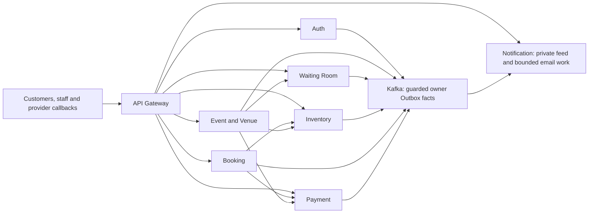
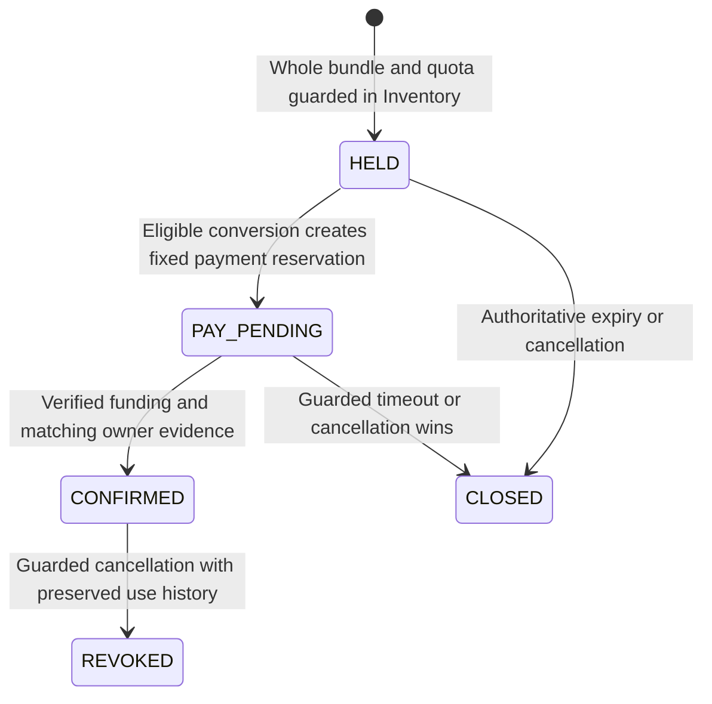

# TicketForge final architecture and delivery package

## Review status — 2026-10-13
Accepted as D-104 on 2026-10-13. All three closeout rounds are complete; full implementation is authorized through ask-matt. Preserve every accepted contract and evidence gate.
No application code, dependency install, Git initialization/push, cloud provisioning, provider request or runnable deployment was performed in this review.
The original eight services, complete technology stack, accepted scope additions, 1M concurrency, zero overselling, hold p99 below 200 ms and 99.9% availability remain requirements.
Accepted [DECISIONS.md](DECISIONS.md) and its referenced ADRs remain normative; [D-103](adr/0103-go-backend-and-supported-toolchain.md) selects Go. A conflict found during implementation is an explicit affected-capability gate, never an automatic waiver.

## Package navigation
- Architecture and contracts: this document plus [ARCHITECTURE.md](ARCHITECTURE.md).
- Work order and repository workflow: [IMPLEMENTATION_BACKLOG.md](IMPLEMENTATION_BACKLOG.md).
- Correctness, failure, load and readiness evidence: [VALIDATION_MATRIX.md](VALIDATION_MATRIX.md).
- Security, observability, deployment and recovery: [OPERATIONS_PLAN.md](OPERATIONS_PLAN.md).
- Dependency choices and release verification: [DEPENDENCY_BASELINE.md](DEPENDENCY_BASELINE.md).
- Interview completion: [GRILL_CLOSEOUT.md](GRILL_CLOSEOUT.md). This is the last interview round.

## Observed local readiness
| Capability | Read-only observation | Delivery impact |
| --- | --- | --- |
| Toolchain | Go 1.24.1, Windows/amd64 | Select project-local supported 1.27.2 at implementation start. |
| Host | 12,766,408,704 memory bytes; 4 logical CPUs | Stage functional tests; full mixed-load capacity is unproved. |
| Storage | F: about 52.1 GB free; C: about 232.5 GB free | Measure Docker-volume, WAL, artifact and retention headroom. |
| Docker | CLI present; Linux daemon pipe unavailable | Restore a Linux container environment before component tests. |

## Observed repository and tools
| Capability | Read-only observation | Delivery impact |
| --- | --- | --- |
| Workspace | F:\TicketForge is not a Git checkout | Initialize without overwriting existing review documents. |
| GitHub | Authenticated as Aveshek-Singha; public Aveshek-Singha/TicketForge exists | Reuse that repository; inspect remote refs before first push. |
| CLI | Git, gh, WSL and kubectl found | Terraform, Helm, k6 and protoc were not found on PATH. |
| External readiness | OCI quotas, sandbox credentials, independent sites and operator devices not verified | Keep real-cloud, provider and physical-recovery evidence explicitly unverified. |

## Core service ownership — front door and source owners
| Service | Owns | Prohibited shortcut |
| --- | --- | --- |
| API Gateway | TLS entry, request validation, Auth enforcement, routing, ingress/rate budgets | Domain SQL access, fresh local counters after unknown shared gates. |
| User/Auth | Account/contact, sessions, roles, MFA, recovery, verification budgets | Redis-only identity, refreshed proof age, replayed factor or credential delivery. |
| Event & Venue | Catalog, venue calendar, immutable occurrence manifest, activation/cancellation workflow | Hot Inventory calls to mutable catalog; overlapping occupancy or silent seat-map edits. |
| Inventory/Seat | Atomic bundle/quota/quote, hold/reservation/closure, entitlement/use, certified seat state | Redis TTL as release authority or partial seat allocation. |

## Core service ownership — workflows and channels
| Service | Owns | Prohibited shortcut |
| --- | --- | --- |
| Booking | Durable checkout/order Saga, owner evidence, confirmation and stable ticket metadata | Provider truth from redirects or direct Payment/Inventory SQL. |
| Payment | Attempts, verified charges, funding/refund ledgers, callback receipts, dispatch/reconciliation | Blind financial retries, new provider IDs for unknown effects, unverified funding. |
| Waiting Room | Durable FIFO/presence/admission/claim/capacity lifecycle | Client clock priority, lottery, reset queue ordinals or lost slots. |
| Notification | Durable notice/channel/dispatch work and certified in-app feed | Email success interpreted as booking truth or SMTP acceptance as inbox delivery. |

## Service communication

## Databases and execution boundaries
Each state-owning service has its own logical PostgreSQL database and non-owner runtime role. Migrations use separate identities; cross-owner SQL, FK, joins and transactions are forbidden.
Protect Inventory, Waiting Room, Booking, Payment and Auth as independently scalable production physical groups. Event/Venue and Notification's protected guards require the same verified durability; any allowed physical co-location declares its blast radius.
Use pgx/v5 parameterized SQL, native constraints and consistent lock ordering. Ordinary SQL uses PgBouncer transaction pooling; D-097's bounded capture alias uses session pooling through verified COMMIT and same-backend WAL capture.
Canonical receipts/effects/Outbox records commit together within their owner. Warning, cancelled synchronous wait, lost connection or unknown outcome never becomes a successful durable result from row visibility alone.

## Hold, payment and closure state

## Allocation invariants
One Event Seat has at most one active valid allocation. PostgreSQL ownership rows/native constraints, not cache locks, enforce this invariant.
One command holds the full selected bundle or none, within one Event Occurrence. Inventory atomically counts confirmed plus reserved units against the four-seat account/occurrence quota.
Initial hold is two minutes; eligible conversion creates a fixed five-minute payment reservation. Client click time, retries, outage and proof waits do not extend original deadlines.
After every required lock/wait, recheck current scope, state, generation, quote and conservative time bounds. Release or resale requires the original guarded closure and admission retirement; expiry observation alone is insufficient.

## Checkout and Payment Saga
Booking first persists exact checkout intent and may return CHECKOUT_PENDING. Inventory then converts only the still-eligible original hold; Payment dispatch waits for exact durable reservation evidence and remaining-time guards.
Payment records the merchant transaction mapping and dispatch phase before potentially external work. Server verification checks exact IDs, BDT paisa, quote and risk status; a redirect/callback body is not funding proof.
Booking confirms only after matching verified funding and Inventory confirmation. Closure and confirmation have one authoritative winner; late, wrong or extra known charges become guarded compensation obligations.
Unknown provider execution retains the original identity and blocks new funding attempts or blind retry. NotFound does not prove non-execution. Refunds require allocation/revocation evidence and the charge-level remaining amount bound.

## Provider boundary
SSLCOMMERZ Bangladesh sandbox only; retain the existing merchant/environment-wide one-request-per-second, one-live-call initial gate and all D-035/D-069 uncertainty rules.
Implement the actual sandbox adapter and a separate isolated high-load test double behind the same interface. Their realms, credentials, egress policies, fixtures and observations cannot mix.
Callback receipt/work must be durably accepted before HTTP acknowledgement; provider validation/reconciliation runs later in reserved bounded workers. Browser callbacks and IPNs do not depend on a live customer session.
Real credentials and callback routability are unverified. Local simulations prove local flow only; actual sandbox responses and failure observations remain a required integration evidence class.

## Public API surface
Use versioned REST JSON/OpenAPI: /v1/events and search; /v1/occurrences/{id}/availability; /v1/waiting-rooms/{id}/join, presence and status; /v1/holds; /v1/bookings/{id}/checkout, status and cancellation.
Add /v1/auth for registration/login/refresh/contact/MFA/recovery, /v1/tickets for private artifacts/reissue, /v1/notifications, signed staff nonce/check-in/passage operations and isolated /v1/provider/sslcommerz callbacks.
Published path details and schemas freeze in BK-002; purpose, scope and owner command boundaries already follow accepted ADRs. Internal unary gRPC/Protobuf carries authorized commands/evidence; Kafka carries owner facts.
Mutating requests bind Idempotency-Key to authenticated scope and canonical semantic input. Replay returns historical receipt, not new permission. Payload mismatch is a conflict; unknown work remains pending under the same ID.

## Circuit breakers and safe transport retry
Use purpose/dependency bulkheads and finite circuit states to reduce demand during unavailable dependencies; open/rejected eligible operations remain in the SLI denominator.
Half-open probes must be safe and explicitly admitted. Never probe a financial initiate/refund call or infer non-execution from an open circuit; provider status queries retain the original identity and merchant gate.
Replay only the original authorized logical command under its specific receipt/deadline/effect contract. HTTP libraries, gRPC proxies, Kafka handlers and pool reconnects cannot add independent business retry.
Keep Redis owner-token locks/atomic scripts for coordination and ordered native PG locks/constraints for business truth; local Go mutexes never protect distributed seat ownership.

## API result and authorization rules
Use structured outcome codes with stable operation/phase IDs: current success, pending/unknown, conflict, expired, forbidden, known rate exhaustion or unavailable authority. Never turn transport timeout into a confirmed cancellation or safe refund retry.
Return 429 for proved exhausted allowance and 503 for uncertain required authority/gates; include these in applicable availability/error measurements. Waiting Room membership is not purchase success.
Enforce object and role ownership at each service, including recovered receipts, private views and artifacts. Headers or a caller-supplied account ID do not establish authorization.
Use end-to-end deadlines, bounded request bodies/queues and no transparent command/provider retry outside each command's accepted contract.

## Browse, search and certified reads
Elasticsearch serves public discovery through audited shared PITs; exact owner source baselines, actual document coverage and original observation age govern usable results. Search documents never carry secrets or authoritative allocation rights.
Publish complete certified owner cuts, transactional dirty/revision stripes, immutable frames/private dictionaries and independently verified source seals under D-057/D-066/D-073/D-076/D-091.
Seat sections remain bounded to 512 seats/64 KiB; overview and private payload limits retain accepted contracts. Missing, old, partial or known-retired proof yields UNKNOWN/unavailable, not ledger-free inventory.
Preserve polling/coalescing, cursor expiries, minimum revisions and read-your-command requirements. Public/private request fan-out has no hot primary scatter or unbounded cache-miss SQL fallback.

## Waiting Room and burst admission
Keep server-accepted FIFO without a pre-sale lottery. Ordinary ready sales and scheduled flash sales retain D-052 cutoffs; account/occurrence membership is durable and reconnects reuse it.
Bound accepted and unaccepted ingress globally; no priority is assigned to a request merely buffered at Gateway. Durable acceptance/unknown heads cannot be skipped to increase throughput.
Use exact presence sequence/original time, suspended eligibility and fixed selection/attempt budgets. A GET does not renew presence. Slot capacity is released only after original Inventory claim/closure or confirmed terminal evidence.
Admission follows measured useful downstream capacity, currently accounted residence and protected recovery shares. Stale controller evidence reduces or pauses new admission; existing accepted work retains its obligations.

## Identity and security flows
Implement verified signup, exact mailbox comparison/uniqueness/retired guards, Argon2id budgets, strict refresh lineage and original-age certified session authority.
Implement optional customer WebAuthn/TOTP, mandatory saved recovery-kit readiness before first queue entry, guarded account/contact recovery and single-use attempts/codes. Ordinary email reset cannot bypass enrolled MFA.
Privileged operators/staff retain user-verifying WebAuthn, scoped step-up and D-036 control. Production high-risk recovery needs two distinct operators; the existing single-maintainer free-profile exception/gap is recorded, not labelled equivalent assurance.
Protect browser sessions/CSRF/origin, service mTLS/SPIFFE/SPIRE, workload policies, purpose/environment keys and current trust generations. No raw credentials, QR secrets, provider passwords or fast password hashes enter projections/logs/Kafka.

## Venue entry, artifacts and cancellation
Keep the accepted online entry scope inside Inventory/Auth/Gateway. Each seat's opaque versioned bearer credential enrolls from matching booking evidence; private rendering does not activate or consume it.
Inventory atomically guards first use, exact admission window, current entitlement/version and no-reentry. Staff/device scope, signed requests, one outstanding lane command and passage reconciliation preserve physical uncertainty.
Customer cancellation retains immutable terms and the before-start cutoff and requires an all-unused bundle. Event cancellation may include used tickets but never erases use history or physical occupancy obligations.
Produce bounded private JSON/PNG/four-page PDF through isolated fixed-layout rendering. Reissue, replay, stale artifacts and saved copies do not reset use, quotas, entitlement or authority.

## Notification behavior
Notification persists Inbox/notice/dispatch guards, original recipient-binding and immutable historical meaning. Auth owns contact grants and fixed security challenges; recipient changes cannot move possibly sent mail to a different person.
Provide a certified private in-app feed, booking/refund/event notices and security email via protected self-hosted Mailpit fixtures. Mailpit capture is real local transport evidence, not external inbox delivery.
Retain D-089 finite shares, retry windows, original challenge expiry, Message-ID/uncertainty semantics and feed/mail SLIs. No notification outcome changes booking or financial truth.
External internet email remains a free-deployment capability gap until actually verified; the code and channel contracts stay implemented.

## PostgreSQL host and regional durability
Use Patroni strict local synchronous protection and independently fenced old-writer history, with protected etcd/HAProxy/PgBouncer control. Preserve per-command logged barriers and same-backend post-COMMIT capture.
Each protected physical group has three independent data nodes at its active site and three complete recovery receivers per other site. D-097 requires two qualified disk-flushed receivers in one off-region cohort before protected phase work or exposure.
The five separately scalable hot owner groups alone imply at least 45 PostgreSQL data/receiver instances in the three-site reference, before Event/Venue, Notification and control resources. Instance count is not a claim that independent hosts are available.
Keep three independent production sites and one native etcd voter per site. During one-site loss, D-102 prepares at both survivors, physically fences, advances generation conditionally and promotes only after native/remote readiness; returning sites remain quarantined.

## Independent authority-journal implementation default
Propose a dedicated Go platform agent at each journal site, outside application database/etcd rollback storage. Store signed canonical prepare/outcome records in a protected append-only local Linux filesystem, with exact scope, sequence, command, prior digest, root/membership generation and original phase identity.
Use exclusive conditional creation, serialized append, durable file and parent-directory sync, and exact-record readback before receipt. Record conflicts, torn/partial writes and uncertain results; never overwrite an existing sequence, synthesize a missing prefix or trust a mutable head file alone.
Require all three site receipts for ordinary changes; D-102 alone permits both verified survivor receipts for the approved recovery plan. No custom replacement for native etcd elections or majority is introduced.
The storage/root/fencing adapters must pass crash, restore, competing-writer and site-independence tests before any protected real deployment. If the filesystem or trust source cannot prove the contract, affected authority fails closed. This is a final-review default, not an implemented or verified protocol.

## Resource admission and disk protection defaults
Generate per-profile finite budgets for SQL backends, capture sessions, KDF CPU/memory, signing, ingress bytes, journal/WAL waiters, mail lanes, rendering and recovery. Count uncertain execution and rollout overlap until verified release or independent fencing.
Reserve shares for accepted checkout, callbacks/evidence, expiry/closure, compensation, source certification and recovery. New demand cannot borrow those shares; Redis/control uncertainty cannot mint replacement local allowances.
Set measured WAL/disk reserve from conservative growth during archive outage, admitted-work drain and fencing time plus maximum transaction/rotation overhead. Pause new admission when a required reserve cannot be established or complete archive coverage exceeds its declared objective; do not delete unarchived WAL or report dropped segments as success.
Capacity manifests begin at safe measured stages and grow only with evidence. They never redefine the 1M acceptance profile or exclude refused eligible work from SLIs.

## Retention and safe cleanup
Preserve critical Kafka/source/Inbox/receipt replay horizons, actually recoverable thirty-day PITR chains and every unresolved money/security/control obligation. Long-lived consumed, retired-contact, ownership and ticket-use guards do not disappear just because a replay horizon ends.
Use owner reference/epoch manifests and bounded mark/retire/sweep jobs for immutable dictionary nodes, frames, PITs and rendered versions. Include serving/retiring/unknown publications, readers, replay references and conservative proof expiry before removal.
Never run a global unbounded scan or cleanup in business locks. If reference completeness or a prior cleanup result is unknown, retain the objects and account their storage; do not silently patch incomplete source coverage.
Test pruning against issued roots, delayed events, restores and outstanding worker incarnations before enabling maintenance.

## Production and free deployment profiles
Keep local-development, local-conformance, oci-free and production-reference with the same domains and full technology stack. Same-host fault injection is explicitly simulated and never certifies independent-host/site survival.
Deploy applications as Docker images on Kubernetes; keep dedicated critical production data/control nodes under Terraform/configuration and verified independent placement. Prefer verified free OKE Basic, otherwise assessed K3s; do not default into paid OKE features.
Use separate coordination/read Redis planes, native HA PostgreSQL, Kafka KRaft controllers/brokers, Elasticsearch, SPIRE, Prometheus/Grafana, OpenTelemetry/Jaeger, backup/journal agents and Mailpit/transport fixtures.
If all required components, retained history or failure-domain guarantees do not fit actual free resources, OCI readiness is blocked for that capability. No paid allocation, trial-credit reliance, component removal or false HA label is authorized.

## Delivery schedule and acceptance boundary
T0 is the final user's implementation authorization. Target all end-to-end code, contracts, fixtures, IaC, CI and operating documents within 48 active implementation hours, following [IMPLEMENTATION_BACKLOG.md](IMPLEMENTATION_BACKLOG.md).
During implementation, run relevant unit/race/contract and focused native-component checks; build integration/load/failure harnesses. Full local deployment and system-wide integration/load/fault campaigns follow Day 2 as requested.
Target OCI deployment roughly three days later, conditional on actual free eligibility, capacity, credentials, TLS/transport and required safe guards. Produce a measured readiness matrix rather than date-based production certification.
The 48-hour objective remains; it is not proof that 103 contracts, real infrastructure, 1M capacity or thirty-day availability have been validated. Unfinished required work remains open; no smaller project is declared complete.

## Final approval scope
Approve these documented defaults and start the complete implementation in F:\TicketForge, preserving the existing documents and accepted ADRs.
The build workflow includes local Git setup and ordinary issue/branch/PR/CI work in the existing public Aveshek-Singha/TicketForge repository; inspect remote refs and use normal pushes without discarding others' work. Public source/config must contain no secrets or sensitive fixtures.
Cloud apply, paid resources, live payments, external messages and irreversible recovery effects are outside this review's execution. Cloud rollout requires a concrete free-eligible reviewed plan and applicable readiness evidence.
After this one final decision, the upfront grill closes. Implementation facts and actual blockers are tracked as engineering work, not another open-ended interview.
